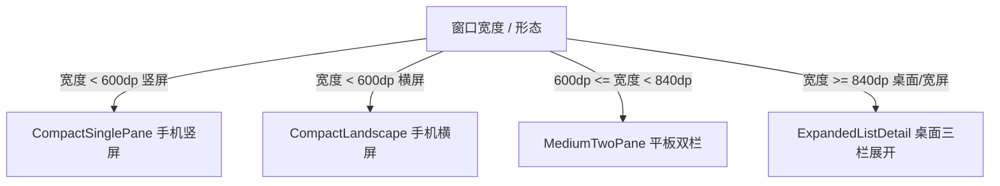

<!-- SPDX-License-Identifier: GPL-3.0-only -->

# Tidings（捎话）系统架构设计

本文档定义 Tidings（捎话）跨平台局域网通信客户端与 Agent 控制面的完整系统架构、模块依赖边界、平台抽象契约及质量门禁规范。

---

## 1. 系统定位与设计原则

Tidings 是一款基于 Kotlin Multiplatform (KMP) 与 Compose Multiplatform 构建的开源、轻量级、去中心化局域网点对点通信应用与 AI Agent 协作工作台。

### 1.1 核心原则

1. **协议兼容性与对称性**：在局域网内与上游 P2P 协议全互联（UDP 单播/广播 + TCP 字节流）。信封编解码严格遵循零冗余键（`hasOnlyKeys`）及白名单校验。
2. **多平台共享内核（Write Once, Run Anywhere）**：所有协议解析、传输控制、重传与退避、节点状态机、会话编排及持久化存储全部收敛于 `:core` 模块，Android、iOS 与 Desktop 共享同一套业务内核。
3. **平台壳极薄化**：平台宿主层（`androidApp`、`iosApp`、`desktopApp`）仅负责初始化、权限申请、生命周期钩子及系统硬件契约的实现，不包含任何业务与协议逻辑。
4. **Agent 与 IM 协议解耦**：宿主机器上的 Agent 通过本地回环 HTTP 控制面（`127.0.0.1:8788`）接入，无需实现底层 P2P 发现、分片与网络协议。
5. **分表持久化与数据隔离**：人类日常聊天记录与 Agent 执行事件/任务队列在数据库层面完全分表隔离，保障聊天数据的整洁与 Agent 事件的可追溯性。

---

## 2. 模块拓扑与分层结构

```
                    ┌────────────────────────────────────────────────────────┐
                    │            androidApp / iosApp / desktopApp            │
                    │   平台宿主壳：生命周期、系统权限、硬件驱动、托盘与常驻  │
                    └───────────────────────────┬────────────────────────────┘
                                                │ 注入 PlatformContracts 实现
                    ┌───────────────────────────▼────────────────────────────┐
                    │                       composeApp                       │
                    │    Compose Multiplatform UI、响应式多端布局、设计规范   │
                    │      （CompactSinglePane / MediumTwoPane / Expanded）   │
                    └───────────────────────────┬────────────────────────────┘
                                                │ 驱动 UI 状态与事件 Flow
                    ┌───────────────────────────▼────────────────────────────┐
                    │                          :core                         │
                    │  ├── protocol/   纯 Kotlin 零 IO 编解码与信封定义        │
                    │  ├── transport/  UDP/TCP 传输、mDNS/单播发现、重发与拉取 │
                    │  ├── storage/    SQLDelight 多平台数据库与实体映射      │
                    │  └── session/    NodeRuntime 节点运行时核心             │
                    └──────────┬─────────────────────────────────┬───────────┘
                               │                                 │
              JVM (无 Compose) │                                 │ 多平台依赖
                    ┌──────────▼───────────────┐                 │
                    │        :agentNode        │                 │
                    │   Headless JVM 库组件    │                 │
                    │   本地 HTTP 控制面 :8788 │                 │
                    └──────────┬───────────────┘                 │
                               ▲                                 │
                               │ implementation                  │
                    ┌──────────┴───────────────┐                 │
                    │        desktopApp        │◄────────────────┘
                    │   桌面托盘、开机自启、   │
                    │   同进程内嵌 Agent 控制面│
                    └──────────────────────────┘
```

### 2.1 模块职责划分

- **`:core`**：核心基础库。包含协议定义、编解码器、网络通道抽象、传输队列、离线暂存、会话编排及数据持久化。
- **`:app`**：领域层。包含控制器（`RelayController` 及其分片）、UI 状态模型、设置/消息/Agent 存储、SQLDelight 库定义与平台契约。**零 Compose 依赖**：应用事实（「要不要落一条投屏记录」「这台设备有没有相机」「投屏该写成哪句话」）都在这里判定，措辞与像素留在 `:composeApp`。换一套 UI 方案时这一层原样复用。
  - 三条边界由两条可执行判据守着：`DomainHasNoComposeTest`（源码级：领域包不许 `import androidx.compose.*`）与 `:cli`（运行时：只链接 `:app` 的程序 classpath 上 0 个 Compose jar）。
- **`:composeApp`**：UI 表现层。包含会话列表、聊天视窗、节点发现、Agent 看板、设置面板及多端自适应布局。它**依赖** `:app`，不再包含领域逻辑。
- **`:cli`**：无 UI 的 Tidings 客户端。不是产品功能，而是「领域层真的能脱离 UI 运行」的**可执行验收物**：它起控制器、发消息、读收件箱，且只链接 `:app`。
- **`:agentNode`**：Agent 控制面组件。提供本地回环 HTTP API（Ktor Server），供 AI 代理或本地脚本调度与交互。在桌面形态下作为库被 `desktopApp` 同进程引用。
- **`:androidApp`**：Android 原生壳工程。配置 `MainActivity`、CameraX 扫码、前台服务（后台消息接收）及 SAF 文件契约。
- **`:iosApp`**：iOS 原生工程（XcodeGen 管理）。配置 `MainViewController`、AVFoundation 扫码及 security-scoped 文件契约。
- **`:desktopApp`**：桌面端原生入口。提供系统托盘常驻、**按需创建窗口**（主窗关闭即销毁，托盘唤回时重建），并常驻承载 `:agentNode` 控制面。另有 `--headless` 形态：只跑运行时与控制面、不组合任何 Compose，用于量守护形态的内存与证明领域层不依赖 UI。

---

## 3. 架构依赖与约束规则

系统架构中强制执行以下单向依赖与设计规则：

1. **`:core` 不得依赖任何 UI 框架**：严禁引入 Compose、Android SDK 或 UIKit。确保其可在无图形界面的 Headless JVM、测试夹具及命令行环境中独立运行。
2. **`protocol` 包零 IO 约束**：`core.protocol` 内严禁出现任何网络套接字（`Socket`）、文件读写、协程分发器（`Dispatchers.IO`）。该层必须是纯确定性函数（Pure Functions），保障与线上多端向量完全对拍。
3. **平台抽象单一出口**：`:app` 与 `:composeApp` 仅能通过 `PlatformContracts` 抽象向平台宿主索取原生能力，禁止在公共代码中穿透平台实现。
   - 反过来也成立：**契约里不许出现 UI 类型**。需要 `@Composable` 的能力（相机取景框、状态栏图标亮度、图片解码后的 `ImageBitmap`）拆成独立窄接口（`QrPreviewProvider`），由平台实现类额外实现；需要 `Context` 开库的能力同理（`AndroidDatabaseHost`）。把这类类型塞进 `PlatformContracts` 会让整个领域层被迫依赖 Compose。
   - 领域层要「一句用户可读的话」时走 `RelayUiTexts` 接口：措辞在 `strings.xml`（`ResourceUiTexts`），判定在领域侧。这是唯一允许领域层产出用户可见文案的通道。
4. **宿主层纯装配原则**：`androidApp`、`iosApp`、`desktopApp` 仅提供平台配置与契约实现，严禁在宿主壳内编写任何业务流程或协议路由逻辑。
5. **`:agentNode` 无 UI 污染**：`:agentNode` 严禁应用 Compose Multiplatform 插件，保持轻量高效。

---

## 4. 源集结构与多平台组织

```
:core
├── commonMain     协议实体、编解码、状态机、SQLDelight 数据库定义、NodeRuntime
├── jvmMain        JVM 平台文件 IO、套接字与线程映射
├── androidMain    Android SAF 句柄转换、ConnectivityManager 网络探测
├── iosMain        iOS NSFileManager、NWPathMonitor、SecurityScoped 资源释放
└── commonTest     黄金测试向量、报文编解码对拍、重传与节点发现测试

:app
├── commonMain     控制器与状态机、设置/消息/Agent 存储、SQLDelight 库定义、平台契约
├── jvmMain        JVM 存储实现、SQLite 驱动、文件锁（另含 testsupport/ 的守卫读盘工具）
├── androidMain    Android 存储实现、框架 SQLite 驱动（走 AndroidDatabaseHost 窄契约）
├── iosMain        iOS 存储实现与 native SQLite 驱动
└── commonTest     控制器编排、状态转移、协议耦合与源码级守卫（647 条）
                   （零 Compose：本模块不应用 Compose 插件、不声明 Compose 依赖）

:composeApp
├── commonMain     多平台 Compose UI、自适应导航骨架、设计系统、文案（strings.xml）
└── commonTest     自适应布局断点、UI 状态派生与跨层守卫测试

:cli
└── main           无 UI 的 Tidings 客户端（起控制器 / 发消息 / 读收件箱），零 Compose

:agentNode
├── jvmMain        ControlPlane 本地 HTTP 路由定义与 Token 鉴权
└── jvmTest        控制面 HTTP 契约测试与进程内对拍

:androidApp
├── main           MainActivity、通知通道配置、前台生命周期托管
└── screenshotTest Compose 预览图逐像素截图回归测试集

:desktopApp
└── jvmMain        应用级组合（托盘/通知/深链）、按需窗口、单实例锁、内嵌 AgentNode 服务
                   --headless 形态不组合 Compose（无窗口、无 Skia）
```

---

## 5. 核心协议与传输架构

### 5.1 信封模型与序列化

局域网内所有数据传输均封装为扁平 JSON 结构的 `Envelope`：

```kotlin
@Serializable
data class Envelope(
    val type: String,
    val from: String,
    val seq: Long,
    val to: String? = null,
    val payload: JsonElement? = null,
    val time: Long? = null,
    val groupRev: Long? = null,
    val targetId: String? = null,
    val adminSecretHash: String? = null,
)
```

- **序列化不变式**：开启 `encodeDefaults = false`，避免默认字段序列化导致对端因键白名单严格比对而丢弃报文。
- **协议帧长**：UDP 报文严格遵守限制（单包安全上限建议 ≤ 800 字节）。大于 1200 字节的载荷自动平滑切换至 TCP 字节流。
- **TCP 帧结构**：采用 4 字节大端网络序整数（Big-Endian Int32）标识 JSON 载荷长度，后接 UTF-8 编码的 JSON 字符流。

### 5.2 节点发现与在线状态管理

- **发现广播与单播**：节点通过 UDP 监听端口（默认 `17878`）接收 `entry`、`alive`、`exit` 与 `presence` 报文。
- **mDNS 自动辅助发现**：在支持 Bonjour / NSD 的平台上广播 `_relay._udp` / `_teahouse._udp` 服务，便于跨子网及未配置组播的局域网自动配对。
- **动态端口绑定保障**：若默认端口被占用，节点自动递退回系统动态分配端口，并将真实绑定的 `tcpPort` 广播于 Profile 报文内，防止同机多实例冲突。
- **发现引擎可整条替换**：给了额外发现引擎时，legacy `Discovery` 不启动（判据在 `NodeRuntime`，契约见 `PlatformContracts.luciolaHost`）。于是换的不只是「怎么发现」，还包括「谁还能被看见」—— 见 §5.6。
- **地址漂移防御**：`PeerRegistry` 记录各节点的验证地址与 `profileRev`。当节点 IP/端口发生漂移时，必须接收全量带有递增版本的 `profile` 报文才允许更新路由。

### 5.3 可靠传输与文件拉取机

1. **可靠 ACK 机制**：`Messenger` 为 `msg`、`file-ctl`、`group` 等可靠帧维护发送队列与超时指数退避（初始 500ms，最高 8s）。连续重发超限后尝试降级走 TCP 发送。
2. **文件传输状态机**：
   - 发送方发出 `file-ctl offer`。
   - 接收方确认接收后，通过 TCP 发起 `file-ctl pull` 请求并附带 `offset`（支持断点续传）。
   - 发送方回执 `pull-ok` 后无缝切换为原始二进制流直传。
   - 传输过程中未完成的文件暂存为 `.part` 文件，校验 SHA-256 完整通过后重命名为正式文件。

   > 这条链是**拉取**语义。双方都声明 `fch1` 时它不被使用：改成发送侧在加密信道上按窗口**推**字节（接收端不再拨 17879/17881 来拉），状态机的对外行为（`.part`、断点续传、SHA-256 校验后改名）不变。见 §5.6 与 `PROTOCOL-EXTENSION.md` §15。

### 5.4 长连接下行通道（K1 / K2）与传输安全两档

手机主动拨主机，建立一条 TCP 长连接（能力位 `lnk1`，由**主机**声明；手机据此决定要不要拨号 —— 不声明就按老端对待，一个拨号都不发）：

| 档 | 条件 | 承载 |
|---|---|---|
| **K1 明文** | 对端在局域网（`isLanAddress`） | 局域网内长连接；**默认关闭**（开关在发起侧的手机上） |
| **K2 TLS** | 公网对端 | TLS + 双向 SPKI pin，**fail-closed** |

- **「局域网」判据唯一**：`IpAddressUtils.isLanAddress(peer, localAddresses)` = 私网/回环 ∨ 链路本地（`fe80::/10`）∨ ULA ∨ **与本机某个地址同 /64**。拨号、拨号诊断、接受裁决、地址复查四处共用它（曾经不一致，后果是把 K1 静默关掉 —— 见 `docs/public-transport-security.md` §11）。**IPv6 的 GUA ≠ 公网可达**：家庭 LAN 常分配 `2408:...::/64` 这类全局地址，只认私网判据会让 K1 一个目标都不拨。
- **fail-closed**（`peerPinAccepted`）：对端没给证书 / 本机没有期望 pin / pin 不一致 ⇒ **拒**；TLS 验不过**不回退明文**。明文只允许局域网：接受侧对非局域网的明文连接回 `not-lan`；地址变化后的复查侧只摘「声明自己是明文**且**已不在局域网」的那条（fail-safe，不误摘 TLS 连接）。
- **身份与 pin**：EC P-256（secp256r1）自签证书，SAN 含本机地址；pin = `sha256:` + SHA-256(SPKI DER)。私钥不变，证书到期**自动续签**（轮换与到期提示仍在计划中，P4）。
- **建连即更新对端地址**；断线自恢复（退避 1s→60s，±20%）。`NetworkWatch`（Android `ConnectivityManager` 回调 / iOS `NWPathMonitor`）在换网时**立即重拨**（真机实测 ≈3s，要求 ≤10s）。
- **免心跳与省电**：有数据往来时不发心跳，保底 Ping 兜底（心跳 15s、45s 判死 ⇒ 判死阈值 > 2×心跳）；Doze（`PowerManager.isDeviceIdleMode`）时降频。**不用息屏作判据** —— 息屏时 NAT 映射往往还活着，拉长心跳反而更容易掉线。

### 5.5 跨网（公网 IPv6）直连与候选池

- **候选池**：配对码可携带 `lan_v4` / `lan_v6` / `public_v6` 三类候选；按本机地址表决定先打哪个（同网段优先 lan，跨网才用 public_v6）。
- **地址漂移重学**：对端地址变化后按新地址重建拨号目标，并复查明文策略（§5.4 的复查侧）。
- **离线积压补发**：出站可靠帧进持久队列；对端上线握手后按序补发。
- **跨网文件传输**：公网场景**另开第二条 TCP**，复用 `file-ctl` / 裸流 / 断点续传；公网必须 TLS + 双向 pin。**屏幕投屏仍仅局域网**（跨网屏幕未实现）。
- **前提**：对端路由器放行 IPv6 入站。本应用不做打洞、不代改网络设置。

### 5.6 加密数据面（luciola）：分层与注入缝

文件字节与投屏画面不再复用「信封 + 明文 TCP」那条路，而是另开一条**始终加密、双向认证**的数据面（局域网里也不降明文）。它分三层，接缝只有一处：

| 层 | 位置 | 它决定什么 |
|---|---|---|
| 平台壳 | `PlatformContracts.luciolaHost`（默认 `null` = 这个壳没接，一切走 legacy） | 装不装这套东西；身份 seed 与信任账本存哪（见 `SECURITY.md`） |
| 领域层 `:app` | `RelayController` 的启动段 | `luciolaMode`（传输工厂与发现工厂**两件都非空**才算）、档案里的 `luciolaPort`、两个能力位、画面端口 `udpPort + 10`、legacy 监听是否让位 |
| 运行时 `:core` | `NodeRuntime` 的注入点 | `messengerTransportFactory` / `extraDiscoveryFactory` / `fileChannelEnabled` / `screenChannelHostFactory` + `screenChannelPort` |

- **发现**：给了额外发现引擎，legacy 发现就不启动。这一条同时是默认开之后**最大的产品风险**：未升级的老客户端与本机互相发现不到（不是「发了没收到」，是节点表里根本没有它）。回退只有一条路 —— 关掉开关并**重启节点**。
- **监听**：`fileChannelEnabled` 为真时**不创建** 17879 明文监听、17881 跨网文件监听与 17882 跨网投屏监听。消息与文件统一走加密信道；画面另开一条独立会话（领域层取 `udpPort + 10`，刻意避开 legacy 那三个口）。
- **归属**：二进制数据帧没有 `Envelope`，所以对端身份靠握手指纹反查端点，而不是帧里的 `from`。新增一条数据面时，这一点最容易漏。
- **协商**：两个能力位都由壳按「数据面真的起来了」声明（只有信道可用才声明 `fch1`、只有画面监听真的绑上才声明 `scr1`）；协商不过就整体退回 legacy，不存在「半条路」。
- **配对与信任**：配对靠二维码里的一次性密钥 + 一条传输层控制帧自证（`PROTOCOL-EXTENSION.md` §15.4）；身份 seed 与信任账本落在平台侧，三端的保护强度不同（`SECURITY.md` 末节）。
- **开关**：`RelaySettings.experimentalLuciola` **默认开**，改了要重启节点才生效；字段名保留旧名只是为了不丢已落盘的设置。

---

## 6. 平台契约设计 (`PlatformContracts`)

系统通过接口抽象消解移动端与桌面端的系统级差异：

| 契约接口 | 功能定义 | Android 实现 | iOS 实现 | 桌面 JVM 实现 |
|---|---|---|---|---|
| `FilePicker` | 选择外部文件并获取抽象句柄 | `ACTION_OPEN_DOCUMENT`（保留 URI Grant） | `UIDocumentPickerViewController` | `JFileChooser` / 本地原生面板 |
| `SaveDirectoryPicker` | 选择存储目录并持久化访问授权 | `ACTION_OPEN_DOCUMENT_TREE` | Security-scoped 目录访问 | 本地目录文件路径 |
| `QrScanner` | 相机扫描二维码并返回内容 | CameraX + ML Kit 离线分析 | AVFoundation 视频流捕捉 | 不提供（桌面端展示二维码供扫） |
| `CameraGate` | 相机硬件访问权限状态与申请 | `Manifest.permission.CAMERA` | `AVCaptureDevice.requestAccess` | 恒为 `Granted` |
| `NetworkMonitor` | 实时监测 Wi-Fi/蜂窝/VPN 网络状态 | `ConnectivityManager.NetworkCallback` | `NWPathMonitor` | 本地网卡轮询与状态判定 |
| `MdnsAdvertiser` | mDNS 节点服务发现与注册 | Android `NsdManager` | iOS Bonjour (`NWListener`) | JmDNS 或系统服务 |
| `PushNotificationHandler` | 本地消息与前台提示通知 | `NotificationManager` 渠道管理 | `UNUserNotificationCenter` | 桌面托盘气泡通知 |

所有文件句柄均抽象为 `FileHandle`，不暴露原始文件路径字符串，由各平台独立维护生命周期，避免移动端沙盒权限过期导致的读取失败。

---

## 7. AI Agent 控制面集成

### 7.1 拓扑关系

`:agentNode` 模块以无界面 Headless 模式运行，在桌面端由 `desktopApp` 同进程启动：

- **HTTP 监听**：默认绑定 `127.0.0.1:8788`。
- **安全认证**：本地随机生成强密钥（Bearer Token），存储于本地受限文件（权限 0600）。
- **RESTful 端点规范**：
  - `POST /v1/send`：向指定节点或群组发送消息、附件或任务指示。
  - `GET  /v1/peers`：查询局域网当前存活的节点快照与 Profile 信息。
  - `GET  /v1/inbox`：按游标（`since`）拉取入站消息与回执事件。
  - `GET  /v1/healthz`：控制面与节点运行时健康状态探测。

### 7.2 协议扩展支持 (PPE-1)

通过 `agent-*` 系列协议帧扩展，支持结构化智能代理通信：
- **`agent-session`**：代理会话的创建与状态同步，关联特定的工作区路径与代理 ID。
- **`agent-event`**：增量事件流推送（支持增量 cursor 与幂等去重）。
- **`agent-queue` / `agent-run`**：代理任务队列与执行状态机流转。
- **`agent-approval` / `agent-ack`**：需要人类介入确认的高风险动作审批（未确认 ≠ 已执行）。
- **`agent-artifact`**：任务产物文件元数据交换。

---

### 7.3 进程外插件宿主（M2 起）

插件是**独立进程**（Python / Node / 任意可执行），主包内不含任何具体 Agent 的业务代码：

- **目录约定**：`<数据目录>/plugins/<pluginId>/`（目录名必须等于 `pluginId`，对不上账不拉起）；清单 `manifest.json` 声明身份、leader、组员、能力与授权工作区（`allowedWorkspaces` / `defaultWsId`；**本机绝对路径不进协议**，只广播 wsId 与标题）。
- **两种接入**：托管子进程（`PluginHost` 扫描目录并拉起，注入 `TIDINGS_PLUGIN_TOKEN`）；独立守护进程自注册（token 来自插件自身配置或宿主数据目录 0600 受控文件）。两种都必须持 token——`PluginTokenGate` 在两处来源皆缺时 503 整体关闸，防本机任意进程自我入驻。
- **端点**：`POST /v1/plugin/register` / `unregister`、`POST /v1/plugin/task`（派单事件流）、`POST /v1/plugin/action`（卡片动作回传）。派单/操作路由按**回环信任**（与 `/v1/send` 同一模型）；设备侧授权仍走 `/v1/agent/*` 的 grants 判据。
- **`ExternalPluginDriver`**：主包内唯一的通用插件驱动（`AgentDriver` 的实现之一），只经回环 HTTP 转发 `openSession` / `executeTask`（流式）/ `handleAction` / `queryProgress`，零业务代码；能力清单读 manifest，能力 ACL 由宿主在驱动外层把关、不透传给插件。
- **参考插件**：`examples/plugins/echo-team-plugin/`（Python 标准库，零第三方依赖）。

---

### 7.4 跨端派单网道（M4 起）

`agentIntent`（§7.3 的插件宿主收到后派单）只覆盖「本群宿主本机执行」；跨端派单让
A 宿主把子任务派到 B 宿主的插件上执行、结果回传，由发起方 Leader 拼看板卡上群 ——
**主群聊里一条跨设备交接文本都不产生**（P2P 点对点网道，群流零刷屏）。

- **协议**：`agent-invoke` / `agent-invoke-result` 两帧（cap `agi1`；键表、op 互斥与
  结果状态机见 `PROTOCOL-EXTENSION.md` §6.13）。`POST /v1/agent/invoke` 是唯一 HTTP
  入口，**只解包**：派发委托装配了域层的那一侧，未接域层的进程如实回 503。
- **域层网道**（`:app` 的 `RelayControllerAgentInvokeComponent`，控制器字段 `invokeCtl`）：
  - **租约表**（`AgentInvokeLeaseTable`）：每条派单登记 `deadlineMs`；先记账再发帧
    （发送失败也有一条可超时的租约，而不是无声消失）；终态翻转是**原子的** —— 结果帧
    与超时巡检并发竞争同一条租约时恰好一次生效；巡检协程把过期 RUNNING 租约翻
    Timeout 并发超时卡（[重试] / [降级为本地执行]）。
  - **审批防重台账**（`AgentCardActionLedger`）：卡片动作首个判定生效（rev+1 广播全群），
    晚到的并发点击幂等丢弃；两壳的 `onCardAction` 槽都接到这份原子台账（M3 槽位的真通路）。
- **desktopApp 装配**（把协议、域层、控制面三段接成通路的唯一一处，源码级守卫
  `DesktopInvokeWiringGuardTest`）：`invokeDispatcher`（HTTP → 域层派发）、
  `invokeExecutor`（本机承接 = `pluginForAgent` → `executePluginTask`）、
  `invokeGrantAllows` / `invokeExecPolicyOf` / `invokeRecordGrantRequest`（授权三桥，
  威胁模型见 `SECURITY.md`）、`onHostCardAction`（宿主侧卡片动作出口）；detach 全清，
  留着野通路会把派单交给已停止的控制面。
- **本机派单唯一实现**：`executePluginTask` 与 `pluginAction` 都住在 `:agentNode` 的
  `ControlPlane` —— HTTP 的 `/v1/plugin/task`、`/v1/plugin/action`（面板路径）与 M4
  执行桥（跨端路径）走**同一份**实现，台账同源；两处各写一份迟早漂成「面板派单有
  台账、执行桥派单没台账」。卡片过桥用 JSON **文本**（desktopApp 类路径无
  serialization，解析在域层的 done 工厂）。
- **授权**：跨端派单必须过目标节点的 `AgentExecAuthorizer`（core）：可信设备
  （`OWNER` / `RW` / 面板批准）自动放行，群主与管理员不默认放行，未授权请求进
  宿主申请台账待机主点头。

---

## 8. 持久化存储设计

数据持久化使用 SQLDelight 构建跨平台统一的 SQLite 存储层：

### 8.1 聊天消息表 (`relay.db`)

- **`messages`**：存储人类聊天记录（单聊、群聊），自增 `seq` 作为单调排序键。agent 相关列：`agent_session_id` / `agent_session_title`（会话分段）与 `card_json` / `agent_state`（声明式卡片与执行状态）；卡片更新是**追加式新行**（同 `cardId`、`rev+1`），不重写旧行；这些列**不进 FTS**。
- **`conversations`**：会话元数据（会话 ID、未读数、最后消息摘要、置顶与静音标记）。
- **`peers`**：节点 Profile 缓存（NodeId、名称、IP、端口、caps、更新版本）。
- **`send_queue`**：离线暂存队列，存储尚未完成 ACK 确认的报文。
- **`dedup`**：基于 `(msg_id, peer_id)` 的滑动窗口去重表。

### 8.3 TLS pin 存储（`stores/peer-pins.json`）

每个 `nodeId` 一条 pin，**并记录它的来源**（`pairing` / `tofu`）。旧文件没有 sources 键 ⇒ 一律读成 `unknown`，**绝不假装 `pairing`**。诊断出口两处：宿主 `/v1/peers` 与手机 `files/relay/diag/link.json` 的 `pinSource`。TOFU 是**降级路径**（首次使用竞态），所以它必须可诊断 —— 这是它留在实现里的唯一前提。

### 8.2 Agent 独立分表

严格遵循数据隔离规范，防止高频 Agent 流水日志污染日常聊天会话：
- **`agent_sessions`**：Agent 会话记录，主键为 `sessionId`，包含所属工作区 `wsId`、工作区目录 `wsPath` 等属性。
- **`agent_events`**：Agent 执行流水线增量事件，支持按 `(sessionId, cursor)` 快速续读与分页。
- **`agent_tasks`**：任务执行单元表，维护队列调度与终态记录。

### 8.4 `stores/` 下的旁路存档（JSON / 追加日志）

不是所有状态都值得进 SQLite。这几份是**旁路存档**，各有自己的失效语义：

| 文件 | 内容 | 失效/上限 |
|---|---|---|
| `stores/peer-pins.json` | 每个 `nodeId` 的 TLS SPKI pin 与来源（`pairing` / `tofu`） | 见 §8.3 |
| `stores/peer-endpoints.json` | 配对码带来的候选端点池（换网后按序兜底） | 对端每次宣告会覆盖 |
| `stores/known-peers.json` | **曾经见过**的对端档案（nodeId / 昵称 / 最后地址 / 最后露面） | 90 天 TTL |
| `stores/messages.log` | 信封追加日志，供 `/v1/inbox?since=` 续读 | 7 天 / 2 万条（`Timings.messageLogTtl` / `messageLogMaxRows`，见下） |
| `stores/queue.log` | 离线补发队列 | 7 天 TTL / 每对端 200 条 |

`known-peers.json` 存在的理由只有一条：**重启后、对端还没被发现在线时，节点列表也要显示真名**。
没有它时，冷启动会先按 nodeId 前 8 位造一个合成名（`node-a1b2c3d4`），用户看到的是一台
自己明明配对过的设备变成了陌生人。`PeerRegistry.restoreOffline` 只**想起它是谁**：
`online = false`、不刷新 `lastSeen`、不产生事件、不覆盖已存在的实时记录。

**`messages.log` 的上限与队列分开取值**：队列是「必须送达的待发」（7 天 / 每对端 200 条），
日志是「供只读回放的增量拉取」，没有理由留全量历史，但没有它就无法增量拉取。
上限由 `NodeRuntime.prune`（每 10 分钟一次）施加，任一条件触发就丢**最旧的**。

> 这条上限曾经是缺的：`FileMessageStore.trim` 早就实现并单测，但**生产路径一次都没调用过** ——
> 真机桌面端一天就长到 **12.9 万行 / 72 MB**，而同一时刻消息表只有 1235 条（多出来的是
> `agent-event` 信封，body 可以到 64 KiB）。功能写了不等于功能生效，所以现在有一条
> **接线测试**（`NodeRuntimeMessageLogTrimTest`）钉住这根线。

**`seq` 是稳定游标，不是行号。** `load()` 与 `rewrite()` 都写/读行自己的 `seq`，
不按行号重排 —— 否则裁剪之后剩余行的序号整体前移，调用方手里的游标会指向错的行
（重复或漏读）。

`/v1/inbox?since=<epochMillis>` 按**写入时刻**裁剪，与 `seq` 无关：一个太旧的 `since`
在裁剪后只会少读到东西，不会读到错的；`nextSince` 始终等于本批最后一行的 `at`。

### 8.5 全文检索索引（FTS5）的维护纪律

`MessageFts` 是**外部内容表**（`content='MessageEntity'` + `tokenize='trigram'`），
索引**不是**自己维护的，靠三条触发器。它们守的是一条不变量：

> `MessageFts_docsize` 的行数必须**恒等于** `MessageEntity` 的行数。

两条真机上翻过车的坑，都写在触发器旁边：

1. `INSERT OR REPLACE` 走的是「隐式删除 + 插入」，而**隐式删除不激活 `AFTER DELETE`** ⇒
   旧行的索引条目留下来、新行又插一条，每条被重复写入的消息留一个孤儿。
   修法：写消息前**显式**执行 `insertMessageDropStaleIndex`（FTS5 的 `'delete'` 命令）。
2. `AFTER UPDATE` 必须**只**在 `text` 真的变了时才动索引（`WHEN old.text IS NOT new.text`）。
   交付状态/回执/文件卡片这些与检索无关的更新，原来每次都会重建一遍索引。

这两条叠加时索引长到 **4,554,999 行 / 21 GB**（真实消息 941 条）。
排查与修复过程见 [`design/runtime-evidence/relay-db-bloat-20261019.md`](design/runtime-evidence/relay-db-bloat-20261019.md)。

**改触发器时要留意**：`.sq` 里的 `CREATE TRIGGER` 只在**新建库**时执行；已存在的库不会
因为装了新版本就换掉旧触发器 —— 修完代码还要对存量库做一次替换 + 重建索引。

---

## 9. 响应式 UI 与自适应布局

`composeApp` 根据设备屏幕可用宽度与形态自动切换四种布局模式（`AppLayoutMode`）：



- **CompactSinglePane**：单栏导航，底部 NavigationBar，页面间采用栈式跳转。
- **MediumTwoPane**：会话列表与聊天视窗并列呈现，导航收缩为侧边 NavigationRail。
- **ExpandedListDetail**：三栏式桌面视图（导航栏 + 会话树/节点树 + 内容主视窗），充分利用宽屏空间。

---

## 10. 构建、测试与质量门禁

为保障跨平台代码质量与协议实现的长期稳定，构建流程强制执行如下门禁：

1. **协议黄金向量对拍**：`core/commonTest` 包含上游标准实现的全量向量序列化测试用例，确保双向编解码逐字节对称。
2. **多平台单元测试**：
   ```sh
   ./gradlew :core:allTests :app:allTests :cli:test :composeApp:allTests :agentNode:test
   ```
   覆盖核心协议、节点状态机、离线队列退避、自适应断点与控制面端点。
3. **Compose Preview 截图比对**：
   ```sh
   ./gradlew :androidApp:validateDebugScreenshotTest
   ```
   对 6 屏主要交互界面在深浅色、不同字号及四种自适应形态下进行全量回归渲染比对。
4. **代码整洁与门禁扫描**：
   运行静态检查工具，确保生产代码中无内部调试痕迹、无未授权的绝对路径依赖，所有公共依赖均来自标准公共 Maven 仓库。


---

## 身份与数据恢复（2026-10-25）

恢复按「身份 / 数据」两个维度分三层（方案 §6）：

- **L0 平台存活存储**：iOS 钥匙串身份包（本地 + iCloud 同步层，收养规则 Q10）；
  Android 公共 Downloads 里的 `KDF(ANDROID_ID)` 混淆包（读取失败走 SAF 导入，A6/Q6）。
- **L1 口令加密导出/导入**：设置页「备份与恢复」卡；**全量快照**（身份 + 设置 + 会话历史，
  `kind="full"`；老的身份包 `kind="identity"` 仍可导入）。容器格式与成套校验见
  `core/.../persist/RecoveryBundle`，载荷编解码见 `:app` 的 `RecoveryDataCodec`，
  批量合入见 `mergeRecoveredThreads`（按消息 id 幂等、`mine` 不翻转）。
- **L2 对端拉回**：`recovery-req` / `recovery-data` 两张帧，fire-and-forget + 全量重发 +
  消息 id 幂等合并（`PROTOCOL-EXTENSION.md` §14）。数据只走应用层消息实体，
  不存在裸库替换——SQLDelight 不降级、FTS 索引必须走触发器维护（§2.3 不变量）。

领域层入口：`RelayController.recovery`（`RecoveryService`）、
`recovery/RecoveryActions.kt`（L1 动作）、`RelayControllerRecoveryComponent.kt`（L2 分派）。
