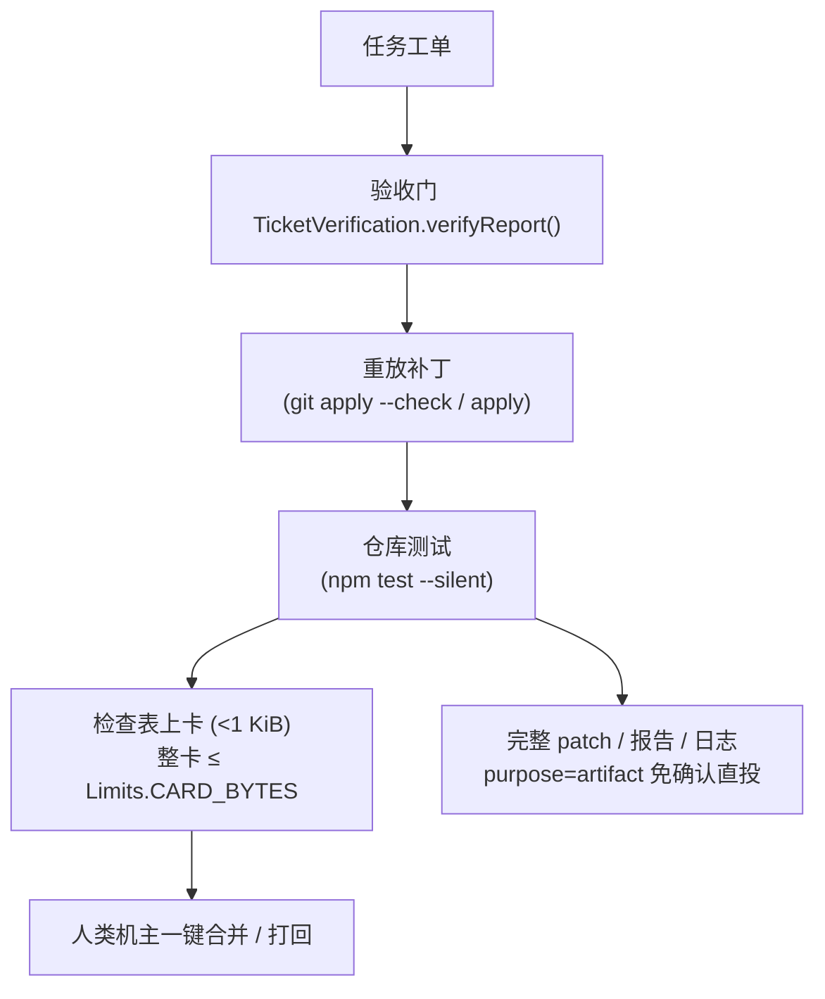

# 榫卯多智能体团队编排与委派模式设计规范（Orchestration Spec）

> **规范标识**：SPEC-ORCHESTRATION-2026-11-03  
> **创建日期**：2026-11-03 · **最近修订**：2026-11-04（晚，三轮）  
> （实现口径单源对账见 §5.3；外部 proposal 经差异裁决后的保留项已并入 §6~§14；
> §15 原待裁决项已全部关闭；委派团队模板 RFC 经裁决已并入 §16 并删除原 RFC 文件；
> LobeHub / DS Bot 源码级竞品调研归档见 §17，§2.2 / §7 / §11 已按调研结论校准；
> 三轮：§7 按代码真身校准——唤醒判据已存在于 `RelayController`（`:app` 单源），N1 缩为
> 「`None` 带原因 + 注入日志桥 + 守卫」）  
> **适用范围**：`:agent-contract`、`:agentNode`、`:orchestration`、`:desktopApp`、`:composeApp`、`:cli`  
> **核心定位**：本规范定位于榫卯（Tenon）局域网团队协同体系中多 Agent 协同任务的**执行架构与调度控制技术规范**。
>
> **单源纪律**：本文中的类型名、状态名、常量名一律以代码真名为准。规范文字与实现不一致时，
> **以代码为事实源**——要么改文字、要么补实现，不许两边各留一份。对照表见 §5.3。
> 本仓生效的编排规范只有本文一份。2026-11-04 的增补草案（§6~§14）与委派团队模板 RFC（§16）
> **已全部并入本文并删除原文件**；逐条裁决记录归档在 `design/spec/agent-collaboration-upgrade-review-2026-11-04.md`
> （标记 `ARCHIVED`，**非规范、不生效、不得被引为依据**）。

---

## 一、 控制流拓扑设计哲学

榫卯多 Agent 编排的核心哲学是：**骨架在代码、策略交模型、数据做媒介**。


| 控制层级 | 权责划分 | 实现约束 | 目标收益 |
|---|---|---|---|
| **执行骨架** | 由 Kotlin 静态代码门严格约束 | 在位校验、异厂商审核、降级优于吞单，由 `StageChainGate.enforce` 硬裁决为 `Pass / Downgrade / Reject` 三态 | 杜绝模型幻觉导致越权或死锁 |
| **决策规划** | 挡位 A 由确定性解析器直出；挡位 B 先由启发式给出两棒，`PlannerLlm.refine` 只做任务拆解**建议** | 只能在 `DelegationPlan(goal, stages, source)` 数据字典内输出分工；无凭证 / 超时 / 解析失败一律回落启发式两棒，产物仍过代码门 | 灵活适应复杂协作意图，且派单永不因模型而挂起 |
| **交互媒介** | 结构化数据帧（JSON） | 整卡 ≤ `Limits.CARD_BYTES`（24 KiB），超限整帧拒收不截断；大产物走 `purpose=artifact` 免确认直投 | 零丢包、强可靠通信保障 |

**「策略交模型」的边界**：模型只推荐「谁干什么」，不裁决「能不能干」。硬约束从模型输出里
拿不到最终解释权；planner 是增强，不是依赖。

---

## 二、 委派双挡体系（Dual-Gear Delegation）

系统提供「指定模式」与「自动组队模式」两种交互挡位，二者**共享同一条执行面**
（`StageChainRunner` 多棒链）与同一种计划数据 `DelegationPlan`，差异仅在于计划的产生源头
（`DelegationPlan.Source.EXPLICIT` / `Source.AUTO`）：

```
                    ┌── 挡位 A（指定模式）：直接指定「@codex 实现，@dsh 审核」
                    │      └─ DelegationParser.parseExplicit（确定性） ──┐
[用户输入进入群聊] ──┤                                                    ├─► [DelegationPlan 计划数据]
                    └── 挡位 B（自动模式）：「组队: 做 X」 ──────────────┤
                           ├─ DelegationParser.parseAuto（启发式 v1，保底）┘
                           └─ PlannerLlm.refine（可选增强，失败即回落 v1）
                                                                           │
                                                                           ▼
                                                     [StageChainGate.enforce 硬裁决]
                                                     （在位 / 单棒形状 / 异厂商审核）
                                                                           │
                                                                           ▼
                                                     [StageChainRunner 多棒链执行]
                                                     （Worktree 沙箱 / TicketVerification 验收门）
```

### 2.1 挡位 A：显式指定模式（Explicit Mode）
- **语法定义**：`@worker 实现 X，@reviewer 审核`；也认 `worker: ...` 的写法与 `codex-cli`
  之类的别名，键归一走 `:agent-contract` 的 `DriverKeys.canonicalKey` 单源。
- **执行特性**：`DelegationParser.parseExplicit` 纯确定性解析，零模型消耗。
- **分句与形状判据**：按 `\r \n ; ； , ，` 分句；**≥2 个不同的**已知 agent 键恰好落在句首
  才成立，句中顺嘴提到 agent 名不算；含审核关键词（`审核 / 把关 / 评审 / 验收 / 检查 / review`）
  的分句归审核棒并**排到队尾**。全是干活或全是审核 → 不是委派形状，返回 `null`。
- **宁可判窄不判宽**：`parse` 返回 `null` 时调用方回落既有单棒路径（含旧的
  `角色(驱动键): 任务` 阶段语法），误吞一条普通派单的代价远高于漏掉一次委派。

### 2.2 挡位 B：自动组队模式（Auto-Team Mode）

> **命名纠偏（§17.1）**：早期文档称「意图组队模式（Intent Auto-Team Mode）」，但
> `goal` 的内容**不参与选棒**，「意图」二字承诺了代码没有的能力，弃用。指令词 `组队:` 不变。

- **语法定义**：`组队: 做 X`；`team:` 是**等价别名**（真机 adb 输入打不出中文，英文别名让
  自动化与西文用户进同一挡位，语义零差异）。`@` 提及被域层剥掉后只剩前缀也能命中。
- **选棒决策流（详见 §16）**：
  1. **按群模板（优先）**：若当前 `groupId` 在 `delegation-teams.json` 中配置了有效模板，
     直接采用配置指定的 `workerKey` 与 `reviewerKey`，置位 `fromTemplate = true`；
  2. **启发式 v1（保底）**：若群无模板，按两张固定优先序表
     （`AgentProfiles.defaultWorkerKey` / `defaultReviewerKey`）选棒并按 `vendor` 排除同厂商；
     名册用 `autoKeys`（`healthyAgentKeys(available)`）—— 二进制在位 ≠ 健康。**确定性选棒，非模型匹配**。
- **可选增强与跳过规则**：
  - 若命中群模板（`fromTemplate == true`），**直接跳过 `PlannerLlm.refine`**（省 Token 与延迟，见 §16.4）；
  - 仅在无模板时才由 `PlannerLlm.refine` 尝试拆解组队；超时或失败静默回落启发式 v1 保底两棒。
- **找不到第二个厂商时只给一棒**：这不是解析失败，由代码门降级为单棒，不静默吞单。

### 2.3 岗位档案标准（`AgentProfiles.Profile`）

每个接入的 Driver 在 `:agentNode` 的 `AgentProfiles.kt` 里**静态声明**以下元数据：

| 字段 | 含义 |
|---|---|
| `key` | 唯一驱动代号（小写，如 `codex` / `claude` / `agy` / `opencode` / `dsh`） |
| `vendor` | 厂商指纹，用于异厂商审核硬隔离；刻意取厂商级粗粒度，不猜上游模型 |
| `displayName` | 展示名（卡面 / 拒绝文案用） |
| `defaultRole` | `AgentProfiles.Role.WORKER / REVIEWER / BOTH`（干活 / 审核 / 都行） |

**这是静态声明表，只回答「它是什么」，不回答「它在不在」**：

- 在位由 `ControlPlane.resolveCliDriver` 在运行时判定为 `availableKeys`；
- 健康由 `AgentHealthLedger` 过滤为 `autoKeys`；
- 别名归一由 `DriverKeys.canonicalKey` 唯一定义，`AgentProfiles.normalizeKey` 与
  `ControlPlane.resolveCliDriver` 都调用它（两处各写一份迟早分叉）。

**档案表没有 `strengths` 字段，也没有 `probe` 字段；「能力覆盖校验」不是一道门。**
自动选棒靠的是固定优先序表与异厂商过滤，不是能力标签匹配。

---

## 三、 交叉审查代码门（Hard Code Gates）与策略裁决

计划数据生成后，必须经由 `StageChainGate.enforce(plan, availableKeys, vendorOf)` 硬裁决。
任何 planner 输出都不可逾越代码门：

```
DelegationPlan
  → StageChainGate.enforce → Decision（三态）
      ├── 1. 在位校验：每棒 agentKey 经 normalizeKey 后必须在 availableKeys
      │        └─ 缺 → Reject（文案列出「缺谁 / 当前可用」，必须可操作）
      ├── 2. 单棒形状：Source.AUTO → Downgrade(only, reason)
      │                 Source.EXPLICIT → Reject（防御分支）
      └── 3. 异厂商审核：首棒 = 干活、末棒 = 审核；同厂商或档案缺失 → Reject
  通过 → Pass(stages) 交 StageChainRunner
```

门只作用于委派计划（`DelegationParser` 的产物）。旧的 `角色(驱动键): 任务` 阶段语法是
显式权力用户控制，**不在门内**（行为零变更）。

### 3.1 异厂商审查硬隔离（Cross-Vendor Verification）
- **原则**：`reviewer.vendor != worker.vendor`，杜绝同一供应商在生成与审查环节的同源认知偏差。
- **同厂商一律 `Reject`，不分计划来源**；文案要附 `AgentProfiles.crossVendorReviewerNames`
  给出的可用异厂商清单，或一个都没有时明说「无法组队审核」。
- **不存在「同引擎隔离 Prompt 接手审核」这条路**，也不存在「放行同源自审」的状态。

### 3.2 运行策略：三态裁决，而非双模式

| `Decision` | 触发 | 语义 |
|---|---|---|
| `Pass(stages)` | 在位齐备、≥2 棒且干活/审核异厂商 | 交链执行器（≥2 棒） |
| `Downgrade(stage, reason)` | **自动组队计划本身只有一棒** | **只留那一根干活棒**，理由随单走；不是「同源自审」 |
| `Reject(reason)` | 缺员 / 显式单棒 / 同厂商 / 档案缺失 | 不吞单，给出可操作文案 |

代码里**没有 `STRICT` / `PERMISSIVE` 两个可配置模式**，也没有「⚠️ 同源自审」卡面标签。
「降级优于吞单」与「派不出去就回落单棒」同源：降级是显式可见的状态，不是静默放行。

### 3.3 Planner 故障自愈与超时降级

`PlannerLlm` 是**增强，不是依赖**，回落只有一层：

- 无 `DEEPSEEK_API_KEY` / 超时（`DEFAULT_TIMEOUT_MS = 20_000L`，连接与读取各 20 s）/
  HTTP 非 2xx / 响应解析失败 / 计划结构不合法 → `refine` 返回 `null`，编排器回落
  `DelegationParser.parseAuto` 的启发式两棒计划；派单永不因 planner 卡住。
- **没有「二级降级一键指引卡片」**：代码里不存在向会话推送格式模板的那一步。
- 凭证只进请求头（`DshCredentials`：env > 凭证文件），不写日志、不进卡、不落账。

---

## 四、 结构化 Acceptance 验收契约与预算防护



### 4.1 协议帧预算红线铁律
- **群卡片硬上限**：`Limits.CARD_BYTES = 24 * 1024`（24 KiB）。`ArtifactPipe.CARD_BYTES`
  引用本体而不重抄数字，让发送 / 接收 / 队列重放自动同源；超限**整帧拒收、不截断**
  （截断后的 JSON 无法解码，这是本仓排查出的最隐蔽真机故障之一）。
- **轻量 Checklist 上卡**：`TicketVerification.Report.checklistRow()` 给三态结果——有不合格
  则 `blocked`、有真跑过且通过则 `done`、**全是跳过则根本不画这一行**（跳过的验收不许
  冒充通过）。总载荷控制在 1 KiB 以内。
- **验收只有两项**：「重放补丁」与「仓库测试」。测试入口只认 `package.json` 的
  `scripts.test`（`npm test --silent`）；其它生态、命令起不来、worktree 建不出来一律
  `skipped`（留 `RelayLog` 痕迹），既不算通过也不算失败——**环境问题不许变成工单阻塞**。
  验收不调 `DesktopPatchMerge.apply`，不替用户推进滚动基线。
- **详报走产物直投**：`ArtifactPipe.needsPipeDelivery`（判据为**严格大于**卡内余量，与协议侧
  拒绝边界同一把尺）决定哪些文件走 `RelayController.sendAgentArtifacts` → core
  `TransferManager` → P2P 文件信道（`purpose=artifact`，对端免确认）。卡内 `artifacts[]`
  只留 `name / bytes / mime / intent / delivered` 自描述条目：`intent` 是稳定 ASCII 键
  （`patch-full` / `test-report` / `run-log` / `prototype`，渲染端本地化），`delivered` 写
  **真实发起过直投**的文件名集合，不是愿望——没投出去的产物如实标 `false`。

> **命名更正**：卡上没有 `evidenceId` 这个键；`ChannelFileTransfer` 也不是生产组件名
> （它只是 `:core` jvmTest 里的一个 E2E 测试类名）。旧版文字里的这两处已作废。

### 4.2 自愈交接循环与熔断器（Max Heal Rounds）
- **死循环防护**：Worker 修复 → 验收门打回 → Worker 二次修复……`DesktopWorkerOrchestrator`
  的自愈循环上限是局部 `maxHealRounds = 3`；每轮失败原因收进 `roundErrors`。
- **跑满仍失败**：`ticket.stage = "blocked"`，卡面翻到 `HealReport.bannerOf(roundErrors, 3)`
  交还横幅——**首因必须在**（否则「第一轮就挂了」会被末轮「没交产物」盖掉）、重复原因
  只写一遍、多个原因标出各自首次出现的轮次；同时记一条
  `BlindSpotPatrol.KIND_BLOCKED`。
- **命名更正**：代码里**没有** `MAX_TURNS` 常量，也没有 `NEEDS_HUMAN_INTERVENTION`
  状态枚举。旧版文字里的这两处已作废。
- **裁决（§15 第 3 条）：暂不抽常量，守卫先行**。全仓生产源码里只有 `maxHealRounds = 3`
  这一处字面量；循环、进度横幅与 `HealReport.bannerOf` 都引用该局部变量，`bannerOf` 的
  `maxRounds` 是**参数**不是第二个事实源，`HealReportTest` / `OrchestrationModuleTest`
  里的 `3` 是合成输入夹具。也就是说「一个 `3` 只许有一处」当前成立，**没有漂移可修**；
  抽常量的唯一收益是给尚不存在的 `:cli` / 移动端消费者用，改动却落在自愈循环这条
  真机翻车最多的执行路径（杀进程树、卡片 rev、`WorktreeSandbox` 全在这里）。
- **替代动作**：加一条源码层守卫（照 `FrameCapSingleSourceTest` 的形状），钉住
  「生产源码里只准有一处 `= 3` 的自愈上限，且 `HealReport.bannerOf` 的实参必须引用它，
  不许写字面量」。`const val` 编译期内联 ⇒ 两处是否同一个数只能源码层守，运行期等值
  断言证明不了任何事。
- **重开触发条件**：`:cli` 或移动端真的要判「什么时候交回人」，或出现第二处字面 `3`。
  届时抽常量有明确驱动与验收判据，一次做完；**不引入 `MAX_TURNS` 等新符号**。

### 4.3 协同盲区巡检器（Blind Spot Patrol）
- **只记录、不抢单**：三类终局事实 `blocked` / `delegation-rejected` / `handback` 追加进
  `$base/YYYY-MM.jsonl`（按月分文件，本地时区）；记录永远不抛——观测面自己崩了不许把
  工单拖死。
- **定期聚类透视**：`startPatrol` 每小时把最近 24h 的计数**打一行 `RelayLog`**
  （`blindspot last24h ...`），不建 Task、不弹通知。
- **当前没有「诊断包」产物**，只有日志行；要出诊断包需另立接口与导出格式。

---

## 五、 工程落地与测试守卫

### 5.1 模块分层与代码落地

| 职责 | 模块与真名 |
|---|---|
| 岗位档案表（静态） | `:agentNode` `AgentProfiles.kt`（`Profile` / `normalizeKey` / 两张优先序表） |
| 键归一单源 | `:agent-contract` `DriverKeys.canonicalKey` |
| 双挡委派解析器 | `:agentNode` `DelegationPlan.kt`（`DelegationPlan` / `DelegationParser.parse`） |
| 可选 LLM 拆解 | `:orchestration` `PlannerLlm.kt`（`refine` / `parsePlan`） |
| 硬代码门 | `:orchestration` `StageChainGate.kt`（`Decision` 三态 / `enforce`） |
| 多棒链执行 | `:agentNode` `StageChain.kt`（`StageChainRunner`）· `:orchestration` `DesktopStageChain.kt` |
| 结构化验收 | `:orchestration` `TicketVerification.kt`（`verify` / `verifyReport`） |
| 产物直投决策 | `:orchestration` `ArtifactPipe.kt`（`needsPipeDelivery` / 自描述条目） |
| 自愈循环与交还 | `:orchestration` `DesktopWorkerOrchestrator.kt`（`maxHealRounds`）· `HealReport.kt` |
| 协同盲区巡检 | `:orchestration` `BlindSpotPatrol.kt` |

### 5.2 质量门禁守卫

| 守卫 | 钉死的判据 |
|---|---|
| `DelegationParserTest` | 显式语法提取、不触发边界、`team:` 别名、G1 健康名册 |
| `StageChainGateTest` | 在位校验、异厂商 `Reject`、自动单棒 `Downgrade`、显式单棒 `Reject` |
| `DesktopInvokeWiringGuardTest` | 委派解析与门的优先级高于旧逻辑；产物投进派单来源的群 |
| `PlannerLlmTest` | 无 key / 超时 / 非法 JSON 一律回落，凭证不泄 |
| `ArtifactPipeTest` | 预算引用 `Limits.CARD_BYTES` 本体、严格大于的边界 |
| `TicketVerificationTest` | 跳过不算通过、失败原因带证据、不推进基线 |
| `HealReportTest` | 首因、去重、轮次标注，空原因不产横幅 |
| `BlindSpotPatrolTest` | 按月分文件、近 24h 聚合、坏行跳过 |
| `PatchBundleWiringGuardTest` / `OfflinePatchBundleTest` | `sendAgentArtifacts` **真的发起**直投；只看调用过证明不了任何事 |

### 5.3 规范 ↔ 实现单源对账表（2026-11-04 校准）

本次校准发现本文旧版与代码存在命名 / 策略漂移。**五个落地文件都真实存在、
`DelegationParser.parse` 也真实在跑**，所以这是「命名与策略走偏」，不是「规范没实现」。
下表左侧是旧版写法（已作废），右侧是代码真名（唯一事实源）：

| 概念 | 旧版写法（作废） | 代码真身（唯一来源） | 处置 |
|---|---|---|---|
| 岗位档案 | `AgentCapabilityDescriptor`（key/vendor/role/strengths/probe） | `AgentProfiles.Profile`（key/vendor/displayName/defaultRole）；`Role = WORKER/REVIEWER/BOTH` | 删 `strengths` / `probe` / 「能力覆盖校验」 |
| 计划数据 | `StageChainPlan` | `DelegationPlan(goal, stages, source)`；`ChainStage.role` 是「开发」/「审核」字符串 | 全文改名 |
| 代码门策略 | `STRICT` / `PERMISSIVE` 双模式 + 「⚠️ 同源自审」 | `StageChainGate.Decision = Pass / Downgrade / Reject`；同厂商**一律** `Reject`，`Downgrade` 只在自动计划本身单棒时发生且**只留干活棒** | 改三态；不改代码去「放行同源自审」 |
| Planner 降级 | 超时 >30s、二级「一键指引卡片」 | `PlannerLlm.DEFAULT_TIMEOUT_MS = 20_000L`，单层回落 `parseAuto` 启发式两棒 | 改文字；二级降级不存在 |
| 验收项 | Lint / Test / Build 三项拆解 | `重放补丁` + `仓库测试` 两项，只认 `scripts.test`，其余 `skipped` | 改图与文字 |
| 详报通道 | `ChannelFileTransfer` + `evidenceId` | `ArtifactPipe` → `sendAgentArtifacts`（`purpose=artifact`）；卡内 `artifacts[]` 带 `intent` / `delivered` | 删旧名 |
| 熔断 | `MAX_TURNS = 3` / `NEEDS_HUMAN_INTERVENTION` | 局部 `maxHealRounds = 3` + `ticket.stage = "blocked"` + `HealReport.bannerOf` | 改文字；常量暂不抽，守卫先行（§15 第 3 条） |
| 盲区巡检产物 | 「输出系统盲区诊断包」 | 每小时一行 `RelayLog`，无诊断包 | 改文字 |
| 适用范围模块名 | `:agentContract` | `:agent-contract`（`settings.gradle.kts` 的 include 名） | 改文字 |

**三条原则**：

1. **以代码真名为唯一来源**；差异要么补实现、要么改规范文字，不许两边各留一份。
2. 改代码前先看这里有没有第二份「事实源」描述；改文字前先看代码是不是这个形状。
3. 本文不写死 `X.kt:NN` 行号（行号会漂，符号名不会）；`staleCommentRefGate` 只认符号。

---

> **§6~§14 的来源**：2026-11-04 对外部 proposal（`agent_collaboration_upgrade_spec.md`
> v1.0.0-PROPOSAL）做了 26 条断言逐条对账，作废 6 / 合并 9 / 修正后保留 7 / 真新增 4；
> 保留项经 Gate 0（§5.3）校准后并入本文。**外部 proposal 正文不进本仓**，
> 归档裁决记录只作举证、不生效。外部文档里被作废的写法不得回潮。

## 六、 术语单源表

| 统一用词 | 唯一来源 | 禁用别名 | 理由 |
|---|---|---|---|
| 唤醒判据 | `README.md` 的群内唤醒规则 + `PROTOCOL-EXTENSION.md §14.5`；代码真身 `RelayController.shouldTriggerAgent` / `agentPromptRoute`（`:app` 单源，三触发点共用） | 「Admin-First」「所有发言默认由 Chief 集中接收」；新增第二份判据函数（`decideWake` 等） | 群内唤醒是确定性规则，改成全托管等于协议行为变更；判据函数只许有一份 |
| 虚拟成员身份 | `agentSenderIdFor()` | `@Coder` / `@Reviewer` 当 senderId | 真机曾出现两种拼写各 801 / 113 条（`AGENTS.md §2.4`） |
| 岗位角色 | `AgentProfiles.Profile.defaultRole`（`WORKER/REVIEWER/BOTH`） | `AgentCapabilityDescriptor` / `strengths` / `probe` /「role = 架构·实现·审核·测试」 | 见 §5.3 |
| 计划数据 | `DelegationPlan` | `StageChainPlan` | 见 §5.3 |
| 代码门 | `StageChainGate.enforce` 三态 | `STRICT` / `PERMISSIVE` /「Hard Code Gates」 | 见 §5.3 |
| 熔断轮次 | `DesktopWorkerOrchestrator.maxHealRounds`（局部，全仓唯一字面 `3`） | `MAX_TURNS` / `relayHops` / `NEEDS_HUMAN_INTERVENTION` | 暂不抽常量，以源码守卫钉「只准一处」（§15 第 3 条） |
| 澄清卡 | `ask_question` | `ask_user` | `AgentCardLogic` 的卡型注册表已注册 |
| 静默信号 | `NO_WAKE`（§15 已裁决） | `[PASS]` / `SKIP` / `Silent_Drop` | `DesktopStageChain` 里 PASS 已表示「审查棒判通过」，同名污染排障字面量；`NO_WAKE` 描述状态而非动作，配「进程内诊断、不出帧」 |
| 上下文分层 | 「三层克制注入」（`docs/lan-team-agent-im-detailed-design.md`） | 「三层 Markdown 记忆」 | 前者是固定层 / 摘要层 / 指针层，与记忆存储不是一回事 |
| 台账根 | `DataDirectoryProvider` → `controller.dataDirectory` | `~/.tenon/memory/` / `journal.jsonl` | 平台注入契约：`AndroidPlatform` / `IosPlatform` / 桌面 `Main` 各自实现 |
| 卡片预算 | `Limits.CARD_BYTES`（24 KiB） | 「TCP 32K / Card 24K 一处 Guard」 | 32 KiB 是群文本、64 KiB 是整帧与 agent-event body，三处口径不同 |
| 团队模板配置 | `DelegationTeam`（`groupId`, `workerKey`, `reviewerKey`, `updatedAt`） | `slots` / `enabled` / `verifyCriteriaIds` | P1 严格两棒，无多余字段（见 §16.2） |
| 模板持久化文件 | `delegation-teams.json` 在 `controller.dataDirectory` | `~/.tenon/` / `<repo>/.tenon/` | 宿主全局，零 UI / 零 Compose，0600（见 §16.3） |
| 编排解析单源 | `DesktopWorkerOrchestrator.parseDelegation` | 两处各调 `DelegationParser.parse` | 统合文本路由与 invoke 桥，防分叉（见 §16.4） |
| 模板置位标志 | `DelegationPlan.fromTemplate`（默认 `false`） | `Source.TEMPLATE` | 模板仍属 AUTO，由布尔位标识并触发跳过 planner（见 §16.4） |

> **命名裁决已定**：统一用 `NO_WAKE`（§15 第 2 条）；§6 / §7 / §13 全文不得再出现 `SKIP`。

---

## 七、 唤醒、静默与诊断

### 7.1 判据必须是代码硬判，不得调用模型

> **不变量**：「未被唤醒」的判定发生在派单之前，是纯函数，**零模型调用**。
> 外部 proposal 的「虚拟成员推理判定无需介入后发 `[PASS]`」**作废**——为省一次调用先付一次调用。
> 出处修正（§17.4）：DS Bot 原版省 Token 靠的是路由层 admin-first（每消息只叫醒 1 个），
> `[PASS]` 只是「已被叫醒但没话说」的收尾协议，**仍耗一次调用**；proposal 把两件事抄混了。
> 本仓对应关系：admin-first ≈ §7.1 纯函数（更省，闲聊零调用），`[PASS]` 的合理位置
> 至多是进程内诊断信号，不是线上行为。

**判据已存在，N1 不新建判据**。代码真身在 `:app` commonMain，已是单源纯函数（零模型调用）：

- `RelayController.shouldTriggerAgent(...)`：要不要叫醒——私聊每条 / 群 `@` 点名 /
  工作区群回复 Agent 那条；
- `RelayController.agentPromptRoute(...)`：要不要叫醒 **+ 谁执行**（`None` / `Remote` / `Local`）。

三个触发点（收方 / 本机发方 / 群发方）都调它，KDoc 钉死「判据只有这一份」。
**不新增 `decideWake` 之类签名不同的第二份判据函数**——那正是 §6 单源纪律禁止的第二事实源，
签名不同的「等价判据」比没有判据更糟。N1 的增量只有两件事：

1. **`AgentPromptRoute.None` 携带原因**。今天 `None` 有两种成因混在同一个返回值里：
   `shouldTriggerAgent == false`（真·未唤醒，`NO_WAKE` 要记的那种）与「唤醒了但本机/远端
   agent 都不在场」（叫了没人应，**不是** `NO_WAKE`）。不带原因的演进会把两者继续焊死，
   §7.4 的原因断言无从下手。
2. **`NO_WAKE` 诊断从 `:app` 触发点经注入日志桥发出**（见 §7.2——`RelayLog` 在
   `:orchestration`，未唤醒的消息根本到不了编排层）。

三条现有规则逐字对齐 `README.md` 的群内唤醒判据：私聊每条都算；群里须 `@` 点名；
（工作区群里）回复 Agent 那条也算；群里别人之间的闲聊不触发。
`PROTOCOL-EXTENSION.md §14.5` 的「未被唤醒时不消耗 Token」由这份既有纯函数保证，
**不是由模型自觉保证**。

### 7.2 `NO_WAKE` 三不不变量（+ 一条「必须要」）

1. **不产生任何模型调用**（唯一的成本判据）；
2. 不进入 `group-text` 线上广播信封；
3. 不写 `MessageEntity`、**不增未读计数、不发本地通知**。

但 **必须** 写一条诊断：`RelayLog.info(tag, msg)`（tag 大小写照旧，
统一大小写会让既有排障字面量匹配失效一次），诊断包从 `recentLogLines` 出「最近日志」节。
**记录条件（§15 第 12 条）**：未唤醒 **且该会话确有 agent 在场**（本机或远端）——
agentless 群的闲聊不记（纯噪声）；「叫了没人应」不记 `NO_WAKE`（§7.1 已裁决它是另一个状态）。
E2E 举证来源 = 诊断环，**不是** `MessageEntity`。「不落库」与「留诊断」必须成对写清。

> **桥是 N1 唯一的新接缝**：`RelayLog` 在 `:orchestration`，而唤醒判定在 `:app`——
> 未唤醒的消息到不了编排层（`onAgentPrompt` 只收已唤醒的），诊断只能从 `:app` 三个触发点
> 原地发出。`:app` commonMain 今天没有任何日志通道 ⇒ 新增一个可注入的日志桥端口：
> 宿主注入 `RelayLog`-backed 实现，`:cli` 注入 stdout / no-op（沿用端口注入的既有形状，
> 守 `:domainComposeFreeGate`）。「编排层一律走 `RelayLog`」的例外仅此一处——桥的宿主端
> 实现仍落在 `RelayLog`，不另起第二套日志。

### 7.3 绝不能走 `agent-event` 帧

`CodecAgent` 的 `eventType` 取值不封闭，看起来「加个值就能上线」；但
`AgentEventForwarder.shouldForwardAgentEventToGroup` **只看 `alreadyInChat`、不看 eventType**
⇒ 任何 agent-event 都可能被转发进群，直接违反 §7.2 第 2 条。
`NO_WAKE` 是**进程内诊断产物**：不上线、不出帧、不进协议白名单、不新增 `MsgTypes.KNOWN` 条目。

### 7.4 守卫与验收

- 源码守卫：三个触发点（收方 / 本机发方 / 群发方）都必须经 `RelayController.agentPromptRoute`，
  且只有 `Local` 才 `onAgentPrompt?.invoke`——不许出现绕过判据的旁路派单
  （参照 `DesktopInvokeWiringGuardTest` 的形状，禁止回潮）。
- 原因断言：两种 `None` 必须可区分——未唤醒记 `NO_WAKE`；「唤醒但无人执行」**不得**记
  `NO_WAKE`（它是另一个状态，混记等于把两种成因焊回一个返回值）。
- 诊断探针：`onSubscription { subscribed.complete(Unit) }` + `await()` 再 flush，避免无 replay 的
  `MutableSharedFlow` 在没订阅者时 `tryEmit` 丢事件（单跑绿 / 全量红的老坑）。
- 断言四件事：零模型调用、零 `MessageEntity` 行、未读数不增、`RelayLog` 有且仅有一条 `NO_WAKE`。
  **不用抓包判据**（抓不到帧也可能是静默丢帧）。

### 7.5 第三挡全托管：不做（§15 第 1 条已裁决）

**先分清「不做」的对象**：本仓**已有 Chief 编排**——`PROTOCOL-EXTENSION.md §14.5` 写的是
「`@Agent` 唤醒**或** Chief 编排，**未被唤醒时不消耗 Token**」，`README.md` 把「什么时候真的
叫醒 Agent」钉死为私聊每条、群里 `@` 点名或回复 Agent 那条。本节否决的不是 Chief 本身，
而是外部 proposal 那句「群聊所有发言默认由 Chief 集中接收」——那是**把精确路由反转成默认监听**，
属于协议行为变更：

- 每条闲聊都要过一次模型，直接撞掉 §14.5 的 Token 不变量；
- `AgentEventForwarder.shouldForwardAgentEventToGroup` 只看 `alreadyInChat`，派单面放大后
  转发面跟着放大；真机投递 120–125 s 且乱序，Token 与延迟会一起变差；
- 需两端同版本与旧语义迁移（`AGENTS.md §2.2`：旧端不认新键整帧拒收）。

> **理由校准（§17.4）**：proposal 那句并非空想，它对应 DS Bot 真实存在且可用的
> `mode='admin'`——每条消息固定 **1 次** admin 模型调用。与本仓的差别是
> **闲聊零唤醒 vs 每消息 1 次调用**：本仓 `§14.5` 的不变量更省，且省掉的是
> 每条消息的固定成本，不只是闲聊。裁决不变，理由按此条为准。

**需求归位**：用户嫌 `@` 麻烦（真机 `input text` 吞字、`@` 派单必须点菜单）的答案是 §9 的
N2 快捷入口——点一下就派单，而不是让 Chief 在后台听所有话。

**若将来真要第三挡**：只能是**用户显式触发**的独立入口 / 独立前缀，仍须独立 RFC +
旧语义迁移 + 两端版本协商；不得以「默认监听」形态回潮。

---

## 八、 委派与熔断

1. **双挡不变**：挡位 A 显式 `@worker/@reviewer`、挡位 B `组队:` / `team:`，唯一入口
   `DelegationParser.parse`；`StageChainGate.enforce` 是硬裁决，冲突时代码门赢。
2. **单一计数器（§15 第 3 条已裁决：暂不抽常量，守卫先行）**：`relayHops` 不新增，
   `maxHealRounds` 保持 `DesktopWorkerOrchestrator` 的局部变量——生产源码里只有这一处
   字面 `3`，没有第二个消费者，改动却落在自愈循环（杀进程树、卡片 rev、`WorktreeSandbox`
   全在这条路径）上。先用源码层守卫钉「只准一处 `= 3`、`bannerOf` 实参必须引用它」
   （`const val` 编译期内联 ⇒ 不要写运行期等值断言）。重开触发条件见 §4.2。
3. **角色 vs 身份**：`@Coder` / `@Reviewer` 只是展示名与 `Profile.defaultRole`；
   驱动键走 `AgentProfiles.normalizeKey`（小写）；发送者标签只由 `agentSenderIdFor()` 生成。
4. **熔断卡**：复用 `HealReport.bannerOf` 交还横幅与 `ask_question` 多选卡，
   **不新增 `agent-approval.choices` / `AgentAckKinds` 取值**（三处同源，本仓踩过两次）。
5. **策略文字已同步**：本文 §3.2 已是 `Pass / Downgrade / Reject` 三态，删掉了
   `STRICT/PERMISSIVE` 与「同源自审」标签的描述 —— 代码里同厂商**一律 `Reject`**，
   `Downgrade` 只在自动计划本身单棒时发生（只留干活棒），从无放行同源自审。
6. **模板接缝（详见 §16）**：挡位 B 命中有效模板时，计划置位 `fromTemplate = true`，
   在 `refinedPlan` 阶段**直接短路跳过 `PlannerLlm.refine`**（省 Token 与延迟，避开 planner 提示词缺陷）；
   产物仍送进 `StageChainGate.enforce` 进行在位与异厂商硬裁决。若模板成员不在位，
   门直接 `Reject` 并出 blocked 卡（点名模板与可用名单），坚决不静默回落保底（§15 第 8 条已裁决）。

---

## 九、 移动端快捷入口（N2，唯一 UI 增量）

### 9.1 指令表

| 指令 | 语义 | 数据来源 | 回执 | 禁止 |
|---|---|---|---|---|
| `/status` | 工作区分支、变更/未跟踪文件数、在跑工单 | 群绑定 `wsId` 的**工作树** | 单行状态条 | **不读 commit**（`DesktopPatchMerge` 只 `git apply` 不提交，用 `git log` 判状态会误导） |
| `/diff` | 变更统计（文件数 / 增删行） | 同上 | 微缩抽屉 | 不带 diff 全文、不带本机绝对路径（`PROTOCOL-EXTENSION.md §14.4` 隐私收口） |
| `/test` | 跑单元测试 | 复用现有 `DesktopWorkerOrchestrator` 工单，**不新建任务流** | 进度条 → 结论卡 | 不把日志塞进卡片（见 §10） |
| `/stop` | 紧急刹车 | 与现有文本 `stop` **同一执行路径** | `StopAck` 可见回执 | 不静默、不新造第二条刹车通路 |

### 9.2 领域层接口（待评审，`:app` / 零 Compose）

```kotlin
// :app commonMain/domain —— 纯 Kotlin；:cli 直接复用做无 UI 验收
// （实现真身 = :app 的 QuickActions.kt；身份用 groupId，与编排器同取值域 —— §16.1 同款裁决）
enum class QuickAction { STATUS, DIFF, TEST, STOP }

/** 全词精确匹配；未知返回 null（不得消费消息）。`/stop` 同义词只有一份：编排层 AbortSignals。 */
fun parseQuickAction(raw: String): QuickAction?

/** 执行端口由宿主注入；:app 不碰进程/Git/文件系统。环境不可用如实返回 null。 */
interface QuickActionPort {
    fun status(groupId: String?): WorkspaceStatus?
    fun diff(groupId: String?): DiffSummary?
    fun runTests(groupId: String?): TicketRef?
    fun stop(groupId: String?, reason: String): StopAck
}

data class WorkspaceStatus(
    val branch: String?,
    val changedFiles: Int,
    val untrackedFiles: Int,
    val activeTicket: String?,
)   // 刻意不含 lastCommit（§15 第 4 条已裁决）

data class DiffSummary(val files: Int, val added: Int, val removed: Int) // 只统计

data class TicketRef(val ticketId: String)

/** P1 回执 = 计数（可证伪）：pid 级「先记集合再逐个核对」由 destroyProcessTree 内部执行。 */
data class StopAck(val abortedSandboxes: Int, val stillRunningSandboxes: Int)
```

> **字段裁决（§15 第 4 条）**：`WorkspaceStatus` **不要** `lastCommit`。
> `DesktopPatchMerge` 只 `git apply` 不提交，合流判据只看工作区；给出最近一次 commit
> 只会产出「看起来有进展、其实没有」的误导读数。状态条只报分支、变更/未跟踪文件数、在跑工单。

**硬要求**：

- **路由（§15 第 13 条已裁决：入站文本前置拦截链）**：快捷指令是**显式命令**，不需要
  `@`——四条指令与 `/stop` 同走入站文本前置拦截（`onAgentAbort` / `onAgentFollowUp`
  那条链的形状与调用点），在唤醒判据**之前**分流：`parseQuickAction` 命中 → 交
  `QuickActionPort` 并消费消息；未命中 → **原样落回唤醒判据**（零行为变更）。
  不许 `/stop` 一条链、其余三条再走 `@` 唤醒——那是把「显式命令」降级成「要点名的话」，
  群里裸打 `/status` 会静默无响应。
- **回执车辆（§15 第 14 条，真机 E2E 抓到后裁决）**：快捷指令与模板配置的回执必须是
  **宿主广播的群消息**（`sendToConversation`，全员可见含发送者）——
  本地 notice 是宿主私有数据，手机上的发送者面对静默（实测：宿主库有回施行、手机库没有）。
  回执文本是 ASCII 读数行（branch/计数/工单号/roster），不做本地化渲染。
- `parseQuickAction` 返回 `null` 时**不得消费消息**，且要给可见回执
  （`design/product-review-2026-11-01.md` 的「拼错 = 静默无效，用户以为停了」）。
- `QuickActionPort` 实现落 `:orchestration` / `:desktopApp`；`:app` 只见接口，守 `:domainComposeFreeGate`。
- `StopAck` 的 pid 核对按 `WorktreeSandbox.destroyProcessTree` 口径：**先记 pid 集合，之后逐个核对**
  —— `ProcessHandle.descendants()` 是快照，根一退出后代过继给 init，句柄枚举不到
  ⇒「根 `isAlive==false`」≠「进程树没了」。
- `/stop` 必须覆盖两条派单路（`onAgentPrompt → DesktopWorkerOrchestrator`；`invokeExecutor` CLI
  分支 → `handlePromptAwait`）。打断桥挂在 `DesktopExtension`、与编排器无关，
  **「打断有效」不是「编排器在跑」的证据**。

### 9.3 共享组件接缝

`MessageComposer` 是手机/桌面逐字共享组件（`AGENTS.md §2.6`）。芯片必须做成**参数/接缝**
（桌面可显式关闭），不得「移动端常驻」。新增中文文案一律进
`composeResources/values*/strings.xml`（`cjkLiteralGate` 棘轮只许降不许升），过
`designLocaleParityGate`；`ux-scoreboard` 跨壳重复分母含 `desktopApp`，同名 Composable 会红。

**P1 状态（2026-11-05：全部落地）**：命令面与芯片 UI 均已交付 —— 解析（`:app`）、
前置拦截链、宿主 `QuickActionPort`、可见回执（`QuickActionReceipt`）、
`/stop` 进 `AbortSignals` 词表；芯片走常驻一行（`.qrow`，仅群聊手机帧；桌面经
`showQuickActions=false` 显式关），原型先声明（复用 info/list/terminal/close 四个既有符号、
取值 28/12/12/10/8/4 与 token 档位对齐），代码 `MessageComposer.quickActions`
按 token 同值消费，11 道设计门 + 差集基线（原型 sha 换版重投影）全绿。
点一下 = 命令字面量进草稿（过目再发，不自动发送 —— 免误触把 `/stop` 当 `/status`）。

### 9.4 设计门（动 UI 必跑）

`designScreenDiffGate` · `designIconGate` · `designConvergeGate` · `designFormPairingGate` ·
`designPreviewPairingGate` · `designDupFrameGate` · `designDpDebtGate` + 截图夹具对账。
验收时全量链按 `AGENTS.md §1` 原样抄，加 `--continue` 与 `--max-workers=1`。

---

## 十、 产物、日志与卡片

- 一个任务在群里**只占一个卡片槽位**：按 `cardId` 折叠、只渲染最新 `rev`（`AgentCardParse` 的
  折叠判据）；rev 必须**严格递增且分配串行**（`cardBroadcastMutex`，
  `BoardCardLocalPersistenceTest` 的 1→2→3 钉子）。
- 卡片正文 ≤1 KiB 轻量 Checklist；详报按本文 **§4.1** 走 `ArtifactPipe` →
  `RelayController.sendAgentArtifacts`（`purpose=artifact` 免确认直投），卡内 `artifacts[]`
  只留 `name / bytes / mime / intent / delivered` 自描述条目。
  `Limits.CARD_BYTES` = 24 KiB，**超限拒绝不截断**。
  > **卡上没有 `evidenceId` 这个键**（§5.3 已判作废）；早期草案里这两处旧名已按本条改正。
- stdout/stderr 绝不在主聊天流倾倒：执行流不写 `MessageEntity`
  （`docs/lan-team-agent-im-detailed-design.md` 的「执行流不上主屏」段）；思考流已有
  `ThinkingBlock`。本节只补「单行动态进度条」的呈现，**不新建日志管道**；完整日志走
  `TransferClient` / `SecureChunkSender` 的既有文件信道。
- `/test` 的结论卡不得塞通过率明细与覆盖率全表；明细走产物直投通道（`artifacts[]` 的 `intent` 条目）。

---

## 十一、 上下文与记忆（观测先行，不承诺缓存收益）

### 11.1 撤回「缓存保护铁律」

KV cache 复用的是**从位置 0 起的最长公共前缀**。动态快照放在「第一条历史消息」仍属前缀，
一变一个字节，其后所有 token 的缓存都失效；从 System Prompt 挪到第一条消息并不改变这一点。
且「System Prompt 字节级恒定」与「bot 专有记忆要生效」互斥。
本仓 prompt 由进程外多厂商驱动自拼，无统一缓存统计面；
`PROTOCOL-EXTENSION.md §14.4` 规定切工作区要**物理重置 Prompt 上下文** —— 与「前缀长期稳定」
直接冲突。**保留该裁决，不为缓存牺牲会话隔离。**

> **出处校准（§17.4）**：DS Bot 原版确实把群记忆作为 snapshot message 放在 Session 开头，
> 但在 **Session 启动时冻结**（改动下一个 part 才生效），且配有 `dev/llm-tap.mjs`
> 实测「与上次请求的第一个差异点 = 可复用前缀」。proposal 抄走了「第一条历史消息」却丢了
> 冻结语义与观测口径——机制本身不虚构，缺的是这两个前提。若 §11.4 观测钉子将来
> 证明前缀稳定有收益，参照的应是「启动时冻结 + 差异点探针」的完整形状，不是裸快照。

### 11.2 存储契约

记忆 / 台账一律接 `DataDirectoryProvider`（`controller.dataDirectory`），与
`GroupForwardLedger`（`AgentEventForwarder`）、`BlindSpotPatrol` 同根。
禁止硬编码 `~/.tenon/memory/`：`:orchestration` 零 UI、`:cli` 无 UI，home dot-dir 破坏可移植性。

### 11.3 事实源边界（先定义再动手）

偏好事实归谁、与 `SessionExemptLedger` / `AgentToolApprovalStore` / `BlindSpotPatrol`
（按月 `.jsonl`）如何分账，必须先有表；**不许出现第二套「记忆台账」**。

### 11.4 三项观测钉子（先有读数，再谈优化）

| 读数 | 定义 | 出口 |
|---|---|---|
| `promptPrefixDigest` | 稳定前缀的字节哈希（宿主侧记录，不进协议） | `RelayLog` |
| `cacheHitTokens` | provider usage 里的缓存命中 token 数 | `RelayLog`；**驱动不暴露就明确记「不可测」** |
| `ttftMs` | 宿主发出请求 → 首 token，单端单调时钟 | `RelayLog` |

**不可测就不立指标**：若驱动不暴露缓存命中，TTFT 只能做离线采样报告，不能进门禁。
计时必须**排除 P2P 投递**（真机投递 120–125 s 且乱序、两端时钟差 13 s、
`MessageEntity.timestamp` 是发送方时钟，端到端耗时不是 TTFT）。

### 11.5 Memory Review 的前置条件

「异步小模型抽取偏好 + 原子 Undo」是真新增但低优先，开工前必须：
① 修失败通道 —— `FileStores.rewriteLog` 的 `openFresh(path) ?: return` 自己吃掉 `deleteFile`，
下游 `runCatching{}.onFailure{}` 是死分支，症状是「看起来在记、其实没记」且零痕迹；
要在**能拿到错误对象**的那一处说话；② 定义并发写、幂等、Undo 粒度；
③ 密钥 / Token / Prompt 注入过滤写成单一判据并配守卫。

---

## 十二、 卡点接管（占位，独立 RFC，不排期）

`kind:"require_intervention"` 的写法作废：L1/L2/L3 是 `MessageTypes` 里的
`agent-approval.riskLevel`，`agent-approval` payload 是 `CodecAgent` 里的固定 8 键严格白名单；
新增回执值要三处同源，且 `wireJson` 是 `encodeDefaults=false`（带默认值的键整键省略
⇒ 对端 `bad-payload`）。

**`screen` 协议是 view-only**：`ScreenPayload` 的 `ScreenOps` 只有 request/accept/reject/end，
`ScreenTcpFrame` 只有 Open/Ready/Next/Frame，`rv1`=查看、`rvs1`=共享，角色只有 Viewer/Sharer。
「手机完成触控后交还、Agent 恢复上下文」需要：双向输入帧（归一化坐标 / 事件类型 / seq /
幂等 / 限速）、宿主输入注入与系统权限、逐次授权与交还状态机、新 cap 声明与台账
（`CapabilityDeclarationTest` + `PROTOCOL-COVERAGE.md`）、**L3** 风险档与安全审计。
这是**新的协议族**，不是「基于现有 screen 协议」。**§15 第 5 条已裁决：不立项** ——
本文只登记问题，**不排期、不写验收**；独立 RFC 批准后再动 `:core`，
不得挂在 N2 底下顺手做。

---

## 十三、 验收口径与真实落地四重证据链（防止假落地）

### 13.1 核心指标与门禁划分

| 判据 | 口径 | 归类 |
|---|---|---|
| 主屏气泡 ≤3 | `(cardId, rev)` 单槽折叠的确定性断言（同 cardId 只渲染最新 rev） | 门禁 |
| 打字字符数降 ≥80% | 固定「跑测试并审阅」任务，断言点击次数与实际输入字符数（纯函数 / 截图测试） | 门禁 |
| 3 轮内收敛或安全停机 100% | 对编排器**纯函数**的合成输入：固定 `DelegationPlan` → 断言轮次与熔断翻面；**不调模型** | 门禁 |
| `NO_WAKE` 三不 | 源码守卫 + 诊断环探针（见 §7.4） | 门禁 |
| Token 节约 ≥60% | 需对照组（同批 prompt / 同模型 / 温度 / 轮数）与「无效调用」判定口径 | 离线采样报告 |
| TTFT 降 ≥40% | 计时点 = 宿主 → 模型 API，排除投递；驱动不暴露缓存读数则不立指标 | 离线采样报告 |
| 50 次模糊需求 100% 收敛 | LLM 非确定且依赖外部服务，撞 `envDependentTestGate` | 离线采样报告，**不作门禁** |

全量门禁链见 `AGENTS.md §1`：八模块测试 `--max-workers=1`（并行会「每轮换一条红」）、
`:testStabilityGate`（3 轮）、10 道 Gradle 门 + `unused-imports.py --check`、
UI 改动 7 道设计门、`ux-scoreboard.py --check`、`RelayLogTest`。

### 13.2 假落地的典型形态与历史警示

本仓最贵的一类缺陷不是「编译不过」，而是**单测全绿、门禁全绿，但在真机上现场能力压根不存在，或者「看起来在记、其实没记」**（`AGENTS.md` 文首）。
在委派与多 Agent 协同体系中，必须重点防范以下四类假落地：
1. **接线绕过（Bypass）**：单测直接测了新函数通过，但真机 invoke 桥走了另一条既有旁路（如历史上 `invokeExecutor` 直调 CLI 绕过编排器）；
2. **内存幻觉（Persistence Failure）**：看起来配置了，其实仅在内存生效，冷启动后全丢，或因默认值忽略被反序列化误判为坏文件回落；
3. **静默放行（Silent Compromise）**：缺员或离线时，系统为了“看起来跑通了”而悄悄换人干活，破坏了用户的明确指定；
4. **静默唤醒（Ghost Wake）**：单测声称不消耗 Token，但由于未做网络信封与事件转发的拦截，实际上仍在广播垃圾帧或消耗外部算力。

为彻底绝杜绝上述假象，建立以下**可证伪、有真实读数的「四重证据链体系」**：

### 13.3 第一重证据：源码级接线守卫（Wiring Guard）

* **目标**：证明“真机运行时确实走且只走这条被测路径”，杜绝双路分叉。
* **落地**：新增 `DelegationTemplateWiringGuardTest`（通过 AST 源码静态扫描，不跑 mock，直接查字节码与调用点）：
  1. **单源派单断言**：断言 `DesktopWorkerOrchestrator` 中的 `handlePrompt` 和 `handlePromptAwait` **必须且只能调用** `parseDelegation`，禁止出现任何直接调用 `DelegationParser.parse` 的旁路分支；
  2. **短路跳过断言**：断言 `refinedPlan` 内部必须包含 `if (plan.fromTemplate) return plan`，杜绝跳过 Planner 保护 Token 的逻辑被意外注释或回溯。

### 13.4 第二重证据：冷启动物理穿透测试

* **目标**：证明“配置真真切切写入物理磁盘，且冷启动能完整还原”。
* **落地**：新增 `DelegationTeamStorePersistenceTest`：
  1. **冷启动回读**：调用 `store.save(...)` 成功写入后，**立即强制销毁当前的 Store 实例**，清空内存引用；
  2. **物理磁盘重读**：构造全新的 Store 实例读取真实物理磁盘文件，断言反序列化还原的 `workerKey` 与 `reviewerKey` 逐字一致；
  3. **文件权限与格式断言**：验证磁盘文件的物理权限必须为 `0600`，`schemaVersion` 严格为 `1`；
  4. **失败通道测试**：构造只读目录等极端环境强行保存，**必须断言 `save()` 返回 `false`**，且在 `RelayLog` 捕获到明确的错误日志，证明写失败绝不被吞掉。

### 13.5 第三重证据：反向判死否定断言（Negative Assertions）

* **目标**：证明“不该发生的系统动作坚决没有发生”。

| 验证目标 | 反向判死断言（只要出现一例，测试直接判红） |
|---|---|
| **跳过 Planner 保护 Token** | 注入带 Mock 计数器的 `autoPlanner`。命中群模板时，**断言 `plannerInvocationCount == 0`**。只要调用过 1 次 Planner，直接判红！ |
| **异厂商硬隔离不妥协** | 调用 `save()` 传入两个同厂商的 key（如均为 OpenAI 驱动）。**断言 `save()` 必须返回 `false`**。只要存进去了，直接判红！ |
| **缺员决不静默换人 (Fail-Closed)** | 配置了 Claude，但将 Claude 从在位列表（available）中移除后触发派单。**断言执行器必须输出 `Reject` 且弹出 Blocked 卡片**。只要系统私自降级换了别的 Agent，直接判红！ |
| **闲聊完全静默 (0 Token)** | 发送一条不带 `@` 的普通闲聊消息。**断言模型调用计数 == 0、`MessageEntity` 写入行数 == 0、未读计数增量 == 0**。只要触碰模型，直接判红！ |

### 13.6 第四重证据：端到端真机黑盒对账（E2E Live Verification）

* **目标**：站在真实客户端视角，跨越真实网络信道与进程边界进行实机闭环检验。
* **落地**（参考 `scripts/run-live-dsh-flow.py` 与 `ACCEPTANCE.md`）：
  1. **配置态真机落盘对账**：通过 Client 发送 `@Chief 以后本群默认组队：Claude 开发，DSH 审核`，检查宿主真实文件系统中 `delegation-teams.json` 是否产生物理更新且内容合规；
  2. **派单卡片来源对账**：在群内发送 `组队: 编写一个纯函数`，断言 Client 收到的工单卡片 **roster 第一棒为 Claude、第二棒为 DSH**（模板选棒生效）—— 模板来源标识按 §16.4 裁决只注入 **Reject 卡 banner**（`Team template: ` 前缀），成功卡不重复标注；
  3. **离线熔断卡片对账**：在宿主临时下线 Worker CLI，在群内再次触发组队派单，断言 Client **必须收到红色的 Blocked 阻断卡片**，banner 带稳定 ASCII 前缀 `Team template: `——**只断言前缀，不断言本地化全句**（卡面文案要走 `designLocaleParityGate`，换语言全句必变）；「点名缺谁 / 列出可用名单」的措辞判据落在 Reject 文案的单测里，不进 E2E。证明系统诚实暴露卡点、零暗中替换。

---

## 十四、 版本与迁移

- 新增帧 / 新键 ⇒ 旧节点**整帧拒收**（`AGENTS.md §2.2`），**两端必须同版本**；
  提交信息里写清这一点。§7 的 N1 与 §9 的 N2 **不新增任何协议键**（刻意选的落地边界）。
- 新增 cap 必须同步 `CapabilityDeclarationTest` 台账与 `PROTOCOL-COVERAGE.md`
  （README §能力声明纪律：声明了却没实现 = 对端按「你能收」发过来却被静默吞掉）。
- 若 N2 需要落库，`.sq` 改 DDL 必须同时加 `.sqm`；**加了 `.sqm` 就等于放弃回滚**
  （旧构建打不开新版本的库，真机验证过）。N2 首选不落库。
- 灰度顺序：先宿主单向可读 → 双端同版 → 真机 E2E；不提供「旧端兼容降级」开关
  （本仓删掉过「跨网通道」这类连接开关，产品立场是不让用户配置）。

---

## 十五、 裁决记录（2026-11-04，清单已关闭）

原 1~5 条待裁决项已全部拍板，结论已写回对应章节；第 6 条此前已裁决；
2026-11-04 晚委派团队模板 RFC 经裁决通过（第 7~11 条）并入 §16，原 RFC 文件已删除；
第 12~13 条系同日深夜开工前的形状裁决（基于代码现状对账：全仓无 agent→宿主工具通路、
快捷指令不过唤醒判据会静默），已写回 §7.2 / §9.2 / §16.6。
**本清单不再有待决项**；如需重开任一条，走独立 RFC 并同步修订对应章节，不得只在清单里改字。

| # | 事项 | 裁决 | 已写回 | 约束 / 理由 |
|---|---|---|---|---|
| 1 | 第三挡全托管 Chief | **不做**（不等于不做 Chief） | §7.5 | 仓内已有 Chief 编排；否决的是「所有发言默认由 Chief 集中接收」这种精确路由 → 默认监听的协议行为变更。需求归位到 N2 快捷入口；将来只能用户显式触发 + 独立 RFC |
| 2 | 静默信号命名 | **`NO_WAKE`** | §6 / §7 / §13 | 与 `DesktopStageChain` 的审查 PASS 彻底分开；`NO_WAKE` 是状态不是动作，配「进程内诊断、不出帧」；全文禁用 `SKIP` |
| 3 | 熔断计数器 | **暂不抽常量，守卫先行**（推翻原「抽常量」倾向） | §4.2 / §5.3 / §6 / §8 | 生产源码只有一处字面 `3`、无第二消费者；抽常量要改真机翻车最多的自愈路径。先加源码层守卫，重开触发条件见 §4.2 |
| 4 | `WorkspaceStatus.lastCommit` | **不要** | §9.1 / §9.2 | 合流不提交（`DesktopPatchMerge` 只 `git apply`），给 commit 是误导读数 |
| 5 | 卡点接管立项 | **不立项**，独立 RFC | §12 | `screen` 是 view-only；远程控制是新协议族 + 宿主注入权限 + 逐次授权状态机 + L3 审计 |
| 6 | 增补草案归属 | **并入本文并删除草案** | 文首 / §6~§14 | 生效规范始终只有一份；评审记录归档标 `ARCHIVED`，非规范不生效 |
| 7 | 团队模板范围 | **P1 严格两棒、文件即接口** | §16.2 / §16.6 | 实用优先，不预留多余结构；零协议帧、零两端版本协商 |
| 8 | 模板成员不在位 | **Reject 出卡，不悄悄回落** | §16.3 / §16.4 | 捍卫 fail-closed 不变量；悄悄换人会让用户对配置产生怀疑 |
| 9 | 模板命中跳过 Planner | **跳过** | §2.2 / §8 / §16.4 | 人已显式选定团队，无需模型越俎代庖；省 Token、省 20s 延迟，避开 planner 异厂商提示词缺陷 |
| 10 | P2 GUI 编辑面板 | **独立裁决，不进 P1** | §16.6 | 对话配置随 P1 内部工具提供（零 UI、零协议）；P2 仅指桌面独立的 GUI 设置窗 |
| 11 | 模板 RFC 归属 | **并入本文 §16 并删除 RFC** | 文首 / §16 | 保持仓内生效编排规范始终只有一份 |
| 12 | 入口 A 实现形状 | **拦截式，不是 LLM 工具调用** | §7.2 / §16.6 | 全仓无 agent→宿主工具通路（`tool_use` 只是 CLI 观测事件）；照 `onAgentAbort` 桥做固定句式拦截：零协议、零模型调用、零工具协议；记录条件（agentless 群不记 NO_WAKE）随本条定 |
| 13 | 快捷指令路由 | **入站文本前置拦截链** | §9.2 | 快捷指令是显式命令，不需要 `@`；与 `/stop` 同一条链（`onAgentAbort` 形状），未命中原样落回唤醒判据（零行为变更）；否则群里裸打 `/status` 静默无响应 |
| 14 | 回执车辆 | **宿主广播群消息，不是本地 notice** | §9.2 | 真机 E2E 实锤：本地 notice 只有宿主看得见，手机发送者面对静默（「发送成功≠对方收到」的再现）；`sendToConversation` 全员可见；芯片行真机另抓到窄屏换行，修为横向滚动（原型 flex 同为不换行） |

> **裁决与举证的关系**：归档评审稿（`agent-collaboration-upgrade-review-2026-11-04.md`）
> 仍保留裁决前的倾向文字（如 `SKIP` / 「抽成单源常量」），那是**历史举证**，不是现行口径；
> 遇冲突一律以本文为准。

> **落地顺序**：N1（§7，零协议改动、直接省 Token）→ 模板团队 P1（§16，配置化选棒）→
> N2（§9，共享组件接缝）→ 观测钉子（§11.4，先补读数、不承诺 TTFT 降幅）。

> **外部调研**：LobeHub 与 DS Bot（外部 proposal 的原型）的源码级对照归档在 §17；
> §2.2 / §7 / §11 中标「出处校准 / 命名纠偏」的注记均出自该轮调研。

---

## 十六、 委派团队模板（按群配置化的挡位 B）

### 16.1 核心定位与键的选择

把挡位 B 的「谁干活 / 谁审核」从两张写死的优先序表，升级成**宿主侧、按群持久化的一等配置对象**：
用户显式选人，代码只负责把 `goal` 原样塞进任务书并照常过 `StageChainGate`。
配置里没有任何关键词、不读 `goal` 的内容、不新增协议键、不引入每轮 LLM 调度。

**唯一键是 `groupId`，不是 `wsId`**：
1. 编排侧两条派单入口（`handlePrompt` 与 `handlePromptAwait`）手里只有 `convId` / `groupId`
   （通过 `ConvId.groupIdOf(convId)` 取得），没有 `wsId`；
2. `wsId` 是消息与会话层的标识，在多设备或换仓时存在分叉，且派单发生于 `resolveWorkspacePath` 之前；
3. 私聊会话无 `groupId`（返回 `null`），自然无模板，无感走既有保底两棒。
群是产品语义上「这个群绑哪个项目」的唯一稳定绑定点。

### 16.2 数据结构与序列化

```kotlin
// :agentNode —— 纯数据 + 纯函数，零 IO、零 Compose、零协议
data class DelegationTeam(
    val groupId: String,
    val workerKey: String,      // 已归一：AgentProfiles.normalizeKey
    val reviewerKey: String,    // 已归一
    val updatedAt: Long,
)
```

```json
{
  "schemaVersion": 1,
  "teams": [
    { "groupId": "grp-…", "workerKey": "claude", "reviewerKey": "dsh", "updatedAt": 1762260000000 }
  ]
}
```

**P1 严格约束（§15 第 7 条已裁决）**：
- 只支持一根干活棒 + 一根审核棒，不设 `slots`、不设 `enabled`、不设 `verifyCriteriaIds`；
- 键归一走 `AgentProfiles.normalizeKey`（内部由 `:agent-contract` 的 `DriverKeys.canonicalKey` 单源定义）；
- 手写 `buildJsonObject` 逐字段读写，**不用 `wireJson` / `@Serializable`**（防止 `encodeDefaults = false` 省略键值）；
- `schemaVersion` 必填且严格等于 1；未知版本或非法结构整份视为不可信。

### 16.3 存储契约与失败语义

1. **落盘位置**：
   文件名 `delegation-teams.json`，落在 `controller.dataDirectory`（平台 `DataDirectoryProvider` 注入的根路径），
   与 `agent-grants.json` / `session-exempts.json` 同生命周期，在 `DesktopExtension.attach` 里装配、`detach` 里释放。
   禁止硬编码 `~/.tenon/`，也禁止写入工作区仓库内部（`.tenon/`）。
2. **读写与并发纪律**：
   采用读写锁 + 临时文件 + `renameTo` + 0600 权限写入；
   内存快照按文件 `mtime` 失效，内存字段保证并发读写可见性（`@Volatile`）；
   `save()` 必须返回 `Boolean` 并记录失败日志，禁止吞掉异常（杜绝「看起来在记、其实没记」）。
3. **三态失败语义（§15 第 8 条已裁决）**：

| 情形 | 处置 | 为什么 |
|---|---|---|
| 文件损坏 / `schemaVersion` 未知 / 结构非法 | **忽略模板 → 回落保底两棒**，写一行 `RelayLog` 诊断 | 配置不可信时派单不该被卡死，但必须留有诊断 |
| 结构合法但**同厂商** | **保存时拒绝写入**，`save()` 返回 `false` 并输出诊断 | `StageChainGate` 对同厂商一律 `Reject`；保存前用 `AgentProfiles.vendorOf` 校验，早失败早暴露 |
| 模板合法但成员**不在位** | **照常过 `StageChainGate`，`Reject` 出 blocked 卡**，banner 点名模板与当前可用名单；**不悄悄回落** | 静默回落保底会让用户误以为配置生效了；fail-closed 是本仓不变量 |

### 16.4 解析与执行接缝

1. **单一决议顺序**：
   - 挡位 A（`Source.EXPLICIT`：用户单条点名多人）拥有最高优先级，模板不介入；
   - 挡位 B（`Source.AUTO`）：
     - 有该 `groupId` 的有效模板 $\to$ 采用模板选棒，置位 `fromTemplate = true`；
     - 否则 $\to$ 调用 `autoPlanner`（`PlannerLlm.refine`）；
     - 否则 / planner 失败 $\to$ 回落启发式保底两棒（现有静态优先序表）。
2. **单源接入函数 `parseDelegation`**：
   在 `DesktopWorkerOrchestrator` 内部实现私有方法：
   ```kotlin
   private fun parseDelegation(prompt: String, available: Set<String>, groupId: String?): DelegationPlan? =
       DelegationParser.parse(
           prompt, available, healthyAgentKeys(available),
           team = groupId?.let { teamStore?.teamFor(it) },
       )
   ```
   `handlePrompt` 与 `handlePromptAwait` **两处统一改调 `parseDelegation`**，杜绝双路分叉。
3. **跳过 Planner（§15 第 9 条已裁决）**：
   `refinedPlan` 首行增加 `if (plan.fromTemplate) return plan`。命中模板即短路，省模型调用、省 20s 延迟，并规避现有 `PlannerLlm` 异厂商提示词缺陷。
4. **硬裁决依然是 `StageChainGate`**：
   模板只提供计划数据，执行必须过门。`Reject` 分支在 `plan.fromTemplate` 时向卡片 banner 注入 `Team template: ` 前缀，清晰标识问题。

### 16.5 守卫清单与验收口径

1. **守卫测试覆盖**：
   - `DelegationTeamTemplateTest`：模板命中选棒、非法格式返回 null、无模板与既有 `DelegationParserTest` 逐字对齐；
   - `DelegationTeamStoreTest`：读写 0600、损坏降级、同厂商拒存、`mtime` 快照失效、并发写安全；
   - `DelegationTemplateWiringGuardTest`：源码层守卫，钉死 `handlePrompt` 与 `handlePromptAwait` 必须且仅能通过 `parseDelegation` 派单，`refinedPlan` 必须含 `fromTemplate` 早退。
2. **验收口径**：
   - 无模板文件时，挡位 B 与改动前逐字一致；
   - 命中模板时，选棒等于配置，`PlannerLlm` 实际调用次数为 0；
   - 坏文件回落保底并有 `RelayLog` 诊断；缺员出卡明确点名模板，无静默换人；
   - 零协议帧改动、零两端版本协商。

### 16.6 配置入口体系与分期边界（§15 第 10 条已裁决）

群模板的生成与维护支持三种接入渠道：

1. **入口 A：对话即配置（首选交互，随 P1 直接落地；§15 第 12 条裁决：拦截式实现）**：
   - 用户在群内发送配置指令：`@Chief 以后本群默认组队：Claude 开发，DSH 审核`
     （`@Chief` 前缀可有可无——判据是**固定句式**，不是呼叫谁）；
   - **实现形状：确定性文本拦截，不是 LLM 工具调用**。全仓没有 agent→宿主工具调用通路
     （`tool_use` 只是 CLI 上报给宿主的观测事件，不是宿主可被调用的工具面），
     为 P1 造工具协议属新协议族，明确不做。形状照 `onAgentAbort` / `onAgentFollowUp` 桥：
     `:app` 在入站文本上按固定句式「以后本群默认组队：<worker> 开发，<reviewer> 审核」
     拦截，命中即交宿主：
     - `AgentProfiles.normalizeKey` 归一化驱动键；
     - `AgentProfiles.vendorOf` 静态异厂商硬校验（同厂商直接拒绝并回错误提示，防错前移）；
     - 校验通过 → `DelegationTeamStore.save()` 原子落盘，回确认卡片；
     - **句式不匹配 → 不拦截、不消费**，照常落回唤醒判据（零行为变更）；
   - **核心价值**：纯宿主拦截与消息闭环，**零协议帧改动、零模型调用、零 Compose UI 改动**，
     手机端与桌面端零开发即可自然享受对话配置体验。
2. **入口 B：文件即接口（底层兜底，随 P1 落地）**：
   - 宿主直接读写 `controller.dataDirectory/delegation-teams.json`，供测试夹具、初始化脚本或高级用户直接管理。
3. **入口 C：桌面独立设置窗编辑面板（P2 评估）**：
   - 桌面客户端独立群设置窗口提供图形化联动选择面板，`wsTitle` 仅作展示。此时再行介入设计门与文案国际化。
4. **P3（独立 RFC）**：多干活棒支持、分工文本模板、验收准则挂接。

---

## 十七、 外部竞品对照与出处（2026-11-04 调研归档）

> 本章是**调研归档**，不新立行为裁决；可执行结论已分别落在 §2.2 / §7 / §11 / §16。
> 证据分级：竞品 raw 源码为一级，官方文档为二级，媒体稿仅作背景不作依据。

### 17.1 挡位 B 的命名纠偏：不是意图识别

`parseAuto` 只做三件事：匹配 `组队:` / `team:` 前缀 → 查静态优先序表 → 产出固定两棒。
`goal` 的内容**完全不参与选棒**（`组队: 修登录超时` 与 `组队: 写个贪吃蛇` 链结构逐字相同）；
真正消费意图的只有可选的 `PlannerLlm.refine`——一次性规划（plan-then-execute），不复核、不重派，
失败静默回落模板。因此本文弃用「意图组队模式」叫法（§2.2），避免文字承诺代码没有的能力。

### 17.2 五个主流框架：没有一家用关键词提取

| 范式 | 代表 | 意图如何进路由 |
|---|---|---|
| 代码确定性路由 | LangGraph 条件边 / OpenAI「结构化分类 → 代码挑人」/ CrewAI sequential / AutoGen RoundRobin | 至多归到有限类别，代码选人；零额外 token、可测 |
| LLM 一次性规划 | CrewAI hierarchical 的 manager | 读目标产出分工，随进度可重派 |
| LLM 每轮选人 | LangGraph supervisor / AutoGen SelectorGroupChat / OpenAI handoff | 每步由模型决定下一个 agent（Anthropic 自述多 agent ≈ 15× token） |
| 描述语义匹配 | Claude Code subagents（`description` 即路由器） | 主模型语义判断 + `@` 显式点名 |
| 账本式重规划 | AutoGen Magentic-One 双 ledger | 每轮结构化自问「是否卡住 / 下一个是谁」，停滞改计划 |

每家都保留**显式确定性入口**（`@` 点名、条件边、分类后代码挑人）。本仓 v1 ≈ CrewAI
sequential；planner ≈ 一次性 manager 但不复核。

### 17.3 LobeHub：复杂度放在「配置 + 每轮调度」两端

- **产品层**（官方文档）：Agent Group 是**预先落库的一等对象**——成员 / 顺序 / 模型 /
  Skills / group prompt / 是否带 Orchestrator 全在配置里；四种拓扑（Sequential / Parallel /
  Iterative / Debate）；首页「Auto team formation」是营销语，实际创建仍是模板 / 手选 /
  Agent Builder 生成配置。运行时层（第三方源码解析，未经官方证实「每轮必调 LLM」）：
  `chatGroups` / `chatGroupsAgents`（`enabled`/`order`/`role`），supervisor 逐轮决定谁发言；
  硬约束有 `TaskVerifyConfig`（独立 verifier + 可配验收标准）、`maxIterations` 与
  `maxTotalCost`（USD 预算）、`consecutiveFailures` 熔断。
- **已抄**：团队配置对象 → §16（`DelegationTeam`）。
- **P3 评估**：验收准则挂接、预算 / 连续失败熔断（§16.6）。
- **不抄**：每轮 LLM supervisor（撞 §14.5 Token 不变量）；Parallel 扇出
  （`GROUP_FANOUT_BUDGET_MS=15s`、候选 ≤2、`(cardId, rev)` 单槽折叠均假设串行）；
  云端 7×24 自动招募（本仓是局域网 P2P、两端同版本、进程外 CLI 驱动）。
- **两条反例比机制更有价值**：LobeHub 试过「后续消息绕过 Router 直通正在干活的 Worker」，
  因干扰与人越权微操而改回三层汇报——印证「编排权必须有单一入口」；其官方排障建议是
  减少 agent、明确交接点、改用 Sequential——**往确定性退，不是往更智能进**。

### 17.4 DS Bot：外部 proposal 的原型（源码级对账）

`github.com/Fei2411/DS-Bot`（DSH 社区插件，与本仓 `dsh` 驱动同源）。四层分配全链路
**没有关键词提取**：

| 层 | 真身 | 判据 |
|---|---|---|
| 配置 | `state.json`：bots（name/role/instructions/model）、rooms（members/admin/mode/notice）、room.goal | 谁参与是预先落库的一等对象；Chief 只是首个 Main Bot，有权限表，**不是运行时调度器** |
| 路由 | `groups.js` 的 `openingCall` 纯代码分支 | `mode='admin'`（默认）只叫醒 admin；`@Name` 只叫被点名者；`@all` 全员；`mode='everyone'` 全员有序。不读正文语义 |
| 调度 | `callIn` + `startable` + `runRound` | 同消息多个 `@` 并行启动、`ordered` 依次发言；`message_bot` 按**精确名字**找人，带 `request_id` 幂等 |
| 模型 | 被唤醒才调一次 | `[PASS]` 是提示词要求输出的普通字符串，`isPass` 正则代码过滤后丢弃、slot 标 `passed` |

`@` 解析是最长名优先的字面匹配（排除邮箱、标签引用），不是语义。唯一让模型参与分配的是
`group_goal` 分阶段计划，但 `cleanStages` 强制成员必须是**群内精确名字**；`pass` 必须带
`evidence` 才推进。其 `DELEGATION_TOOLS` **显式禁用** DSH 自带 subagent/workflow，
理由「用户看不见也停不了」——与本仓「编排权单一入口」同取向。

**由此修正三处早期口径**（已写回 §7.1 / §7.5 / §11.1）：

1. `[PASS]` 不是 proposal 编的，是抄来的，且**抄歪了**：DS Bot 省 Token 靠路由层
   admin-first 每消息只叫醒 1 个；`[PASS]` 只是「已被叫醒但没话说」的收尾协议，仍耗一次调用。
2. 「所有发言默认由 Chief 集中接收」对应 DS Bot 真实的 `mode='admin'`（每消息 1 次调用）；
   与本仓的差别是**闲聊零唤醒 vs 每消息 1 次**，裁决不变、理由修正。
3. 前缀缓存机制不虚构：DS Bot 的 snapshot message 在 **Session 启动时冻结**并配
   `dev/llm-tap.mjs` 差异点探针；proposal 丢的正是冻结语义与观测口径。

顺带定位 proposal 模块四的误读源头：`browser_handoff` 是「浏览器面板里把登录 / 支付交给用户、
用户接管时 Bot 让位」，与手机触控注入、反向输入帧无关（§12 维持不立项）。

### 17.5 收敛结论

竞品的共同形状是「**谁参与 = 显式配置；谁下一轮 = 运行时调度或确定性代码**」，没有任何一家
从用户目标文本里提取关键词来分角色。外部 proposal 的问题不是机制虚构，而是把原型的
路由层省 Token、冻结快照、配置化团队分别**各抄丢了一半**。本仓取向：骨架在代码
（门、唤醒、验收、熔断），策略交模型（仅 planner，一次性、失败即回落）；每轮 LLM 调度与
并行扇出在可预见的约束（Token 不变量 / 15 s 扇出预算 / 旧端整帧拒收 / 24 KiB 卡）下不引入。
