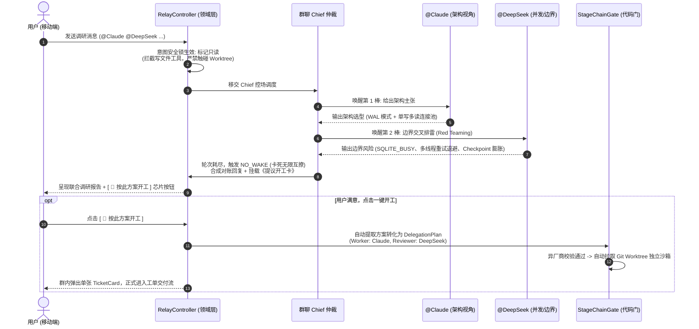

# 榫卯多智能体协同体系下一阶段（P2）升级实施方案：双流解耦与极简闭环

> **规范标识**：`SPEC-ORCHESTRATION-P2-REVISED`  
> **创建日期**：2026-11-05  
> **对齐基线**：`SPEC-ORCHESTRATION-2026-11-03` / `AGENTS.md` / `PROTOCOL-EXTENSION.md`  
> **适用模块**：`:agent-contract`、`:agentNode`、`:orchestration`、`:app`、`:composeApp`、`:desktopApp`  
> **性质**：P2 里程碑正式升级方案与架构演进契约

---

## 一、 核心设计哲学：双流解耦，概念折叠

为了避免系统在多轮迭代中陷入“概念堆叠、状态机失控、用户认知过载”的功能爆炸陷阱，本方案基于第一性原理，确立系统核心骨架：

**明确解耦多智能体交互中的两条本质链路 ——「认知研讨流」与「工单交付流」：**

```mermaid
flowchart TD
    subgraph Stream_Cognitive ["1. 认知研讨流 (Cognitive Flow: 纯只读 · 零副作用 · 自由发散)"]
        A["群聊日常提问 / 多模型调研<br/>(@AgentA @AgentB 你俩分析下这个方案)"] --> B["Chief 控场调度 (各答 1 轮，受控防客套)"]
        B --> C["多厂商独立输出权衡与风险分析"]
        C --> D["回复文末生成结构化《提议开工卡》"]
    end

    subgraph Stream_Delivery ["2. 工单交付流 (Delivery Flow: 强沙箱 · 高副作用 · 严谨串行)"]
        D -->|用户点击 [按此方案开工]| E["生成标准 DelegationPlan"]
        E --> F["StageChainGate.enforce 硬裁决 (在位 + 异厂商 + 限流感知)"]
        F --> G["Worker 独立沙箱编码 (WorktreeSandbox)"]
        G --> H["线性多棒审查 (Worker -> SecReview -> PerfReview)"]
        H -->|全部通过| I["单卡折叠交付 (代码合流 + Artifact 链接)"]
        H -->|自愈失败熔断| J["熔断卡: 原地单句人工指引重试 (Human Steering)"]
        J -->|用户输入一句话| G
    end

    subgraph Card_Hygiene ["3. 全流程帧预算与防刷屏守卫"]
        G & H -.->|调试碎步与巨量 Diff| K["本地落盘为 Artifact (进程内事件，不出帧)"]
        G & H -.->|状态推进| L["群聊始终只维护 1 张动态 TicketCard (严格 ≤ 5 KiB)"]
    end
```

### 核心收益
1. **用户体验极简**：用户在聊天中感觉不到复杂的“模式切换”，聊就是聊（安全只读），做就是做（沙箱严格隔离），从聊到做只需顺手点一下提议卡。
2. **架构边界清晰**：认知流不碰 Git 沙箱与复杂状态机，交付流不碰网络拓扑与并发投票。两条流仅通过一张标准的《提议开工卡》单向触发。
3. **1:1 与群聊拓扑大一统**：1:1 并非被阉割的玩具通道，1:1 是 $N=2$ 的点对点极简协同；群聊是 $N > 2$ 的多端协同。UI 表现、工单卡片、审批流、Diff 审查与一键合并在两类会话中 100% 保持同构一致。

---

## 二、 边界护城河：明确不做清单（Anti-Goals）

为坚决守住系统架构的清爽与鲁棒性，以下特性在本阶段**明确禁止引入**：

| 提议项 | 裁决 | 坚决不做的理由 |
|---|---|---|
| **独立的 `/discuss` 专属模式** | ❌ **不做** | 群聊天然就是用来沟通的。不造伪模式，通过底座意图锁自动实现只读保护。 |
| **DAG 扇出并发审查（Fan-out）与多方投票** | ❌ **不做** | P2P 弱网环境下的并发审查、锁冲突与 AND 裁决极易产生分布式时序死锁。多维审查一律走确定性线性流水线。 |
| **复杂的跨会话断点续跑协议（Resume Protocol）** | ❌ **不做** | 避免造 `resumedFrom`、会话缝合树等大概念破坏协议帧白名单；熔断后采用极简的原地人工单句修正。 |
| **重型心跳与分布式动态服务网格** | ❌ **不做** | 不搞复杂的定期探测协议，采用被动捕获 429 内存标记秒级规避。 |
| **聊天顶栏伪「切换会话」控件** | ❌ **坚决废弃** | 违背 IM 连续时间线心智。会话（Session）是工单执行现场（Task as Session），随工单卡片生命周期自愈与销毁，严禁在顶栏弹窗做切片。 |
| **1:1 派单无工作区静默吞单** | ❌ **坚决不做** | 1:1 派单时必须通过「当前选定 ➔ 宿主唯一默认 ➔ 交互澄清卡」三级推导确定工作区，绝不因缺少 groupId 而静默丢单。 |

---

## 三、 五大核心能力规格与实现契约

### 规格 1：多 Agent 认知研讨流（安全只读 + 受控回合 + 一键开工）

#### 1. 意图安全锁（只读兜底）
* 当用户在群聊中发起咨询、架构探讨或多模型调研时，只要 Prompt 中未携带显式派单指令（如 `组队:`、`实现` 等）：
* 宿主底座**默认拦截所有写文件工具**。Agent 仅拥有代码检索、文档读取与推理能力，严禁私自触发 `WorktreeSandbox` 写操作，确保调研绝对零副作用。

#### 2. 发言节奏与防死锁（遵循 Chief 规则）
* 用户一次 `@` 多个 Agent 时，由群聊 Chief 进行单次轮询调度。
* 每个被点名 Agent 仅发言 **1 轮**，独立陈述技术立场与潜在风险；
* 严格禁止 Agent 之间脱离人类参与的双向私聊，从源头杜绝无限客套与 Token 爆炸。

#### 3. 提议开工卡（Proposal Action Hook）
* 当 Agent 产出一份完整的技术方案后，回复末尾附带轻量提议动作：
  > 💡 **建议落地方案**：按上述设计重构持久层接口  
  > `[ 按此方案开工 ]`
* **交互闭环**：用户点击按钮后，宿主自动将该方案提炼为目标任务，调用既有的 `DelegationTeamStore` 匹配团队模板，生成 `DelegationPlan`，直接拉取分支进入工单交付流。

#### 4. 典型端到端实战范例（Walkthrough Example）

为使开发与测试对落地形态具备毫无歧义的认知，以下以“离线存储队列调研”为例展示完整流转：

##### A. 场景输入（移动端用户群聊发问）
> **用户发送**：  
> `“@Claude @DeepSeek 我们打算把消息离线队列从内存切到 SQLite，怎么设计既能保证写入吞吐，又能防止并发死锁？你们调研分析下。”`

##### B. 底层执行时序图


##### C. 终端呈现模拟（移动端实际渲染形态）
> **🤖 Claude & DeepSeek 联合调研结论**：
> 
> **【核心主张】**：采用 SQLite WAL 模式，读写连接分离；写入走单线程专属队列，避免多线程直连竞争。
> 
> **【异构对账与潜在风险】**：
> | 关注维度 | Claude 架构建议 | DeepSeek 边界找茬 | 最终权衡 |
> |---|---|---|---|
> | **并发写入** | 开启 WAL 模式 | 高并发下 WAL 文件易膨胀至上百 MB | 增加主动 Checkpoint 阈值 |
> | **死锁防护** | 统一单连接串行写入 | 崩溃时易遗留锁导致启动失败 | 启动时增加 `busy_timeout` 熔断自愈 |
> 
> ---
> 💡 **建议落地方案**：新增 `SqliteOfflineQueueStore`，实现单写多读与 busy 退避机制。  
> 🛠️ **推荐团队**：Worker: `Claude` ➔ Reviewer: `DeepSeek`  
> 
> **`[ 🚀 按此方案开工 ]`**   *(操作芯片：点击后无需复制文本，立即触发立项)*

---

### 规格 2：工单交付流“单卡折叠”（根除刷屏与 24 KiB 预算隐患）

#### 1. 全生命周期单卡占位
* 任务启动后，在群聊中**仅发布并维护 1 条动态卡片**（`TicketCard`），禁止为每个微小步骤单独广播群消息。
* **执行中**：卡片展示紧凑单行状态：
  ```text
  [工单 #42] 重构持久层接口
  进度：Worker(codex) 编码中 (45s) ──► Reviewer(dsh) 待命中
  ```
* **终态**：折叠为精炼的交付凭证：
  ```text
  [工单 #42] 交付完成 (耗时 1m20s)
  变更：4 个文件 (+120 -30) | 异厂商审查：PASS (dsh 签字)
  [查看改动 Diff]  [查看执行日志]
  ```

#### 2. 产物外置与帧预算保护
* 完整的调试输出、单测日志和巨量 Patch **严禁塞入即时通讯协议帧**；
* 所有长文本统一落盘为本地 `Artifact`（进程内持久化，不入网络帧）；
* 动态卡片体积严格压在 **5 KiB** 以内（远低于 24 KiB 卡片红线），确保在弱网和多端同步下绝对零丢包。

---

### 规格 3：多维度审查的确定性“线性多棒”（流水线推进，拒绝 DAG）

#### 1. 拓扑严格保持线性
* 坚持复用已有的 `List<Stage>` 结构，不改变底层调度模型。
* 当业务需要安全审查（Reviewer A）与性能审查（Reviewer B）双重把关时，排布为严格的线性多棒链：
  $$\text{Stage 1: Worker (编码)} \longrightarrow \text{Stage 2: Reviewer A (安全审查)} \longrightarrow \text{Stage 3: Reviewer B (性能审查)}$$

#### 2. 异厂商硬隔离与自愈推进
* 审查棒必须全部满足异厂商硬隔离：`Vendor(Reviewer A) != Vendor(Worker)` 且 `Vendor(Reviewer B) != Vendor(Worker)`。
* 任何一棒审查不通过（`REJECT`），将审核意见打包打回 Worker 进行整改；只有所有审查棒全部给出 `PASS`，才触发代码合流。
* **优势**：时序完全确定，测试极易构造，彻底规避并发竞争死锁。

---

### 规格 4：自愈熔断提供“人机协助纠偏（Human Steering）”

#### 1. 痛点破局
* 目前 3 轮自愈失败后直接熔断，用户面对失败卡片只能推倒重来，前期 90% 的编码成果直接作废。

#### 2. 熔断卡挂载纠偏槽位
* 在熔断卡（`HealReport.bannerOf`）上增加轻量输入控件：
  ```text
  自愈已达 3 轮上限 (卡点: 单测 Mock 数据不匹配)
  [ 给 Agent 输入一句话指引 (选填)                     ]
  [ 携带指引重试 ]          [ 放弃并保留工作区 ]
  ```
* 用户在移动端轻量输入单句指导（如：“忽略该单测，仅修改接口判空”），点击重试；
* 宿主保留当前已有分支与代码现场，将用户的这句提示作为增量上下文注入，**追加 1 轮终验机会**。
* 既不需要复杂的跨会话断点协议，又完美挽救了濒临失败的任务。

---

### 规格 5：驱动限流与耗尽的“轻量被动感知”

#### 1. 零网络开销的被动捕获
* 不做主动心跳探测；
* 当 Agent 进程报错返回标准的 `429 Too Many Requests` 或 `Quota Exhausted` 时，驱动层在内存字典中记录该 Agent 的冷却到期时间戳（例如默认冷却 5 分钟）：
  ```kotlin
  object DriverCooldownTracker {
      private val cooldowns = ConcurrentHashMap<String, Long>()
      fun markRateLimited(driverKey: String, durationMs: Long = 300_000L)
      fun isAvailable(driverKey: String): Boolean
  }
  ```

#### 2. 门禁前置秒级避坑
* 用户派单或自动组队时，`StageChainGate.enforce` 优先检查冷却状态；
* 若目标 Agent 处于冷却期，代码门直接拒收并给出明确提示：
  `"Agent [Claude] 当前处于限流冷却中（预计还需 2 分钟），已自动推荐使用 [Codex] 替代"`；
* 杜绝任务发出去后白白等 30 秒超时才报错。

---

### 规格 6：全域解耦插件化体系（Pluggable Extensibility System）

#### 1. 架构定位：内核做裁判与舞台，扩展能力全部插件化
坚决杜绝在 Tenon 主工程中为每个新增模型、CLI 工具、或特定业务编排编写硬编码 Kotlin 代码。系统确立四维插件规范（与 `agent-autoloop` 极简外置哲学对齐）：
* **Agent 插件（执行体）**：通过通用子进程适配器（`ProcessAgentDriver`），由 `~/.tenon/plugins/agents/<name>/manifest.json` 声明 CLI 启动命令与参数模板（支持 `{prompt}`、`{session}`、`{workspace}` 等占位符），标准输出通过 JSON-Lines 协议流式映射为事件七型。
* **Workflow 插件（编排剧本）**：将任务分步、动态委派条件、自愈重试次数、强制卡片门禁外置为声明式 `workflow.json`，用户与社区可自由共享开发、审查、巡检流水线。
* **Source 插件（外部触发源）**：在 `:agentNode` 开放轻量 Webhook 路由，将 GitHub/GitLab 事件或报警信号转换为标准入站事件。
* **Channel 插件（外部交互通道）**：桥接飞书、钉钉、企业微信与桌面原生通知，与 Tenon 的单卡折叠原位 Patch 机制保持双向同步。

#### 2. 运行时沙箱与包规格
* **目录包格式（Tenon Bundle）**：语言无关的标准目录（`manifest.json` + Python/Shell/Node 可执行文件或纯 CLI 命令引用），坚决不搞易崩溃的 JVM 动态 JAR，也不绑死 Node.js。
* **进程隔离与防崩溃（Subprocess stdio）**：外部插件运行在独立子进程中，设置硬性执行超时。插件崩溃或死循环仅表现为单个任务报错，Tenon 核心进程 100% 免疫。
* **跨端协同模型**：桌面端常驻节点执行插件子进程；手机端通过 P2P 协议同步已装载插件清单，以原生 Compose 渲染表单并远程下发审批决策。

---

### 规格 7：大道至简：1:1 与群聊大一统交互契约（Unified Chat & Task Interaction Contract）

#### 1. 同构原则（Isomorphism Principle）
* 1:1 直连（手机 ↔ 桌面电脑/智能体，$N=2$）与群聊协同（多设备 ↔ 多 Agent 团队，$N>2$）在 UI 表现层与执行控制层必须保持 100% 同构；
* 共享完全一致的交互基石：动态 TicketCard（≤5 KiB 原位刷新）、微状态进度轮播（绝不倾倒万行日志刷屏）、敏感权限审批横幅、Diff 预览抽屉、一键合并按钮、`/stop` 打断与单句人工纠偏（Human Steering）。

#### 2. 工作区极简方案（从权限矩阵收敛为项目指针）
* **群聊即专案频道（Project War Room）**：1 群 = 1 本地仓库。建群绑仓库，群顶栏副标题清晰标示 `📁 my-project`。群内打字就是改代码。**彻底废除输入框上方打字唤起的 `AgentContextCapsule` 动态胶囊与抽屉**；
* **1:1 挂接项目指针药丸（Project Pill）**：1:1 顶栏副标题常驻 `📁 my-project ▾`。单项目自动锁定，多项目点击弹出轻量 BottomSheet 单选列表一键切换；
  * **中途切换行为**：切换后聊天流插入本地轻量提示线 `─── 切换当前工作区至 api-service ───`；
  * **历史卡片物理隔离**：已存在卡片永远锁定自身最初绑定的仓库标签，不受顶栏后续切换影响；
* **编排器解绑 `groupId`**：`DesktopWorkerOrchestrator.resolveWorkspacePath` 优先取当前选定的 `chatWorkspaceId` 或宿主唯一活跃工作区，彻底消除 1:1 丢单。

#### 3. 会话治理与工单即会话（Task as Session）
* 彻底移除 [`ChatHeader.kt`](composeApp/src/commonMain/kotlin/com/kapp/tenon/feature/chat/ChatHeader.kt) 中伪「切换会话」控件，聊天流保持连续自然时间线；
* 一次开发任务对应一张动态工单卡，底层驱动的 `sessionId` 随卡片生命周期自愈与销毁，用户在前端无需感知底层 Session 切换；
* 智能体 Tab（工作区看板）唯一定位为全局资产看板与深度日志抽屉，常驻 DSH 外部桥接任务与 Worktree 健康度，唯一跳转动作引导进入专案群聊或 1:1。

#### 4. 传输安全与离线容错（Protocol & Offline Resilience）
* **1:1 卡片传输严格避坑**：1:1 纯文本帧 `kind: "text"` 受限于严格白名单（`TEXT_KEYS`），禁止携带 `card` 键；1:1 卡片通过 `agent-invoke` / `agent-invoke-result` 链路传输或在宿主生成后本地事件驱动入库，严防接收端 `extra-field` 静默丢弃；
* **主机休眠排队**：电脑盒盖休眠或断网期间，手机端任务通过 `RelayQueueStore` 离线排队；开盖建连后严格通过 `Codec.decodeTcp` 格式无损重放，原位点亮 TicketCard 开始执行。

---

## 四、 记忆与上下文治理体系（现存基线与演进边界）

在多智能体开发系统中，最忌讳的做法是搞“自由散漫的大文本 MEMORY.md”或将多轮历史无脑拼入 Prompt。本节基于本仓现存源码与最新裁决，确立记忆系统的全景基线与演进边界。

### 1. 现状真相对账表（已落地 vs 观测中 vs 明确暂缓）

| 记忆与上下文机制 | 现状状态 | 代码/规范落点 | 权责与设计定调 |
|---|:---:|---|---|
| **会话内 200 字摘要 + 文件指针** | ✅ **已落地** | `DesktopStageChain.kt` / `stageSummaryOf` | 严格 `take(200)` 截断，杜绝原始长 CoT 刷屏与模型迷失。 |
| **工具免批表 (`AgentToolApprovalStore`)** | ✅ **已落地** | `AgentToolApprovalStore.kt` | 按 `(设备, Agent, Tool)` 三维结构化落盘 JSON，避免重复打扰。 |
| **会话免审台账 (`SessionExemptLedger`)** | ✅ **已落地** | `SessionExemptLedger.kt` | 0600 本地持久化，5 分钟租约 TTL，异常文件自动 fail-closed 清空。 |
| **协同盲区巡检台账 (`BlindSpotPatrol`)** | ✅ **已落地** | `BlindSpotPatrol.kt` | 按月 `.jsonl` 自动记录熔断（`KIND_BLOCKED`）与拒单卡点。 |
| **群团队模板记忆 (`DelegationTeamStore`)** | ✅ **已落地** | `DelegationTeamStore.kt` | 记住群默认开发与审查角色搭配。 |
| **切换任务物理重置上下文** | ✅ **已落地** | `PROTOCOL-EXTENSION.md §14.4` | 切换工单强制物理重置 Prompt，杜绝旧任务脏上下文污染。 |
| **前缀缓存 (KV Cache) 观测钉子** | 📊 **观测期** | 规范 §11.4 观测钉子 | 撤回虚假前缀保证；驱动暴露读数前不画饼、不盲目优化。 |
| **后台小模型自动提炼记忆 (Memory Review)** | 🛑 **明确暂缓** | 规范 §11.5 门禁约束 | 并发安全、原子 Undo 及 Prompt 防注入门禁满足前，坚决不立项。 |

---

### 2. 会话内短记忆：三层克制注入与指针化（§7.7）

多 Agent 委派接力时，严禁将 Worker 的几万字原始思考链（Raw CoT）无脑丢给 Reviewer：
1. **固定层（Tools Layer）**：只保留当前 Agent 本轮必需的 2~3 个工具声明；
2. **语义摘要层（Summary Layer）**：上游改动必须强制提炼为 **≤ 200 字的结构化 Summary**（修改了哪些模块、解决什么问题）；
3. **数据指针层（Data Pointer Layer）**：巨量 Git Diff 与单测日志落盘为本地文件，Prompt 中仅传递文件指针（`path` 与 `sha256`），下游 Agent 按需调用 `read_file` 查阅。

---

### 3. 协作与配置记忆：四大结构化持久台账（Ledgers）

记忆必须是结构化、有审计、跨端一致的资产，统一由 `DataDirectoryProvider`（`controller.dataDirectory`）管理，严禁硬编码路径：
* `AgentToolApprovalStore`：工具授权记忆；
* `SessionExemptLedger`：会话级免审记忆；
* `BlindSpotPatrol`：容易自愈失败的死锁与高危模块记忆；
* `DelegationTeamStore`：群常用阵容记忆。

---

### 4. 任务隔离防污染：切工单物理重置（PROTOCOL-EXTENSION §14.4）

过去的旧上下文通常是新任务的毒药（例如上周的 Mock 逻辑被误带入生产上线任务）：
* 每次拉起新 Worktree 或切换工单，底层强制重置外部 Agent 驱动进程，**物理抹平 Prompt 上下文**；
* 每个新任务都是纯净的执行视界，**宁要干净的重置，不要充满幻觉的连续性**。

---

### 5. 缓存与长期记忆演进裁决（§11 裁决写回）

1. **撤回前缀缓存承诺（§11.1）**：
   * 多厂商驱动（Claude、DeepSeek、Codex）由独立外部 CLI 自拼 Prompt，宿主无法强行统一前缀；
   * 打下三枚客观观测钉子：`promptPrefixDigest`（前缀哈希）、`cacheHitTokens`（驱动返回的缓存命中）、`ttftMs`（首字耗时），不可测时不立指标。
2. **异步小模型提炼记忆设为严格前置门禁（§11.5）**：
   * 必须先修通失败通道与定义并发写 Undo 粒度；
   * 密钥、Token 与 Prompt 注入过滤必须写成单一判据并配守卫，未满足前不开工。

---

## 五、 模块分工与变更落点

严格遵循 `:domainComposeFreeGate`（领域层 `:app` 零 Compose 依赖）：

```text
teahouse-mobile/
├── agent-contract/     // 驱动键与轻量契约
│   ├── DriverCooldownTracker (冷却时间戳)
│   └── PluginManifest (插件标准元数据与能力声明模型)
├── agentNode/          // 控制面 HTTP 服务
│   └── SourceWebhookRoute (外部 Webhook 事件接收与签名校验)
├── orchestration/      // 编排与门禁核心
│   ├── StageChainRunner (支持线性多棒顺序推进)
│   ├── StageChainGate (在位校验增加冷却感知)
│   ├── HealReport (熔断卡挂载人工指导纠偏参数)
│   ├── ProcessAgentDriver (万能子进程 CLI 适配器与事件七型映射)
│   ├── WorkflowPluginEngine (声明式 workflow.json 剧本加载与状态推进)
│   └── PluginRegistry (本地 ~/.tenon/plugins/ 动态发现与防目录穿透加载)
├── app/                // 领域层 (零 Compose)
│   ├── QuickActions (支持建议卡点击事件的领域派单转换)
│   └── ConversationDomainService (只读意图锁与单卡折叠状态维护)
└── composeApp/         // 表现层 (UI 渲染)
    ├── TicketCard (单卡占位、状态动态推进与折叠展示)
    ├── HealReportBanner (熔断卡挂载输入框与纠偏按钮)
    └── PluginWorkflowTimeline (工作流剧本时间线渲染与节点状态)
```

---

## 六、 四重证据链与全维度测试方案

为了确保 P2 升级在实现过程中不产生暗坑、不破坏既有不变量、不在真机上翻车，必须严格对齐本仓的四重证据链（接线守卫 ➔ 物理穿透 ➔ 否定断言 ➔ 帧预算与稳定性），建立全维度自动化测试矩阵。

### 1. 测试分层与源集定位

测试代码必须严格按模块分层放置，牢牢守住 `:domainComposeFreeGate` 边界：

| 模块 | 测试源集 | 负责验证的核心逻辑 |
|---|---|---|
| **`:orchestration`** | `src/test/kotlin/...` | 线性多棒流水线、`StageChainGate` 异厂商硬校验、熔断卡人工纠偏接入、限流冷却内存字典。 |
| **`:app`** | `src/commonTest/kotlin/...` | `RelayController` 意图锁（只读拦截）、Chief 受控单轮调度、`NO_WAKE` 守卫、建议卡一键转化。 |
| **`:composeApp`** | `src/jvmTest/kotlin/...` | `TicketCard` 单卡折叠渲染、状态推进流、熔断卡输入组件。 |
| **全仓稳定性** | `:testStabilityGate` | 多 Agent 协作与自愈流程并发 3 轮稳定性，确保 0 竞态、0 假死。 |

---

### 2. 核心测试用例矩阵（按 5 大能力拆解）

#### A. 认知研讨流（只读安全锁 + 受控单轮 + 一键开工）
* **用例 1.1（正向：意图识别与只读降权）**：
  * **输入**：用户发送 `@Claude @DeepSeek 你俩分析下这个方案`。
  * **断言**：派发给 Agent 的工具列表中，写文件和提交工具被物理过滤；宿主目录中未创建任何 Git Worktree 分支。
* **用例 1.2（负向判死：越权写拦截）**：
  * **模拟**：研讨期间，Mock Agent 强行发出写文件指令。
  * **断言**：沙箱底层抛出 `PermissionDeniedException`，磁盘改动量严格为 0。
* **用例 1.3（节奏控制：受控单轮与 `NO_WAKE` 守卫）**：
  * **执行**：Claude 答完第 1 轮后尝试再次调用工具并自发 `@DeepSeek`；
  * **断言**：Chief 强制截断，轮次置零；记录 `NO_WAKE` 诊断，不向网络发射任何帧。
* **用例 1.4（衔接测试：建议卡一键生成 `DelegationPlan`）**：
  * **输入**：模拟用户点击回复末尾的 `[ 🚀 按此方案开工 ]` 芯片；
  * **断言**：`QuickActions` 拦截事件，成功解析目标方案文本，命中 `DelegationTeamStore` 预设模板，成功实例化出合法的 `DelegationPlan`。

#### B. 工单交付流“单卡折叠”（帧预算与防刷屏守卫）
* **用例 2.1（防刷屏：全流程消息增量 = 1）**：
  * **执行**：启动包含 1 棒 Worker + 1 棒 Reviewer 的完整任务，中间经过 5 次工具调用与 2 次局部重试；
  * **断言**：在消息存储中查询当前群聊，该任务对应的消息记录严格始终只有 1 条（通过 MessageId 更新，不新增消息）；状态从 `RUNNING` 推进到 `REVIEWING` 再到 `DONE`。
* **用例 2.2（帧预算铁律：卡片体积 ≤ 5 KiB）**：
  * **执行**：Worker 产出一份包含 10 个文件、2000 行变更的巨型 Patch；
  * **断言**：巨量 Diff 和单测长日志被写到本地磁盘（Artifact 路径）；序列化后的 `TicketCard` JSON 载荷大小严格 ≤ 5 KiB（远低于 24 KiB 的卡片硬预算红线）。

#### C. 确定性线性多棒审查（Multi-Stage Pipeline）
* **用例 3.1（异厂商代码门全链路硬校验）**：
  * **场景 A（合规）**：`Worker(Claude) ➔ Reviewer A(DeepSeek) ➔ Reviewer B(Codex)`。断言 `StageChainGate.enforce` 返回 `Pass`，流水线顺序推进。
  * **场景 B（同厂商违规）**：`Worker(Claude) ➔ Reviewer A(DeepSeek) ➔ Reviewer B(Claude)`。断言代码门直接返回 `Reject`，报出 `CrossVendorViolationException`，坚决不启动任务。
* **用例 3.2（多审查打回与自愈流转）**：
  * **执行**：Reviewer A 给出 `PASS`，但 Reviewer B 给出 `REJECT`（附带性能缺陷说明）；
  * **断言**：系统不会盲目合流，而是将 Reviewer B 的意见打包作为新的验收条件打回给 Worker；自愈轮次加 1，Worker 进入下一轮修复。
* **用例 3.3（全通关合流）**：
  * **执行**：Reviewer A 和 Reviewer B 均给出 `PASS`；断言触发分支合并操作，卡片状态流转为 `COMPLETED`。

#### D. 自愈熔断的人机协助纠偏（Human Steering）
* **用例 4.1（3 轮熔断状态阻断）**：
  * **执行**：模拟连续 3 轮审查不通过；断言自愈循环终止，工单状态置为 `HEAL_EXHAUSTED`，保留现有 Worktree 不清理。
* **用例 4.2（增量修正重试恢复）**：
  * **执行**：模拟用户在熔断卡上提交补充提示：“忽略性能测试，按现状提交”；
  * **断言**：宿主拦截该操作，恢复 Worker 进程并注入用户的单句提示；允许追加且仅追加 1 轮终验自愈（`attempt = 4`, `maxAllowed = 4`）；若 Reviewer 审查通过，卡片正常翻绿并合流。

#### E. 驱动限流的轻量被动感知
* **用例 5.1（429 被动捕获与内存记录）**：
  * **执行**：Mock Agent 进程返回 `HTTP 429 Too Many Requests`；断言 `DriverCooldownTracker` 捕获该错误，并在内存中将该 Agent 标记为锁定 300 秒。
* **用例 5.2（代码门秒级前置避坑）**：
  * **执行**：在锁定期间，用户尝试再次派单给该 Agent；断言 `StageChainGate.enforce` 在 5ms 内即时拒收，给出降级推荐，物理上没有发起任何网络请求或进程启动。
* **用例 5.3（TTL 过期自然复苏）**：
  * **执行**：模拟时间流逝超过 300 秒；断言 `DriverCooldownTracker.isAvailable()` 返回 true，该 Agent 恢复可派发状态。

---

### 3. 测试代码骨架示意

```kotlin
class MultiAgentResearchAndDeliveryTest {

    @Test
    fun researchMode_strictlyBlocksWriteTools_andCapsTurns() = runTest {
        val controller = createTestRelayController()
        
        // 1. 用户发问：@两个 Agent 调研方案
        val prompt = "@claude @deepseek 分析下怎么实现离线缓存？"
        val outcome = controller.handleInboundUserMessage(prompt)
        
        // 2. 断言意图为只读研讨，无 Worktree
        assertTrue(outcome.isReadOnlyResearch)
        assertNull(controller.activeWorktreeFor(prompt))
        
        // 3. 验证工具注入：只有读取工具，没有写入工具
        val tools = controller.grantedToolsFor("claude")
        assertTrue(tools.contains("read_file"))
        assertFalse(tools.contains("write_file"))
        assertFalse(tools.contains("git_commit"))
        
        // 4. 断言受控轮次：每人发言 1 轮后强制 NO_WAKE
        assertEquals(1, controller.speakerTurnsOf("claude"))
        assertEquals(1, controller.speakerTurnsOf("deepseek"))
        assertEquals(NoWakeReason.TURN_EXHAUSTED, controller.lastNoWakeReason)
    }

    @Test
    fun ticketCard_singleCardFold_payloadUnderBudget() = runTest {
        val orchestrator = createTestOrchestrator()
        
        // 执行一个带大量 Diff 的任务
        val plan = DelegationPlan.createExplicit("重构模块", worker = "claude", reviewer = "deepseek")
        val ticket = orchestrator.execute(plan)
        
        // 验证卡片在群聊中只有 1 条记录
        val messages = orchestrator.messageStore.listGroupMessages()
        assertEquals(1, messages.size, "群聊全生命周期必须始终只有 1 张卡片占位")
        
        // 验证卡片 JSON 序列化大小严格 <= 5 KiB (红线 24 KiB)
        val serializedCard = TicketCardSerializer.serialize(ticket.toCard())
        assertTrue(serializedCard.toByteArray().size <= 5 * 1024, "卡片大小必须 <= 5 KiB")
    }

    @Test
    fun healExhausted_acceptsHumanSteering_andRecovers() = runTest {
        val orchestrator = createTestOrchestrator()
        
        // 模拟连续 3 轮失败进入熔断
        orchestrator.simulateHealRoundsExhausted(rounds = 3)
        assertEquals(StageChainState.HEAL_EXHAUSTED, orchestrator.currentTicket.state)
        
        // 人工介入：给一句指引重试
        orchestrator.resumeWithHumanInstruction("忽略单元测试，直接提交入参修改")
        
        // 断言自愈追加 1 轮终验，并成功合流
        assertEquals(StageChainState.COMPLETED, orchestrator.currentTicket.state)
        assertTrue(orchestrator.currentTicket.reviewPassed)
    }
}
```

---

### 4. 门禁与提交前验收基准

所有涉及 P2 改动的提交，必须通过以下五道硬性门禁：

1. **单测串行全绿（--max-workers=1 验收）**：
   ```bash
   ./gradlew :core:jvmTest :app:jvmTest :orchestration:test :agent-contract:test --continue --max-workers=1
   ```
2. **并发稳定性连跑 3 轮（抓并发与锁竞争）**：
   ```bash
   ./gradlew :testStabilityGate
   ```
3. **领域层零 Compose 检查**：
   ```bash
   ./gradlew :domainComposeFreeGate
   ```
4. **代码注释与痕迹门禁**：
   ```bash
   ./gradlew :cjkLiteralGate :constructionTraceGate :staleCommentRefGate --continue
   ```
5. **帧预算实测对账**：
   运行集成测试时开启 `FrameBudgetInspector`，断言网络卡片最大读数不超过 5,120 字节。

---

## 七、 真实用户验收场景规格（End-to-End User Experience Scenarios）

为了让产品、研发与测试对最终落地效果具备**完全一致的视觉与交互共识**，本节详细定义 5 个最核心的真实用户测试场景：包含**用户如何发起、卡片应该显示什么、用户有哪些操作项、以及符合产品定位的合格判据**。

---

### 场景 1：多 Agent 方案调研 ➔ 一键开工

* **业务定位**：解决“开工前需要多模型技术对比与排雷，但不想手动复制方案去开工”的痛点。
* **1. 用户如何发起**：
  * 用户在群聊输入框正常打字发问：  
    `“@Claude @DeepSeek 我们打算把消息离线队列从内存切到 SQLite，怎么设计既能保证写入吞吐，又能防止并发死锁？你们调研分析下。”`
* **2. 卡片与界面显示什么**：
  * 群内依次出现两段独立见解：Claude 架构主张（WAL模式 + 单写多读），随后 DeepSeek 边界排雷（指出并发锁与 Checkpoint 隐患）；
  * 紧随其后呈现一张精简的结构化提议卡片：
    ```text
    ┌──────────────────────────────────────────────────────────────┐
    │ 🤖 Claude & DeepSeek 联合技术调研结论                         │
    ├──────────────────────────────────────────────────────────────┤
    │ 【核心主张】SQLite WAL 模式，单写多读连接池，写入专属队列串行化  │
    │ 【关键排雷】busy_timeout 熔断自愈，主动控制 Checkpoint 膨胀   │
    │ ──────────────────────────────────────────────────────────── │
    │ 💡 建议立项：新增 SqliteOfflineQueueStore 实现单写多读与退避  │
    │ 🛠️ 推荐团队：开发: Claude ➔ 审查: DeepSeek (异厂商合规)     │
    └──────────────────────────────────────────────────────────────┘
    ```
* **3. 用户可操作项**：
  * **操作芯片 1**：`[ 🚀 按此方案开工 ]`
  * **操作芯片 2**：`[ 💬 继续讨论补充 ]`
* **4. 点击行为与合格判据**：
  * **用户行为**：点击 `[ 🚀 按此方案开工 ]`；
  * **合格判据**：
    * 调研期间**本地没有创建任何 Git 分支，未改动任何文件**；
    * 两个 Agent 绝不在群里自发展开第二轮客套吹捧（`NO_WAKE` 守卫生效）；
    * 点击按钮后 1 秒内自动提炼目标并进入场景 2，用户**无需手动复制粘贴哪怕一个字符**。

---

### 场景 2：工单交付中的“单卡折叠推进”（全生命周期 1 张卡）

* **业务定位**：彻底消灭 Agent 执行任务时的碎片日志刷屏，保住 24 KiB 卡片红线。
* **1. 用户如何发起**：
  * 从场景 1 点击 `[ 按此方案开工 ]`，或在群内直接打字：`“组队: 优化持久层接口”`。
* **2. 卡片与界面显示什么（全生命周期复用同一条消息占位，3 态流转）**：
  * **状态 A（编码中）**：
    ```text
    ┌──────────────────────────────────────────────────────────────┐
    │ ⚙️ [工单 #101] 优化持久层接口                                │
    │ 状态：Worker(Claude) 编码中 (已耗时 45s)                      │
    │ 进度：已修改 3 个文件... (正在执行单元测试)                   │
    │ 审查：Reviewer(DeepSeek) 待命中                              │
    └──────────────────────────────────────────────────────────────┘
    ```
  * **状态 B（审查中）**：
    ```text
    ┌──────────────────────────────────────────────────────────────┐
    │ 🔍 [工单 #101] 优化持久层接口                                │
    │ 状态：Worker 已交付，Reviewer(DeepSeek) 交叉审查中 (15s)     │
    │ 产物：Patch 包含 4 个文件 (+120 -35)，单测全部通过           │
    └──────────────────────────────────────────────────────────────┘
    ```
  * **状态 C（终态完成 · 紧凑折叠）**：
    ```text
    ┌──────────────────────────────────────────────────────────────┐
    │ ✅ [工单 #101] 交付完成 (总耗时 1m35s)                       │
    │ 变更：4 个文件 (+120 -35) | 审查签字：PASS (DeepSeek)        │
    │ 分支：feat/offline-queue-sqlite (已合并到主分支)             │
    └──────────────────────────────────────────────────────────────┘
    ```
* **3. 用户可操作项**：
  * 执行中：`[ ⏹ 终止任务 ]`（点击直接取消 Worker 进程并回滚沙箱）；
  * 终态完成后：`[ 🔍 查看 Diff 摘要 ]`、`[ 📄 完整日志 (Artifact) ]`。
* **4. 合格判据**：
  * 任务从启动到结束，群消息总数增量**严格始终为 1 条**；
  * 卡片序列化大小**严格 ≤ 5 KiB**；
  * 详细的几千行 Diff 和长日志落盘为本地文件，绝不通过即时通讯网络帧广播。

---

### 场景 3：确定性多维度审查（开发 ➔ 安全审查 ➔ 性能审查）

* **业务定位**：满足生产级高质量把关诉求，时序确定，绝不引入并发死锁。
* **1. 用户如何发起**：
  * 群模板预设了双审查，或显式指定：  
    `“组队: 重构鉴权模块 (开发: Claude, 安全审查: DeepSeek, 性能审查: Codex)”`
* **2. 卡片与界面显示什么**：
  * 卡片清晰呈现确定性流水线步进：
    ```text
    ┌──────────────────────────────────────────────────────────────┐
    │ 🛡️ [工单 #102] 重构鉴权模块                                  │
    │ 流水线：                                                     │
    │  1. 编码实现  [Claude]   ──► ✅ 交付完成                     │
    │  2. 安全审查  [DeepSeek] ──► ✅ PASS (无 SQL 注入与越权漏洞) │
    │  3. 性能审查  [Codex]    ──► 🔍 审查中 (验证高并发锁耗时...) │
    └──────────────────────────────────────────────────────────────┘
    ```
* **3. 用户可操作项**：
  * `[ ⏹ 终止流水线 ]`；
  * 若第 3 棒指出性能问题并给出 `REJECT`，卡片折叠显示打回意见，自动回退到 Claude 进行自愈第 1 轮。
* **4. 合格判据**：
  * 时序严格为单向线性链（`Worker ➔ Reviewer A ➔ Reviewer B`），物理上无并发抢锁；
  * 代码门强制要求所有审查棒与 Worker 互为异厂商，同厂商秒级阻断。

---

### 场景 4：自愈 3 轮熔断 ➔ 人机协作纠偏（Human Steering）

* **业务定位**：任务已完成 90% 但卡在微小单测死角时，避免全盘推倒重来，赋能人工一句话挽救。
* **1. 用户如何发起（被动触发）**：
  * Worker 与 Reviewer 经过 3 轮自愈交互仍未达成一致，系统触发安全熔断。
* **2. 卡片与界面显示什么**：
  * 卡片变为琥珀色告警态，明确展示卡点原因：
    ```text
    ┌──────────────────────────────────────────────────────────────┐
    │ ⚠️ [工单 #103] 自愈已达 3 轮上限 (触发熔断保护)              │
    │ 核心卡点：Reviewer 指出 "UserRepositoryTest.mockDb 签名不兼容"│
    │ 当前状态：已完成 90% 代码编写，Worktree 现场已冻结保留       │
    ├──────────────────────────────────────────────────────────────┤
    │ 💡 人机纠偏：输入一句指引，为 Agent 提供场外指导              │
    │ ┌──────────────────────────────────────────────────────────┐ │
    │ │ 请输入修正指引 (例如: 忽略该单测/改用新接口签名)         │ │
    │ └──────────────────────────────────────────────────────────┘ │
    └──────────────────────────────────────────────────────────────┘
    ```
* **3. 用户可操作项**：
  * **输入槽**：支持单行文字输入（如移动端打字：`“不用修旧 mock，直接在 UserRepository 加一个兼容重载即可”`）；
  * **操作按钮 1**：`[ ⚡ 携带指引重试最后一轮 ]`
  * **操作按钮 2**：`[ 🛑 放弃并保留当前代码 ]`（保留 Worktree 供人工去桌面端接管）
* **4. 点击行为与合格判据**：
  * **用户行为**：输入指引并点击 `[ 携带指引重试 ]`；
  * **合格判据**：
    * 现有分支代码 **100% 物理保留**，无需重新生成前面 90% 的代码；
    * 仅且仅追加第 4 轮终验机会（`attempt = 4`, `maxAllowed = 4`）；
    * 审查通过后正常翻绿合流；若仍未通过，彻底转人工，严禁无限循环。

---

### 场景 5：遇到 Agent 官方限流（429）时的前置避坑

* **业务定位**：消除派单给欠费/限流 Agent 导致的 30 秒超时假死与挂起。
* **1. 用户如何发起**：
  * 某个 Agent（如 Claude）刚在上一轮抛出 429 或配额耗尽，用户再次尝试 `@Claude` 派单或模板首选了它。
* **2. 卡片与界面显示什么**：
  * 门禁在 **5ms 内即时拦截**，并给出发起人专属的轻量提示卡片：
    ```text
    ┌──────────────────────────────────────────────────────────────┐
    │ ⏱️ Agent 暂时不可用                                          │
    │ 原因：[Claude] 处于官方限流冷却期 (预计还需 2 分钟解除)      │
    │ 建议：已自动为您匹配同属架构型角色的可用智能体 [DeepSeek]    │
    └──────────────────────────────────────────────────────────────┘
    ```
* **3. 用户可操作项**：
  * **操作芯片 1**：`[ 🔄 一键换用推荐 Agent 开工 ]`
  * **操作芯片 2**：`[ ⏰ 等待冷却后自动重试 ]`
  * **操作芯片 3**：`[ ❌ 取消 ]`
* **4. 点击行为与合格判据**：
  * **合格判据**：
    * 物理上**完全没有向不可用的 Agent 发起任何网络请求或拉起外部 CLI 进程**；
    * 用户在移动端界面上没有任何“卡顿转菊花”的感觉，被动提示瞬间呈现。

---

### 场景 6：零发版接入自定义外部 Agent 与工作流剧本（Plugin Extension）

* **业务定位**：用户或团队引入新开源模型、本地 Python 代码审查脚本或特定发布工作流时，无需修改或重新编译 Tenon。
* **1. 用户如何发起**：
  * 用户在电脑目录 `~/.tenon/plugins/agents/deepseek-local/` 放置 `manifest.json` 与 `run.py`，或配置官方 CLI 命令行模板；
  * 打开手机端 Tenon，进入群聊或新建会话。
* **2. 卡片与界面显示什么**：
  * **手机端动态感知**：新建会话下拉菜单自动出现 **「DeepSeek 本地版」** 与自定义剧本 **「代码自动诊断与修复流」**；
  * 发起任务后，界面实时呈现**多节点执行时间线**：
    ```text
    ┌──────────────────────────────────────────────────────────────┐
    │ 📋 工单 #108: 代码自动修复流水线 [运行中]                    │
    │                                                              │
    │  ✅ 步骤 1: 问题根因分析 (Agent: Claude Code)  [耗时 14s]      │
    │  🔄 步骤 2: 编写修复代码 (Agent: DeepSeek 本地) [思考中...]   │
    │  ⏳ 步骤 3: 自动化回归测试 (Agent: Gradle Test Runner)       │
    │  ⏸️ 步骤 4: 人工合流审批门禁                                 │
    └──────────────────────────────────────────────────────────────┘
    ```
* **3. 用户可操作项**：
  * 步骤推进至审批门禁时，手机端 TicketCard 原地翻蓝，展示 Diff 工件摘要与操作芯片：
  * **操作芯片 1**：`[ 🚀 批准合并并发布 ]`
  * **操作芯片 2**：`[ 🔁 携带建议打回重修 ]`
  * **操作芯片 3**：`[ 🛑 终止工作流 ]`
* **4. 点击行为与合格判据**：
  * **合格判据**：
    * 插件在子进程中崩溃或抛出异常时，Tenon 桌面与手机端**零闪退**，卡片精准捕获退出码与 stderr 摘要；
    * 手机端与桌面端通过 P2P 同步单卡，审批后卡片就地变绿，流水线平滑推进至步骤 4；
    * 全流程不出主工程协议帧，所有 Diff 与大日志走本地 `Artifact` 引用。

### 场景 7：1:1 对端直连派单、审批与闭环合并（1:1 Direct Task Dispatch & Merge）

* **业务定位**：单人开发者在 1:1 私聊中使唤桌面电脑上的 Agent，无需强行建群，享受与群聊完全同构的工单交付与审查体验。
* **1. 用户如何发起与切换项目**：
  * 用户在手机端消息列表打开与桌面 Mac 的 1:1 私聊；
  * 顶栏副标题清晰展示当前项目指针药丸：`📁 teahouse-mobile ▾`；
  * 用户若需改动其他项目，轻触药丸，在弹出的单选抽屉中点击 `api-service`，顶栏即刻响应，聊天流出现轻量本地提示线；
  * 直接打字输入需求：`“帮我实现导出用户订单为 CSV 的功能”`（无需 `@` 任何 Agent）。
* **2. 卡片与界面呈现**：
  * **三级工作区推导生效**：编排器自动锁定当前所选的 `chatWorkspaceId`（或宿主唯一活跃仓库），立即进入沙箱；
  * 1:1 聊天流中弹出与群聊同款的单张动态 TicketCard，微状态原位更新（耗时、正在修改文件等，绝无万行终端刷屏）：
    ```text
    ┌──────────────────────────────────────────────────────────────┐
    │ 📋 工单 #t109: 导出用户订单为 CSV (api-service) [编码中 35%] │
    │  ⏳ 状态: Worker(Codex) 编码中 (22s) ──► Reviewer(Claude) 待命 │
    │  📦 分支: worktree/t109-export-csv                           │
    │  [ 🛑 中断任务 ]                                              │
    └──────────────────────────────────────────────────────────────┘
    ```
* **3. 用户可操作项**：
  * **查看详细终端输出**：轻触卡片主体，滑出“工单执行日志”全量日志抽屉，不污染聊天流；
  * **敏感操作拦截**：若 Agent 执行文件删除或 Shell 提权，卡片上方即时弹出审批横幅：`[ 允许本次 ]` / `[ 本会话免审 ]` / `[ 拒绝 ]`；
  * **验收完成**：测试跑通、异厂商审查 PASS 后，卡片翻绿：
  * **操作芯片 1**：`[ 🔍 查看改动 Diff ]`（端内弹出结构化代码高亮比对阅读器）
  * **操作芯片 2**：`[ 🚀 一键合并到主分支 ]`（桌面端将沙箱分支原子合入本地主干，并调用安全清理）
* **4. 点击行为与合格判据**：
  * **合格判据**：
    * 1:1 私聊顶栏无任何无用的「切换会话」控件，消息流平铺连续；
    * 1:1 发出的派单指令绝对零丢单，沙箱与 TicketCard 稳定生成并原位刷新；
    * 1:1 卡片传输严格避开单聊纯文本帧 `kind: "text"`（杜绝 extra-field 协议拒收）；
    * 点击一键合并后，桌面本地 Git 仓库成功推进 HEAD，工单卡翻绿归档，沙箱安全销毁且绝不穿透跟随软链接。

---

## 八、 总结：下阶段开发排期

* **Step 1（体验闭环）**：1:1 与群聊大一统交互落地（顶栏伪切换会话下线 + 1:1 三级工作区推导防吞单） + 工单交付流单卡折叠（消灭刷屏） + 提议卡一键开工 + 调研实战接入（场景 1、场景 2、场景 7）；
* **Step 2（质量与韧性）**：自愈熔断挂接人工单句纠偏 + 线性多棒审查支持（场景 3、场景 4）；
* **Step 3（可用性防错）**：驱动层被动 429 内存冷却与门禁前置提示（场景 5）；
* **Step 4（插件化扩展·P2 阶段交付）**：`ProcessAgentDriver` 子进程命令行通用适配器 + `~/.tenon/plugins/` 目录规范与 Manifest 解析（场景 6 基础）；
* **Step 5（生态外延·P2.5/P3 演进）**：`workflow.json` 声明式剧本引擎 + Source Webhook 外部入站 + Channel 飞书/桌面系统通知桥接。
