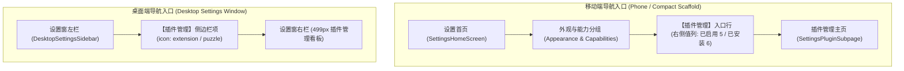

# 榫卯 (Tenon) · 插件管理界面与交互原型设计规范
# (Plugin Management UI/UX Prototype Specification)

> **规范标识**：`SPEC-UI-PLUGIN-MANAGEMENT-2026-11-08`  
> **适用模块**：`:composeApp`（设置与控制台表现层）、`:app`（领域状态流）、`:agentNode`（控制面 API）  
> **架构基线**：[`design/spec/tenon-plugin-extensibility-detailed-spec-2026-11-05.md`](tenon-plugin-extensibility-detailed-spec-2026-11-05.md)（全域插件化详细设计规范 LLD）  
> **演进参考**：[`docs/AGENT-TRIGGER-AND-PLUGIN-SPECIFICATION.md`](../../docs/AGENT-TRIGGER-AND-PLUGIN-SPECIFICATION.md)（触发式编排演进提案）  
> **交互原型**：`prototype/relay.html`  
> **核心原则**：**单端开发三端复用、状态如实零假报、操作防呆有确认、崩溃隔离可视化**。

---

## 目录
1. [导航入口与层级拓扑 (Navigation Topology)](#1-导航入口与层级拓扑-navigation-topology)
2. [页面信息架构 (Information Architecture)](#2-页面信息架构-information-architecture)
3. [多端原型布局线框 (Wireframes & Form Factors)](#3-多端原型布局线框-wireframes--form-factors)
   - 3.1 移动端（手机 / 平板竖屏）布局
   - 3.2 桌面端（双栏独立设置窗口）布局
4. [核心组件与交互卡片规格 (Card & Component Spec)](#4-核心组件与交互卡片规格-card--component-spec)
   - 4.1 插件列表卡片（PluginCard）
   - 4.2 插件状态指示灯（Status Pill）
   - 4.3 插件个性化配置抽屉（Settings Drawer）
   - 4.4 安装新插件对话框（Install Sheet）
5. [交互行为与控制面接口映射 (API Mapping)](#5-交互行为与控制面接口映射-api-mapping)
6. [设计系统 Token 与无障碍规范 (Design System Tokens)](#6-设计系统-token-与无障碍规范-design-system-tokens)

---

## 1. 导航入口与层级拓扑 (Navigation Topology)

插件管理作为系统的**扩展与能力底座**，在多端遵循统一的双向入口规则：



### 1.1 首页入口规格（以设置首页为例）
* **所在分组**：设置首页「外观与能力」分组第 3 行（排在「外观」、「能力声明」之后）；
* **标题**：`插件管理`
* **副标题**：`AI 智能体驱动与扩展工具箱`
* **右侧当前值（动态统计）**：
  * 当安装了 6 个插件且 5 个启用时，显示：`已启用 5 / 已安装 6`；
  * 全部禁用时显示：`全部禁用`；
  * 数据源实时响应 `GET /v1/plugin/states`。

---

## 2. 页面信息架构 (Information Architecture)

插件管理主页面自上而下由四大区块构成：

```
┌────────────────────────────────────────────────────────┐
│ [←] 插件管理                       [+ 安装] [⟳ 刷新]   │  <- 顶栏 TopBar
├────────────────────────────────────────────────────────┤
│  [ 全部 (6) ]   [ 运行中 (5) ]   [ 已禁用 (1) ]        │  <- 状态过滤 Segmented Bar
├────────────────────────────────────────────────────────┤
│  ┌─ 官方内置席位 ───────────────────────────────────┐  │
│  │ 🤖 Claude Code          v1.0.0   [ ● 运行中 ] [⏻]│  │  <- 插件卡片 (内置保护)
│  │    CLI 执行体 · 终端 / 代码重构 / 架构设计      │  │
│  │                                                  │  │
│  │ ⚡ DeepSeek Harness (dsh) v1.0.0  [ ● 运行中 ] [⏻]│  │
│  │    CLI 审查员 · 逻辑对账 / 单测审查             │  │
│  └──────────────────────────────────────────────────┘  │
│  ┌─ 第三方与扩展 ───────────────────────────────────┐  │
│  │ 📧 智能邮件套件          v2.0.0   [ ○ 已禁用 ] [⏻]│  │  <- 扩展插件 (支持配置/卸载)
│  │    MCP 服务 · 定时晨报 / 紧急邮件 Inbound       │  │
│  │    [ ⚙️ 配置 ]  [ 🗑️ 卸载 ]                      │  │
│  └──────────────────────────────────────────────────┘  │
│  💡 提示：内置 CLI 席位由系统底座托管，第三方插件以独立沙箱运行│  <- 底部说明
└────────────────────────────────────────────────────────┘
```

---

## 3. 多端原型布局线框 (Wireframes & Form Factors)

### 3.1 移动端布局原型（以 390×844 竖屏基线为准）

```text
┌──────────────────────────────────────────┐
│  ←  插件管理                      +   ⟳  │  <- LargeTitleBar (高度 56dp)
├──────────────────────────────────────────┤
│                                          │
│  ┌─ [全部 6] ── [运行中 5] ── [已禁用 1] ─┐│  <- 过滤分段器 (高度 36dp)
│  └───────────────────────────────────────┘│
│                                          │
│  内置智能体 (6)                           │  <- SectionTitle (14sp / 600)
│  ┌──────────────────────────────────────┐│
│  │ 🤖 Claude Code                [ ON ] ││  <- Switch 拨动开关
│  │    v1.0.0 · 内置 CLI 席位             ││
│  │    状态: ● 端口 8788 (健康)           ││  <- 绿色健康呼吸点
│  │    能力: agent · code-review · term  ││  <- 标签胶囊 (Chips)
│  └──────────────────────────────────────┘│
│  ┌──────────────────────────────────────┐│
│  │ ⚡ DeepSeek Harness (dsh)     [ ON ] ││
│  │    v1.0.0 · 内置 CLI 席位             ││
│  │    状态: ● 运行中                    ││
│  │    能力: agent · reviewer · terminal ││
│  └──────────────────────────────────────┘│
│  ┌──────────────────────────────────────┐│
│  │ 📦 Echo Mock Agent           [ OFF] ││
│  │    v1.0.0 · 离线测试桩                ││
│  │    状态: ○ 已被用户停用              ││  <- 灰色停用态
│  └──────────────────────────────────────┘│
│                                          │
│  第三方与扩展 (0)                         │
│  ┌──────────────────────────────────────┐│
│  │ 暂无外部扩展插件                      ││  <- 空态占位
│  │ 点击右上角 [+] 可从本地 zip 安装     ││
│  └──────────────────────────────────────┘│
│                                          │
└──────────────────────────────────────────┘
```

### 3.2 桌面端布局原型（720×560 独立设置窗，右栏宽度 499px）

```text
┌──────────────┬─────────────────────────────────────────────────┐
│ 🔴 🟡 🟢      │ 榫卯 设置                                       │
├──────────────┼─────────────────────────────────────────────────┤
│ 身份与连接   │ 插件管理                                [+ 安装插件] │
│ 连接         │ 集中管理智能体执行体与外部服务扩展              │
│ 通知         ├─────────────────────────────────────────────────┤
│ 外观         │ 筛选: [全部]  [已启用]  [已停用]        [⟳ 刷新状态] │
│ 能力声明     │                                                 │
│ 数据与存储   │ ┌─────────────────────────────────────────────┐ │
│ 诊断         │ │ [🤖] Claude Code                     [ 启用中 (v) ]│ │
│ 【插件管理】 │ │      内置 CLI · claude · 状态: 正常在线     │ │
│ ──────────── │ │      [终端能力] [代码审查] [架构分析]       │ │
│ 这台电脑     │ └─────────────────────────────────────────────┘ │
│ 桌面         │ ┌─────────────────────────────────────────────┐ │
│ 输入法自检   │ │ [📧] 邮件助手套件 (Mail Assistant)   [ 启用中 (v) ]│ │
│              │ │      v2.0.0 · 外部进程 · PID: 48921         │ │
│              │ │      [Cron 定时] [Webhook 监听]             │ │
│              │ │      操作: [ ⚙️ 偏好设置 ]  [ 🗑️ 卸载 ]       │ │
│              │ └─────────────────────────────────────────────┘ │
└──────────────┴─────────────────────────────────────────────────┘
```

---

## 4. 核心组件与交互卡片规格 (Card & Component Spec)

### 4.1 插件列表卡片（PluginCard）与三层图标体系规格（Icon Architecture）
* **容器规格**：
  * 背景色：`MaterialTheme.colorScheme.surfaceVariant`（浅色 `#F5F6F8`，深色 `#1E2024`）；
  * 圆角：`12.dp`（`RoundedCornerShape`）；
  * 内边距：`16.dp`；外间距：垂直 `8.dp`。
* **信息布局**：
  * **主标题行**：左侧 38×38dp 圆角方块图标（Squircle，见下文图标规格），紧随名称与版本号；右侧为 Material 3 `Switch` 启停开关。
  * **状态行**：
    * 运行中：`TagTone.Ok`（绿色微光圆点 + `在线 (端口: 8788)`）；
    * 离线/异常：`TagTone.Queued`（黄色感叹号 + `进程已退出 / 未检测到 CLI 二进制`）；
    * 已禁用：`TagTone.Plain`（灰色圆点 + `已停用`）。
  * **能力标签行（Chips）**：将 `capabilities` 映射为 `10.dp` 字号的小胶囊，如 `agent`、`terminal`、`cron`。
  * **底部操作条（仅针对提供配置项或外部插件展示）**：
    * `[⚙️ 设置]`：点击展开插件参数配置抽屉；
    * `[🗑️ 卸载]`：高危红色按钮（内置席位不渲染此按钮，防误删核心底座）。

#### 4.1.1 插件图标三层架构（Icon Tiers & Fallback Spec）
在多智能体协同（群聊 `@agent`、工作区看板 `WorkspaceBoard`、责任链审批卡片 `StageChainGate`、设置列表）中，插件图标是**首要视觉辨识凭证**。严禁列表退化为纯文本命令行。

| 分层 | 适用对象 | 呈现形式 | 规范与视觉规则 |
|:---|:---|:---|:---|
| **第一层：内置席位专用标识**<br>(First-party Dedicated) | 官方底座托管 CLI 驱动 (`claude`, `dsh`, `codex`, `agy`, `opencode`, `echo`) | 厂商专属品牌色 + 矢量符号徽章 | • **Claude**: `#D97706` (暖橙/陶土) + 终端符号<br>• **DeepSeek**: `#1E40AF` (深海蓝) + 智脑/审查符号<br>• **Codex**: `#059669` (翡翠绿) + 极简代码符号<br>• **Antigravity**: `#4F46E5` (科技靛蓝) + 巡检盾牌<br>• **OpenCode**: `#EA580C` (开源橙) + 终端符号<br>• **Echo Mock**: `#64748B` (蓝灰) + 测试桩符号 |
| **第二层：扩展插件清单声明**<br>(Manifest Declared) | 第三方扩展包、MCP 外部进程 | `manifest.json` 声明 `icon` 字段 | • **相对路径**: `"icon": "assets/icon.png"` (推荐 64×64 PNG/SVG)<br>• **预置矢量 Token**: `"icon": "mail"` / `"database"` / `"cloud"`<br>• **防崩溃熔断**: 尺寸上限 64 KiB，最大解码 256×256，走沙箱安全读取，杜绝恶意畸形图片导致宿主 OOM |
| **第三层：确定性首字兜底**<br>(Deterministic Fallback) | 未提供图标、图片破损、离线测试桩 | 确定性哈希底色 + 插件首字符 (Squircle) | • 复用 `AvatarPalette.resolveBg(hash, name)` 算法<br>• 从茶青、湖蓝、藤紫、苍绿等 10 种底色确定性取值<br>• 绝不留白、绝不死链、同名同色恒定一致 |

#### 4.1.2 视觉形态与拓扑语义区别（Shape Semantics）
* **真人联系人 / 好友群聊**：一律采用 **正圆形 (`CircleShape`, 40dp/48dp)**；
* **插件 / 智能体席位**：一律采用 **圆角方块 (`RoundedCornerShape(10.dp ~ 12.dp)`, 38×38dp)**；
* **右下角状态指示微徽章（Status Indicator Dot）**：
  * 直径 `11px`，带 `2px` 宿主表面底色描边（防混色）；
  * 🟢 运行中 (`var(--online)` / `#10B981`)；
  * 🔵 就绪已就位 (`#3B82F6`)；
  * 🟡 离线/告警 (`var(--queued)` / `#F59E0B`)；
  * ⚪ 已停用 (`var(--on-2)` / `#9CA3AF`)。

### 4.2 插件状态指示灯（Status Pill）
根据控制面返回的 `status` 与 `enabled` 二元组映射，严禁界面说假话：

| 控制面数据 | 界面指示灯呈现 | 含义说明 |
|:---|:---|:---|
| `enabled=true, status="online"` | 🟢 **运行中** (`#10B981`) | 进程在线，Healthz 探活成功，随时可接单 |
| `enabled=true, status="installed"` | 🔵 **就绪** (`#3B82F6`) | CLI 探针在位，待派单拉起瞬时沙箱 |
| `enabled=true, status="offline"` | 🟡 **离线/异常** (`#F59E0B`) | 子进程挂死或缺失 API 登录态，悬浮提示原因 |
| `enabled=false, status="disabled"` | ⚪ **已停用** (`#9CA3AF`) | 机主主动关闭，不占用系统任何端口与时钟 |

### 4.3 插件个性化配置抽屉（Settings Drawer）
当插件的 `manifest.json` 中声明了 `settings`（如 API Token、监控邮箱、时区偏移）时：
* 点击 `[⚙️ 设置]` 从底部滑出（移动端）或居中弹窗（桌面端）；
* 动态读取当前落盘的配置字典，支持 `String`、`Boolean`、`Int` 类型的动态表单输入；
* 点击 `[保存并应用]` 时，先请求 `POST /v1/plugin/settings`，再重启对应插件子进程。

### 4.4 安装新插件对话框（Install Sheet）
* **触发方式**：点击顶栏右上角 `[+]` 按钮；
* **交互流程**：
  1. 调用系统文件选择器，筛选 `.zip` 格式的插件安装包；
  2. 宿主读取包内 `manifest.json`，在弹窗中展示**安全权限核对卡**：
     * *插件名称与开发者声明*；
     * *申请权限清单（如网络访问域名白名单、是否申请 Terminal 终端权限）*；
  3. 机主点击 `[确认安装]` 后，调用 `POST /v1/plugin/install`；
  4. 解压校验成功后列表就地无刷新增加新插件条目。

---

## 5. 交互行为与控制面接口映射 (API Mapping)

| 用户操作 | 触发动作 | 接口调用与参数 | 界面反馈 |
|:---|:---|:---|:---|
| **进入插件管理页** | 初始化加载 | `GET /v1/plugin/states` | 展示骨架屏（Skeleton），加载完成后渲染插件卡片列表 |
| **拨动启停开关** | 切换插件状态 | `POST /v1/plugin/toggle`<br>`{"pluginId": "...", "enabled": true/false}` | 开关立即呈现 Pending 动效；成功后指示灯颜色翻转；若失败弹出 Snackbar 并回滚开关 |
| **保存插件配置** | 抽屉中点击保存 | `POST /v1/plugin/settings`<br>`{"pluginId": "...", "settings": {...}}` | 吐司提示“配置已更新，插件已重新加载” |
| **安装本地插件** | 选择 `.zip` 文件 | `POST /v1/plugin/install`<br>`{"path": "/path/to/archive.zip"}` | 弹出进度指示器，成功后播放入场微动效 |
| **卸载外部插件** | 确认弹窗二次确认 | `POST /v1/plugin/uninstall`<br>`{"pluginId": "..."}` | 卡片淡出移除，右侧概要数字实时更新 |

---

## 6. 设计系统 Token 与无障碍规范 (Design System Tokens)

本原型规格严格遵守仓库现有的设计契约与棘轮门禁（零新增硬编码数值）：

1. **尺寸与内边距**：
   * 页面侧边距：`LocalAppSpacing.current.lg` (`16.dp`)；
   * 卡片内边距：`LocalAppSpacing.current.lg14` (`14.dp` / `16.dp`)；
   * 列表项垂直间距：`LocalAppSpacing.current.md` (`12.dp`)；
   * 内容最大宽度封顶：移动端跟随 `ContentWidths.Settings` (`640.dp`)，桌面端右栏严格定宽 `499.dp`（避免出现横向滚动条）。
2. **色彩体系（Color Roles）**：
   * 卡片底色：`MaterialTheme.colorScheme.surfaceVariant`；
   * 标题文字：`MaterialTheme.colorScheme.onSurface`；
   * 辅助状态文字：`MaterialTheme.colorScheme.onSurfaceVariant`；
   * 品牌激活色：`MaterialTheme.colorScheme.primary`。
3. **无障碍设计（Accessibility & Touch Targets）**：
   * 启停 Switch、设置按钮、卸载按钮的有效点击热区均满足 $\ge 48 \times 48\,\text{dp}$；
   * 所有图标均配有 `contentDescription`，支持 TalkBack / VoiceOver 读屏无障碍辨识。
