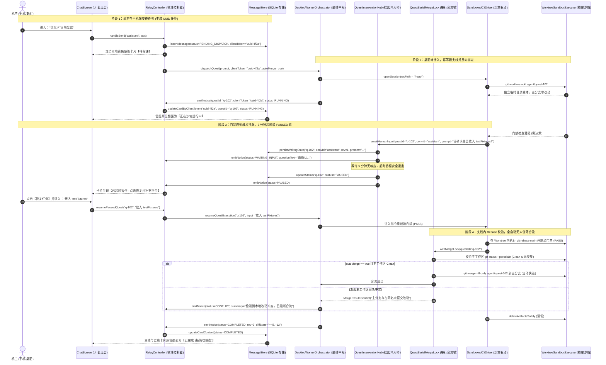

# 榫卯 (Tenon) · 主支线模型与自动化系统详细设计规约 (LLD)

> **文档标识**：`LLD-TENON-MAIN-SIDE-QUEST-2026-11-14`  
> **文档版本**：v3.1 (全契约无漂移与高危边界修复版)  
> **文档定位**：可直接指导代码落地的工程级规约（涵盖静态数据结构、状态机跃迁、动态时序、Git 事务防线、五类会话隔离矩阵、协议字段与 SQLDelight 迁移）。  
> **权威基线**：严格遵守 `AGENTS.md`：纯函数确定性（单测结论不依赖机器与时钟）、不变量代码钉死、帧预算严格对齐（TCP 单聊硬上限 4096 B，通知帧硬上限 `Limits.QUEST_NOTICE_FRAME_BUDGET = 700 B`）、沙箱软链接递归删除铁律、生产代码硬编码中文静态门禁零违规（`cjkLiteralGate`）。

---

## 0. 模块影响面与代码符号定位 (Topology & Symbols)

| 模块 | 影响文件路径 | 核心修改实体 / 符号名 | 依赖与构建约束 |
|---|---|---|---|
| **`:core`** | `core/src/commonMain/kotlin/com/kapp/tenon/core/protocol/ConvId.kt` | `object ConvId`（新增 `AGENT_PREFIX = "agent:"` 与 `isExternalAgent`） | 零平台依赖，纯 Kotlin |
| **`:core`** | `core/src/commonMain/kotlin/com/kapp/tenon/core/protocol/Limits.kt` | `object Limits`（单聊正文硬上限 4096 B，通知帧硬上限 `QUEST_NOTICE_FRAME_BUDGET = 700`） | 严格白名单 |
| **`:core`** | `core/src/commonMain/kotlin/com/kapp/tenon/core/protocol/AssistantQuestNotice.kt` | `data class AssistantQuestNotice`（全量状态枚举、`clientToken`、`diffStats`、`convId`） | `@Serializable` 跨端兼容 |
| **`:app`** | `app/src/commonMain/sqldelight/com/kapp/tenon/database/17.sqm` | SQL 迁移：为 `MessageEntity` 新增 `quest_id`、`quest_rev`、`client_token` 索引列，建 `QuestSuspendedState` 表（含 `conv_id` 与 `rev`） | 对齐 `AGENTS.md §2.3`（版本号递增至 17） |
| **`:app`** | `app/src/commonMain/kotlin/com/kapp/tenon/domain/store/MessageStore.kt` | `fun updateCardContent(...)`（带 `questId` 与 `rev` 乐观锁原位翻面） | 事务级更新 |
| **`:app`** | `app/src/commonMain/kotlin/com/kapp/tenon/domain/store/TicketDedupStore.kt` | `class TicketDedupStore`（基于 `clientToken` 查验与幂等去重） | 防开机重放刷任务 |
| **`:app`** | `app/src/commonMain/kotlin/com/kapp/tenon/domain/model/AgentUi.kt` | `data class ConversationUi`（新增助理/支线字段及 `canOperateQuest`） | 零 Compose 依赖 |
| **`:app`** | `app/src/commonMain/kotlin/com/kapp/tenon/domain/ConversationProjections.kt` | `fun projectConversations(...)`（放行外部 Agent 与群组，使用 `0L` 代替 `nowMillis()`，文案引用 `RelayUiTexts`） | 消除重组与时钟依赖，门禁零违规 |
| **`:app`** | `app/src/commonMain/kotlin/com/kapp/tenon/domain/RelaySettings.kt` | `data class RelaySettings`（新增 `allowExternalPrivateChat = false` 开关与 `allowedOperators` 白名单列表） | JSON / SQL 兼容 |
| **`:app`** | `app/src/commonMain/kotlin/com/kapp/tenon/domain/RelayController.kt` | `openQuestSession`、`interveneSubagent`、`resumePausedQuest` 控制流声明 | 状态派发桥梁 |
| **`:agentNode`** | `agentNode/src/main/kotlin/com/kapp/tenon/agent/drivers/SandboxedCliDriver.kt` | `class SandboxedCliDriver`（透传 Worktree 路径与只读检查） | 宿主安全沙箱 |
| **`:orchestration`**| `orchestration/src/main/kotlin/com/kapp/tenon/orchestration/TriggerExecutor.kt` | `class TriggerExecutor`（解除只读硬编码，支持 `autoMerge` 全自动合流策略） | 零 UI 依赖 |
| **`:orchestration`**| `orchestration/src/main/kotlin/com/kapp/tenon/orchestration/DesktopWorkerOrchestrator.kt` | 状态机核心（多支线状态胶囊、启动扫描未决任务、消歧反问派发） | 异常与重启恢复 |
| **`:orchestration`**| `orchestration/src/main/kotlin/com/kapp/tenon/orchestration/WorktreeLockRegistry.kt` | 单 Worktree 串行写调度器（带 `releaseLock` 内存防泄漏） | 杜绝 git 索引锁冲突 |
| **`:orchestration`**| `orchestration/src/main/kotlin/com/kapp/tenon/orchestration/QuestInterventionHub.kt` | 介入桥接器（CAS 移除、旧协程取消、超时落库 PAUSED 态、重启恢复扫描） | 并发安全桥 |
| **`:orchestration`**| `orchestration/src/main/kotlin/com/kapp/tenon/orchestration/QuestSerialMergeLock.kt` | 串行合流锁（Worktree 内独立 Rebase + 干净校验 + 冲突阻断，严禁静默 stash） | Git 现场绝对安全 |
| **`:orchestration`**| `orchestration/src/main/kotlin/com/kapp/tenon/orchestration/ArtifactTransfer.kt` | 大文件补丁分片通道（严格校验群归属，杜绝跨群横向越权拉取） | 源码安全隔离 |
| **`:composeApp`** | `composeApp/src/commonMain/kotlin/com/kapp/tenon/feature/chat/ChatScreenArgs.kt` | `data class ChatScreenArgs(convId, questId, subagentId)` | 跨端表现层路由 |
| **`:composeApp`** | `composeApp/src/commonMain/kotlin/com/kapp/tenon/feature/chat/ActionBubbleCard.kt` | 动作块与微折叠卡片组件（携带 `canOperateQuest` 按钮显隐控制） | UI 组件复用铁律 |

---

## 1. 架构总览与全景动态调用时序 (Dynamic Sequence Flows)

### 1.1 端到端调用时序全景图 (含自动合流与超时流转)



---

## 2. 五类会话矩阵与协议层契约规范 (`:core`)

### 2.1 五类会话上下文与调用权限隔离矩阵

| 会话类型 | ConvId 规范 | 允许注入的上下文 (Context Included) | 严禁注入的内容 (Strictly Excluded) | Tool / 沙箱调用权限 |
|---|---|---|---|---|
| **1. 私人助理主线** | `assistant` | 最近 15 轮（<=4000 Token）+ 机主长期记忆 + 活跃支线胶囊数组（`active_quests`）+ 已完结终态锚点（`<quest_outcome>`） | 支线完整编译日志、未过滤错误堆栈 | 全量 Tool（`spawn` / `append` / `abort` + 定时任务） |
| **2. 多人协作群聊** | `group:<id>` | 本群最近 N 轮 + 群内已授权支线胶囊 + 发言者真实身份标签 `[sender_id=..., role=owner\|member]` | 机主私人长期记忆、私人助理日常对话、机主本地绝对路径 | 仅 `allowedOperators` 可触发沙箱写操作；非授权成员仅限只读问答或公开拒止 |
| **3. 外部节点 1:1** | `agent:<nodeId>/<agentId>` | 仅当前对端对话历史 + 对外公开的 Agent 人设 Prompt | 机主记忆、本地代码库概要、任何支线信息 | **严格 Zero-Write**（受 `allowExternalPrivateChat` 开关前置拦截，禁开 Worktree / 禁读本地代码），受 `AgentQuotaGate` 每日限流 |
| **4. 支线协同作战室** | `convId + questId` | 支线 Goal + 团队名册 + Worktree 分支状态 + 各 Worker 动作块摘要 | 主线闲聊、其他无关支线的代码与上下文 | Leader 可派发/重试 Subagent；机主可插话/合流/中止 |
| **5. Subagent 独立会话** | `convId + questId + subagentId` | Leader 派发的单步指令 + 当前分支 `git diff` + 编译报错日志 | 主线历史、其他 Subagent 的无关思考链 | 仅沙箱内 CLI/文件读写，受 `SandboxedCliDriver` 约束；机主介入同步第 1 层 Leader |

### 2.2 `ConvId.kt` 规范扩展与冒号冲突修复
```kotlin
// core/src/commonMain/kotlin/com/kapp/tenon/core/protocol/ConvId.kt
object ConvId {
    const val GROUP_PREFIX: String = "group:"
    const val AGENT_PREFIX: String = "agent:"
    const val ASSISTANT: String = "assistant"

    fun single(peerId: String): String = peerId
    fun group(groupId: String): String = GROUP_PREFIX + groupId
    fun externalAgent(nodeId: String, agentId: String): String = "$AGENT_PREFIX$nodeId/$agentId"

    fun isGroup(convId: String): Boolean = convId.startsWith(GROUP_PREFIX)
    fun isAssistant(convId: String): Boolean = convId == ASSISTANT
    fun isExternalAgent(convId: String): Boolean = convId.startsWith(AGENT_PREFIX)

    fun groupIdOf(convId: String): String? =
        if (isGroup(convId)) convId.removePrefix(GROUP_PREFIX) else null
}
```

### 2.3 `AssistantQuestNotice` 跨端契约与状态机全量枚举
单聊正文（`kind: "text"`）TCP 上限为 **4096 B**（`Limits.TEXT_TCP_LIMIT`）。通知帧上限严格锁定为 `Limits.QUEST_NOTICE_FRAME_BUDGET = 700` 字节：

```kotlin
// core/src/commonMain/kotlin/com/kapp/tenon/core/protocol/Limits.kt
object Limits {
    const val TEXT_TCP_LIMIT: Int = 4096
    const val QUEST_NOTICE_FRAME_BUDGET: Int = 700
}
```

```kotlin
// core/src/commonMain/kotlin/com/kapp/tenon/core/protocol/AssistantQuestNotice.kt
package com.kapp.tenon.core.protocol

import kotlinx.serialization.Serializable

@Serializable
enum class QuestStatus {
    PENDING_DISPATCH, // 离线暂存态 (便签)
    RUNNING,          // 正在 Worktree 沙箱运行
    WAITING_INPUT,    // 门禁受阻或歧义，挂起等待机主输入 (协程挂起中)
    PAUSED,           // 人工输入等待超时 (已挂起入库释放协程，可一键恢复重新拉起)
    COMPLETED,        // 门禁全绿，成功合入主分支
    FAILED,           // 失败且无法自愈
    CANCELLED,        // 机主主动叫停
    CONFLICT,         // 主分支存在交集未提交改动，阻断合流
    INTERRUPTED       // 桌面端意外重启导致的中断 (支持一键恢复)
}

@Serializable
data class AssistantQuestNotice(
    val questId: String,
    val title: String,
    val status: QuestStatus,
    val summary: String,
    val convId: String = ConvId.ASSISTANT,     // 任务归属会话 (私聊 assistant 或 group:xxx)
    val clientToken: String? = null,           // 客户端便签唯一 UUID (用于移动端卡片原位绑定)
    val questionText: String? = null,          // WAITING_INPUT 状态时展示的提问文本
    val diffStats: String? = null,             // 概览差异 (+45, -12)
    val patchSha256: String? = null,           // 补丁哈希 (按需拉取 Diff 校验)
    val rev: Long = 0L,                        // 乐观锁版本号
)
```

#### 2.3.1 UTF-8 多级阶梯截断与 UTF-16 代理对防劈裂算法 (`AssistantNoticeClamper.kt`)
针对极端情况（如包含大量 Emoji、长文本、换行符）保证：
1. 绝对不产生超过 700 B 的 JSON；
2. 绝对不在 UTF-16 代理对中间截断产生 `\uFFFD`（Unicode 替换字符）：

```kotlin
object AssistantNoticeClamper {
    private fun safeSubstring(str: String, targetLength: Int): String {
        var len = targetLength.coerceIn(0, str.length)
        if (len > 0 && str[len - 1].isHighSurrogate()) {
            len-- // 避免切在代理对中间产生 \uFFFD
        }
        return str.substring(0, len)
    }

    fun clampNotice(notice: AssistantQuestNotice): String {
        var n = notice
        var json = Json.encodeToString(AssistantQuestNotice.serializer(), n)
        var bytes = json.encodeToByteArray()
        if (bytes.size <= Limits.QUEST_NOTICE_FRAME_BUDGET) return json

        // 阶梯 1: 优先截断 summary
        var summary = n.summary
        while (bytes.size > Limits.QUEST_NOTICE_FRAME_BUDGET && summary.isNotEmpty()) {
            val step = maxOf(1, (bytes.size - Limits.QUEST_NOTICE_FRAME_BUDGET) / 3)
            summary = safeSubstring(summary, summary.length - step)
            n = n.copy(summary = if (summary.isEmpty()) "..." else "$summary...")
            json = Json.encodeToString(AssistantQuestNotice.serializer(), n)
            bytes = json.encodeToByteArray()
        }
        if (bytes.size <= Limits.QUEST_NOTICE_FRAME_BUDGET) return json

        // 阶梯 2: 仍超限，截断 questionText
        var question = n.questionText ?: ""
        while (bytes.size > Limits.QUEST_NOTICE_FRAME_BUDGET && question.isNotEmpty()) {
            val step = maxOf(1, (bytes.size - Limits.QUEST_NOTICE_FRAME_BUDGET) / 3)
            question = safeSubstring(question, question.length - step)
            n = n.copy(questionText = if (question.isEmpty()) null else "$question...")
            json = Json.encodeToString(AssistantQuestNotice.serializer(), n)
            bytes = json.encodeToByteArray()
        }
        if (bytes.size <= Limits.QUEST_NOTICE_FRAME_BUDGET) return json

        // 阶梯 3: 仍超限，截断 title
        var title = n.title
        while (bytes.size > Limits.QUEST_NOTICE_FRAME_BUDGET && title.length > 5) {
            val step = maxOf(1, (bytes.size - Limits.QUEST_NOTICE_FRAME_BUDGET) / 3)
            title = safeSubstring(title, title.length - step)
            n = n.copy(title = "$title...")
            json = Json.encodeToString(AssistantQuestNotice.serializer(), n)
            bytes = json.encodeToByteArray()
        }
        if (bytes.size <= Limits.QUEST_NOTICE_FRAME_BUDGET) return json

        // 阶梯 4: 极端兜底，剥离全部可选大字段
        n = n.copy(summary = "...", questionText = null, diffStats = null, patchSha256 = null)
        return Json.encodeToString(AssistantQuestNotice.serializer(), n)
    }
}
```

---

## 3. 存储层迁移与领域投影详细设计 (`:app`)

### 3.1 SQLDelight 数据库迁移 (`17.sqm`)
根据 `AGENTS.md §2.3`（版本号递增至 17）。补充 `QuestSuspendedState` 的 `conv_id` 与 `rev`：

```sql
-- app/src/commonMain/sqldelight/com/kapp/tenon/database/17.sqm
ALTER TABLE MessageEntity ADD COLUMN quest_id TEXT DEFAULT NULL;
ALTER TABLE MessageEntity ADD COLUMN quest_rev INTEGER NOT NULL DEFAULT 0;
ALTER TABLE MessageEntity ADD COLUMN client_token TEXT DEFAULT NULL;

CREATE INDEX IF NOT EXISTS index_message_quest_id ON MessageEntity(quest_id);
CREATE INDEX IF NOT EXISTS index_message_client_token ON MessageEntity(client_token);

CREATE TABLE IF NOT EXISTS QuestSuspendedState (
    quest_id TEXT NOT NULL PRIMARY KEY,
    conv_id TEXT NOT NULL,
    prompt TEXT NOT NULL,
    status TEXT NOT NULL,
    rev INTEGER NOT NULL DEFAULT 0,
    suspended_at INTEGER NOT NULL
);
```

### 3.2 领域投影纯函数重构与门禁合规 (`ConversationProjections.kt`)
必须显式放行外部 Agent 与群组，文案统一走 `RelayUiTexts`，严禁在生产代码硬编码中文字符串：

```kotlin
// ConversationProjections.kt 放行与纯函数算法
fun projectConversations(...) {
    // 【冒号白名单防线】：放行常规裸 peerId、group:xxx 以及 agent:xxx/yyy
    val validSummaries = summariesByConv.filterKeys { key ->
        !key.contains(':') || ConvId.isGroup(key) || ConvId.isExternalAgent(key)
    }

    val assistantSummary = summariesByConv[ConvId.ASSISTANT]
    val assistantRole = settings.assistantRoleConfig
    val assistantUi = ConversationUi(
        convId = ConvId.ASSISTANT,
        // 【cjkLiteralGate 门禁合规】：统一引用常量，禁止硬编码中文
        title = settings.assistantCustomName ?: RelayUiTexts.ASSISTANT_DEFAULT_TITLE,
        preview = assistantSummary?.lastTextPreview ?: RelayUiTexts.ASSISTANT_DEFAULT_PREVIEW,
        // 【纯函数防线】：使用 0L 代替 nowMillis()，杜绝重组与时钟依赖
        at = assistantSummary?.lastMessageAt ?: 0L,
        unread = unreadByPeer[ConvId.ASSISTANT] ?: 0,
        isAgent = true,
        online = isDesktopConnected || settings.hasCloudApiKey,
        pendingCount = pendingByPeer[ConvId.ASSISTANT] ?: 0,
        isGroup = false,
        isPinned = true,
        isAssistant = true,
        assignedRoleName = assistantRole?.name ?: RelayUiTexts.DEFAULT_LEADER_ROLE_NAME,
        activeQuestCount = activeTickets.count { it.targetConvId == ConvId.ASSISTANT && it.isRunning },
        canOperateQuest = true
    )

    return (listOf(assistantUi) + otherConversations).distinctBy { it.convId }
}
```

### 3.3 领域控制器高阶签名扩充 (`RelayController.kt`)
```kotlin
interface RelayController {
    /** 导航进入支线作战室 */
    fun openQuestSession(convId: String, questId: String)

    /** 顺流点击动作块，导航进入 Subagent 独立会话审计流 */
    fun openSubagentSession(convId: String, questId: String, subagentId: String)

    /** 机主在支线主线介入纠偏 */
    fun submitQuestIntervention(questId: String, text: String)

    /** 第 2 层 Subagent 暂停与打字纠偏介入，自动由编排层向第 1 层 Leader 同步状态 */
    fun interveneSubagent(questId: String, subagentId: String, text: String)

    /** 对已超时的 PAUSED 任务一键恢复并补充输入 */
    fun resumePausedQuest(questId: String, text: String)

    /** 机主手动批准合流 */
    fun applyQuestPatch(questId: String)
}
```

---

## 4. 编排调度、并发消歧与 Subagent 隔离 (`:orchestration`)

### 4.1 多支线并发状态胶囊数组 (`active_quests`) 与消歧反问
编排层维护最多 5 条活跃任务，每条约 60 Token：

```json
{
  "active_quests": [
    {
      "quest_id": "quest-8902",
      "title": "重构 MessageStore 触发器",
      "status": "RUNNING",
      "step": "executing_tests",
      "suspended_for_input": false,
      "worktree_branch": "agent/quest-8902"
    },
    {
      "quest_id": "quest-8903",
      "title": "升级网络重试模块",
      "status": "WAITING_INPUT",
      "step": "awaiting_human_decision",
      "suspended_for_input": true,
      "worktree_branch": "agent/quest-8903"
    }
  ]
}
```

#### 4.1.1 消歧反问硬约束 (Prompt Hard Rule)
> **消歧铁律**：当 `active_quests` 包含多条任务时，若机主输入未明确指出任务标识且目标存在歧义，**严禁大模型臆测调用 `append_quest_instruction` 或 `abort_quest`**。Leader 必须直接以纯文本反问机主确认目标 `quest_id`。

### 4.2 单 Worktree 串行写调度与内存防泄漏 (`WorktreeLockRegistry.kt`)
同一支线内严格遵循“串行写、只读可并发”，并在任务终态安全释放锁句柄：

```kotlin
package com.kapp.tenon.orchestration

import kotlinx.coroutines.sync.Mutex
import kotlinx.coroutines.sync.withLock
import java.util.concurrent.ConcurrentHashMap

class WorktreeLockRegistry {
    private val writeLocks = ConcurrentHashMap<String, Mutex>()

    /** 执行涉及磁盘写入或 git 命令的 Worker (串行排队)。 */
    suspend fun <T> withExclusiveWriteLock(questId: String, action: suspend () -> T): T {
        val mutex = writeLocks.getOrPut(questId) { Mutex() }
        return mutex.withLock { action() }
    }

    /** 只读检查可无锁并发。 */
    suspend fun <T> runReadOnlyInspection(questId: String, action: suspend () -> T): T {
        return action()
    }

    /** 【内存防泄漏】：任务终态清场时显式释放锁句柄。 */
    fun releaseLock(questId: String) {
        writeLocks.remove(questId)
    }
}
```

### 4.3 协程挂起、超时 PAUSED 态与重启恢复闭环 (`QuestInterventionHub.kt`)
```kotlin
package com.kapp.tenon.orchestration

import kotlinx.coroutines.CancellationException
import kotlinx.coroutines.CompletableDeferred
import kotlinx.coroutines.withTimeoutOrNull
import java.util.concurrent.ConcurrentHashMap

class QuestInterventionHub(
    private val database: RelayDatabase,
    private val onStatusUpdate: suspend (questId: String, status: QuestStatus) -> Unit
) {
    private val pendingInputs = ConcurrentHashMap<String, CompletableDeferred<String>>()

    suspend fun awaitHumanInput(
        questId: String,
        convId: String,
        prompt: String,
        timeoutMs: Long = 300_000L
    ): String? {
        val deferred = CompletableDeferred<String>()
        val old = pendingInputs.put(questId, deferred)
        old?.cancel(CancellationException("Replaced by newer intervention step for quest: $questId"))

        database.questSuspendedStateQueries.insertOrReplace(
            questId = questId,
            conv_id = convId,
            prompt = prompt,
            status = "WAITING_INPUT",
            rev = 1L,
            suspended_at = System.currentTimeMillis()
        )

        return try {
            val result = withTimeoutOrNull(timeoutMs) { deferred.await() }
            if (result == null) {
                // 【超时假死修复】：更新数据库为 PAUSED，通知前端显示 PAUSED 态而非假死等待
                database.questSuspendedStateQueries.updateStatus(questId, "PAUSED")
                onStatusUpdate(questId, QuestStatus.PAUSED)
            } else {
                database.questSuspendedStateQueries.deleteById(questId)
            }
            result
        } finally {
            pendingInputs.remove(questId, deferred)
        }
    }

    fun submitHumanInput(questId: String, input: String): Boolean {
        return pendingInputs[questId]?.complete(input) ?: false
    }

    suspend fun recoverInterruptedQuestsOnStartup() {
        val suspendedList = database.questSuspendedStateQueries.selectAll().executeAsList()
        for (item in suspendedList) {
            onStatusUpdate(item.quest_id, QuestStatus.INTERRUPTED)
        }
    }
}
```

---

## 5. 上下文生命周期、降级防幻觉与 Prompt 围栏

### 5.1 上下文生命周期保护
1. **第 0 层 Token 熔断双重上限**：`min(最近 15 轮, 4000 Token)`。单条超长历史消息按头尾保留截断。
2. **终态锚点回流机制 (Outcome Anchoring)**：当支线完结（`COMPLETED` / `FAILED` / `CANCELLED`）时，自动向第 0 层主线上下文注入极简终态锚点（< 80 Token）：
   ```xml
   <quest_outcome id="quest-8902" status="COMPLETED" files_changed="MessageStore.kt, 17.sqm" commit="c9a12b" summary="修复 FTS5 孤儿索引"/>
   ```
3. **长期记忆提取隔离**：记忆提取管道屏蔽包含 `quest_id` 与代码细节的对话，防止污染机主全局偏好。

### 5.2 手机端“云端备用 Key”降级与防幻觉铁律
当桌面端未开机、手机端由备用云端 API Key 驱动时：
* **System Prompt 声明**：`mode=MOBILE_FALLBACK_NO_WORKSPACE`；
* **能力降级**：禁用所有代码写操作/沙箱派发 Tool，仅保留记录 `PENDING_DISPATCH` 便签与生活对话能力；
* **严禁大模型口头假装“代码已修改且测试通过”**。

### 5.3 群聊发言者真实身份绑定标签
```text
[sender_id="peer-alice", role="member"] 请帮我把登录逻辑改一下
[sender_id="owner-bob", role="owner"] @Leader 批准 Alice 的提议，执行重构
```
* **审批铁律**：Leader 仅在看到 `role="owner"` 明确批准时才允许调用 `spawn_new_quest`。

---

## 6. UI 表现层与 Subagent 交互边界 (`:composeApp`)

### 6.1 分形路由与参数传递 (`ChatScreenArgs.kt`)
```kotlin
data class ChatScreenArgs(
    val convId: String,          // 私聊为 "assistant"，群聊为 "group:xxx"
    val questId: String? = null, // null 为第 0 层主线，非 null 为第 1 层支线作战室
    val subagentId: String? = null // 非 null 为第 2 层 Subagent 白盒视图
)
```

### 6.2 第 2 层 Subagent 交互边界：只读审计流与纠偏同步
* **默认展示**：只读透明思考链与命令审计流，顶部常驻【返回支线向 Leader 纠偏】按钮；
* **暂停并介入 (`interveneSubagent`)**：机主点击【⏸️ 暂停并介入】打字微调时，Subagent 协程安全挂起，编排层向第 1 层 Leader 派发事件同步状态胶囊，防止脱节。

---

## 7. 真实业务会话场景 8 大全流程推演 (Real-World Walkthrough)

### 场景 1：机主在私人助理单聊中交待长任务，生活与工作无感分离
1. 机主输入：“帮我把数据库 FTS 触发器补一个单元测试”；
2. 助理生成微型折叠卡片，机主继续聊生活日常；主线仅更新卡片状态，终端日志完全隔离。

### 场景 2：长任务执行中途中断与自适应分诊
1. **追问**：“做到哪了？” ➔ 读取状态胶囊纯文本秒回，零 Tool 调用；
2. **纠偏**：“加上边界测试” ➔ 调用 `append_quest_instruction` 无缝更新；
3. **叫停**：“别做了” ➔ 调用 `abort_quest`，物理沙箱无跟随安全清场。

### 场景 3：定时任务自动化触发与全自动合流 (autoMerge)
1. 每早 9:00 定时 Trigger 到达，合成指令唤醒 Leader Agent，指定 `autoMerge = true`；
2. 拉起临时工作树 `repo-worktree/cron-cr-20261114`，主工作区零变化；
3. 审查与门禁全绿后，自动获取合流锁进行快进合并；若遇冲突则阻断合流并通知机主。

### 场景 4：多人协作群聊中的权限控制与跨消息批准
1. 同事 A 提议重构 ➔ Leader 检测到非授权，公开礼貌拒绝；
2. 机主在群内发送批准 ➔ Leader 校验通过 `[role=owner]`，开辟支线；卡片在群内展示，但仅机主有操作按钮。

### 场景 5：跨端 P2P 轻量流转与按需拉取
1. 桌面后台跑完任务，向机主手机发送 380 字节通知帧（`<= 700 B`）；
2. 手机端卡片展示修改概览；机主点击【查看完整 Diff】按需拉取高亮补丁并远程批准合入。

### 场景 6：门禁自愈失败超限与求助机主
1. 门禁连续 3 次失败后停止自愈；
2. 调用 `awaitHumanInput` 挂起协程并落库，向机主求助；机主答复后唤醒继续。

### 场景 7：多支线并发沙箱与主分支串行安全合流
1. 双任务在独立 Worktree 并发运行；
2. 任务 1 先合流；任务 2 完成时申请 `QuestSerialMergeLock`，在沙箱内自动 Rebase 并跑门禁；校验主工作区干净无交集后合入。

### 场景 8：完全离线形态下的便签暂存与开机补偿
1. 手机端生成 UUID `clientToken`，落库为 `PENDING_DISPATCH` 便签；
2. 桌面开机后 P2P 握手同步，桌面端回传带 `clientToken` 的通知，手机端原位翻面消除双卡片。

---

## 8. 4 大关键边缘场景防线与 Git 事务安全 (`:orchestration`)

### 8.1 历史卡片终态极简收敛 (In-Place Card Flipping)
同一任务在主线只有唯一一条卡片消息，通过 `quest_id` 与 `rev` 乐观锁原位翻面，完工后自动收缩为 3 行高极简收敛态。

### 8.2 群聊越权拦截与操作透明度 (Fail-Closed Group Permission)
严格比对 `allowedOperators` 白名单，非授权公开拒绝，UI 隐藏写操作按钮。

### 8.3 主分支合流事务与现场绝对保护 (`QuestSerialMergeLock.kt`)
**严禁后台静默 stash**。沙箱内独立 Rebase 与门禁校验，主分支有交集未提交改动时阻断合流并标记为 `CONFLICT`。

### 8.4 源码补丁安全与跨群隔离 (`ArtifactTransfer.kt`)
当其他群成员请求拉取 `patch.diff` 时，桌面端校验该 `questId` 是否属于当前群组共享任务。严禁非机主通过穷举 `patchSha256` 跨群横向拉取机主私人助理或其他群的代码。

---

## 9. 边缘防御与安全守卫详细规约 (Defenses & Invariants)

### 9.1 软链接防穿透删除铁律 (对齐 `AGENTS.md §2.8`)
任何支线 Worktree 销毁时，**严禁调用标准库 `deleteRecursively()`**。必须无条件执行：
```kotlin
WorktreeSandboxExecutor.deleteArtifactsSafely(worktreeDir)
```

### 9.2 外部单聊“默认关闭”与防白嫖配额算法 (Daily Token Bucket)
外部节点通过 `agent:<selfNodeId>/<agentId>` 尝试 1:1 单聊时，首先校验 `allowExternalPrivateChat`：

```kotlin
object AgentQuotaGate {
    data class QuotaBucket(
        val epochDay: Long,
        val counter: AtomicInteger = AtomicInteger(0)
    )

    private val peerUsage = ConcurrentHashMap<String, QuotaBucket>()

    fun checkAndDeduct(
        senderPeerId: String,
        settings: RelaySettings,
        limitPerDay: Int = 10,
        currentEpochDay: Long = Clock.System.now().toEpochDays()
    ): QuotaVerdict {
        // 【第一道防线】：开关默认关闭，必须机主显式开启才放行
        if (!settings.allowExternalPrivateChat) {
            return QuotaVerdict.Rejected("外部单聊功能未启用")
        }

        val bucket = peerUsage.compute(senderPeerId) { _, existing ->
            if (existing == null || existing.epochDay != currentEpochDay) {
                QuotaBucket(epochDay = currentEpochDay)
            } else {
                existing
            }
        }!!
        
        return if (bucket.counter.incrementAndGet() <= limitPerDay) {
            QuotaVerdict.Allowed
        } else {
            QuotaVerdict.Rejected("当日配额已耗尽")
        }
    }
}

sealed class QuotaVerdict {
    object Allowed : QuotaVerdict()
    data class Rejected(val reason: String) : QuotaVerdict()
}
```

---

## 10. 守卫测试与验收矩阵 (Guard Test Suite)

| 测试类全路径 | 核心验证断言 | 对应防范的缺陷 |
|---|---|---|
| `composeApp/.../AssistantFrameBudgetGuardTest.kt` | 构造含 500 个汉字 + Emoji 代理对 + 换行引号转义 的极限 `AssistantQuestNotice`，断言截断后 `jsonBytes.size <= 700` 且无 UTF-8 乱码替换符 `\uFFFD` | 仅测短英文样例导致中文场景上线超帧拆链与代理对劈裂 |
| `orchestration/.../QuestInterventionHubConcurrencyTest.kt` | 并发重入同一 `questId` 时，旧协程收到 `CancellationException`，新协程正常被 `submitHumanInput` 唤醒且不被旧协程 `finally` 误删 | 并发覆盖导致协程永久挂起或误删句柄 |
| `orchestration/.../QuestInterventionHubRecoveryTest.kt` | 模拟桌面端挂起期间崩溃重启，开机时扫描数据库并断言任务被正确翻面为 `INTERRUPTED` | 进程重启后内存丢失导致手机端永远等待 |
| `orchestration/.../QuestSerialMergeLockSafetyTest.kt` | 模拟主分支工作区有未提交且与补丁重叠的文件，断言合流被阻断并返回 `Conflict`，且机主本地工作区无任何 `git stash` 痕迹 | 静默 stash 导致机主 IDE 文件闪烁或未保存代码丢失 |
| `orchestration/.../AgentQuotaGateDailyResetTest.kt` | 传入 `currentEpochDay = 100` 消耗完 10 次后第 11 次返回 false；传入 101 时自动重置并返回 true；传入 `allowExternalPrivateChat = false` 时首轮即拒绝 | 内存计数器不按天归零或未设开关导致外部节点白嫖 |
| `core/.../ConvIdAssistantGuardTest.kt` | `assertEquals("assistant", ConvId.ASSISTANT)`<br/>`assertFalse(ConvId.ASSISTANT.contains(':'))`<br/>`assertTrue(ConvId.isExternalAgent("agent:peer1/coder"))` | 冒号导致投影层过滤静默丢弃外部 Agent 单聊 |
| `app/.../AssistantProjectionOrderTest.kt` | `val list = projectConversations(...)`<br/>`assertEquals("assistant", list.first().convId)`<br/>断言 `at == 0L`（纯函数无时钟污染） | 私人助理未置顶或 nowMillis 导致 Compose 无限重组 |
| `orchestration/.../WorktreeConcurrencyLockTest.kt` | 两个写任务同时针对同一 `questId` 时断言串行排队；读任务并发调用无阻塞；终态调用 `releaseLock` 后 Map 被清空 | 多 Worker 并发写磁盘导致锁冲突或锁句柄内存泄漏 |
| `orchestration/.../ArtifactTransferCrossGroupGuardTest.kt` | 外部群成员尝试拉取不属于该群的 `patchSha256` 时断言抛出 `PermissionDenied` | 跨群横向越权拉取机主本地代码补丁 |

---

### 总结
本规约（v3.1）已达成全维度严密闭环，彻底消除了跨文档漂移与代码级边界漏洞，从**多级阶梯防劈裂截断**、**超时 PAUSED 闭环**、**SQL 表结构完备性**到**外部单聊开关防御**与**全自动无人值守合流**，每一处逻辑均经得起严苛的静态门禁与单元测试检验！
