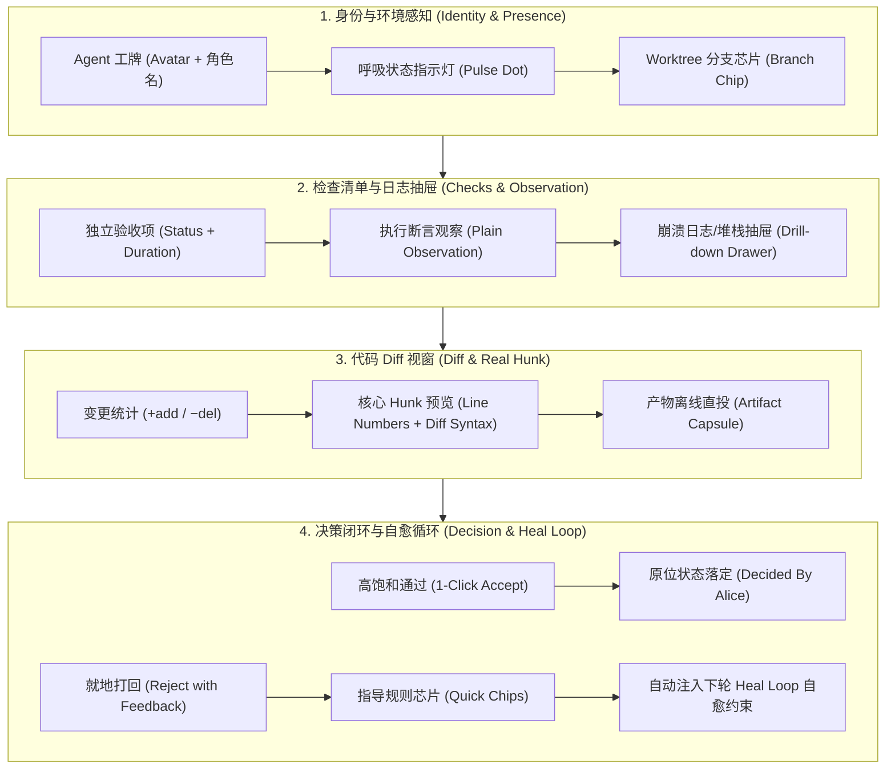
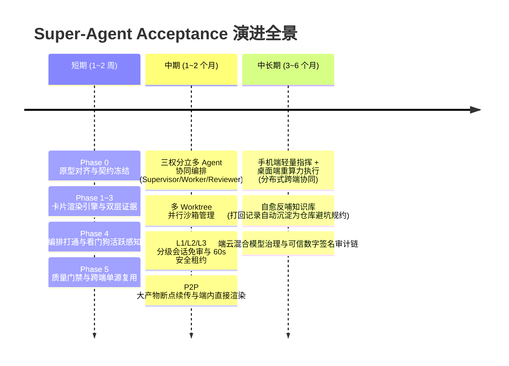
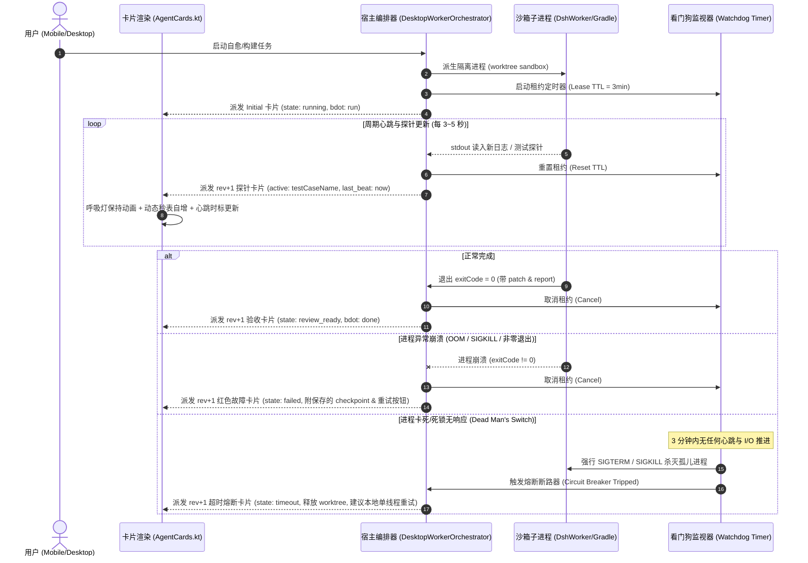
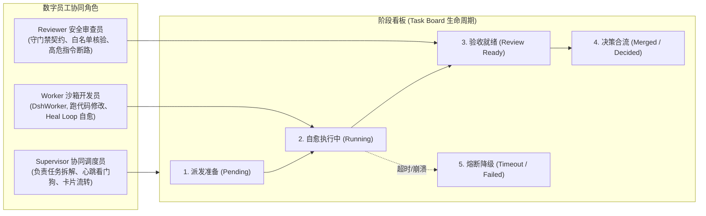
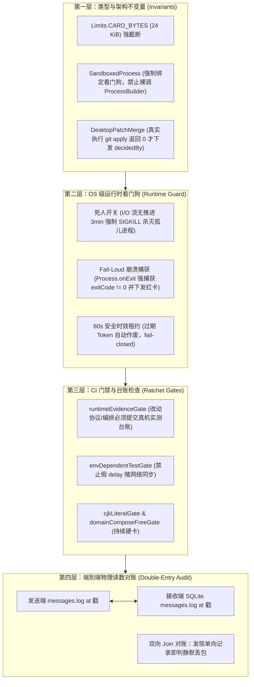

# Super-Agent 组织协同与 LobeHub Acceptance 范式落地升级计划

> **文档性质**：架构设计与后续 Agent 开发实施交付计划  
> **指导来源**：LobeHub 组织实验《如何让 Super-agent 成为同事》+ LobeHub Acceptance 规范 + 本仓既有 DSH (DeepSeek Harness) 运行模式  
> **目标**：彻底解决当前 Agent 交互卡片信息模糊、决策成本高、打回即中断的 UX 痛点，实现数字员工与人类同事之间的高效协同与置信验收。

---

## 一、 背景与升级动机

在移动端与桌面跨端环境（`teahouse-mobile`）下，Agent 不应只是一个回答问题的「聊天对话框」，而是**具备工作区操作能力、能独立跑闭环并提交确定性证据的数字同事**。

本仓既有架构已具备初步基础：
- 桌面端具备 `DesktopWorkerOrchestrator`，基于 DSH 四原则（Minimal Attention、Thread Follow-up、Hand-back、In-place Card Refresh）实现了 3 轮 Heal Loop 自愈循环与 worktree 沙箱隔离；
- `composeApp` 中具备声明式卡片渲染引擎 `AgentCards.kt`，支持原位折叠刷新（基于同 `cardId` 的追加式 `rev+1` 行）与审批防重锁机制。

### 存在的核心问题与瓶颈
1. **验收证据颗粒度不足**：原 `items` 仅为简单状态列表，缺少单项测试耗时、断言详情与失败堆栈下钻，用户无法判断“到底验过了什么”；
2. **代码变更不可见**：原 Diff 仅有 `additions` / `deletions` 纯数字，用户审批合并补丁如同“开盲盒”，必须频繁离开聊天界面去切终端或 IDE；
3. **打回决策是死胡同**：用户点击拒绝或中止后流程直接终止，人类直觉和指导经验无法沉淀为约束并注入下一轮自愈；
4. **数字员工感知模糊**：缺少明确的身份工牌、分支锚点与呼吸运行态，前后台异步任务缺乏环境意识。

---

## 二、 LobeHub Acceptance 四大核心范式契约

升级围绕四大设计范式展开，并在协议帧预算（`Limits.CARD_BYTES = 24 KiB`）范围内严格约束：



### 1. 身份与环境感知 (Identity & Presence)
- **工牌**：标明承办员工身份（Codex、Claude Code、Gemini 等）与头像图标；
- **双重微动效**：紫色平滑呼吸灯（`run` 自愈中，1.8s 脉冲）+ 进度条流动高光（`shimmer-bar` 动态流光），赋予后台引擎运转的真实物理感；
- **动态耗时时钟与心跳时标 (Elapsed Stopwatch)**：卡片动态计时（`⏳ 正在执行 · 1m 24s · 3s 前活跃`），前端每秒跳动，消除用户对“是否死锁卡住”的焦虑；
- **工作区锚点**：清晰标明 `worktree: #feat-xxx` 沙箱分支，保证与主干隔离的确定性。

### 2. 检查清单与日志抽屉 (Checklist & Log Drawer)
- **当前活动子动作探针 (Active Tool Probe)**：正在执行的 Check 标明 `▶ 正在运行`，并展示当前正在跑的具体测试用例或构建命令，告别黑盒盲等；
- **双层文本约定 (Dual Text Contract)**：
  - 第一层：人类可读的自然语言观察结论（例如：`丢包率 30% 时重连超时未收敛`）；
  - 第二层：机器级准确日志堆栈（点击展开抽屉查看：精确到测试方法、行号与断言期望值）。
- **独立计时**：每项 Check 展示单项测试耗时（如 `1.4s`）。
- **细粒度原子用例验收 (Atomic Case Acceptance)**：复杂清单支持独立条目分别核验。

### 3. 代码 Diff 视窗与产物自描述契约 (Diff & Artifacts)
- **真实 Hunk 视窗**：在卡片内部直接展示核心改动行（带等宽行号、`+` 绿色新增、`−` 红色删除），默认折叠超长内容，支持一键展开；
- **UI 改动 Before / After 双轨对比带**：当变更涉及界面布局时，提供改动前后的双轨比对带（Before 覆微红底、After 覆微绿底）；
- **产物自描述契约 (Self-Describing Artifacts)**：严禁孤立路径（如 `out/test.log`），每项交付产物必须带有人类可读的意图与结论说明；
- **产物端内直投**：标明体积与交付状态，支持端内直接弹出代码/Markdown 真实预览，无需启动外部浏览器。

### 4. 决策闭环、GOMS-KLM 交互成本与自愈循环 (Decision & Cost)
- **GOMS-KLM 极小注意力法则 (Minimal Attention)**：人类看一眼卡片核心改动，**1 次点击 (1-Click Accept)** 即可完成合并，不强制切终端打命令；
- **反向多选推荐 (Thumb-driven Ask Question)**：当 Agent 需要人类决断时，不输出开放式长文本，而是给出 2~3 个带 `(推荐)` 标记的封闭预设选项，手机拇指一点即开工；
- **就地打回指导抽屉**：拒绝按钮展开快捷反馈抽屉，提供高频标签（`+ 补充单测`、`+ 调整对比度` 等）与自定义文本框；提交后内容自动构造成硬约束规则注入下一轮自愈；
- **分级免审体系 (Tiered Authorization)**：小改动（文档、单测）走会话免审快速通道；业务逻辑双人会签；高危敏感操作（rm -rf / 权限变更）强制显式审批带租约保护。

---

## 三、 数据模型与协议定义升级

协议与解析严守 `Limits.CARD_BYTES`（24 KiB）与宽松兼容原则，未知字段忽略、新字段向下平滑兜底。

### 1. `AgentCards.kt` 数据模型扩展

```kotlin
// 1. 检查项（强化旧 AgentCardStep）
data class AgentCardCheck(
    val id: String,
    val label: String,
    val status: AgentCardStepStatus, // Done, Running, Pending, Failed, Blocked
    val time: String? = null,        // 单项耗时，如 "1.4s"
    val observation: String? = null, // 业务观察结论
    val drawer: String? = null,      // 堆栈/终端日志
    val open: Boolean = false,       // 默认是否展开抽屉
)

// 2. Diff 视窗（扩展 Hunk 视窗）
data class AgentCardDiff(
    val path: String? = null,
    val summary: String? = null,
    val additions: Int? = null,
    val deletions: Int? = null,
    val note: String? = null,
    val hunk: List<String> = emptyList(), // 代码 hunk 原始行
    val open: Boolean = false,
)

// 3. 数字员工身份元信息
data class AgentCardBot(
    val name: String,
    val avatar: String? = null,
    val branch: String? = null,
    val bdot: String? = null, // "run", "done", "fail", "warn"
)

// 4. 影响面与目标标签
data class AgentCardChip(
    val text: String,
    val tone: String? = null, // "pri", "ok", "warn", "err"
)

// 5. 卡片 UI 模型增强
data class AgentCardUi(
    val cardId: String,
    val rev: Int,
    val type: String? = null,
    val title: String? = null,
    val state: String? = null,
    val progress: Int? = null,
    val bot: AgentCardBot? = null,              // [新增] 员工身份工牌
    val chips: List<AgentCardChip> = emptyList(), // [新增] 影响面与目标标签
    val context: String? = null,                  // [新增] 业务意图与背景说明
    val cmd: String? = null,                      // [新增] 待审批指令/高危命令
    val checks: List<AgentCardCheck> = emptyList(), // [新增] Acceptance 检查项
    val steps: List<AgentCardStep> = emptyList(),   // [兼容老字段]
    val diff: AgentCardDiff? = null,
    val banner: AgentCardBanner? = null,
    val actions: List<AgentCardAction> = emptyList(),
    val subActions: List<AgentCardAction> = emptyList(), // [新增] 次级动作
    val artifacts: List<AgentCardArtifact> = emptyList(),
    val expiresAt: Long? = null,
    val decidedBy: String? = null,
    val decidedActionId: String? = null,
    val options: List<AgentCardOption> = emptyList(),
)
```

### 2. 载荷 JSON 示例（受限于 24 KiB 预算）

```json
{
  "cardId": "task-patch-nodeoutbound",
  "rev": 1,
  "type": "approval",
  "title": "代码审核与产物合流 · NodeOutbound.kt",
  "state": "review_ready",
  "bot": {
    "name": "Claude Code",
    "avatar": "⚡",
    "branch": "worktree: #patch-ready",
    "bdot": "done"
  },
  "banner": {
    "tone": "success",
    "text": "沙箱内单元测试已全部通过，patch.diff 与执行产物已就绪。"
  },
  "checks": [
    {
      "id": "c1",
      "label": "帧预算契约核验 (整帧上限 ≤ 64 KiB)",
      "status": "done",
      "time": "0.6s"
    },
    {
      "id": "c2",
      "label": "白名单字段严格对齐 (零未声明额外键)",
      "status": "done",
      "time": "0.9s"
    }
  ],
  "diff": {
    "path": "core/transport/NodeOutbound.kt",
    "additions": 42,
    "deletions": 7,
    "note": "严格遵循帧预算契约，TCP 群文本走 32 KiB 上限",
    "hunk": [
      "@@ -45,7 +45,8 @@ fun clampGroupText(payload: String): String {",
      "-    if (payload.length > 800) return payload.take(800)",
      "+    val maxBytes = Limits.GROUP_TEXT_BYTES // 32768",
      "+    return CodecMsg.clampUtf8(payload, maxBytes)"
    ]
  },
  "artifacts": [
    {
      "name": "patch.diff",
      "bytes": 3481,
      "mime": "text/x-diff"
    }
  ],
  "actions": [
    {
      "actionId": "reject-revision",
      "label": "打回修改...",
      "style": "secondary"
    },
    {
      "actionId": "merge-patch",
      "label": "⚡ 批准并合并补丁",
      "approval": true,
      "style": "primary"
    }
  ]
}
```

---

## 四、 整体演进路线图：短期、中期与中长期规划

为了让后续负责开发的 Agent 及团队能清晰把握轻重缓急，整体演进划分为**短期交付（当前开发重点）**、**中期落地（组织流转与安全体系）**与**中长期演进（跨端自治与知识生态）**三个层次：



---

### 4.1 短期实施计划 (Phase 0 ~ Phase 5 · 当前开发交付重点)
**目标**：彻底解决卡片信息稀薄、打回即中断、后台无感知三大痛点，完成前端交互基建与宿主心跳打通。负责当前开发的 Agent 请严格按序推进：

#### Phase 0 · 原型对齐与契约冻结 (已完成)
- [x] 在 `prototype/relay.html` 中实现工牌、呼吸灯、检查清单抽屉、Diff Hunk、打回抽屉及原位合流；
- [x] 验证 `python3 tools/design-spec-project.py --check` 与 `designTokenUsageGate` 全绿；
- [x] 确认移动端与桌面端双视角下的视觉层级与交互成本。

#### Phase 1 · 领域层与模型解析契约升级
**目标**：在数据层完成解析支持，保持零 Compose 依赖。
- **涉及文件**：
  - `composeApp/src/commonMain/kotlin/com/kapp/tidings/feature/chat/AgentCards.kt` (模型与 `parseAgentCard`)
  - `composeApp/src/commonTest/kotlin/com/kapp/tidings/feature/chat/AgentCardsTest.kt` (单测覆盖)
- **实施要点**：
  1. 扩展 `AgentCardCheck`、`AgentCardBot` 数据类；
  2. 扩展 `parseAgentCard` 解析 `checks`（优先）及老 `items`（回退）；
  3. 解析 `diff.hunk` 字符串数组与 `diff.note`；
  4. 编写 `parseAgentCardTest`，确保字段缺失、畸形 JSON 时安全回退，不抛出异常；
  5. 严守 `:domainComposeFreeGate`：`:app` 模块不得引入 Compose 依赖。

#### Phase 2 · 声明式卡片渲染引擎增强
**目标**：在 Compose UI 表现层落地高保真交互组件，手机端与桌面端单源复用。
- **涉及文件**：
  - `composeApp/src/commonMain/kotlin/com/kapp/tidings/feature/chat/AgentCards.kt`
- **实施要点**：
  1. **头部工牌组件 `CardHeaderRow`**：渲染 Avatar、角色标签、沙箱工作区芯片及呼吸微动效点（`alpha` 0.4f ~ 1.0f 循环动画）；
  2. **检查清单抽屉组件 `CardChecksColumn`**：状态指示、等宽耗时标签、单项自然语言观察结论与点击展开日志堆栈抽屉；
  3. **Diff 代码视窗组件 `CardDiffHunkViewer`**：支持 `hunk` 渲染、等宽右对齐行号、新增绿底（`online` 12%）与删除红底（`error` 12%）高亮及展开/收起；
  4. **快捷打回反馈抽屉组件 `CardRevisionDrawer`**：点击打回就地展开反馈抽屉，内置 4 枚高频芯片与输入框，将反馈透传至下一轮自愈。

#### Phase 3 · 多语言资源与文案契约对齐
**目标**：彻底消灭硬编码字符，保证中英双语对齐，杜绝 `cjkLiteralGate` 红线。
- **涉及文件**：
  - `composeApp/src/commonMain/composeResources/values/strings.xml`
  - `composeApp/src/commonMain/composeResources/values-en/strings.xml`
- **新增词条规范**：
  - `card_diff_expand_code` / `card_diff_collapse_code`
  - `card_revision_hint` / `card_revision_submit`
  - `card_revision_chip_test` / `card_revision_chip_contrast` / `card_revision_chip_compat` / `card_revision_chip_perf`
  - `card_check_time_format`
  - `card_session_exempt` / `card_session_exempt_active`

#### Phase 4 · 宿主编排层打通与看门狗心跳 (`:desktopApp`)
**目标**：将卡片交互真实连通至后台工作编排器，建立防死锁看门狗与后台活跃感知管道。
- **涉及文件**：
  - `desktopApp/src/main/kotlin/com/kapp/tidings/desktop/DesktopWorkerOrchestrator.kt`
- **实施要点**：
  1. **审批合流驱动**：收到 `SYSTEM_ACTION_MERGE_PATCH` 动作时，调用 `DesktopPatchMerge` 执行 git 合流，触发状态变更为 `rev+1`，回写 `decidedBy = 本机机主`；
  2. **打回反向注水**：收到 `reject-revision` 打回意见时，提取用户填写的约束文本，注入 `DshWorker` 的下一轮自愈提示词前置约束（Prompt Constraint），启动沙箱重跑；
  3. **心跳流式发射器 (Heartbeat Emitter)**：后台执行工具调用时，按 3~5 秒间隔流式向聊天通道发射心跳与当前子动作探针（`current_tool`），刷新前端卡片活跃态；
  4. **看门狗死锁熔断器 (Watchdog Timer)**：设置 3 分钟租约超时（Lease TTL）；若进程卡死无 I/O，自动熔断标记为 `timeout`，释放 worktree 并提示 fallback 方案；
  5. **子进程主动崩溃捕获 (Fail-Loud Crash Hook)**：通过 `Process.onExit` 监听子进程退出码，当发生 SIGKILL 或非 0 崩溃时，立即抓取 stderr 现场，派发 `state = failed` 的 `rev+1` 红色错误卡片，绝不静默卡死在 `Running`。

#### Phase 5 · 验证与质量门禁通关 (Verification)
执行交付前必须跑通以下完整链条，缺一不可：

```bash
# 1. 编译与单元测试（验收必须串行，防等待窗口饥饿）
./gradlew :core:jvmTest :app:jvmTest :composeApp:jvmTest :desktopApp:test --continue --max-workers=1

# 2. 质量与架构门禁校验
./gradlew :cjkLiteralGate :constructionTraceGate :staleCommentRefGate \
          :domainComposeFreeGate :designSpecDrift :designTokenUsageGate --continue

# 3. 冗余 Import 检查
python3 tools/unused-imports.py --check
```

---

### 4.2 中期实施计划 (1~2 个月 · 组织流转与安全体系)
**目标**：由“单兵 Agent”进阶为“多数字员工协作团队”，建立结构化安全防线与高效通道。

1. **三权分立编排体系 (Supervisor-Worker-Reviewer)**：
   - 扩展 `DesktopWorkerOrchestrator`，引入协同调度中枢 Supervisor；
   - 支持将一个复杂 Feature 拆解为多个子任务，分别分发至独立的 `worktree` 沙箱由不同的 Worker 并行开工；
   - 专设 Reviewer 角色在合流前对 Diff 实施语法规范、白名单键与帧预算审计，形成结构化多阶段看板（Task Board）。
2. **分级会话免审与安全租约引擎 (Tiered Authorization)**：
   - **L1 会话免审**：支持机主在卡片勾选「本次会话免审」，对单测、文档、日志类的微小自愈由 Reviewer 自动验讫并合并，大幅削减交互摩擦；
   - **L3 高危破坏性指令屏障**：对于涉及 `rm -rf`、配置重置、网络穿透等操作，引入 60 秒时效倒计时租约；超时未确认自动断路作废，保障底线安全。
3. **P2P 大产物离线直投通道 (High-speed Artifact Pipe)**：
   - 当构建产生超过 24 KiB 预算的完整日志、全量测试报告或二进制产物时，利用 Tidings 原生 TCP P2P 通道自动传输；
   - 在移动端或桌面端卡片内直接以弹窗预览完整 Markdown / Diff 内容，无需切出应用。

---

### 4.3 中长期演进愿景 (3~6 个月 · 跨端自治与知识生态)
**目标**：打破设备与单次会话边界，实现分布式跨设备协同与自我进化的数字员工组织。

1. **分布式跨设备协同拓扑 (Mobile Commander + Desktop Executor)**：
   - **手机端定位**：轻量级“随身指挥官”。用户在移动场景下通过自然语言下发任务、接收高密度置信卡片，并在手机上单手拇指一键审批；
   - **桌面端定位**：重量级“算力执行工场”。常驻后台持有完整代码仓库、本地 Docker / Gradle 构建沙箱与看门狗，静默执行重型编译与 3 轮 Heal Loop 自愈；
   - 两端通过 Tidings 双向 P2P 加密隧道保持秒级状态同步，无需依赖任何第三方公有云中转。
2. **自愈反哺知识规约库 (Self-Evolving Knowledge Base)**：
   - 将人类用户每一次在「打回修改...」中输入的指导意见，以及 Agent 自身在多轮自愈中摸索成功的修复经验，自动由 Supervisor 提炼沉淀；
   - 自动生成仓库级避坑规约，注入 `AGENTS.md` 或 Agent Skills 库中，实现“一人踩坑，全组织 Agent 永不再犯”的自我进化机制。
3. **端云混合智能体治理与可信审计链 (Observability & Audit Trail)**：
   - 建立端云混合调用策略：小模型处理卡片意图识别、命令安全过滤与心跳监测，大模型执行复杂架构推演与代码自愈；
   - 全链路生成不可篡改的执行审计证据链（含机主数字签名、时间戳、验收项指纹），完全满足企业级安全合规要求。

---

## 五、 本仓高压红线备忘 (开发 Agent 必读)

在修改任何代码时，必须严格遵守 `AGENTS.md`：
1. **单源原则 (§2.6)**：移动端与桌面端必须共享 `AgentCards.kt` 中的同一份 `AgentCardBubble` 实现，严禁在 `desktopApp` 或其它包中自造第二份卡片渲染！
2. **严禁硬编码中文 (§2.1 `cjkLiteralGate`)**：所有面向用户的提示、按钮、芯片标签必须写入 `strings.xml` 并通过 `Res.string.*` 引用，生产 Kotlin 源码中出现汉字直接判红。
3. **注释禁区 (§2.1 `constructionTraceGate` & `staleCommentRefGate`)**：注释中严禁出现具体日期、内网 IP、个人绝对路径、模型名称以及 `ClassName.kt:NN` 形式的行号引用。
4. **领域层纯洁性 (§2.1 `domainComposeFreeGate`)**：`:app` 模块不得包含任何 `androidx.compose.*` 依赖。
5. **帧预算安全 (§2.2 `Limits.CARD_BYTES`)**：卡片总字节数严控在 24 KiB 以内，Diff Hunk 仅截取关键片段（超长日志与全量补丁必须通过 P2P 离线文件附件交付，严禁硬塞进卡片 JSON）。

---

## 六、 后台活跃感知与防死锁看门狗机制 (Watchdog & Dead Man's Switch)

解决用户“**不知道 Agent 是正在后台干活还是已经死锁卡死/退出**”的焦虑痛点。系统设计了五层递进式的存活感知与看门狗断路机制：



### 1. 动态心跳秒表与最近活跃时标 (Elapsed Stopwatch)
- **前端动态秒表**：卡片在 `state == "running"` 时，前端通过 `LaunchedEffect(state)` 启动轻量每秒计步器，界面直观渲染 `⏳ 正在执行 · 1m 24s`，消除画面静止造成的“死机”错觉；
- **最近心跳时标 (Heartbeat Age)**：载荷记录 `lastBeatTs`，前端展示 `3s 前心跳`。如果超过 15 秒未收到心跳包，秒表旁显示黄色弱警告 `⚠️ 响应缓慢`，提早预警卡顿。

### 2. 活动工具探针 (Active Tool Probe)
- Agent 严禁“静默执行”耗时操作。在执行具体步骤（如 `./gradlew :core:jvmTest`、`Git cherry-pick`）时，宿主将当前正在执行的指令/用例方法名实时填入 `checks` 对应项的 `observation`，界面显示 `▶ 正在运行: testUdpBroadcastPacketDrop`，实现黑盒透明化。

### 3. 看门狗租约超时机制 (Watchdog Lease & Circuit Breaker)
- **租约时间 (Lease TTL)**：默认单任务最大时限为 3 分钟（复杂构建可申请延长至 5 分钟）；
- **死人开关 (Dead Man's Switch)**：只要子进程持续输出 stdout/stderr，租约定时器自动重置；若持续 3 分钟无任何输出，看门狗判定为**死锁**；
- **主动断路**：看门狗向进程树发送 `SIGTERM`（5秒后 `SIGKILL`），强制回收工作树与文件锁，向聊天流注入 `state = "timeout"` 的卡片，展示已完成的阶段 checkpoint，并提供一键降级方案（如切 CPU 本地跑、跳过非核心检查）。

### 4. 崩溃主动现场捕获 (Fail-Loud Crash Capture)
- 严禁让进程崩溃被异常吞掉，导致卡片永久挂在 `Running` 状态；
- `DesktopWorkerOrchestrator` 针对每一个派生的 JVM / CLI 子进程绑定 `Process.onExit` 钩子，一旦退出码 `!= 0`，立刻截取 stderr 尾部 20 行，组装为 `drawer`，以红色 `state = "failed"` 卡片送达，并提供「恢复现场」和「一键重试」按钮。

---

## 七、 LobeHub 微色调语义与视觉交互规范

### 1. 微色调低噪语义 (Micro-tint Semantics)
LobeHub 在卡片设计上的核心美学是**避免大面积高饱和刺眼纯色背景**，改用 8% ~ 12% 的微透明底色搭配高对比语义文字，在夜间/深浅主题下均能保持极高舒适度与信息信噪比：

| 语义状态 | 底色微色调 (Micro-tint) | 前景文字/描边 | 适用场景 |
|---|---|---|---|
| **Primary (智能体/重点)** | `rgba(107, 78, 230, 0.08)` / 紫微调 | `#6B4EE6` / `Color(0xFF6B4EE6)` | 工牌 Chip、业务意图框左侧条、主推荐操作 |
| **Success (验收通过/新增)** | `rgba(16, 185, 129, 0.08)` / 绿微调 | `#10B981` / `Color(0xFF10B981)` | 测试全部通过条、Diff 新增行高亮、已合并完成态 |
| **Warning (高危/超时预警)** | `rgba(245, 158, 11, 0.08)` / 橙微调 | `#F59E0B` / `Color(0xFFF59E0B)` | 破坏性 Bash 命令提示、心跳延迟预警、租约过期 |
| **Error (失败/删除)** | `rgba(239, 68, 68, 0.08)` / 红微调 | `#EF4444` / `Color(0xFFEF4444)` | 测试断言崩溃抽屉、Diff 删除行高亮、看门狗熔断 |
| **Neutral (中立/代码视窗)** | `rgba(255, 255, 255, 0.04)` (Dark) | `OnSurfaceVariant` | 等宽代码视窗背景、检查项单项耗时标签 |

### 2. GOMS-KLM 极小操作成本与防重落定 (Optimistic Locking & Decided Stamp)
- **1-Click 极速合流**：主卡片提供明确的 `⚡ 批准并合并补丁` 主按钮，直接完成跨端验证合流；
- **乐观锁置灰**：点击瞬间，客户端立即将操作按钮置为禁用等待态（Spinner），防止用户因网络延迟连续连击造成多重提交；
- **原位只读落定 (Decided Stamp)**：收到对端 ACK 后，卡片操作栏原地置换为 `✓ 已由 Alice 批准`（带时间与身份），隐藏所有操作按钮，彻底杜绝重复决策和历史污染。

### 3. 拇指化封闭决策与推荐选项 (Thumb-driven Ask Question)
- 当数字员工遇到架构分歧或需要确认下一步路线时，严禁输出无边界的开放式长文本让用户在手机上敲键盘；
- 卡片底部渲染 2~3 个封闭选项胶囊（Option Pills），首项强制标明 `(推荐)`，移动端拇指一键轻击即可将决断序列化回传给 Agent 继续开工。

### 4. 产物自描述契约 (Self-Describing Artifact Capsule)
- 严禁孤立路径推送（杜绝仅仅发一个 `build/reports/test.log` 文本）；
- 交付产物必须以独立卡片胶囊呈现，标明文件类型图标、人类可读意图（如 `完整回归测试报告 (包含1509条用例明细)`）、精确文件体积与直投状态；
- 点击后端内直接拉起全屏/弹窗高保真渲染（Real Diff 或 Markdown），无需启动外部重型软件。

---

## 八、 组织协同、角色化分工与阶段看板

LobeHub 组织实验的核心在于**让 Agent 像人类同事一样承担专门角色，建立明确的工作流权责边界**：



### 1. 角色分工权责表
- **Supervisor (协同调度员)**：负责任务拆解、派发 worktree、维持周期性心跳探测、管理看门狗租约并在超时时执行断路回收；
- **Worker (沙箱开发员)**：在独立的 worktree 隔离沙箱内编写代码、运行 Gradle 验证并执行最多 3 轮 Heal Loop 自愈修复；
- **Reviewer (安全审查员)**：对生成的 Diff 实施本仓 5 大高压红线（`cjkLiteralGate`、`Limits.CARD_BYTES` 帧预算等）审计，确保无非法 extra-field 并生成双层验收证据。

### 2. 分级免审与安全租约 (Tiered Authorization)
- **L1 会话免审 (Session Exemption)**：只读查询、文档修正、单元测试补全等低危任务，允许用户勾选「本次会话免审」，后续循环由 Reviewer 自动验讫并自动合流；
- **L2 业务合流审批 (Standard Review)**：涉及核心协议、领域层逻辑改动的，必须推送完整 Diff Hunk 卡片，需机主显式 1-Click 确认；
- **L3 高危指令与权限变更 (High-Risk Lease Barrier)**：涉及 `rm -rf`、配置重置、网络穿透等破坏性动作，强制弹出高危命令警告视窗（红橙微底色），并附加 60 秒时效租约（超时自动作废回滚），坚决落实 fail-closed 安全底线。

---

## 九、 硬约束体系与真实环境验收规约 (Enforcement & Ground-Truth Verification Contract)

本仓核心哲学：**「用系统不变量 (Invariants) 代替调用方的自觉」**。为了杜绝“测试全绿、单测在说谎、真机上静默丢帧或假死”的昂贵缺陷，系统构筑了四重硬约束机制：



### 1. 第一层：架构与类型硬约束
- **禁止裸调进程**：所有涉及沙箱执行的模块必须经由统一封装的 `SandboxedProcess` 派生，其构造函数强制要求传入 `leaseTtl: Duration` 与 `heartbeatSink`，从 API 签名上彻底消除“没有看门狗保护的裸进程”。
- **发送侧硬截断不变量**：在 `NodeOutbound.sendCard` 出口强制做 UTF-8 字节数度量。超过 24 KiB 时，自动截断超长 Hunk 并将全量补丁转为 P2P 文件传输附件，确保发出的帧永远符合对端白名单与预算。
- **物理合流防伪造**：卡片上 `decidedBy` 的落定不可由前端伪造。必须是桌面宿主 `DesktopPatchMerge` 真正调用 `git apply`，且子进程返回 `exitCode == 0` 后，才由宿主下发带有数字签名的确认帧。

### 2. 第二层：OS 级运行时死人开关与租约
- **死人开关 (Dead Man's Switch)**：宿主对子进程的 `stdout` / `stderr` 管道进行流包装。只要有日志流出即重置 3 分钟定时器；若连续 3 分钟没有产生任何新字节，看门狗在操作系统底层发送 `kill -9` 强行终止，绝不让孤儿任务无限霸占 CPU 与 Worktree 锁。
- **Fail-Loud 崩溃捕获**：注册 `process.onExit()` 异步钩子，一旦退出码 `!= 0`，自动截取 stderr 尾部 20 行填充至 `AgentCardCheck.drawer`，并立即下发 `state: failed` 的红色卡片，杜绝异常被静默吞掉导致的“假死在 Running”。
- **高危操作租约屏障**：对于涉及 `rm -rf` 等破坏性动作，宿主签发 60 秒时效的 `LeaseToken`。手机端发来的审批若超时则判定作废（fail-closed），沙箱执行器拒绝执行并直接销毁现场。

### 3. 第三层：CI 门禁与真实台账卡点
- **`runtimeEvidenceGate` 台账门禁**：
  - 改动 `core/transport/`、`AgentCards.kt` 或 `DesktopWorkerOrchestrator.kt` 时，提交中必须包含 `design/runtime-evidence/*.md` 下的真机实测台账；
  - 必须包含宿主 Commit、真机型号（如 Pixel 6 / 红米）、ADB 读数、实际交付文件字节数与端侧落库时间；
  - 缺少真机台账直接阻断 PR 合流。
- **`envDependentTestGate` 防假测试**：禁止在测试用例中使用固定 `delay` 赌异步同步，必须使用探针监听确定事件（如 `Await.untilCondition`）。

### 4. 第四层：端到端物理读数复式对账
- **双向 Join 对账脚本 (`tools/audit-packet-delivery.py`)**：
  - 验收时通过 ADB 拉取 Android 设备的 SQLite 数据库，与 Mac 宿主的 `messages.log` 进行 `cardId + rev` 对账；
  - **静默丢包判红**：若宿主显示 `SendOutcome.SENT` 但移动端 SQLite 中无对应行，直接判定为 P0 级严重架构缺陷；
  - **延迟阻塞预警**：若信封时间戳与接收端真实落库时间（`at` 列）差值大于 10 秒，判定为队列饥饿阻塞，需优化调度策略。
