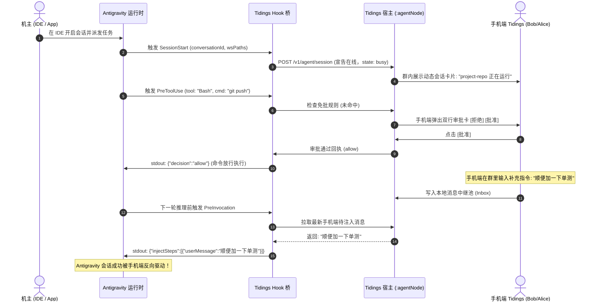

# 捎话 Tidings · Google Antigravity 接入与协同技术方案 (Integration Design)

> **文档版本**：v1.0.0-RFC  
> **更新时间**：2026-10-31  
> **适用范围**：Google Antigravity（App / CLI `agy` / IDE 扩展）深度接入 Tidings 局域网协同 IM。  
> **核心价值**：**“IDE 里的会话手机随时看，手机发的话能反向注入，群内能直接调遣 agy 跑沙箱重构”**。

---

## 目录
1. [接入背景与全景定位](#1-接入背景与全景定位)
2. [Antigravity 现成能力与触点拓扑](#2-antigravity-现成能力与触点拓扑)
3. [三大接入形态设计](#3-三大接入形态设计)
   - 3.1 形态 A：【主动派单驱动】CLI 子进程驱动 (`agy` Subprocess Driver)
   - 3.2 形态 B：【被动感知与反向注入】Lifecycle Hooks 跨端投射桥
   - 3.3 形态 C：【智能体自主工具】Tidings Relay MCP Server
4. [核心突破：手机端向 Antigravity 反向注入机制](#4-核心突破手机端向-antigravity-反向注入机制)
5. [数据映射与协议契约 (Data Mapping)](#5-数据映射与协议契约-data-mapping)
6. [落地分期与实施路线](#6-落地分期与实施路线)

---

## 1. 接入背景与全景定位

Tidings 定位为**局域网团队协同 Agent IM**。在接入 Claude Code、Codex 的同时，**Google Antigravity** 是生态中能力最完整、且唯一同时具备 **桌面 App、CLI (`agy`)、IDE 扩展 (VS Code / JetBrains)、Sidecar 与 Lifecycle Hooks** 的重磅宿主。

接入 Antigravity 将彻底打通两条关键用户场景：
1. **场景 1（群聊主动调遣）**：群内团队成员在手机端直接 `@Antigravity`，宿主自动拉起 `agy` 在本地 Git Worktree 沙箱中完成代码重构，推流卡片并交付补丁；
2. **场景 2（IDE 会话移动端投射）**：机主在工位电脑的 VS Code / Antigravity App 中结对编程，离开工位后，手机端 Tidings 自动同步该会话的最新进展，且**手机端发消息能直接反向注入回 IDE 会话中继续推理**！

---

## 2. Antigravity 现成能力与触点拓扑

基于真机环境（Antigravity App v2.24.0 + `agy` CLI 1.2.14）的实测对账：

```
+-----------------------------------------------------------------------------------+
| Antigravity 宿主体系 (本地落盘: ~/.gemini/antigravity & ~/.gemini/config)           |
+-----------------------------------------------------------------------------------+
| 触点 1: Lifecycle Hooks (全局 hooks.json / 工作区 .agents/hooks.json)               |
|         - SessionStart    -> 广播会话建立 (conversationId, workspacePaths)        |
|         - PreToolUse      -> 工具调用前置拦截 (可回传 deny 实施远程审批)           |
|         - PreInvocation   -> 【杀手级能力】injectSteps[].userMessage 反向注入消息   |
|         - Stop            -> 会话结束 (可回传 continue 让 Agent 续跑)             |
+-----------------------------------------------------------------------------------+
| 触点 2: agy CLI 双工流式通信 (headless)                                            |
|         - agy --input-format stream-json --output-format stream-json              |
|         - 逐行吐出 step_update (tool_name, text_delta, subagent_info)             |
+-----------------------------------------------------------------------------------+
| 触点 3: MCP (Model Context Protocol) 扩展                                        |
|         - ~/.gemini/config/mcp_config.json 挂载 Tidings 本地工具集                 |
+-----------------------------------------------------------------------------------+
```

---

## 3. 三大接入形态设计

针对不同使用阶段，系统提供三层互补的接入形态：

### 3.1 形态 A：【主动派单驱动】CLI 子进程驱动 (`agy` Subprocess Driver)

- **适用场景**：团队协同群聊中通过 `@Antigravity <任务需求>` 派活；
- **实现位置**：`:agentNode` 中的 `CliSubprocessDriver`；
- **执行流序**：
  1. 宿主收到群内任务，签出独立轻量沙箱：`git worktree add /tmp/tenon-ws/<taskId> -b task-<taskId>`；
  2. 宿主拉起 CLI 子进程：
     ```bash
     agy --output-format stream-json \
         --workspace "/tmp/tenon-ws/<taskId>" \
         -p "<用户Prompt与上下文摘要>"
     ```
  3. **凭证完全免配**：子进程自动继承宿主机已有的 Google 登录凭证（`~/.gemini`），不需要机主二次配置 API Key；
  4. **NDJSON 流式解析与背压**：
     - `step_update` 中的 `text_delta` $\rightarrow$ 映射为群内文本片段（20Hz 背压）；
     - `tool_name` $\rightarrow$ 映射为原位任务看板卡（`steps[].status = running`）；
  5. 任务结束提取 `git diff`，推流 Diff 审阅卡。

---

### 3.2 形态 B：【被动感知与反向注入】Lifecycle Hooks 跨端投射桥

- **适用场景**：机主在电脑使用 Antigravity App 或 IDE 编码，离开电脑后在手机端远程监控、审批高危命令并反向说话；
- **实现位置**：轻量守护脚本 `antigravity-tidings-hook`（配置于 `~/.gemini/config/hooks.json`）；
- **生命周期映射**：



---

### 3.3 形态 C：【智能体自主工具】Tidings Relay MCP Server

- **适用场景**：Antigravity Agent 在执行复杂编排时，主动利用 Tidings 局域网通讯网格；
- **配置落点**：`~/.gemini/config/mcp_config.json`；
- **提供工具清单**：
  - `tidings_send_group_card`：向协同群发送结构化看板卡或进度汇报；
  - `tidings_request_human_approval`：主动挂起并请求机主手机审批；
  - `tidings_fetch_node_capabilities`：查询当前局域网有哪些在线算力标签（如 `gpu:rtx4090`）。

---

## 4. 核心突破：手机端向 Antigravity 反向注入机制

过去外部桥接方案最大的软肋是**“只能单向看日志，无法在手机端插话指导”**。而在 Antigravity 体系中，官方提供的 `PreInvocation` Hook 是一个原生的双向通信后门：

1. **注入契约**：在每次模型调用前，Antigravity 执行 `PreInvocation` 钩子，等待 Hook 进程返回 JSON；
2. **注入 Payload**：
   ```json
   {
     "decision": "continue",
     "injectSteps": [
       {
         "userMessage": "来自手机端机主的紧急纠偏：不要修改 Core 模块，仅在 App 模块增加适配层。"
       }
     ]
   }
   ```
3. **模型响应**：Antigravity 内部运行时会**将该文本作为真实的用户提问**插入当前对话上下文，模型立即遵循该指导进行纠偏，实现了真正的人机无缝协同！

---

## 5. 数据映射与协议契约 (Data Mapping)

| Antigravity 数据项 | Tidings 协议字段 | 映射与裁剪规则 |
|:---|:---|:---|
| `conversationId` (UUID) | `sessionId` | 原样透传，作为局部会话隔离主键 |
| Agent 身份标识 | `agentId` | 映射为规范短 ID，如 `agent:antigravity`（≤21 字符，严格小写） |
| `workspacePaths[0]` | `wsPath` | 绝对路径，映射到已绑定的工作区实体 |
| `step_index` | `agentCursor` | 单调递增游标，用于保证消息按序上屏 |
| `text_delta` | `token` | 流式纯文本片段（20Hz 限频聚合） |
| `tool_info` | `card.steps[]` | 提取工具名称与执行状态，原位覆盖卡片 |
| 最终代码变动 | `card.diff` | 通过 Git 提取变动行数统计（+add / -del） |

---

## 6. 落地分期与实施路线

1. **第一期（形态 A 率先落地，预计 1~2 天）**：
   - 在已定稿的 `CliSubprocessDriver` 中支持 `agy` CLI 探测与参数拉起；
   - 实现 `agy --output-format stream-json` 的行缓冲与卡片事件映射；
   - 跑通群内 `@Antigravity` 派单与 Git Worktree 沙箱生成 Patch 的全链路。
2. **第二期（形态 B 远程投射与反向注入，预计 2 天）**：
   - 编写轻量 `antigravity-tidings-hook` 脚本，注册进 `~/.gemini/config/hooks.json`；
   - 联调 `PreToolUse` 双行审批与 `PreInvocation` 手机消息反向注入；
   - 实现 Mac 桌面 IDE 编程、手机随时随地批复与说话的无感体验。
3. **第三期（形态 C MCP 工具箱上架）**：
   - 封装标准 Stdio MCP Server，让 Antigravity 能主动调用 Tidings 局域网算力网格。

---

## 7. 结论

**Antigravity 具备目前业内最开放、最完整的扩展钩子体系！**  
接入 Antigravity 不仅技术路径极其清晰（拥有现成的 CLI 与 Hooks），而且能直接弥补移动端“无法反向干预桌面 Agent”的历史短板，是提升 Tidings 人机协同体验的绝佳抓手。
