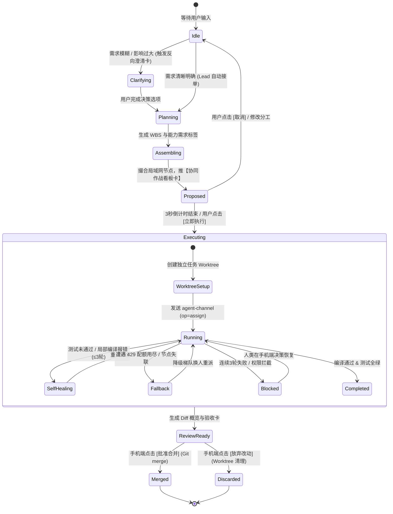

# 捎话 Tidings · 动态多智能体团队编排与自愈技术规范 (Dynamic Multi-Agent Team Orchestration & Self-Healing Spec)

> **定位与愿景**：面向局域网团队协同场景，解决用户仅需通过自然语言提出需求，系统即可**自动推选任务主理人、动态招募跨机 Agent 团队、流水线执行分工、隔离沙箱编码、自愈异常故障并由手机一键终审**的完整工程落地闭环。
> 
> **设计基石**：坚决不硬编码固定团队角色与模型，基于动态能力标签（Capability Tags）、Git Worktree 独立沙箱、严格 14 键 P2P 信令（`agent-channel`）与单卡槽原位演进机制构建。

---

## 一、 核心架构原则与设计不变量

1. **唯一主理人负责制（Single Lead Authority）**：
   无论协同过程中拉入多少个跨机 Agent，面向用户与群聊的沟通接口永远只有唯一当选的 **Lead（任务主理人）**。严禁多个 Worker Agent 同时在群内发言抢答，彻底杜绝噪音风暴。
2. **能力画像与动态点将（Dynamic Tag-Based Roster）**：
   团队成员不提前写死在代码或配置中。Lead 将需求抽象为角色技能标签（如 `[role:coder, lang:kotlin]`），在局域网在线节点池（`peer-tags.json`）中按需即时撮合。
3. **单向责任链流水线（Stage-Gate Pipeline）**：
   严禁 Agent 之间在群聊内展开自然语言自由闲聊。执行流严格遵循单向责任链（架构分析 $\rightarrow$ 编码实现 $\rightarrow$ 自动化验证 $\rightarrow$ 终审合并）。
4. **Git Worktree 轻量沙箱隔离**：
   所有任务在独立的 Worktree 沙箱（`worktree/task-{taskId}-{role}`）中执行，禁止在主工作树并发写入，任务完工或撤销后无痕清理。
5. **单卡槽原位演进（Single Kanban Morphing Card）**：
   一个任务在群聊中严格只占用一条消息位置，所有子步骤进展、模型思考、改动概览均通过 `(cardId, rev)` 原位推流刷新，群聊历史始终保持清爽。
6. **反官僚化与原始需求直达（No Bureaucratic Plans Rule）**：
   主理人（Lead）的职责是“意图准入、标签点将与进度守门”，**严禁擅自给 Worker 编写具体实现方案或扩写清单（Workers investigate and implement; never add implementation plans）**。原始需求与上下文指针直达 Worker，由 Worker 在其 Worktree 沙箱中结合真实代码自主调研与实现。
7. **增量消息订阅扇出（Subscription Fan-out）**：
   一旦任务开工，用户在群内发出的增量纠偏指令直接扇出到正在执行的 Worker 实例，作为即时修正上下文，严禁重复触发全量路由与建队评估。
8. **严格 14 键白名单与 64 KiB 预算**：
   信令与卡片载荷 100% 依托既有的 `agent-channel` 与群文本 `card` 字典，绝不新增任何顶层协议键，单帧硬上限严守 64 KiB。

---

## 二、 编排全生命周期状态机

整个协同任务生命周期由发起侧协调器与接收侧编排器共同驱动，状态流转如下：



---

## 三、 五大核心机制实现细则

### 3.1 领头人选举与防臆想意图澄清 (Lead Election & Anti-Hallucination)

#### 1. 领头人推选双层裁决
* **显式指定**：用户在群消息中显式 `@AgentName`（如 `@Antigravity`），该 Agent 立即升格为本次任务的 **Lead**。
* **缺省驻场**：若未 `@` 任何 Agent，由当前群绑定的物理工作区宿主默认 Agent（`WorkspaceAnchorLead`）接单。

#### 2. 意图澄清门禁（Anti-Hallucination Gate）
当用户输入过于简短宽泛（如“把架构优化一下”），Lead 禁止擅自执行写操作，必须先在群内推送**【意图澄清卡片】**：
```json
{
  "cardType": "interactive_decision",
  "cardId": "clarify-8910",
  "title": "🎯 需求意图确认",
  "prompt": "检测到目标较为宽泛，请在继续前确认范围与方案：",
  "options": [
    { "id": "opt_vscroll", "label": "仅重构消息列表为虚拟滚动 (推荐)", "recommended": true },
    { "id": "opt_full_arch", "label": "全量清理领域层废弃依赖" }
  ],
  "multiSelect": false
}
```
用户在移动端拇指点选后，Lead 接收到确认结果才正式进入任务规划。

---

### 3.2 动态点将与能力画像撮合 (Dynamic Tag-Based Roster)

#### 1. WBS 任务角色化分解
Lead 将需求拆解为结构化阶段，并给出每一阶段所需的能力标签集合（`requiredTags`）：
```kotlin
data class SubTaskSpec(
    val phaseId: String,
    val title: String,
    val requiredTags: Set<String>,
    val timeoutMs: Long = 180_000L
)

// 示例：拆解出的标签需求
val phases = listOf(
    SubTaskSpec("p1", "协议与接口设计", setOf("role:architect", "reasoning:high")),
    SubTaskSpec("p2", "组件编码与UI实现", setOf("role:coder", "lang:kotlin", "framework:compose")),
    SubTaskSpec("p3", "单元测试与全量构建", setOf("role:tester", "env:gradle"))
)
```

#### 2. 基于 `PeerTagRouter` 的撮合逻辑
Lead 调用 `PeerTagRouter.resolve(requiredTags)` 在当前局域网在线节点表（`peer-tags.json`）中寻路：
1. **本机亲和性优先**：若当前宿主机（Local Host）具备对应标签且资源水位健康（CPU < 80%），优先本地执行，避免网络开销；
2. **算力网格协同**：若本地缺失某能力（例如本地无 GPU / 无 Claude 凭据），自动将任务分派给具备 `model:claude-3-7-sonnet` 的远端节点；
3. **柔性无匹配处理**：若局域网完全无匹配节点，弹出提示卡引导机主配置或降级使用通用模型。

---

### 3.3 声明式 Worktree 隔离与单向推进 (Worktree Sandbox Pipeline)

#### 1. 工作区互斥与独立沙箱
在执行前，发起端通过 `agent-channel` 申请工作区资源锁：
```json
{
  "op": "assign",
  "taskId": "task-8910-p2",
  "fromAgent": "agent:antigravity",
  "targetTag": "role:coder",
  "resources": ["workspace:/workspace/demo-repo"],
  "context": {
    "gitBranch": "worktree/task-8910-p2",
    "baseSha": "941598aa",
    "prompt": "在 composeApp 中实现 VirtualMessageList，注意保持领域层零 Compose 依赖",
    "constraints": ["禁止修改 14 键协议白名单", "禁止在源码中引入 CJK 字符串硬编码"]
  },
  "leaseMs": 180000
}
```

#### 2. 日志脱敏与指针化传输 (No Frame Explosion)
Worker 在执行构建或跑测时，海量 stdout/stderr 严禁塞入网络帧：
* 日志在 Worker 本地磁盘落盘为 `.tidings/logs/{taskId}.log`；
* `agent-channel-result` 帧中仅包含末尾 15 行错误摘要与日志文件哈希指针；
* 桌面端 Inspector 按需通过 `TransferClient`（分块流式传输）拉取完整日志。

#### 3. 5 秒前台命令转后台机制 (5-Second Backgrounding)
Worker 在沙箱中执行耗时 Shell 命令（如 `./gradlew test`、`npm build`）时：
* 前台命令等待阈值设定为 5 秒，超过 5 秒未退出自动转入后台异步作业（Background Job）；
* 这一机制彻底释放会话主循环，确保 Worker 在长时编译期间依然能够接收来自移动端的“打断”或“增量纠偏”指令，消除假死隐患。

#### 4. 连续对话与增量纠偏订阅扇出 (Subscription Fan-Out)
一旦协同任务卡片就绪并在执行中，若用户在群聊中继续追加自然语言指示（如：“把包名改一下”、“加上混淆规则”）：
* 协调器识别其上下文属于该活跃任务（`activeTaskId`）；
* 消息直接作为增量 Context 扇出至正在执行的 Worker 实例；
* 绝不重复触发全量 WBS 拆解与点将重选，实现人在走动中的平滑纠偏体验。

---

### 3.4 异常韧性与四级降级矩阵 (Fault-Tolerance & Fallback Matrix)

在分布式局域网环境中，异常处理是保障系统不挂起的命脉。系统构筑四级容错阶梯：

| 故障级别 | 异常表现 | 处理动作与自愈路径 |
|:---|:---|:---|
| **Tier 1: 逻辑小错** | 单元测试个别失败、语法偶发告警 | **有限自愈重试**：Lead 将失败报错与 Diff 重新封装分派给原 Worker，允许最多 3 轮自我修复。 |
| **Tier 2: 算力告急** | 模型报 `429 Too Many Requests`、Token 额度耗尽 | **动态换人重派 (Failover)**：Worker 立即回执 `status: quota_exceeded`。Lead 标记该节点在当前标签下熔断，在候选池中降级挑选备用模型节点（如 Claude $\rightarrow$ Codex $\rightarrow$ 本地 DeepSeek）在原 Worktree 分支接力。 |
| **Tier 3: 硬件失联** | 笔记本合盖、断网离开、子进程崩溃 | **租约超时回收 (Lease Reaper)**：任务租约默认 180s。Worker 需每 30s 维持一次 Jitter 心跳。超时 0 响应则收割该任务所有权，清理孤儿分支并在备用节点重新拉起。 |
| **Tier 4: 终极阻塞** | 连续 3 轮无法修复、涉及越界敏感操作 | **人类求助门禁**：挂起流水线，在手机端推送【求助/接管卡片】，由人类在手机端点击决策：`[更换方案]`、`[忽略该测试]` 或 `[终止任务]`。 |

---

### 3.5 单卡槽原位演进与移动终审 (Kanban Morphing & Mobile Review)

任务在群聊界面自始至终由同一个卡片对象承载，通过递增 `rev` 原位推流：

````carousel
```json
// 卡片状态 1: 团队组建与计划确认
{
  "cardType": "orchestration_kanban",
  "cardId": "task-8910",
  "rev": 1,
  "state": "proposed",
  "lead": "Antigravity (本机)",
  "roster": [
    { "role": "架构分析", "assignee": "Antigravity", "status": "done" },
    { "role": "代码编写", "assignee": "Claude (Bob-Mac)", "status": "pending" },
    { "role": "自动化测试", "assignee": "Runner (Linux-Server)", "status": "pending" }
  ],
  "actions": [{ "id": "btn_start", "label": "立即开工 (3s)" }]
}
```
<!-- slide -->
```json
// 卡片状态 2: 流水线执行中 (动态推流)
{
  "cardType": "orchestration_kanban",
  "cardId": "task-8910",
  "rev": 12,
  "state": "executing",
  "currentPhase": "代码编写中: VirtualMessageList.kt (+124/-12)",
  "progressPercent": 65,
  "actions": [{ "id": "btn_abort", "label": "打断" }]
}
```
<!-- slide -->
```json
// 卡片状态 3: 终审验收与合流
{
  "cardType": "orchestration_kanban",
  "cardId": "task-8910",
  "rev": 25,
  "state": "review_ready",
  "summary": "重构完成：虚拟滚动实现就绪，全量单测全绿 (Pass 457/457)",
  "diffStats": { "filesChanged": 3, "insertions": 142, "deletions": 18 },
  "actions": [
    { "id": "btn_reject", "label": "拒绝并丢弃", "style": "danger" },
    { "id": "btn_merge", "label": "批准合并入主干", "style": "primary" }
  ]
}
```
````

用户在移动端点击 `[批准合并入主干]` 后：
1. 宿主机在底层执行 `git merge --no-ff worktree/task-8910`；
2. 执行 `git worktree remove` 物理清理临时沙箱目录；
3. 卡片更新终态 `state: "merged"`，群聊恢复静默待命状态。

---

## 四、 规约与门禁核对清单

在本技术方案落地过程中，必须严格遵守以下代码与协议红线：

1. **零 Compose 依赖**：协调器逻辑全部收敛在 `:app` 的 `commonMain` 中，严禁引入 Compose 运行时；
2. **单一词汇来源**：动作回执必须引用 `MessageTypes.kt` 的常量定义，严禁私自硬编码字符串；
3. **真机零丢帧**：群文本绝不外挂新顶层键，所有协同状态字段 100% 收敛在现有的 `card` 字典内；
4. **Git Checkpoint 保护**：执行前必须记录 Base Commit SHA，严禁在未提交工作树上强制 checkout。

---

## 五、 DSH Super-Agent 哲学与极致注意力沉淀

为了彻底解决“多 Agent 架构常见的人工分工繁重、无谓闲聊刷屏、中断死锁”三大通病，本仓在落地执行体中深度吸收 DSH（DeepSeek Harness Super-Agent）精髓，确立以下运行机制：

### 1. 极简注意力法则（Minimal Human Attention）
- **人类一句话直达沙箱，不费心思分角色**：用户在群聊里提出具体需求（例如 `@dsh 修复按钮双击崩溃问题`），调度侧默认将原始 Prompt 原汁原味投递给绑定的 Worktree 沙箱 Worker 全包执行。
- **杜绝 Router 加戏与脑补**：调度器严禁擅自编写长篇大论的计划或分解列表。调查、定位代码、实施改动、跑测试自检全部由 Worker 在沙箱内独立闭环。
- **仅在显式多工种时启用责任链**：仅当人类输入明确包含多阶段交接指令（`parseStages` 匹配 $\ge 2$ 棒），或通过外部编排 API 触发时，才启动多阶段流水线。

### 2. Thread Follow-up 直通与沙箱唤醒
- **运行中工单的追问直通**：当一个群/会话存在正在运行的工单任务时，用户追加发送的纠偏指令不再作为新工单重新调度，而是直接作为 Follow-up 上下文注入运行中的沙箱。
- **Blocked 状态自动唤醒**：当工单因权限、疑问等原因挂起为 `blocked` 时，用户发送的下一条消息直接解除挂起，工单状态原地切回 `working` 恢复执行。

### 3. 即时打断机制（Immediate Abort）
- **毫秒级取消响应**：用户在群里发出“停”、“取消”、“stop”、“abort”等信令时，调度器就地取消运行中的异步协程并向 CLI 驱动发送终止信号，卡片原位刷新为 `cancelled` 终态并释放沙箱 Worktree。

### 4. 超纲退单机制（Hand-back）
- **诚实退单不硬抗**：当 Worker 或调度器识别到当前群未绑定有效 Git 工作区，或需求超出该代码仓职责边界时，Worker 主动触发 Hand-back，卡片原地更新为退单说明（如 `Handed back: no git workspace bound to group`），避免产生假执行或静默挂死。

---

## 六、 零配置双模自适应与 Git 全拓扑管理

为了兼顾代码工程与日常办公场景，系统根据目录客观事实自动分流，人类无需预先制定模式：

### 1. 零配置双模自适应（Git 模式 vs 纯文件模式）
- **Git 事务模式（探测到 `.git`）**：
  自动启动 Git Worktree 隔离沙箱与任务分支，主工作树保持原样，出 Diff 审查卡并支持移动端/桌面端一键 `[Merge]` 合入。
- **纯文件产物模式（普通文件夹/无 `.git`）**：
  不报错、不退单，自动切入影子目录执行，监听文件哈希与变更列表，出文件产物卡直传群聊。

### 2. Git 去中心化全拓扑管理（不局限于 GitHub/GitLab）
- **纯局域网脱网**：使用 `git bundle create` 将增量提交打包为自包含二进制流，通过 P2P 加密大文件信道发送对端，原生解包协同；
- **设备对等 Remote**：通过 Desktop 内置 Ktor 引擎承接 Git 协议，局域网设备间直接互设 Remote 拉取分支；
- **内网或自建中枢**：支持局域网 Gitea、Forgejo 或 NAS Bare Repo；
- **公共云端托管**：外网环境下无缝兼容 GitHub/GitLab PR 工作流。


