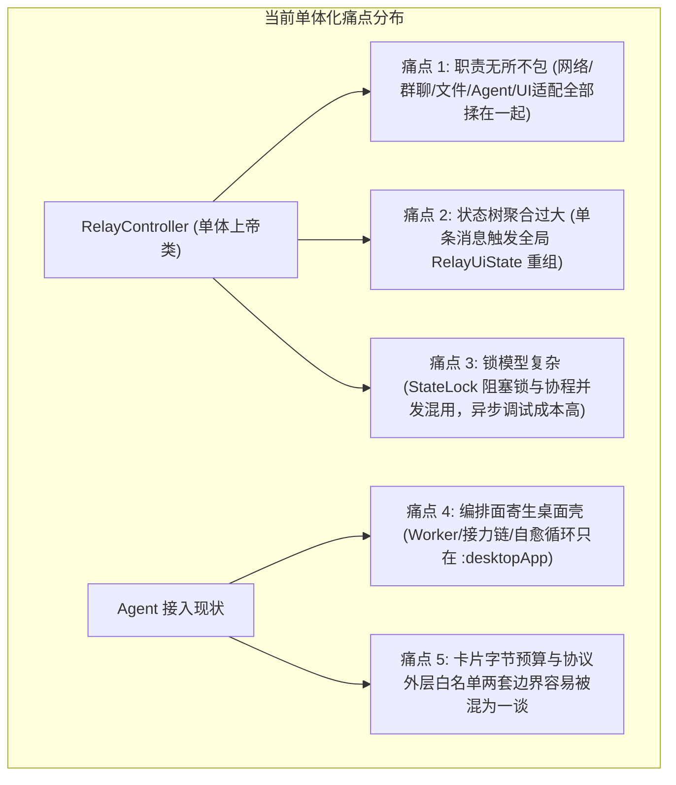
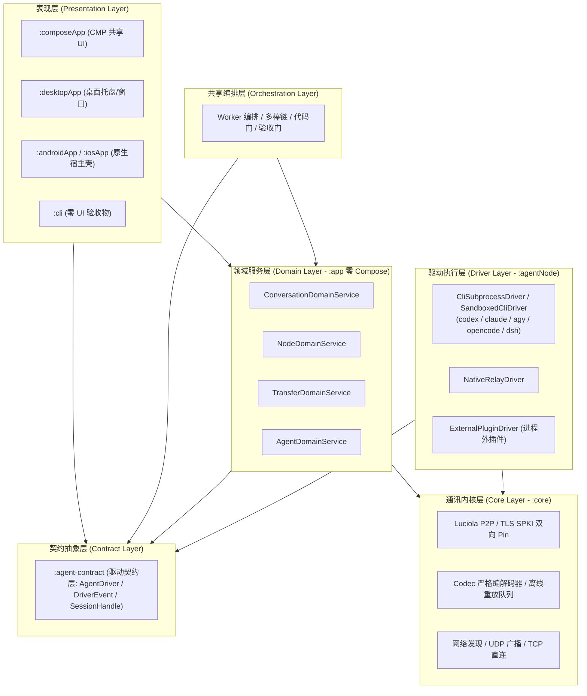
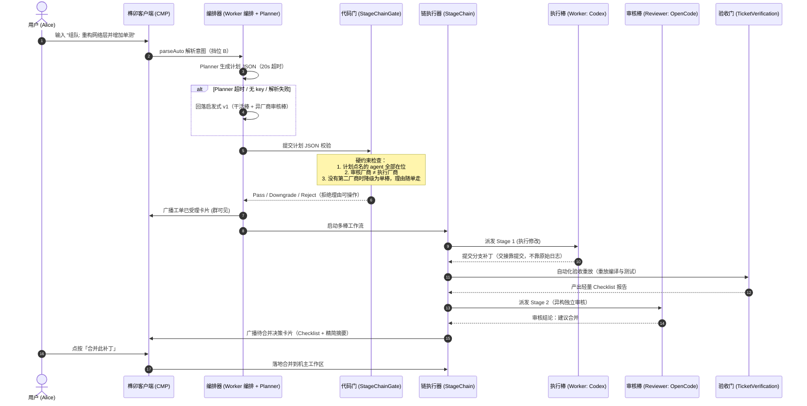
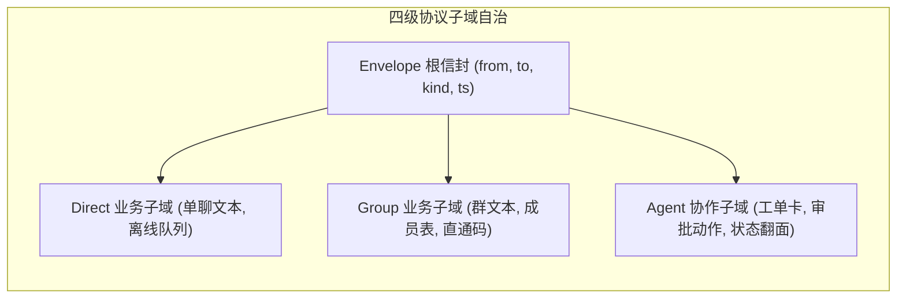
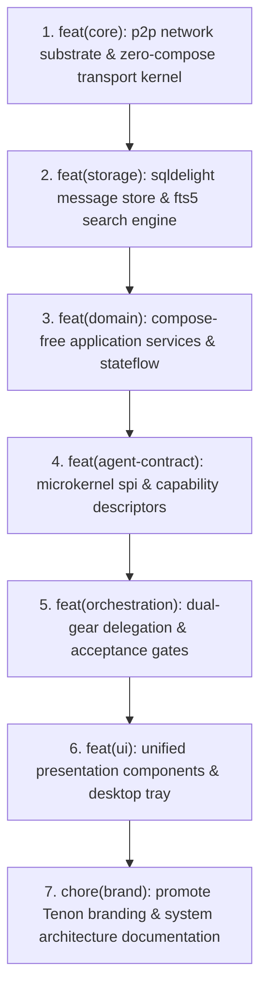

# Tenon（榫卯 Tenon）系统整体架构优化与 Agent 高扩展性演进蓝图

> **文档标识**：ARCH-BLUEPRINT  
> **适用范围**：`:core`、`:app`、`:agentNode`、`:composeApp`、`:desktopApp`、`:cli`（以及驱动契约层 `:agent-contract`）  
> **核心命题**：在局域网 P2P 团队协同与多 Agent 深入集成的现实背景下，对系统进行全局解耦，建立高内聚、低耦合、强扩展的 Agent 微内核与协作编排体系。

---

## 一、 执行摘要与演进背景

随着本系统近期业务能力的爆发式演进——相继落地了 **Luciola P2P 加密直连**、**Ktor 本地 Agent 控制面**、**五款真 CLI 驱动（Codex / Claude Code / Antigravity / OpenCode / DSH）**、**多棒责任链（StageChain）**、**Git Worktree 沙箱**、**验收门（TicketVerification）** 以及 **全平台品牌向「榫卯 Tenon」升级**，系统已经从最初的局域网点对点通信工具，演进为一个**人机同在场的超级局域网协同操作系统**。

然而，能力的极速增长带来了代码层面的复杂度集聚：单体 Controller 职责过度集中、表现层与 Agent 细节强耦合、协议外层白名单与卡片字节预算的边界容易被误读、状态流粒度过粗导致重组放大。

本蓝图以**现状代码为准**制定一份清晰、可持续、高扩展性的**全局架构治理与演进方案**。凡是与代码不符的早期草图（无状态驱动接口、超限自动剥离、同源自审自动放行等）都在正文中按实际实现改正；尚未存在的机制一律标注为「增量」，不写成既成事实：

1. **结构解耦**：把**现有**的会话制驱动契约抽取到独立的 `:agent-contract` 纯接口模块，而不是重新定义一套接口；
2. **驱动扩展**：统一已有的四类驱动形状（子进程 CLI / 沙箱 CLI / 本机中继 / 进程外插件），新增引擎只补注册与发现，不触碰主程序；
3. **编排深化**：把桌面壳独占的多棒编排、代码门与验收门下沉为共享编排面，落地「委派双挡（显式指定 / 意图路由）」；
4. **稳定坚守**：坚守本仓铁律——领域层零 Compose 依赖、严格白名单、超限拒绝不截断、无锁协程流。

对应到实施主线，本蓝图收敛为四个阶段：**Phase 1 编排下沉 → Phase 2 驱动契约统一 → Phase 3 领域服务化 → Phase 4 表现层收敛**。历史重塑与文档治理（第八节）放在四阶段完成之后，不属于架构阶段。

---

## 二、 系统现状与痛点诊断



### 2.1 单体膨胀：`RelayController` 职责过载
- **现状**：`RelayController` 承载了节点生命周期、网络拓扑维护、消息分发、文件断点续传、群元数据同步、本地数据库读写以及 Agent 调度的装配职责。系统已经把它拆成 **13 个 `RelayControllerXxxComponent`**（Agent、AgentInvoke、Avatar、Cabinet、Cidr、Groups、Messages、Pk、Recovery、Screen、ScreenHistory、Settings、Transfers），但**状态仍集中在主类持有的 `RelayCoreState` 里**。
- **体量**：`RelayController` 体系共 **15 个文件、约 1.1 万行**——主类 `RelayController.kt` **2,447 行**，13 个 Component 合计 **8,436 行**，另有横切扩展 `RelayControllerOps.kt` **110 行**。
- **已有基础**：每个 Component 的构造只拿一个 `host` 参数，依赖面是显式的（组件内逐个 `host.` 前缀），这为 Phase 3 的四域服务化提供了现成的边界起点。
- **弊端**：任何单点能力的调整（如修改链卡合并逻辑）仍要穿透主类与共享状态，增加了跨业务逻辑污染和回归验证成本。

### 2.2 Agent 控制面与表现层耦合过深
- **现状**：`composeApp` 中的卡片渲染逻辑（`AgentCards.kt`、`AgentApprovalCards.kt`）直接依赖卡片里的业务字段；手机端 `parseAgentCard` 认识的是一套固定 schema（`cardId` / `rev` / `type` / `title` / `progress` / `items` / `checks` / `banner` / `artifacts` 等）。
- **关键事实**：编解码层把卡片当成**不透明 `JsonObject`**，只校验它是对象且整卡不超过字节预算，**不逐键白名单**。因此编解码层与渲染层之间的卡片 schema 是**跨端约定**，而不是协议白名单——两件事不能混为一谈。
- **弊端**：每当新增一种 Agent 动作或调整驱动事件结构，必须同步改表现层与领域层代码；卡片 schema 一旦漂移，两端不会在编解码层报错，只会在渲染层缺字段。

### 2.3 协议白名单、取值域与「静默丢失」风险
- **现状**：群文本走严格字段白名单（`CodecMsg.GROUP_TEXT_KEYS`）与取值域常量对象（`AgentAckKinds` / `AgentGrantScopes` / `AgentExecPolicies` 等）。多一个外层键、或键对但值不在取值域，接收侧都会整帧拒收。
- **卡片是另一条边界**：卡片在 codec 里是不透明 `JsonObject` + `Limits.CARD_BYTES`（24 KiB）**字节预算**，超限由发送侧与接收侧各自拒绝——它不走逐键白名单，也不存在「自动剥离长文本」这条路。
- **真正的风险面**：① 外层群文本键漏配白名单（新增可选键必须同步白名单，旧端不认识就整帧丢弃，两端必须同版本）；② 取值域清单各写一份；③ 卡片字节预算被当成「可以截断」的软约束。三者共同的结果都是**发送侧显示成功、对端静默丢帧**。
- **纪律**：任何「键 + 取值域」字段，取值域只能有一个定义；卡片内层字段属于渲染 schema，变更要两端同版本，不靠白名单兜底。

### 2.4 粗粒度状态流重组风暴
- **现状**：`RelayUiState`（约 763 行）将会话、消息列表、节点表、群信息、设置、传输状态集中在一个聚合数据类中。它的头注明确写着「**全应用唯一的状态**」——理由是节点表、消息、队列深度是同一份真实数据，会话屏与聊天屏看的是同一个对端，每屏各自持有一份会退化成占位串。
- **弊端**：单条消息入库或心跳在线态变更都会让整棵状态树产生新快照，聊天视图树跟着重组。问题不在「数据该不该共享」，而在**订阅面太粗**：任何一域变化都会唤醒全部消费者。
- **改造方向**：保留单一事实源与唯一写入方（`RelayCoreState` + `RelayStateWriter`），只把**对外订阅面**切成按域切片（见 4.3 与 Phase 4）。

---

## 三、 核心架构设计原则

1. **领域层零 Compose 依赖**：
   - `:app` 模块坚决不引入 Compose 相关 API，纯粹由 Kotlin 标准库与协程驱动。UI 表现层 `:composeApp` 作为消费者，通过纯接口和状态流接入。
2. **计划即数据，骨架在代码，策略交模型**：
   - 坚决杜绝黑盒 Router 接管系统权限。LLM 只能输出标准化的计划 JSON 数据（`DelegationPlan`），真实的 Git 分支派发、沙箱隔离、代码审查与合并落地全部由受控代码驱动。
3. **协议白名单与帧预算铁律**：
   - 群文本 32 KiB、卡片 24 KiB（`Limits.CARD_BYTES`）、整帧 64 KiB。**超限即拒、绝不截断**：发送侧不产出注定被拒的帧，接收侧整帧拒收。轻量状态进卡片，大日志与完整证据走文件信道（`purpose=artifact`）。
4. **微内核等于「现有的会话制契约」，不是重新发明接口**：
   - 驱动契约就是代码里的 `AgentDriver`：`openSession` / `executeTask` / `handleAction` / `queryProgress`，事件走 `DriverEvent` 回调。能力 ACL 是**宿主状态**（`DriverRegistry` / `DriverCapabilityAcl`），不在接口上，也不透传给进程外插件。
   - 任何「无状态 `execute(task, workspace, env): Flow`」的设想与现状冲突，只能作为提案讨论，不得写进契约。

---

## 四、 全局模块拓扑与分层解耦体系



### 4.1 抽取纯契约层 `:agent-contract`
`:agent-contract` 的职责是**把已经存在的类型搬到一个零依赖模块**，让 `:app`、`:agentNode`、`:cli` 与移动端共享同一份驱动契约，而不是再定义第二套：

- **`AgentDriver`**：会话制接口——`openSession(wsPath, resumeSessionId)`、`executeTask(sessionId, prompt, onEvent)`、`handleAction(sessionId, actionId, decidedBy)`、`queryProgress(sessionId)`，以及 `driverId` / `displayName` / `listCapabilities()`；
- **`DriverEvent`**：七型密封接口——`ThoughtDelta`、`TokenDelta`、`ToolCall`、`Card`、`Artifact`、`Finished`、`Error`；
- **`SessionHandle` / `TaskProgressSnapshot` / `DriverCapability`**：会话句柄、进度点查快照与能力元数据；
- **岗位档案与计划数据**：`AgentProfiles`（纯声明表：key / vendor / displayName / defaultRole）与 `DelegationPlan` / `ChainStage`（计划 JSON 的 Kotlin 形态）可按依赖方向一并下沉；**执行器 `StageChain` 不下沉**，它依赖沙箱与运行时。

**明确不进契约层的**：能力 ACL（宿主状态，属于 `DriverRegistry` / `DriverCapabilityAcl`）、进程外插件桥、沙箱执行器。进程外插件驱动永远不会把 ACL 调用转发到插件进程——这是 4.1 的硬边界。

### 4.2 领域层解耦：组件 → 四域服务映射
目标是把 `RelayController` 体系收敛为 `:app` 内四个**零 Compose** 的垂直领域服务。下表的「现有组件」是已存在的 13 个 Component，映射依据是它们当前的职责与 `host` 依赖面；Phase 3 照此边界收拢，而不是推倒重写：

| 现有组件 / 文件 | 当前职责 | 目标域服务 |
|---|---|---|
| `RelayControllerMessagesComponent` | 单聊消息本体：发送、撤回、补发、落盘、检索 | **ConversationDomainService** |
| `RelayControllerGroupsComponent` | 建群/退群、群资料、成员、群消息 | **ConversationDomainService** |
| `RelayControllerPkComponent` | 会话内小游戏卡（比大小/猜拳） | **ConversationDomainService** |
| `RelayControllerScreenHistoryComponent` | 投屏记录 upsert 成聊天消息 | **ConversationDomainService**（消息产物面） |
| `RelayControllerRecoveryComponent` | 身份恢复 L2 的历史拉回（扩展在 Messages 上） | **ConversationDomainService**（网络触发留在 Node） |
| `RelayController` 主类 | 节点生命周期、发现、配对、传输装配 | **NodeDomainService**（Phase 3 后主类只留装配） |
| `RelayControllerCidrComponent` | 网段扫描、扫描结果 gossip | **NodeDomainService** |
| `RelayControllerAvatarComponent` | 节点头像与资料交换 | **NodeDomainService** |
| `RelayControllerSettingsComponent` | 设置落盘、端口、远程中继、能力声明 | **NodeDomainService**（纯 UI 偏好后续可上移） |
| `RelayControllerTransfersComponent` | 文件 offer/accept、续传、残片、传输日志 | **TransferDomainService** |
| `RelayControllerCabinetComponent` | 共享柜授权、浏览、上下行 | **TransferDomainService** |
| `RelayControllerScreenComponent` | 投屏会话协商与帧流（与文件直传共用数据平面） | **TransferDomainService**（是否独立成屏务域留待 Phase 3 裁决） |
| `RelayControllerAgentComponent` | agent 会话、事件、队列、审批、取消、回执、产物 | **AgentDomainService** |
| `RelayControllerAgentInvokeComponent` | 跨端派单网道、租约、执行门禁、看板卡 | **AgentDomainService** |
| `RelayControllerOps.kt` | 落盘 / 插消息 / 替换等横切小事务 | 共享事务辅助，不归属任何单一域 |

四个服务对外只暴露命令与状态流；主类的「装配」职责保留，但它不再直接持有跨域状态。

### 4.3 细粒度 `StateFlow` 响应式状态流切片
先回应 `RelayUiState` 头注里的单状态理由：**单一事实源是对的，切片不改数据所有权**。`RelayCoreState` 仍是唯一可变状态，`RelayStateWriter` 仍是唯一写入方（「改表 → 同一临界区里 commit」没有第二条路）。切片切的是**对外订阅面**：

- `chatFlow`：会话摘要、当前会话消息、未读与发送中计数；
- `agentFlow`：agent 会话、运行态、待审批、产物；
- `nodeFlow`：节点表、发现/诊断、配对候选；
- `transferFlow`：传输进度、传输日志、共享柜视图；
- 设置偏好可另立一档；跨域的一次性 UI 请求（如定位会话）保持单次消费字段。

**可判定收益**：不是「重组率降低百分之多少」这类没有量具的口号，而是「改 agent 会话表不会让 `chatFlow` 产生新值」——由切片级测试逐条断言（见 Phase 4）。

---

## 五、 Agent 高扩展性微内核与编排架构



### 5.1 `AgentDriver` 契约：抽取现有会话制接口
下面的代码就是**现有实现**（`drivers/AgentDriver.kt`；Phase 2 原样搬入 `:agent-contract`，包名与全限定名不变）；搬移不是改语义：

```kotlin
interface AgentDriver {
    val driverId: String
    val displayName: String
    suspend fun listCapabilities(): List<DriverCapability>

    /** 开启（或接续）会话；返回的 sessionId 是后续三个成员的寻址键。 */
    suspend fun openSession(wsPath: String, resumeSessionId: String?): SessionHandle

    /** 执行任务并流式回调事件（回调，不是 Flow）。 */
    suspend fun executeTask(
        sessionId: String,
        prompt: String,
        onEvent: suspend (DriverEvent) -> Unit,
    )

    /** 回传一次卡片操作；decidedBy 由宿主用于审批防重。 */
    suspend fun handleAction(sessionId: String, actionId: String, decidedBy: String)

    /** 点查进度；null = 当前没有可报告的进度（不是失败）。 */
    suspend fun queryProgress(sessionId: String): TaskProgressSnapshot?
}
```

- **事件类型**：`ThoughtDelta`、`TokenDelta`、`ToolCall`、`Card`、`Artifact`、`Finished`、`Error`。其中 `Card` 是不透明 JSON，字节预算由宿主在构群帧时把关；`Artifact` 的本机路径只走进程内，**绝不进协议帧**。
- **四类驱动按同一形状对齐**（均已实现）：`CliSubprocessDriver`、`SandboxedCliDriver`（同一 CLI 引擎的两种执行形态）、`NativeRelayDriver`、`ExternalPluginDriver`。注册、发现与在位探针统一走 `DriverRegistry` / `ControlPlane.resolveCliDriver`。
- **能力 ACL 不在接口上**：`updateCapabilityAcl` / `isCapabilityAllowed` 落在宿主 `DriverRegistry`（经 `DriverCapabilityAcl`）；内置驱动经构造注入的谓词读宿主状态，`ExternalPluginDriver` 完全不接触 ACL。

### 5.2 岗位档案（`AgentProfiles`）
岗位档案是**静态声明表**，回答「它是什么」，不回答「它在不在」。当前表里五款引擎：

| key | vendor | 默认岗位 |
|---|---|---|
| `codex` | openai | WORKER |
| `claude` | anthropic | WORKER |
| `agy` | google | WORKER |
| `opencode` | opencode | BOTH |
| `dsh` | deepseek | BOTH |

- **key 归一**：`codex-cli` / `codex` 命中，`antigravity` 归一成 `agy`；与 `ControlPlane.resolveCliDriver` 的四条匹配规则同源，两边不能分叉。
- **在位探针**：由 `ControlPlane.resolveCliDriver` 在运行时判定（CLI 装没装、能不能起），档案表不参与。
- **健康度**：二进制在位 ≠ 健康。宿主用 `AgentHealthLedger` 记录最近的会话失败史，编排器在组队前过滤掉近期失败的键。

**增量（尚未存在）**：`strengths`（擅长领域）与 `healthProbe`（API Key / 登录态探针）是增强项，不是现有字段；引入前不得在计划 JSON 或门禁里当既有事实使用。

### 5.3 委派双挡（Delegation Dual-Gear）
一个统一入口，两条生成路径，下层执行面完全复用（`DelegationPlan` → 同一套 `StageChain` 执行器）：

- **挡位 A（Explicit 指定模式）**：
  - 用户显式指令：`@codex 实现 X，@opencode 审核`；
  - `DelegationParser` 只做「谁干什么」的归位：分句后至少两个不同的已知 agent 键落在句首才算委派；句中顺嘴提到不算（宁可判窄不判宽），产出计划 JSON，无额外模型开销。
- **挡位 B（Autonomous 自动组队模式）**：
  - 用户自然语言意图：`组队: 做 X`（`team:` 是等价别名）；
  - 编排器调用宿主轻量 Planner LLM，基于岗位档案自动编排分工，产出计划 JSON；
  - **超时与降级**：Planner 单次上限 **20 秒**（`PlannerLlm.DEFAULT_TIMEOUT_MS`）。无 key、超时、结构不合法一律返回 null，回落到启发式 v1 的「干活棒 + 异厂商审核棒」；派单永不因为 planner 而卡住。

### 5.4 交叉审查代码门（Hard Code Gates）与降级策略
计划 JSON 由 `StageChainGate` 用硬编码 Kotlin 规则裁决，planner 只能建议、代码门赢。**现行三条规则**：

1. **在位**：计划点名的每个 agent（键归一后）必须在位置；缺谁、当前有什么，拒绝理由必须可操作；
2. **异厂商审核**：干活棒与审核棒同厂商 → 审核不独立，拒绝并给出当前可用的异厂商名单；
3. **降级优于吞单**：自动组队的启发式计划在找不到第二个厂商时只产出一棒，门把它**降级为单棒**（`Decision.Downgrade`，理由随单走），把事实告诉用户；planner 若给出同厂商审核，门直接拒绝（`Decision.Reject`）——两条路都不静默吞掉一次委派。

门只作用于**委派计划**。旧的 `角色(驱动键): 任务` 阶段语法是显式的权力用户控制，不在门内，行为零变更。

**待决提案（不是现行策略）**：单人单机、只配了一种引擎时「同源隔离 Prompt 接手 + 卡面强制打 `⚠️ 同源自审` 标签」的放行方式。它与现行「降级优于吞单」相反，因为自动放行会把「审核不独立」这个事实藏进一个标签里。提案若要落地，必须先回答「谁看到标签、标签是否可机判、审计台账怎么记」三个问题，并单独评审；在此之前文档与代码都按现行降级策略执行。

### 5.5 轻量化 Acceptance 验收报告（预算保护铁律）
- **卡片面轻量摘要**：`TicketVerification` 产出 Checklist（如 `[✓] Test 87/87`、构建/应用补丁结论），卡片只放聚合检查项；整卡受 `Limits.CARD_BYTES`（24 KiB）字节预算约束。
- **完整证据走文件信道**：完整补丁、测试 stdout、错误堆栈与日志走宿主既有的 `purpose=artifact` 免确认文件通路（`RelayController.sendAgentArtifacts` → core 的 `TransferManager` → P2P 文件信道）。卡片内的 `artifacts[]` 只保留自描述条目（`name` / `bytes` / `mime` / `sha256` 与稳定 intent 键），**本机路径到此为止，绝不进帧**。
- **发送侧不产出注定被拒的帧**：卡内放不下的产物由 `ArtifactPipe` 的预算决策直接分流到文件信道，而不是截断卡片。早期草图里 `evidenceId` 一类「卡片只记录一个 id」的说法与实现不符，已按上述字段改正。

### 5.6 自愈循环与人工介入熔断器（Max Turn Breaker）
- **现状**：桌面壳的自愈循环已有轮次上限——`DesktopWorkerOrchestrator` 里把 `maxHealRounds` 写成本地常量 3；超过即出 blocked 卡并把每轮首因如实写进横幅（`HealReport`）。另有 I/O 空闲看门狗（`SandboxIdleWatchdog`）在「进程活着但长时间无推进」时按既有中止序止损。
- **增量（裁决：守卫先行，暂不抽常量）**：`SPEC-ORCHESTRATION-2026-11-03 §15 第 3 条` 已裁决保留 `DesktopWorkerOrchestrator` 里私有的 `maxHealRounds` 局部变量——全仓生产源码只有这一处字面 `3`，没有第二个消费者，抽常量却要改动真机翻车最多的自愈路径。先加源码层守卫（参照 `FrameCapSingleSourceTest`）钉住「生产源码只准一处 `= 3`、`HealReport.bannerOf` 实参必须引用它」；待 Phase 1 编排下沉后 `:cli` / 移动端真要判「什么时候必须交回人」、或出现第二处字面 `3` 时，再抽成编排层单源常量。**不引入 `MAX_TURNS` / `NEEDS_HUMAN_INTERVENTION` 这类新符号**：该 Spec §4.2 / §8 已裁决以代码真名为准，终态就是 `ticket.stage = "blocked"` + `HealReport.bannerOf` 交还横幅。
- 超限后的行为：工单翻面冻结，通知人类机主点选最终处置方案；不允许无限 Token 消耗或死锁分歧。

---

## 六、 协议子域自治与可靠性保障



1. **子协议白名单与编解码器（目标态）**：
   - 现状是 `Codec` / `CodecMsg` / `CodecInvoke` 加若干白名单与取值域常量对象；目标是按子域收敛出独立校验器（如 Direct / Group / Agent 三套），使某一个 Agent 新卡片的调整不影响基础群聊与单聊解析，杜绝全局整帧误拒。
   - **卡片内层不在白名单里**：卡片是 codec 眼中的不透明 `JsonObject`，只校验「是对象 + 不超过 `Limits.CARD_BYTES`」。子协议治理要管的是**外层键与取值域**，以及卡片 schema 的跨端版本对齐。
2. **超限即拒 + 长内容走文件信道**：
   - 任何卡片编码前都不得「超过 24 KiB 就自动剥离长文本」——截断后的 JSON 解不了，且会制造「发送侧以为成功、接收侧整帧拒收」的静默丢失。正确行为是**拒绝**：
     - 发送侧：`NodeOutbound` 的卡片预算断言、宿主卡片构建器的整卡字节闸门（`OrchestratorCards` 超预算直接抛，不静默截断）；
     - 宿主入口：控制面 `POST /v1/agent/hook/card` 超预算回 400 `card-too-large`（拒绝不截断）；
     - 接收侧：卡片/群文本超预算一律 bad-payload 整帧拒收。
   - 长日志、完整测试报告、全量补丁走 `purpose=artifact` 文件通路；卡片只保留摘要与自描述产物条目。发、收、队列重放三处共用同一份 `Limits.CARD_BYTES`，不允许各写一个数字。

---

## 七、 实施与演进路线图

四个阶段按依赖顺序推进；每阶段的验收都要**可判定**（源码级守卫、门禁读数、可执行验收物），不使用「重组率降低百分之多少」这类没有量具的口号。

| 阶段 | 核心任务 | 交付物与可判定验收标准 |
|---|---|---|
| **Phase 1：编排下沉** | 把桌面壳独占的编排面下沉到共享编排模块（优先 `:agentNode`，或新建 `:orchestration`；裁决依据是依赖方向：需要 `ControlPlane` / `StageChain` 的纯逻辑，但不能依赖桌面 UI）。首批 5 个文件合计 **2,732 行**：`DesktopWorkerOrchestrator`（1,886）、`DesktopStageChain`（352）、`PlannerLlm`（148）、`StageChainGate`（86）、`TicketVerification`（260）。桌面壳只留装配（构造注入控制器桥）。灰区一并裁决：台账/巡检/租约判定 7 文件合计 790 行、卡片补丁 3 文件合计 463 行、`DesktopExtension` 2,155 行的宿主接线 | ① `:cli` 的 classpath 上能建一条链并跑完假驱动（零桌面依赖）；② `:domainComposeFreeGate` 绿；③ `:jlinkModulesGate` 同步更新；④ 桌面既有测试不回退；⑤ 共享编排模块内无桌面 UI import（源码级守卫） |
| **Phase 2：四类驱动 SPI 统一 + `:agent-contract`** | 把**现有**契约（`AgentDriver` / `DriverEvent` 七型 / `SessionHandle` / `TaskProgressSnapshot` / `DriverCapability`）抽到 `:agent-contract`；规范化 `CliSubprocessDriver` / `SandboxedCliDriver` / `NativeRelayDriver` / `ExternalPluginDriver` 的注册、发现与在位探针口径（与 `ControlPlane.resolveCliDriver`、`AgentProfiles.normalizeKey` 同源）；把两条不变量写进契约：**交接靠提交不靠原始日志**（`StageChain.promptOf` 只吃 `StageSeed`）、**单卡单槽翻面刷新**（`cardId` + `rev` 单调） | ① 驱动行为零变更（现有驱动测试全绿）；② 契约模块零 Compose、零桌面依赖，三端（桌面/移动/`:cli`）可共享；③ 两条不变量有源码级守卫测试，并做反向验证（把旧行为放回去用例变红）；④ 同步 `settings.gradle.kts`、`:jlinkModulesGate`、`:domainComposeFreeGate` 扫描根与四份注释门禁扫描根清单 |
| **Phase 3：四域服务化 + StateLock 替换** | 按 §4.2 的组件→服务映射，把 `RelayController` 体系（15 文件约 1.1 万行，主类 2,447 行、13 个 Component 8,436 行）收敛为 Conversation / Node / Transfer / Agent 四个 `:app` 内零 Compose 服务，主类只留装配。`StateLock` **按点替换**，现状 5 个文件：`StateLock.kt`（expect）、`StateLock.jvmShared.kt` / `StateLock.ios.kt`（两个 actual）、`DatabaseDriverFactory.kt`（驱动缓存锁 + 每库写锁）、`RelayCoreState.kt`（`lock`）；`SerializedAccessDriver` 是消费者。替换目标是 `Dispatchers.limitedParallelism(1)` 的单线程事务上下文或 `MutableStateFlow`；必须保留「可重入、持锁期间不挂起」等既有约束，删一个换一个 | ① 主类不再直接持有跨域状态（源码级守卫）；② 每个锁点替换都有反向验证（旧锁放回去用例能复现问题）；③ 改并发/存储后 `:testStabilityGate` 连跑 3 轮全绿；④ `:app` / `:core` / `:cli` 测试绿，`:domainComposeFreeGate` 绿 |
| **Phase 4：表现层收敛** | ① `RelayUiState` 按订阅面切片（`chatFlow` / `agentFlow` / `nodeFlow` / `transferFlow`）：先回应其头注的单状态理由，**保语义不保形状**——单一事实源与 `RelayStateWriter` 唯一写入方不变，只改订阅面；② Shell-Content 收敛：`ui/desktop` 现有 **9,964 行**、`*Pane.kt` 合计 **4,026 行**，按「内容共享、外壳参数化」的判据收敛（先统一模型，再统一组件，最后拆外壳）；③ 文案资源化：编排面 CJK 基线（提示词、岗位词、拒绝理由、检查项、diff 摘要）按既有口径（宿主生成、随卡下发、手机渲染）入资源，最终 `:cjkLiteralGateBaseline` 只降不升 | ① 切片级测试断言「改 agent 表不产生 chatFlow 新值、改节点态不产生消息快照」；② `tools/ux-scoreboard.py` 的 `ci.duplicate_composables` 只降不升；③ 组件两端帧进 `componentSpecs.previews`（手机帧 + 桌面帧缺一不算共享）；④ `:designScreenDiffGate` 量具缺口按「先逐字确认原型、再 `--baseline --reason` 记账」处理；⑤ 文案完成后 CJK 基线只降不升 |

四阶段完成后再执行第八节的 Git 历史重塑与资产治理——那是对已定型交付物的整理，不属于架构演进阶段。

---

## 八、 工程资产治理与 Git 历史重构规范

### 8.1 治理背景与核心哲学
在系统从早期原型走向工业级架构的演进过程中，历经了多轮方案探索、实验验证与功能迭代。历史提交记录中不可避免地混杂了调试过程、临时探索日志，部分设计讨论也曾提及外部同类产品。随着架构演进蓝图的确立与品牌向「榫卯 Tenon」全面升级，必须建立严格的工程资产治理体系：

1. **第一人称独立叙事法则（First-Person Independent Narrative）**：
   - 严禁在代码、注释或正式文档中使用外部产品名称作为功能参考；
   - **拒绝在扫描器或门禁中硬编码敏感词黑名单**（`BANNED_KEYWORDS = ["A", "B", ...]` 属于反模式，黑名单本身就是对代码库的二次反向污染）；
   - 榫卯（Tenon）拥有独立完备的话语体系与领域实体（微内核 SPI、双挡路由、交叉代码门、验收凭据信道）。正式入库代码与文档仅描述本系统自身模型。

2. **工程资产物理两分法（Physical Separation of Concerns）**：
   - **持久契约资产（严格纳入 Git）**：仅保留经过定型且采用第一人称叙事的正式文档体系：
     - 根目录规范：`ARCHITECTURE.md`（系统分层）、`AGENTS.md`（不变量与门禁约束）、`README.md`；
     - `docs/` 核心契约：`architecture-blueprint.md`（全局演进蓝图）、`adr/`（架构决策记录）、`PROTOCOL-AGENT-WORKSPACE.md`（工作区协议）、`public-transport-security.md`（公网传输安全）、`physical-acceptance-sop.md`（物理验收 SOP）、`desktop-distribution-guide.md`（桌面打包分发）；
     - `design/` 设计契约：`design/spec/`、`design/tokens/` 等表现层设计规范。
   - **过程消耗品（物理隔离，严禁入库）**：方案推演草案、早期技术预研（Spike）、竞品横评、真机联调阶段性排查日记等，一律收敛于 `/docs/plans/`（受根目录 `.gitignore` 保护，永不上线）。任何非持久契约均不得直接提交至 `docs/` 根目录。

### 8.2 执行时机：为什么必须在「架构重构完工后」进行历史重塑？
- **业务稳定优先**：如果在重构开发期间频繁重写 Git 历史，会导致远程分支发散、团队协作基线错乱、未完成特性的 cherry-pick 冲突；
- **状态冻结交付**：当 Phase 1 ~ 4（编排下沉、驱动契约统一、四域服务化、表现层收敛）全部落地，并通过工程门禁与全量串行测试后，代码资产达到确定终态。此时进行历史梳理成本最低、风险可控，能一次性交付最高工业水准的洁净版本历史。

### 8.3 Git 历史重构的七大里程碑（Milestone Squash）
架构重构完成后，通过创建新孤儿子分支或阶梯 Squash，将数百个零散提交重组为 7 个结构清晰、语义严肃的工业级里程碑提交：



1. **Commit 1: `feat(core): p2p network substrate & zero-compose transport kernel`**
   - Luciola P2P 加密直连、TLS 双向校验、UDP/TCP 双通道信封、严格字段白名单与 24 KiB 卡片预算防御机制。
2. **Commit 2: `feat(storage): sqldelight message store & fts5 search engine`**
   - SQLDelight 数据库定义、自包含迁移链条、FTS5 全文索引防孤儿触发器、无锁读写分离。
3. **Commit 3: `feat(domain): compose-free application services & stateflow`**
   - 领域层彻底去 Compose 依赖，拆分会话/节点/传输与 Agent 调度垂直服务。
4. **Commit 4: `feat(agent-contract): microkernel spi & capability descriptors`**
   - 独立的 `:agent-contract` 纯接口模块、会话制 `AgentDriver` SPI、标准化岗位档案。
5. **Commit 5: `feat(orchestration): dual-gear delegation & acceptance gates`**
   - 委派双挡（显式 `@` 与意图路由）、异厂商交叉审查硬代码门、轻量卡片 + 文件信道 Acceptance 凭据、自愈熔断器。
6. **Commit 6: `feat(ui): unified presentation components & desktop tray`**
   - 手机/桌面统一 UI 组件库、对话卡片折叠动效、桌面托盘常驻与无头模式支持。
7. **Commit 7: `chore(brand): promote Tenon branding & system architecture documentation`**
   - 全平台榫卯（Tenon）品牌落地、多语言对账、工程门禁体系与架构演进蓝图。

### 8.4 重建操作标准程序（SOP）
1. **全量镜像备份**：`git push origin main:backup/pre-reconstruct-YYYYMMDD`，确保不可逆操作前具备 100% 还原点；
2. **文档资产对账与物理隔离**：
   - 检查 `git status` 与 `docs/` 目录；
   - 将所有过程推演、草稿、临时笔记移动至 `/docs/plans/`；
   - 显式确认 `git check-ignore docs/plans/any-draft.md` 生效；
3. **阶梯重塑暂存（Staging）**：
   - 检出干净分支，按 7 大里程碑模块顺序分批 `git add` 并生成语义化提交信息；
4. **验证门禁全量守门**：
   - 必须通过工程门禁全量（`:cjkLiteralGate`、`:constructionTraceGate`、`:domainComposeFreeGate` 等）；
   - 串行运行全量测试用例确认无功能与并发退化；
5. **安全替换与团队对齐**：
   - 仅在主分支具备强制推送租约时更新：`git push --force-with-lease origin main`；
   - 团队成员统一执行 `git fetch && git reset --hard origin/main` 迁移至全新基线。

---

## 九、 总结

本演进蓝图立足于**榫卯（Tenon）**的局域网团队协同核心定位，既借力了业界前沿的「多 Agent 岗位化协作与 Acceptance 验收」经验，又严格捍卫了本仓「本地优先、去中心化、代码门裁决、零静默丢失」的纪律。

与早期草图相比，这一版把三件事钉死为事实：**驱动契约是会话制的**（`openSession` / `executeTask` / `handleAction` / `queryProgress` + `DriverEvent`），**卡片预算是硬拒绝而非自动剥离**（超限即拒、长内容走文件信道），**编排门是「降级优于吞单」而非同源自动放行**（同源放行只作为待决提案单列）。在此之上，Phase 1 ~ 4 把编排从桌面壳里取出来、把契约抽到共享模块、把单体拆成四域服务、把表现层按订阅面收敛，为系统未来接入任意外部 AI 生产力工具奠定坚固的架构基石。
