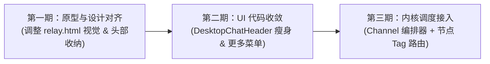

# 捎话 Tidings · 局域网团队协同 Agent IM 架构与产品设计方案

> 日期：2026-10-31  
> 状态：设计定稿 · 待实施  
> 核心命题：在局域网 P2P 团队协同与 Agent IM 新定位下，理清**人与人协作**、**人与 Agent 交互**以及**多节点同名工作区调度**的系统架构与产品形态。

---

## 一、 产品再定位：局域网团队协同 Agent IM (Human-Agent Team IM)

### 1.1 纠偏：为什么不是“纯 Agent 个人工作台”？
如果将产品完全重构成类似于 Cursor 或终端 Agent 调度器的纯 Agent 工具，将彻底自废武功，丢弃本项目最核心的壁垒——**P2P 去中心化通讯内核（TLS + 双向 SPKI Pin、局域网直连、离线队列、大文件/文件夹断点直传、多端自适应）**。

### 1.2 真正定位：人机同在场的超级群聊
- **场景**：局域网内的一个真实研发团队（几台电脑、几部手机），在同一个群聊中讨论方案、互传文件与截图。
- **Agent 的角色**：私有 Agent 不是孤岛式个人插件，而是**入驻在群聊中的常驻超级协作者**。
- **协同方式**：人类做方案讨论与高危审批，Agent 做任务执行、进度同步与结果交付，跨机调度网格提供算力后盾。

```mermaid
flowchart TD
    subgraph LAN["局域网团队协同底座 (Local Team Mesh)"]
        subgraph Humans["团队成员（人类）"]
            H1["Alice (Mac 架构师)"]
            H2["Bob (手机 审阅人)"]
        end
        subgraph Agents["智能体入驻 (私有 Agent)"]
            A1["Codex (宿主: Alice-Mac)"]
            A2["Claude (宿主: Bob-Mac)"]
            A3["Runner (宿主: Linux-Server)"]
        end
        G["同一个项目协作群聊 (Team Group Chat)"]
        H1 <-->|P2P 文字 / 截图 / 大文件直传| H2
        H1 -->|@ 委派任务| A1
        A1 -->|跨机派单 / agent-channel assign| A3
        A1 -->|高危审批卡片| G
        H2 -->|手机端点击批准 (免开电脑)| G
        A3 -->|交付验证产物 Artifact| G
    end
```

---

## 二、 多设备同名工作区（Workspace）调度解法：对齐 Paseo 范式

### 2.1 核心困境：同名代码库如何避免打架？
> 场景：Alice 和 Bob 电脑上都有 `teahouse-mobile` 仓库，群里入驻了两个同名的 Codex Agent。当有人在群里派发任务时，如何避免两边同时改代码、脏数据冲突或执行穿透？

### 2.2 黄金法则：代码物理隔离，绝不强行融合
> **「代码只有在某台具体机器的磁盘上，才是一个真实的工作区。」**  
> 绝对不要试图在局域网内搞跨机器的“虚拟文件夹无冲突实时编辑”，Git 才是代码版本汇合的唯一工具。

系统树状归属链：
```
物理节点 (Node: 设备 ID + 网络地址)
   └── 能力标签 (Tags: gpu, docker, macos, linux, runner)
          └── 宿主托管工作区 (Workspace: 绝对路径 + 分支状态)
                 └── 挂载的 Agent 实例 (Driver: Claude, Codex, 自定义脚本)
```

### 2.3 调度模式：显式主理 vs 标签路由（Paseo v0.13 式）

| 调度方式 | 运作机制 | 适用场景 |
|:---|:---|:---|
| **模式 A：群聊主理绑定 (Workspace Binding)** | 群聊显式绑定某个节点的工作区作为主理（例如该特性的主干在 Alice 的 Mac 上）。群内默认的 `@Codex` 直接由该主理工作区接单。 | 日常特性开发、代码重构、单点主导任务 |
| **模式 B：定向呼叫 (Explicit Host)** | 用户在派发时显式指定宿主：`@Codex(Alice-Mac)` 或 `@Runner(Linux-Server)`。 | 明确针对某台特定机器的环境排错 |
| **模式 C：标签路由 (Tag-based Dispatch)** | 任务通过 OpenBot 式的 `resources: ["workspace:<path>"]` 或 Paseo 式的 `--require gpu,linux` 声明环境。调度器自动匹配持该 Tag 的空闲节点，在 **Git Worktree 轻量沙箱** 中执行，提取 Diff 交付产物。 | 自动化回归、跑大模型微调、跨机集成测试 |

### 2.4 安全红线：谁的机器，谁审批
无论任务是由谁从手机或别的电脑触发的，只要涉及到写磁盘、跑危险命令（如 `rm -rf`、`git push`）：
- **审批权永远归属于该代码工作区所在的宿主机主**；
- 宿主机主拥有本地白名单与免批配置权，杜绝跨机非授权穿透。

### 2.5 异构多 Agent 模型选型与凭证安全 (Model Routing & Credential Security)
针对群内不同 Agent（架构师、编码员、测试员）的模型使用，融合 OpenBot 与 Paseo 的长处：
- **OpenBot 范式（按角色分配模型）**：群主理/架构师 Agent 绑定深度思考模型（如 `deepseek-v4.1-reasoner` / `claude-3-7-sonnet`），执行员/测试员 Agent 绑定高吞吐低时延模型（如 `deepseek-v4.1-flash` / `haiku`）。
- **Paseo 范式（模型即能力标签）**：节点可打 `model:claude`、`model:deepseek`、`model:local-ollama` 等标签。若手机端无外网访问或没有某模型的 Key，任务自动路由至拥有该模型凭证与环境的桌面节点沙箱执行。
- **凭证绝不上网**：API Key 与 Token 仅在具体节点本地沙箱通过环境变量注入，P2P 局域网消息中严禁出现任何明文密钥。

### 2.6 极简工程不变量与防返工铁律 (Zero-Rework Core Invariants)
为避免开发过程中因方案不切实际而推翻返工，架构设计严格确立六大工程不变量：
1. **零旧版兼容包袱**：开发中项目不搞向下兼容折衷，数据持久化直接走 SQLDelight `18.sqm` 原生关系表，协议端到端同版本推移；
2. **Git Worktree 轻量原生沙箱**：彻底摒弃笨重的 Docker 强制依赖，毫秒级签出临时工作树，100% 复用宿主本地 SDK 与构建缓存，完工无痕删除；
3. **单卡槽原位刷新 `(cardId, rev)`**：实时 stdout 日志走抽屉管道不存库，群聊流中一个任务恒占 1 个卡片槽位，杜绝 SQLite 膨胀刷屏；
4. **移动端审批自收敛 (TTL)**：审批带 5 分钟超时，超时自动转挂起释放 CPU，严禁因手机锁屏导致宿主电脑编译死锁；
5. **极简单向责任链 (Pipeline)**：`Architect` $\rightarrow$ `Coder` $\rightarrow$ `Tester` 单向传递产物，严禁 Agent 之间双向私聊发散；
6. **宿主硬件水位与低电量自保**：节点在心跳中上报硬件负载，`CPU > 85%` 自动拒单，`电池 < 20%` 自动避让重任务，做懂礼貌的智能算力宿主。

---

## 三、 产品界面（UI/UX）整体重构方案

针对之前“按钮堆叠严重、三层头部嵌套、观感拉大手机端”的问题，进行系统性收拢：

### 3.1 会话头部（Header）：从“按钮堆放区”转为“在线与状态感知区”

#### 1. 按钮大幅收拢进「⋯」（More）菜单
- **右上角常驻直出原则**：**最多保留 1~2 颗高频正向操作，其余全部进下拉菜单**。
  - **群聊（团队协同）**：
    - 直出：`[群成员/节点]`（查看当前谁在线、入驻了哪些 Agent）。
    - 折叠菜单（`⋯`）：群设置、查看群共享文件、清空聊天记录、解散/退出群聊。
  - **单聊（对人或对独立 Agent）**：
    - 直出：`[复制 ID]`（或图标化）。
    - 折叠菜单（`⋯`）：在新窗口打开、查看屏幕共享、传输日志、清空会话。
- **彻底将破坏性动作（清空、关闭）降级到下拉菜单末尾**，避免误触。

#### 2. 头部信息价值提升
- 展示群名称、局域网在线人数与 Agent 状态（例如：`3/5人在线 · 2个智能体就绪`）；
- 单聊或 Agent 会话头部标明其宿主与能力：`teahouse-mobile @ Alice-Mac (能力: ag1, gpu)`。

---

### 3.2 消息流与交互卡片（Agent Cards）：克制、紧凑、原位刷新

#### 1. 杜绝全屏代码刷屏
Agent 的中间过程（长日志、大段代码）不直接丢在聊天流里，而是收纳在结构化卡片中：
- **任务看板卡（Task Board）**：进度条 + 步骤状态行（✓ ▶ ○ ✕ ⏸）+ 当前指派人；
- **Diff 审阅卡（Diff Review）**：紧凑单行摘要（`+42 -7 core/.../NodeOutbound.kt`），点击抽屉看全文；
- **产物卡（Artifact Manifest）**：带 SHA256 校验与大小的轻量清单卡，按需点击存储。

#### 2. 原位刷新（In-place Update）
- 沿用并强化 `(cardId, rev)` 机制，任务状态变更只推进 `rev`，原位替换渲染，旧版本不重复推流刷屏。

#### 3. 审批按钮分层（S4-2b / S4-2d 规范）
- 第一行核心动作：`[拒绝]`（描边）与 `[批准]`（实心高亮）；
- 第二行次级小字：`本次会话免审` / `始终信任此工具`，彻底解决 393dp 窄屏排版撑爆问题。

---

### 3.3 桌面布局与第三栏（Inspector）

#### 1. 消除“三层 Header”的垂直挤压
- 融合标题栏（Traffic Lights）与全局工具栏，去除冗余的面包屑和副标题；
- 状态栏精简，将可用空间全量交还给消息流与代码审阅区。

#### 2. 引入桌面第三栏（宽屏自适应抽屉）
- 在 1100px 以上的宽屏桌面形态下：
  - **左栏（侧栏）**：会话列表（支持工作区/Agent 聚合 + 待处理审批汇总）；
  - **中栏（主视窗）**：群聊与卡片交互流；
  - **右栏（Inspector 抽屉）**：常驻展示当前选中的**代码变更完整 Diff、任务日志流、或群内共享产物库**，无需下钻换页。

---

## 四、 后续实施分期计划



1. **第一期（原型稿同步）**：
   - 更新 `prototype/relay.html`，完成头部右上角按钮收拢进 `⋯`、体现双行免审按钮与紧凑任务卡片。
2. **第二期（桌面 UI 瘦身落地）**：
   - 重构 `DesktopChatPane.kt` 中的 `DesktopChatHeader`，接入 `TopBarOverflowAction`，消灭平铺按钮堆叠问题。
3. **第三期（编排与调度闭环）**：
   - 提交当前工作区的 `ChannelOrchestrator`（M7-T2）与相关测试；
   - 完善节点标签体系（M7-T4 Paseo 式 Tag Dispatch），实现真正安全的局域网跨机协同。
