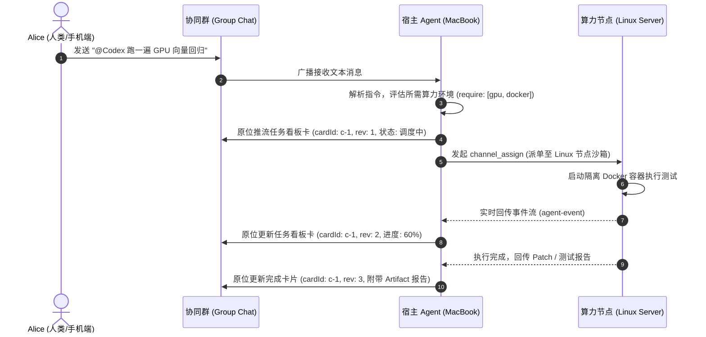
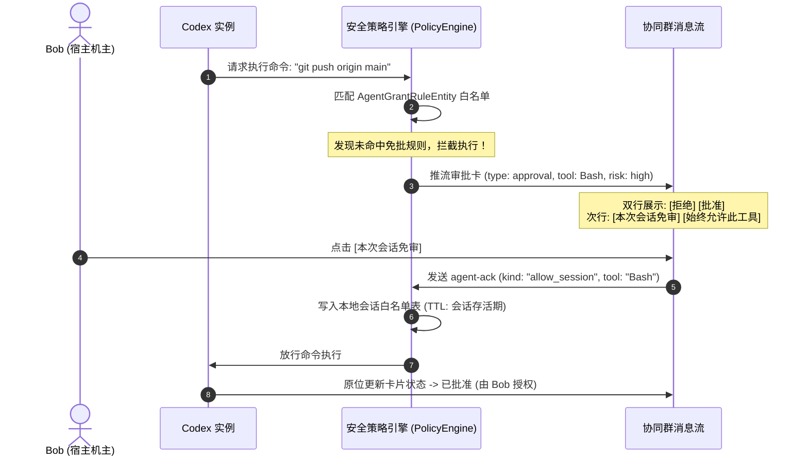
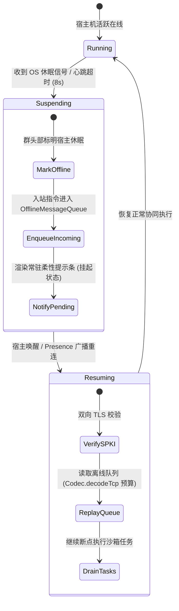
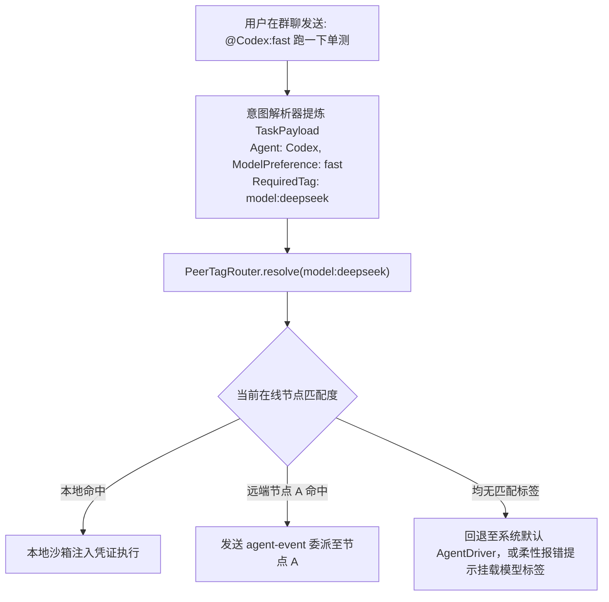

# 捎话 Tidings · 局域网团队协同 Agent IM 详细工程设计文档 (Detailed Design & RFC)

> **文档版本**：v1.1.0-RFC (Greenfield In-Dev Edition)  
> **更新时间**：2026-10-31  
> **核心原则（开发中项目原则）**：
> - **零旧版本历史包袱**：本项目处于高频快速演进的开发期，**不考虑任何面向老旧历史版本的向下兼容、回退容错或降级胶水代码**；
> - **一步到位原生设计**：存储直接走 SQLDelight 关系表（ACID + 索引约束），协议直接走干净明确的最优帧语义，不做“为了兼容老客户端而委曲求全”的折衷方案；
> - **协同节点同版本假定**：局域网参与协同的所有节点默认均部署同一开发分支构建，协议演进端到端同步推移。
> 
> **前序文档**：[lan-team-agent-im-architecture.md](lan-team-agent-im-architecture.md)（架构方案定稿）  
> **设计目标**：将高阶架构方案拆解为可直接执行的工程规范，涵盖模块分层、网络协议与白名单、SQLDelight 存储演进、Paseo 式跨机调度状态机、安全审批流程以及 UI 状态对齐标准。

---

## 目录
1. [系统分层与模块边界设计](#1-系统分层与模块边界设计)
2. [协议与数据传输规范 (Protocol & Frame Budget)](#2-协议与数据传输规范)
   - 2.1 群协同卡片帧格式 (`kind: "group-text"` + `card`)
   - 2.2 跨机派单帧格式 (`kind: "agent-event"` / `channel_assign`)
   - 2.3 审批回执与免审帧 (`kind: "agent-ack"`)
3. [数据库持久化演进 (SQLDelight & Migration)](#3-数据库持久化演进)
   - 3.1 实体 Schema 与迁移文件（版本 16 $\rightarrow$ 17）
   - 3.2 FTS 触发器与防孤儿不变量
4. [核心业务流序与状态机 (State Machines & Sequences)](#4-核心业务流序与状态机)
   - 4.1 流程 A：群内委派任务与跨机算力派单
   - 4.2 流程 B：高危工具拦截、双行审批与免审流转
   - 4.3 流程 C：宿主设备休眠与断点队列续传
   - 4.4 流程 D：异常处理、审批拒绝与故障自愈状态机
5. [领域层控制器与接口契约 (Domain API Contracts)](#5-领域层控制器与接口契约)
   - 5.1 `ChannelOrchestrator`（协同编排器）
   - 5.2 `WorkspaceManager`（工作区 1:1 防重管理器）
   - 5.3 `ApprovalPolicyEngine`（安全策略引擎）
   - 5.4 Paseo 算力标签体系与本地任务沙箱隔离契约
   - 5.5 多 Agent 异构模型选型、路由与 Provider 映射规范
6. [UI 表现层与组件架构 (Compose Specification)](#6-ui-表现层与组件架构)
   - 6.1 桌面三栏架构与 Inspector 抽屉
   - 6.2 Agent 卡片原位刷新系统
   - 6.3 顶栏动作收拢规范
7. [极简轻量化与防陷阱设计规范 (Lightweight Design & Anti-patterns)](#7-极简轻量化与防陷阱设计规范)
   - 7.1 移动端后台休眠与审批自收敛
   - 7.2 聊天流与数据库防刷屏机制
   - 7.3 Git Worktree 分支隔离与锁冲突防御
   - 7.4 信令与大文件传输严格分离
   - 7.5 多 Agent 极简单向责任链
   - 7.6 桌面端弹性自适应断点
   - 7.7 动态分层上下文裁剪与指针化
   - 7.8 `assign` 与 `transfer` 权责划分契约
   - 7.9 意图模糊时的反向多选卡
   - 7.10 节点平滑抖动心跳与宽限期
   - 7.11 任务全局租约与执行侧幂等防重
   - 7.12 宿主硬件水位保护与低电量自保
8. [质量门禁与可测试性验证 (Quality Gates & Verification)](#8-质量门禁与可测试性验证)

---

## 1. 系统分层与模块边界设计

系统严格遵守仓内分层架构约束（见 `AGENTS.md`），保证平台间的高内聚与低耦合：

```mermaid
graph TD
    subgraph UI[UI 表现层 :composeApp]
        DesktopChat[DesktopChatPane]
        DesktopInspector[DesktopInspectorPane]
        MobileChat[MobileChatScreen]
        AgentCardComp[AgentCardComposables]
    end

    subgraph Domain[领域层 :app (零 Compose 依赖)]
        Orchestrator[ChannelOrchestrator]
        WsMgr[WorkspaceManager]
        ApprEngine[ApprovalPolicyEngine]
        SqlDelight[RelayDatabase & SQLDelight Stores]
    end

    subgraph Core[跨平台内核 :core]
        ProtocolCodec[Codec / CodecMsg 白名单]
        FrameBudget[FrameBudget / TCP 截断保障]
        OfflineQueue[OfflineMessageQueue]
        Transport[UdpBroadcast / TcpTlsTransport]
    end

    subgraph AgentNode[控制面 :agentNode]
        AgentDriver[Anthropic / IPC Agent Driver]
        SandboxExec[Docker / Host Sandbox Executor]
    end

    UI -->|绑定 StateFlow 状态| Domain
    Domain -->|调用传输与编解码| Core
    Domain -->|管理与调度| AgentNode
    AgentNode -->|事件回传 (agent-event)| Core
```

- **`:core`**：定义协议原语、帧预算（Frame Budget）、严格白名单、编解码器（Codec）。严禁出现 Android/JVM/Desktop 专有逻辑。
- **`:app`（领域层）**：**零 Compose 依赖**（由 `:domainComposeFreeGate` 守护）。承载控制器、SQLDelight 数据库定义、离线队列策略与协同规则。
- **`:composeApp`（UI 层）**：仅消费领域层暴露的 `StateFlow`，实现桌面端/移动端自适应布局与微边框现代工卡。
- **`:agentNode`（Agent 控制面）**：管理本地进程生命周期、跨机派单沙箱、Tool 拦截与免批规则验证。

---

## 2. 协议与数据传输规范 (Protocol & Frame Budget)

### 2.1 群协同卡片帧格式 (`kind: "group-text"`)

群文本走严格字段白名单（`CodecMsg.GROUP_TEXT_KEYS`）。任何新增键未加入白名单均会导致对端整帧拒收（`extra-field`）。

#### 1. 字段白名单（终态，不扩展）
```kotlin
// 文件落点: core/src/commonMain/kotlin/.../protocol/CodecMsg.kt
// **终态 14 键**（规格 §4.1 裁决）：本方案对群文本白名单 **零新增** ——
// 结构化卡片复用既有的 `card` 键（终态成员），不追加任何顶层键。
// id/from/ts 是信封层字段，不在 payload 白名单里；senderNick 不存在
// （昵称显示走 memberNicks / agentSenderIdFor 归属链，不进帧）。
private val GROUP_TEXT_KEYS = setOf(
    "kind", "text", "groupId", "groupRev", "mentions", "resend", "replyTo",
    "senderId", "agentSessionId", "agentCursor", "agentSessionTitle",
    "agentIntent", "agentState", "card",
)
```

#### 2. 帧字节预算（Frame Budget）
- `group-text` 整包硬上限：**32 KiB**。
- `card` 结构体硬上限：**24 KiB**（超限时直接拒绝，不截断破坏 JSON 结构）。
- 发送端在 `NodeOutbound` 中必须显式校验，让“绝不产出注定被拒的包”成为系统不变量。

#### 3. 卡片载荷 Schema (`card` 字段结构)
```json
{
  "cardId": "c-9f82a1",
  "rev": 3,
  "type": "task | diff | artifact | approval | status",
  "title": "重构网络传输层 · 完成",
  "banner": {
    "tone": "done | info | warn | danger",
    "text": "1509 项测试全部通过"
  },
  "progress": 100,
  "steps": [
    { "label": "环境准备与代码拉取", "status": "done" },
    { "label": "执行 Gradle 全量编译", "status": "done" },
    { "label": "运行回归测试用例", "status": "done" }
  ],
  "diff": {
    "path": "core/src/commonMain/kotlin/Codec.kt",
    "add": 42,
    "del": 7,
    "note": "未知键透传优化"
  },
  "artifact": {
    "name": "refactor-report.md",
    "meta": "18 KB · text/markdown",
    "sha256": "3a8c1f..."
  },
  "approval": {
    "approvalId": "ap-102",
    "tool": "Bash",
    "summary": "git push origin main:release/1.4",
    "risk": "high",
    "status": "pending | approved | denied | expired"
  }
}
```

---

### 2.2 跨机派单帧格式 (`kind: "agent-event"`)

跨机派单**不走** `agent-event`（那是状态广播帧族）——本仓已按 M7-T2 决策包落地独立帧族 `agent-channel` / `agent-channel-result`（cap `agc1`，单播 RELIABLE，`CodecChannel` 校验，`ChannelOrchestrator` 接收宿主侧互斥台账已实现）。本方案的「Paseo 算力标签派单」消费这两个既有帧 + `targetTag` 路由（`ChannelTags.isWellFormed` 单源谓词 + `PeerTagRouter.resolve`），**不新增帧、不加 eventType**：

```json
// 发起（主理宿主 → 算力节点宿主，单播 P2P）：帧类型 "agent-channel"，cap agc1 门控
{
  "channelId": "ch-9f82a1",
  "op": "assign",                       // assign（租约必填）| transfer（所有权移交）
  "fromAgent": "agent:codex",
  "targetTag": "gpu-rtx4090",           // 与 toAgent 恰一；形状 [a-z0-9][a-z0-9._-]*
  "task": "在沙箱跑 tests/gpu/ 全量回归",
  "deadlineMs": 600000,
  "resources": ["workspace:/workspace/teahouse-mobile"]
}
// 应答（算力节点 → 主理宿主）：帧类型 "agent-channel-result"
// status 复用 CodecInvoke.InvokeResultStates（done/denied/no-executor/no-plugin/timeout/error），
// 无匹配标签时以 no-tag-match 语义答 no-plugin 族 + 柔性提示卡（见 4.4-4），绝不静默丢弃。
```
> 帧字段级约束（恰一互斥、租约纪律、结果自洽）以 `CodecChannel` 与决策包 §1.4 为准，本文不复写第二份。

---

### 2.3 审批回执与免审帧 (`kind: "agent-ack"`)

严格杜绝“第 7 种静默丢失”（取值域白名单缺失）。取值域**只有一份定义**——代码 `AgentAckKinds`（core/protocol `MessageTypes.kt`，实测 8 值），编解码校验与所有消费方共同引用；本文不另写第二份清单，只列与本方案相关的取值：

```kotlin
// 唯一来源: core/src/commonMain/kotlin/.../protocol/MessageTypes.kt 的 object AgentAckKinds
// 实际 8 值：queued / approved / denied / cancelled / received /
//           allow_session（本次会话免审）/ revoke_session（撤销）/ always（按 tool 名免审，落宿主授权表）
// 注意：不是 approve/deny，也不是 allow_always —— 取值以 AgentAckKinds.VALUES 为准，
// 任何文档示例与它冲突时以代码为准（AGENTS.md §3 第 7 种静默丢失的防线）。
// choices 字段的「生态词」allow/deny 是另一个字段（宿主兜底词汇，见 PROTOCOL-EXTENSION §6.5），
// 与这里的 kind 取值域分属两个字段，禁止混用。
```

---

## 3. 数据库持久化演进 (SQLDelight & Migration)

基于“开发中项目无需考虑历史降级包袱”的原则，我们直接采用 **SQLDelight 原生关系表设计**，享受强类型查询、唯一约束（UNIQUE INDEX）与事务 ACID 保障，完全不需要为了兼容老版本而把数据绕道写入松散的独立 JSON。

当前数据库实际已包含 17 个迁移文件（1.sqm ~ 17.sqm，Schema 版本 18）。新增协同模型严格创建 **`18.sqm`**（版本升至 19），并同步补入主 `RelayDatabase.sq`。

### 3.1 实体 Schema 与迁移文件 (`18.sqm`)

```sql
-- 文件落点: app/src/commonMain/sqldelight/com/kapp/tidings/db/migrations/18.sqm
-- 新增协同工作区绑定、算力标签与本地免批规则表 (版本 18 -> 19)

-- 1. 工作区绑定表 (1:1 物理隔离与防重)
CREATE TABLE IF NOT EXISTS WorkspaceBindingEntity (
    workspaceId TEXT PRIMARY KEY NOT NULL,
    groupId TEXT NOT NULL,
    hostNodeId TEXT NOT NULL,
    wsPath TEXT NOT NULL,
    gitBranch TEXT NOT NULL,
    isHostActive INTEGER AS Boolean NOT NULL DEFAULT 1,
    createdAt INTEGER NOT NULL,
    updatedAt INTEGER NOT NULL
);

CREATE UNIQUE INDEX IF NOT EXISTS idx_ws_binding_unique 
ON WorkspaceBindingEntity(groupId, hostNodeId, wsPath);

-- 2. 算力节点标签 (Paseo Tags)：**不建表** —— 已落地为独立 JSON store
--    stores/peer-tags.json（PeerTagFileStore，commit 1e774b1a）。三条理由：
--    a) 节点表不在 relay.db（PeerEntity 不存在），标签跟着走库反而要造新表挂空；
--    b) knownPeersSnapshot() 从 PeerRecord 整份重建后 save，任何「顺手加字段」都会被
--       下一次 save 静默抹掉（决策包 §3.2 A 案两坑）；
--    c) 标签是机主本地便条，不广播不查询 joins，JSON store（不过期、与 registry 解耦）
--       零迁移零协议键。若未来出现 SQL 级查询需求再议迁表，须先过停机条件 6（数据库迁移先问人）。

-- 3. 本地免批授权规则表 (安全策略)
--    分工（D-025④）：AgentToolApprovalStore = 宿主级（tool 粒度）免批，既有 M4/S4-2 线资产；
--    本表 = 工作区作用域免批规则的持久化层（新维度：workspaceId + toolPattern + scope + expiresAt）。
--    两层各管各的维度，不互抄字段、不重复存同样规则；开工前先对账既有 AgentGrantStore 结构。
CREATE TABLE IF NOT EXISTS AgentGrantRuleEntity (
    ruleId TEXT PRIMARY KEY NOT NULL,
    workspaceId TEXT NOT NULL,
    toolPattern TEXT NOT NULL,      -- 如 "git status*", "pytest*"
    scope TEXT NOT NULL,            -- "session" | "always"
    grantedBy TEXT NOT NULL,
    createdAt INTEGER NOT NULL,
    expiresAt INTEGER NOT NULL      -- 0 表示不过期
);

-- 4. 扩展消息表中的 card 载荷 (结构化卡片存储)
ALTER TABLE MessageEntity ADD COLUMN cardPayload TEXT DEFAULT NULL;
```

### 3.2 FTS 触发器与防孤儿不变量
- **铁律**：`MessageFts_docsize` 行数 $\equiv$ `MessageEntity` 行数。
- `AFTER UPDATE` 触发器必须严格添加条件：`WHEN old.text IS NOT new.text`，卡片状态（`rev`、审批结果）变更只改 `cardPayload`，**严禁触发 FTS 全文索引重写**，避免磁盘空间膨胀。
- `INSERT OR REPLACE` 的隐式删除**不触发 `AFTER DELETE`** ⇒ 原位刷新卡片（推进 `rev`）重写同一条消息前必须先显式执行 `insertMessageDropStaleIndex`（FTS5 的 `'delete'` 命令）——这是单卡槽原位刷新不变量 3 的配套纪律。
- **ALTER 类迁移必须同时查 unversioned 哨兵路径**（`5c1d1b46` 的教训）：迁移运行器对「表已最新、无人盖章」的库要走最新形状哨兵跳迁移，否则 18.sqm 的 `ADD COLUMN cardPayload` 会 `duplicate column` 拦在启动前。
- 迁移自包含（不假设表存在，`IF NOT EXISTS` 补建）+ 加 `.sqm` 同步 `ScreenHistoryRecordTest` 版本断言 + 修完存量数据 `VACUUM`。

---

## 4. 核心业务流序与状态机 (State Machines & Sequences)

### 4.1 流程 A：群内委派任务与跨机算力派单



---

### 4.2 流程 B：高危工具拦截、双行审批与免审流转



---

### 4.3 流程 C：宿主设备休眠与断点队列续传



---

### 4.4 流程 D：异常处理、审批拒绝与故障自愈状态机 (Failure Modes & Recovery)

在实际人机交互中，必须具备完整的异常处理闭环，杜绝任何“界面挂起、死循环无响应、脏数据污染”的现场：

#### 1. 编译/测试执行失败与自愈重试 (Auto-heal Loop)
当 Agent 执行构建命令（如 Gradle 构建或单测）退出码非 0 时：
- **禁止全量堆栈刷屏**：由宿主提炼关键报错（匹配 `error: / FAILED / Exception`，限前 3 行与关键文件行号）；
- **自愈循环契约（最多 3 轮）**：
  ```mermaid
  flowchart TD
      TestFail["测试/构建失败 (exitCode != 0)"] --> Extract["提取关键报错摘要 (<= 3 行)"]
      Extract --> CheckRetry{"重试次数 < 3?"}
      CheckRetry -->|"是 (round <= 3)"| Feedback["将报错摘要注入 Codex 上下文\n触发 Auto-heal 自愈重试"]
      Feedback --> ReRun["重新生成 Patch 并重跑验证"]
      ReRun --> TestFail
      CheckRetry -->|"否 (超限)"| MarkDanger["卡片状态转为 danger\n标题: 构建失败 (已尝试自愈 3 轮)"]
      MarkDanger --> HumanActions["提供操作按钮:\n[查看错误日志] [手动重试] [转交人工修复]"]
  ```

#### 2. 用户审批拒绝后的优雅降级 (Graceful Denial Handling)
当机主对高危命令点击 `[拒绝]`（Deny）时：
- 安全引擎向 Agent 派发 `DriverEvent.Interrupted("PermissionDenied: Tool execution rejected by host owner")`；
- Agent **严禁直接崩溃或无限等待**，必须捕获该中断信号，在群聊中生成说明：“机主已拒绝执行 `git push` 命令，已停止远端推送，当前代码保留在本地临时补丁中”；
- 审批卡片原位更新为 `tone: warn`，显示 `[已由 Bob 拒绝]`，流程安全收敛。

#### 3. 用户手动打断与级联杀进程 (Task Abortion & Cancellation)
当用户点击任务看板卡右上角的 `[中止任务]`（Abort）时：
- 宿主 `ChannelOrchestrator` 触发 `abortTask(taskId)`；
- **级联杀进程规范**：不仅在应用层置位取消标志位，还必须通过平台接口向该任务的进程组（Process Group）发送 `SIGTERM`，若 3 秒内未退出则强制发送 `SIGKILL`，杜绝子进程在后台持续消耗算力或死锁文件；
- 临时沙箱目录立即执行清理（`rm -rf /tmp/tidings-sandbox-<taskId>`），卡片状态更新为 `tone: info, text: "任务已由用户手动中止"`。

#### 4. 算力标签无匹配节点的柔性提示 (No Matching Tag Fallback)
当任务指定的算力标签（如 `gpu:rtx4090` 或 `model:claude`）在局域网内无在线节点匹配时：
- `PeerTagRouter` 返回 null，调度器**绝不静默丢弃**；
- 在群内原位弹出柔性操作卡片：
  - **提示**：“当前局域网内暂无拥有 [gpu:rtx4090] 标签的在线节点”；
  - **选项**：`[在本机 CPU 降级执行]`、`[挂起等待节点上线]`、`[取消任务]`。

#### 5. 代码合并前脏状态与冲突防御 (Dirty Working Tree & Merge Conflict)
当机主在群内点击 `[合并此补丁]`（Merge Patch）时：
- **前置健康检查（Pre-merge Health Check）**：
  宿主先执行 `git status --porcelain`：
  - 若存在未暂存/未提交的代码，**立刻阻断合并**，弹窗提示：“宿主工作区存在未提交的修改，为防覆盖，请先 stash 或 commit 后再合并”；
  - 若发生 Git 冲突，**严禁生成 `.rej` 垃圾文件**，提供一键操作：`[切换为新分支合并: feature/patch-x]`，由机主手动解决冲突。

---

## 5. 领域层控制器与接口契约 (Domain API Contracts)

所有接口声明在 `:app` 模块的 `commonMain` 中，**禁止导入任何 Compose 库**。

### 5.1 `ChannelDispatchCoordinator`（发起侧协同协调器，:app）
> **命名（D-025①）**：接收侧编排器 = agentNode `ChannelOrchestrator`（已交付，互斥台账/租约/回执，名字不动）；
> 本节是**发起侧**的 :app 协调器，改名避免 import 撞车。两侧经 `agent-channel` / `agent-channel-result` 帧族通信。
> **实现口径（D-025②）**：消费既有路径，不新建第二套——意图提炼走 `agentIntent`（`handleInboundAgentIntent`），
> 节点选择用 `PeerTagRouter.resolve`（已交付 `1e774b1a`，返回 `nodeId: String?`；`NodeEntry` 不存在，节点表不在库），
> 跨机派单复用 `sendAgentChannel`（`NodeRuntime` 发送门）与 M4 的 `dispatchCrossHostInvoke` 经验。
```kotlin
// 文件落点: app/src/commonMain/kotlin/.../orchestrator/ChannelDispatchCoordinator.kt
interface ChannelDispatchCoordinator {
    /** 根据算力/模型需求标签选择匹配的在线节点（PeerTagRouter 封装；null = 无匹配 ⇒ 柔性提示卡 4.4-4） */
    suspend fun resolveExecutionNode(requiredTags: Set<String>): String?

    /** 按既有发送门（对端 caps agc1）分发任务到目标节点宿主（op=assign，租约必填） */
    suspend fun dispatchToNode(
        targetNodeId: String,
        taskPayload: TaskDispatchPayload
    ): DispatchOutcome

    /** 取消当前正在执行的任务 (打断执行；接收侧中止语义见 4.4-3 级联杀进程) */
    suspend fun abortTask(taskId: String): Boolean
}
```

### 5.2 `WorkspaceBindingManager`（工作区 1:1 防重管理器，:app）
> **命名（D-025③）**：与 agentNode `WorkspaceRegistry`（agent-workspace 帧的会话台账）是两套东西——
> 本节管 relay.db 的 `WorkspaceBindingEntity`（群 ↔ 宿主物理工作区绑定）；后者管跨端工作区宣告帧的台账。分工不混。
```kotlin
// 文件落点: app/src/commonMain/kotlin/.../workspace/WorkspaceBindingManager.kt
interface WorkspaceBindingManager {
    /** 将群聊与具体的物理宿主工作区绑定 (防重校验) */
    suspend fun bindWorkspace(
        groupId: String, 
        hostNodeId: String, 
        absolutePath: String
    ): Result<WorkspaceBinding>

    /** 检查当前工作区是否已被其他群绑定 */
    suspend fun isPathBound(hostNodeId: String, absolutePath: String): Boolean

    /** 获取指定群绑定的代码工作区快照 (Git 分支与状态) */
    fun observeWorkspaceStatus(groupId: String): Flow<WorkspaceStatusSnapshot?>
}
```

### 5.3 `ApprovalPolicyEngine`（安全策略引擎）
```kotlin
// 文件落点: app/src/commonMain/kotlin/.../security/ApprovalPolicyEngine.kt
interface ApprovalPolicyEngine {
    /** 判定指定工具调用是否允许静默执行 */
    suspend fun evaluateToolExecution(
        workspaceId: String,
        sessionId: String,
        tool: String,
        params: Map<String, String>
    ): EvaluationResult

    /** 授权审批通过并写入免批规则 */
    suspend fun recordGrant(
        workspaceId: String,
        rule: GrantRuleSpec
    ): Result<Unit>
}

sealed interface EvaluationResult {
    data object Allow : EvaluationResult
    data class RequireApproval(val approvalId: String, val reason: String) : EvaluationResult
    data class Block(val reason: String) : EvaluationResult
}
```

### 5.4 任务沙箱隔离契约：对齐 OpenBot 与 Paseo 的轻量化设计 (Lightweight Sandbox Contract)

#### 1. 为什么“强制容器 (Docker) 沙箱”过重且不切实际？
在早期设想中，容易直觉性地引入 Docker 容器隔离，但在真实的局域网跨端开发场景中，强制容器化存在致命缺陷：
- **工具链与本地缓存割裂**：开发者宿主机配置了完整的 Android SDK、Xcode、特定的 JDK 以及数 GB 的 Gradle 缓存（`~/.gradle/caches`）。丢进容器后缓存丢失，每次任务都要从零拉依赖，巨慢且严重消耗带宽；
- **macOS 与原生开发障碍**：跨平台移动项目（如 iOS 编译、AWT/Skiko 渲染）根本无法在 Linux Docker 容器中执行；
- **设备负担过重**：要求协同者的 Mac 笔记本常驻耗费 4~8GB 内存的 Docker Desktop，产品落地门槛极高。

#### 2. OpenBot 与 Paseo 的真实处理哲学
研读源码可以发现，两款先锋项目均采用了**极度轻量、开箱即用的原生隔离方案**：
- **OpenBot 的做法**：**“Git Worktree 临时工作区 + 声明式资源互斥锁 (Resources Mutex) + 应用层工具审批”**。
  - 改代码不在原目录改，而是利用 Git 原生机制开一个临时 `git worktree`；
  - 调度器通过 `resources: ["workspace:<abs-path>"]` 将同一工程的任务自动串行化，防止并发写冲突；
  - 安全依赖应用层对高危命令的审批拦截，而非笨重的容器 namespace。
- **Paseo 的做法**：**“原生子进程为主 (Native Subprocess First) + 容器仅为可选标签”**。
  - Paseo 90% 的算力节点就是普通的开发机，默认直接拉起本地子进程，仅做环境变量净化与工作目录限制；
  - 只有明确打上 `--tag docker` 标签且任务显式要求的场景，才调用 Docker。容器只是高级可选插件，绝非门槛。

#### 3. Tidings 团队协同 IM 的轻量沙箱架构（三位一体轻量沙箱）

```
+-----------------------------------------------------------------------------------+
| 物理宿主机 (Host Node: Mac / Linux / Windows)                                      |
|                                                                                   |
|  [代码根仓库] /workspace/teahouse-mobile (.git 对象库，机主代码零污染)             |
|       │                                                                           |
|       ▼ 毫秒级创建 (git worktree add -b tmp-<taskId>)                             |
|  +-----------------------------------------------------------------------------+  |
|  | 轻量隔离工作区 (Git Worktree: /tmp/tidings-ws/<taskId>)                      |  |
|  |                                                                             |  |
|  |  - 拥有完全独立的文件工作树，与机主当前未保存代码彻底物理隔离                  |  |
|  |  - 共享本地 .git 对象库与本地 SDK / Gradle 缓存，无需重复下载依赖            |  |
|  |  - 执行进程：Native Subprocess (环境变量净化，挂载独立 Process Group)         |  |
|  |  - 安全拦截：危险命令由 ApprovalPolicyEngine 双行审批拦截                    |  |
|  |                                                                             |  |
|  |  [提纯输出]                                                                 |  |
|  |       ├── git diff (提取为 patch.diff，覆盖文件清单与 +/- 统计)                |  |
|  |       └── report.json (测试报告与退出码)                                     |  |
|  +-----------------------------------------------------------------------------+  |
|       │                                                                           |
|       ▼ 任务完成，毫秒级清理 (git worktree remove --force)                        |
|  [产物交付] 推送群内 Diff 审阅卡 -> 机主审查无误后一键合流                          |
+-----------------------------------------------------------------------------------+
```

#### 4. 轻量沙箱执行生命周期契约

```kotlin
// app/src/commonMain/kotlin/.../sandbox/WorktreeSandbox.kt
interface LightweightSandbox {
    /** 毫秒级从原仓库签出独立工作区 */
    suspend fun createWorktree(
        repoPath: String, 
        taskId: String, 
        baseBranch: String
    ): Result<SandboxWorkspace>

    /** 执行受限编译与测试命令 (注入纯净环境变量) */
    suspend fun executeCommand(
        workspace: SandboxWorkspace,
        command: String,
        envOverrides: Map<String, String>
    ): ExecutionResult

    /** 提取变动补丁 (git diff) 并彻底销毁临时 worktree */
    suspend fun extractDiffAndCleanup(
        workspace: SandboxWorkspace
    ): PatchArtifact
}
```

- **第一步：秒级隔离**：执行 `git worktree add /tmp/tidings-ws/<taskId> -b task-<taskId>`，零磁盘冗余，不碰原目录文件；
- **第二步：复用本地环境**：子进程直接使用宿主已有的 JDK、Gradle、Cargo、Node 等工具链，复用 `~/.gradle/caches`，秒级开编；
- **第三步：提纯产物**：执行 `git diff > /tmp/tidings-ws/<taskId>/patch.diff`，收集变动；
- **第四步：无痕销毁**：执行 `git worktree remove --force` 并删除临时分支，不留任何临时垃圾；
- **第五步：容器降级**：仅当节点安装了 Docker、声明了 `docker` 标签且用户任务显式要求时，才走容器运行器；默认 100% 走极速轻量的 Git Worktree 方案。

---

### 5.5 多 Agent 异构模型选型、路由与 Provider 映射规范 (Model Selection & Routing)

在实际工程协作中，不可能让所有 Agent 使用同一种模型（例如跑单测用顶级推理模型太慢且贵，而架构设计用小模型能力不足）。基于前序对 **OpenBot** 与 **Paseo** 的调研分析，本系统提炼并融合了二者的处理机制：

#### 1. 调研机制对比与融合结论

| 维度 | OpenBot 处理机制 | Paseo 处理机制 | Tidings 团队协同 IM 融合落地方案 |
|:---|:---|:---|:---|
| **核心范式** | **角色强绑定模型 (Role-to-Model Binding)**<br/>每个 Agent（Coder、Reviewer、Orchestrator）在内部配置中固定模型与 Prompt 模板 | **能力标签路由 (Model-as-a-Tag Routing)**<br/>节点声明自身拥有的模型/API（如 `--tag model:claude`），任务按需求路由 | **双层分工架构**：<br/>① 逻辑层：Agent 角色拥有推荐模型预设（默认模型 + 替代模型）<br/>② 物理层：通过 Paseo 标签寻路持有该模型访问权/凭证的宿主节点执行 |
| **任务分派** | `channel_assign` 仅指定接收 Agent ID，不越俎代庖干涉其内部模型调用 | 任务发起时要求 `requireTags: ["model:deepseek-v4"]`，调度器找节点 | `ChannelAssign` 支持指定 Agent 角色，可携带可选的 `modelVariant`（如 `fast` 或 `pro`）；由调度器匹配标签 |
| **凭证管理** | 单机环境，读取本机环境变量或系统 CLI 登录态 | 节点本地沙箱注入 API Key，不在网络层广播凭证 | **凭证宿主本地化**：P2P 协议绝不明文传输 API Key；机主在各节点本地配置，通过沙箱环境变量注入 |
| **多 Provider 适配** | 依赖各 Agent 自身 SDK 或统一 HTTP proxy | 将算力节点与环境变量解耦，沙箱运行时动态挂载 | 统一适配器规范：支持 OpenCode Go / OpenAI / Anthropic 格式的 Endpoint 与 Key 映射 |

#### 2. Agent 角色模型推荐配置矩阵 (Default Model Presets)

在群聊协同场景中，不同角色的认知负荷与成本预算差异极大：

| 协同角色 (Agent Role) | 推荐模型定位 | 典型推荐模型 (以 OpenCode Go / 主流模型为例) | 决策理由与特征 |
|:---|:---|:---|:---|
| **群主理人 (Orchestrator / Architect)** | 强逻辑、深度思考模型 (Reasoner / Pro) | `deepseek-v4.1-reasoner` / `claude-3-7-sonnet` / `o3-mini` | 负责把控全局架构、拆解多步骤任务、审阅复杂 Diff，需要强推理能力 |
| **执行工程师 (Coder / Implementer)** | 高性价比、大吞吐代码模型 (Coder) | `deepseek-v4.1-flash` / `qwen2.5-coder` / `claude-3-5-haiku` | 负责根据计划逐个编写函数、补全实现，注重响应速度与代码补全准度 |
| **质量测试员 (Tester / Runner)** | 极速响应、遵循指令模型 (Flash / Light) | `deepseek-v4.1-flash` / `gemini-2.0-flash` | 负责执行 Gradle 构建、解析日志、运行测试套件，侧重快速工具调用与报错提炼 |
| **安全审计员 (Security Guard)** | 严格合规、低幻觉模型 (High Determinism) | `claude-3-7-sonnet` (严格参数) / `gpt-4o` | 负责审查 Bash 命令风险级别与文件写入边界，严禁误判与幻觉 |

#### 3. Paseo 模型能力标签与路由规则

我们将模型能力作为 Paseo 算力标签的一等公民。节点在 `peer-tags.json` 中可声明其具备的模型访问能力：

- `model:claude`：该节点拥有 Anthropic / Claude Code 可用环境或授权；
- `model:deepseek`：该节点具备 DeepSeek 接口调用链路或 OpenCode Go 代理通道；
- `model:local-ollama`：该节点本地运行了 Ollama / vLLM（离线完全可跑）；
- `gpu:cuda`：该节点具备显卡支持，可拉起本地微调或重度推理。

**调度仲裁流 (Dispatch Flow)**：


#### 4. 凭证注入与统一 Provider 映射契约 (Provider Environment Mapping)

为了兼容多款 CLI（Claude Code、Codex、OpenCode 等），宿主节点在启动 Agent 沙箱或子进程时，统一按照以下规则将凭证注入环境变量：

```kotlin
// app/src/commonMain/kotlin/.../agent/AgentModelConfig.kt
data class ModelProviderConfig(
    val providerId: String,          // e.g. "opencode-go", "deepseek-direct", "anthropic"
    val apiBaseUrl: String,          // e.g. "https://api.opencode.go/v1"
    val apiKey: String,              // 机主本地保存，严禁进入 P2P 报文
    val defaultModel: String,        // e.g. "deepseek-v4.1-flash"
    val reasonerModel: String? = null // e.g. "deepseek-v4.1-reasoner"
)

object ModelEnvMapper {
    /** 将宿主配置映射为不同 CLI 的专属环境变量 */
    fun buildEnvironment(config: ModelProviderConfig, targetCli: String): Map<String, String> {
        return when (targetCli) {
            "claude" -> mapOf(
                "ANTHROPIC_BASE_URL" to config.apiBaseUrl,
                "ANTHROPIC_API_KEY" to config.apiKey,
                "ANTHROPIC_MODEL" to config.defaultModel
            )
            "codex" -> mapOf(
                "OPENAI_BASE_URL" to config.apiBaseUrl,
                "OPENAI_API_KEY" to config.apiKey,
                "CODEX_MODEL" to config.defaultModel
            )
            "opencode" -> mapOf(
                "OPENCODE_API_KEY" to config.apiKey,
                "OPENCODE_MODEL" to config.defaultModel
            )
            "antigravity" -> mapOf(
                // agy CLI 默认复用 ~/.gemini 登录凭证；若自定义模型网关则注入兼容端点
                "OPENAI_BASE_URL" to config.apiBaseUrl,
                "OPENAI_API_KEY" to config.apiKey,
                "ANTIGRAVITY_MODEL" to config.defaultModel
            )
            else -> mapOf(
                "OPENAI_BASE_URL" to config.apiBaseUrl,
                "OPENAI_API_KEY" to config.apiKey
            )
        }
    }
}
```

#### 5. 安全不变量与隔离纪律 (Strict Security Invariants)

1. **凭证永不离机**：API Key 与 Session Token 仅落盘于节点本地的持久化加密区（或凭证文件），**绝对禁止在局域网 P2P 报文（`group-text`、`agent-event` 等）中携带任何鉴权密钥**。
2. **算力节点自主鉴权**：委派任务时，主理端只传递任务 Prompt、上下文快照与所需标签；算力节点沙箱在接收到指令后，使用算力节点自身的凭证调用模型。
3. **标签虚假防御**：如果某节点打上 `model:claude` 标签但实际调用超时或鉴权失败，`ChannelOrchestrator` 会记录其 `lastError=auth-failed` 并降级该节点在该标签下的路由权重，同时在群内以柔性卡片提示机主排查该节点凭证。

#### 6. Google Antigravity 专属协同契约 (Hooks & Inverse Injection)
详细方案见独立设计规范 `docs/ANTIGRAVITY-INTEGRATION-DESIGN.md`。核心契约如下：
- **主动派单 (agy)**：`CliSubprocessDriver` 探测到 `~/.local/bin/agy` 或系统 `$PATH` 时自动注册 `agent:antigravity`，启动命令追加 `--output-format stream-json --workspace <worktree>`，将 `step_update` 流式转换为群内任务看板卡原位刷新；
- **被动审批 (PreToolUse)**：Hook 拦截危险工具（如 `Bash: git push`），向宿主发起审批请求，群内推送双行审批卡，手机端点击 `[批准]` 后，Hook 向进程 stdout 吐出 `{"decision":"allow"}` 放行；
- **反向注入 (PreInvocation)**：手机端在群聊中输入补充修正指令时，暂存于宿主中继队列。Antigravity 触发 `PreInvocation` 时通过 `injectSteps[].userMessage` 将手机消息作为用户输入反向注入当前推理上下文，实现免开电脑直接纠偏。

---

## 6. UI 表现层与组件架构 (Compose Specification)

### 6.1 桌面三栏架构与 Inspector 抽屉

在 `DesktopChatPane` 中，根据窗口宽度动态开启三栏布局：
```
+-----------------------------------------------------------------------------------+
| TopBar (Traffic Lights + 群名 + 在线节点数 + [成员] [⋯])                            |
+-------------------+---------------------------------------+-----------------------+
| 侧栏 (Conversations) | 主聊天流 (Chat Stream)                 | 第三栏 (Inspector)    |
|                   |                                       |                       |
| - 待审批聚合胶囊   | - 顶部常驻感知条 (执行互斥/休眠挂起)     | - 选中卡片的完整 Diff  |
| - 团队协同群       | - 文本气泡 (62% 宽)                   | - 任务日志全文流      |
| - 节点列表         | - Agent 宽幅卡片 (max-width: 700dp)    | - 交付产物清单下载    |
|                   | - 协同输入区 (快捷胶囊: @Codex, /test)  |                       |
+-------------------+---------------------------------------+-----------------------+
```

- **宽度断点**：`WindowWidth < 840dp` 走单栏；`840dp ~ 1100dp` 走标准两栏；`> 1100dp` 自动展开第三栏 Inspector。
- **状态流转**：点击消息流中的任意 Diff 或 Artifact 卡片，右侧 Inspector 原位展开，不跳出当前会话。

### 6.2 Agent 卡片原位刷新系统

在 Compose 中，利用 `(cardId, rev)` 维持不可变状态流，防止重复产生气泡：
```kotlin
@Composable
fun AgentCardItem(
    card: AgentCardUiState,
    onAction: (CardAction) -> Unit,
    modifier: Modifier = Modifier
) {
    Surface(
        shape = RoundedCornerShape(16.dp),
        border = BorderStroke(1.dp, MaterialTheme.colorScheme.outlineVariant),
        shadowElevation = 2.dp,
        modifier = modifier
            .fillMaxWidth()
            .widthIn(max = 700.dp) // 独享 700dp 展开视窗
            .padding(vertical = 8.dp)
    ) {
        Column(
            modifier = Modifier.padding(18.dp),
            verticalArrangement = Arrangement.spacedBy(12.dp) // 呼吸节奏留白
        ) {
            AgentCardHeader(card.type, card.title, card.rev)
            card.banner?.let { AgentCalloutBanner(it) }
            card.progress?.let { AgentProgressBar(it) }
            card.diff?.let { AgentDiffSnippet(it) }
            card.artifact?.let { AgentArtifactPill(it) }
            card.approval?.let { 
                AgentDualRowApprovalActions(
                    approval = it, 
                    onAction = onAction
                ) 
            }
        }
    }
}
```

---

## 7. 极简轻量化与防陷阱设计规范 (Lightweight Design & Anti-patterns)

在真实工程落地中，必须时刻警惕“看起来美好、但落地极脆极重”的直觉型过度设计。以下 6 项规范为本系统不可违背的轻量化准则：

### 7.1 移动端后台休眠与审批自收敛 (Mobile Doze & Approval TTL)
- **陷阱**：假定手机端是一个 24 小时不断线的长连接客户端。实际上 Android Doze 锁屏数分钟即切断 Socket，iOS 更是数十秒挂起进程。
- **准则**：
  1. **宿主自持决策权**：代码宿主（桌面端）是决策与执行的主体，手机仅是远程观察/操控端；
  2. **审批超时自动挂起 (Approval TTL)**：审批卡片默认带 TTL（如 5 分钟），超时机主未确认自动转为 `expired` 挂起状态并释放 CPU，**严禁无限期挂起阻塞宿主线程**；
  3. 手机端重新点亮屏幕打开 App 时，通过增量拉取（Delta Sync）同步最新状态。

### 7.2 聊天流与数据库防刷屏机制 (Chat Stream Anti-pollution)
- **陷阱**：Agent 执行每一步、打出的每行日志都生成一条聊天消息，导致 SQLite 数据库一天暴增数万行垃圾记录，用户无法找寻真实发言。
- **准则**：
  1. **执行流与归档卡片分离**：Agent 实时 stdout 日志只走内存/回环的 Inspector 实时管道，**绝不写入 `MessageEntity` 数据库表**；
  2. **全周期单卡片槽位**：一个任务在群聊流中永远只占 **1 个卡片槽位**，通过 `(cardId, rev)` 原位覆盖；任务结束仅沉淀终态卡片（或 Diff 卡），保持聊天流干净整洁。

### 7.3 Git Worktree 分支隔离与锁冲突防御 (Worktree Lock Defense)
- **陷阱**：并发任务签出同名分支，导致 Git 抛出 `already checked out` 错误，或异常退出留下死锁的 Worktree。
- **准则**：
  1. **唯一化临时分支**：命名严格采用 `tidings/ws-<taskId>-<timestamp>`；
  2. **开工前自动清理**：每次创建 Worktree 前，宿主自动执行 `git worktree prune` 剔除孤儿目录；
  3. **单工作区串行化**：同工作区任务在调度层默认串行队列执行，前一个合流或取消后再拉起下一个，杜绝 Git 索引并发锁冲突。

### 7.4 信令与大文件传输严格分离 (Signaling vs Payload Separation)
- **陷阱**：试图把打包出来的 20MB APK、生成的大产物直接塞进群聊消息帧内发给对端。
- **准则**：
  1. **信令走群聊**：群内 `agent-artifact` 帧严格只携带**轻量元数据**（文件名、sha256、bytes、summary），完全控制在 TCP 预算（32 KiB）以内；
  2. **大文件走本仓原生 P2P 传输通道**：手机端或远端节点点击下载时，**直接复用本仓既有的 `TransferClient` 与 `SecureChunkSender`**（原生已具备 `CHUNK = 64 * 1024` 固定分片与 `receivedChunks = BooleanArray` 位图覆盖断点续传），在专用端口流式拉取，**绝对不挤占群聊信令通道，零外来重复轮子**。

### 7.5 多 Agent 极简单向责任链 (Pipeline Delegation vs Multi-agent Chat)
- **陷阱**：搞复杂的 Agent 之间自发群聊协商（Agent 之间相互提问甚至产生死循环），消耗巨量 Token 且结果不可预测。
- **准则**：
  1. **严格单向流水线**：`@Architect`（任务清单分解） $\rightarrow$ 派发 `@Coder`（产出补丁） $\rightarrow$ 派发 `@Tester`（沙箱验证） $\rightarrow$ 交付机主；
  2. **产物契约交接**：上游只向下游传递上下文与任务产物（Diff / Report），禁止 Agent 之间的双向私聊发散，任务路径始终单向收敛。

### 7.6 桌面端弹性自适应断点 (Responsive Breakpoint Protection)
- **陷阱**：不管窗口多小强行展示三栏，导致中间聊天气泡被挤压成细长面条。
- **准则**：
  1. **宽度 >= 1200dp**：常驻展开三栏（侧栏 + 主视窗 + Inspector 抽屉）；
  2. **840dp ~ 1199dp**：两栏形态；点击 Diff/日志时，Inspector 以**右侧滑出抽屉（Slide-over Drawer）**覆盖展示，点击遮罩轻量收起；
  3. **< 840dp**：单栏折叠模式，点击产物全屏检视，彻底避免排版畸变。

### 7.7 动态分层上下文裁剪与指针化 (Context Window Pruning & Pointers)
- **陷阱**：把上游 Agent 的长对话、数百行构建日志全量无脑喂给下游 Agent，导致 Context 撑爆、时延暴增、模型“迷失在中间”。
- **准则**：
  1. **三层克制注入**：
     - 固定层：只保留当前 Agent 必需的 2~3 个工具声明；
     - 语义摘要层：上游 Agent 产出必须强制提取为 **200 字以内的结构化 Summary**，下游只读该摘要，**严禁注入上游原始思考链 (No Raw CoT)**；
     - 数据指针层：长日志、完整代码存入本地临时目录，Prompt 中只传绝对路径与 SHA256，由 Agent 按需调用 `read_file` 查阅。

### 7.8 `assign` 与 `transfer` 权责划分契约 (Delegation vs Handover)
- **陷阱**：多 Agent 协作时没有清晰的责任收敛机制，导致几个 Agent 抢着说话或无人汇报。
- **准则**：
  1. **`channel_assign` (委派)**：调用方挂起，接收方完成后回传 `channel_result` 唤醒调用方整合汇报。**机主在群里永远只面对主理架构师 (`@Architect`)**；
  2. **`channel_transfer` (移交)**：调用方完全退出当前生命周期，接收方接管成为会话新 Owner（如规划完成后全权移交重构专员）。

### 7.9 意图模糊时的反向多选卡 (Human-in-the-loop Ask Clarification)
- **陷阱**：用户在手机端输入简短模糊指令，Agent 盲目猜测修改导致代码被改坏。
- **准则**：
  1. 意图歧义度高于阈值时，**严禁 Agent 擅自调用代码修改工具**；
  2. 强制调用 `ask_question` 输出带预设选项的结构化卡片（如 `[在线节点优先 (推荐)]` `[ID字典序]`）；
  3. 手机端用户无需打字，直接**拇指轻点卡片选项**，Agent 获得确定性参数后再开工。

### 7.10 节点平滑抖动心跳与宽限期 (Jitter Ping & Grace Period)
- **陷阱**：Wi-Fi 短暂波动或工位合盖走动时，死板的心跳超时引发“节点掉线风暴”，误杀正在跑的任务。
- **准则**：
  1. **Jitter Ping**：心跳周期引入随机扰动（`baseInterval = 5s, jitter = ±1.5s`），防同网广播风暴；
  2. **健康衰减与 15s 宽限期**：单次丢包扣分标记为 `Flapping`，不立即杀任务；持续丢失给予 15 秒宽限期，机主开盖连上后断点续传。

### 7.11 任务全局租约与执行侧幂等防重 (Task Lease & Idempotency)
- **陷阱**：局域网弱网重发或离线消息重放导致同一个重构任务被执行两次，引发文件锁死。
- **准则**：
  1. 派单包携带全局唯一 **`taskUuid`** 与有效租约（`leaseDuration = 30s`）；
  2. 算力节点维护最近任务执行幂等表：命中已执行或执行中的 `taskUuid`，**直接返回当前状态或缓存产物，绝不重复启动子进程**。

### 7.12 宿主硬件水位保护与低电量自保 (Resource Watermark & Power Conservation)
- **陷阱**：借用机主笔记本算力时，无视机主正在剪视频或电池即将耗尽，直接搞死机主电脑。
- **准则**：
  1. 心跳中附带硬件遥测（CPU 负载、剩余内存、是否插电、电池电量）；
  2. **过载避让**：`CPU > 85%` 或 `内存 < 1GB` 时节点自动拒单避让；
  3. **低电量自保**：`!isPluggedIn && battery < 20%` 自动下线算力标签，群内标明“电量过低暂停接单”，绝不透支机主电脑。

---

## 8. 质量门禁与可测试性验证 (Quality Gates & Verification)

实施落地过程中，必须通过以下六大门禁层级检验：

### 8.1 必跑测试命令（串行排队）
```bash
./gradlew :core:jvmTest :app:jvmTest :cli:test :composeApp:jvmTest \
          :composeApp:testAndroidHostTest :agentNode:test :desktopApp:test --continue \
          --max-workers=1
```

### 8.2 稳定性三轮校验
```bash
./gradlew :testStabilityGate
```
确保并发替身（`InMemoryMessageStore`、`InMemoryQueueStore`）在多协程高频调度下 0 死锁、0 竞态失败。

### 8.3 静态与设计契约门禁
- `domainComposeFreeGate`：坚决守住 `:app` 领域层 0 Compose 依赖；
- `cjkLiteralGate`：文案必须全部抽取到 `strings.xml`，代码中 0 硬编码中文字符串；
- `staleCommentRefGate` 与 `constructionTraceGate`：注释中不留绝对路径、日期与过期符号引用；
- `unused-imports.py --check`：没有多余未使用的 import。
