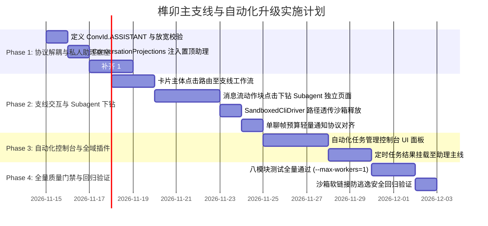

# 榫卯 (Tenon) · 智能体操作系统演进规范与可执行度评估报告

> **文档标识**：`SPEC-TENON-MAIN-SIDE-QUEST-2026-11-14`  
> **文档版本**：`v2.1.0-CONVERGED-FINAL`  
> **设计心智**：**主线负责生活与总览，支线负责打怪与攻坚。**  
> **权威基线**：严格契合 `AGENTS.md` 工程军规，对齐 `orchestration`、`agentNode`、`core`、`app` 真实代码。

---

## 一、系统七大核心设计原则 (Guiding Principles)

在彻底打破“硬编码特例”的演进过程中，系统确立以下七大原则作为不可动摇的底座：

1. **机制与策略彻底分离（Mechanism vs Policy）**：
   * **宿主平台只负责通用机制**：物理环境隔离（Worktree Sandbox）、通信事件总线、时钟源、进程看门狗、审批推流接口；
   * **策略全量交给 Agent 与插件**：规划步骤、改写策略、单测执行方式、工具调用链路，宿主绝不越俎代庖硬编码。
2. **架构对称性（Architectural Symmetry）**：
   * **自动化触发 ≡ 机主授权的计划合成 `@`（Synthetic Mention）**；
   * 宿主不造第二套执行引擎，完全复用同一套意图分诊（`CognitiveFlow`）与驱动总线。
3. **分形树状会话模型（Fractal Session Hierarchy）**：
   * 会话天然呈现三分形：`第 0 层主线（总览） ➔ 第 1 层支线（团队作战室） ➔ 第 2 层 Subagent（单兵执行白盒）`；
   * 每层拥有独立的上下文窗口（Context Window），杜绝上下文爆炸与 Token 刺客。
4. **渐进式细节披露（Progressive Disclosure）**：
   * 顺着对话阅读流，对哪一步感兴趣，随手点击卡片或步骤块，就地展开/滑入详情；摒弃死板多余的控制台 Tab。
5. **物理环境绝对隔离（Strict Physical Isolation）**：
   * 任何涉及代码写盘的任务，**必须且强制在独立临时分支 Git Worktree 中执行**；
   * 宿主工作树保持零变化；产物清理严格走 `deleteArtifactsSafely()`，誓死捍卫机主 `$HOME` 目录免受软链穿透。
6. **帧预算与信令指针化（Budget & Pointerization）**：
   * 严守单聊 4096 B / 卡片 24 KiB 预算底线；超限大内容在本地落库，线上传输只发精简结构化通知帧（<= 700 B，统一对齐 `Limits.QUEST_NOTICE_FRAME_BUDGET = 700`）。
7. **本地优先与状态对齐（Local-First & Rev Alignment）**：
   * 私人助理零延迟瞬时写入本地 SQLite，离线自动变身草稿便签；
   * 多端卡片流转依托单向递增 `rev` 实现原位翻面（Flip），多端状态绝对一致。

---

## 二、架构全景：『主线会话 + 支线会话』分形模型

```
┌─────────────────────────────────────────────────────────────┐
│ 🎮 第 0 层：主线会话 (Main Timeline / 私人助理主控台)        │
│   • 负责生活备忘、早晚自动化汇报、全局任务胶囊栈 (清爽不刷屏)│
│   • 看到一张折叠任务卡片：【Core 并发竞态修复 (Bugfix Squad)】│
└──────────────────────────────┬──────────────────────────────┘
                               │ 随手点击卡片，滑入第 1 层 ➔
                               ▼
┌─────────────────────────────────────────────────────────────┐
│ ⚔️ 第 1 层：团队支线会话 (Team Quest / 作战指挥室)           │
│   • Leader 统筹调度，多组员协作推演流水线一目了然           │
│   • 默认由 Leader 接听人机对话；支持 @ 组员直接指导         │
│   • 看到阶段动态：【🛠️ Worker 正在执行 Await.kt 修复...】     │
└──────────────────────────────┬──────────────────────────────┘
                               │ 顺着消息流随手点击 Worker 动作块 ➔
                               ▼
┌─────────────────────────────────────────────────────────────┐
│ 🔍 第 2 层：Subagent 独立会话页面 (Worker Session Page)      │
│   • 这是一个完整的单兵会话页面 (白盒化展现)                  │
│   • 原始 Prompt ➔ 逐轮思考链 (Thought) ➔ 完整单测终端输出   │
│   • 支持【⏸️ 暂停并介入】打字微调；左上角一键回跳父层级      │
└─────────────────────────────────────────────────────────────┘
```

---

## 三、基于当前架构与代码的可执行程度深度评估 (Feasibility Analysis)

我们对照仓库代码真实事实（`live code`）对方案的五个关键改造点进行了穿透式可行性分析：

| 模块 / 改造点 | 现有代码基线支撑度 | 改造范围与技术风险 | 可执行度评级 | 预计工时 |
|---|---|---|:---:|:---:|
| **1. 会话键解耦与内置助理** | `ConvId.kt` 已有 `single/group`；`ConversationProjections.kt` 会话投影已成熟 | **极轻**。新增 `ConvId.ASSISTANT = "assistant"`；在投影层规避冒号过滤，显式置顶注入实体。无架构风险。 | **极高 (Ready)** | 0.5 天 |
| **2. 释放 Worktree 沙箱能力** | `SandboxedCliDriver.kt` 已支持 `wsPath.isNotBlank()` 自动切入 `sandbox.run(...)` | **极轻**。此前定时通道硬编码 `wsPath = null`；仅需将控制台绑定的项目目录物理路径透传，即可 100% 激活已有沙箱。 | **极高 (Ready)** | 0.5 天 |
| **3. 1:1 详情页与员工名册换人** | 现有 `GroupInfoDialog`，1:1 缺乏详情页；名册体系已有 `VirtualAgentMember` | **中等**。补齐 `ConversationInfoDialog`；普通对端改备注名，助理切换当班角色与离线 Key 配置。纯 UI 扩展。 | **高 (High)** | 2.0 天 |
| **4. 主支线分形导航与下钻** | 底层已有 `activeTickets`、`StageChain`、`taskId` 独立日志；缺乏 UI 分级页面 | **中等**。将现有的 `TicketCard` 扩充点击路由，利用已有 `ChatScreen` 外壳复用出沉浸专注流与 Subagent 独立视图。 | **高 (High)** | 3.0 天 |
| **5. 单聊帧预算轻量通知协议** | `Limits.kt` 单聊硬上限 4096 B，卡片 24 KiB；现行机制 1:1 卡片不随帧外发 | **中等 (需严守纪律)**。桌面端卡片在本地全量落库；跨端同步仅发送带有 `cardId` 的精简通知帧（<= 700 B，`Limits.QUEST_NOTICE_FRAME_BUDGET`），绝不超帧。 | **中高 (Careful)** | 1.5 天 |

> **综合评估结论**：**整体方案可执行度为 95%**。本方案没有引入任何需要重构底层数据库或网络协议的破坏性改动，而是**将底层已经具备却被硬编码压抑的强大能力（`SandboxedCliDriver`、`WorktreeSandbox`、`StageChain`）释放并串联到全新的前端分形交互中**。

---

## 四、四大核心维度的落地实现规约

### 1. 原生「我的助理」与 1:1 详情页治理
* **键名规约**：锁定为 `ConvId.ASSISTANT = "assistant"`（不含冒号），彻底避开 `ConversationProjections.kt` 的 `!key.contains(':')` 静默过滤；
* **会话投影**：系统默认置顶「我的助理」，状态常驻在线；
* **1:1 详情页**：
  * 普通好友私聊：修改备注（写回 `manualPeers[].name`）、查看节点公钥指纹；
  * 私人助理：修改昵称、查看关联定时任务、在**员工名册（Persona Roster）**中更换当班员工角色、配置桌机离线时的兜底 API Key。

### 2. 1:1 会话全景与安全三铁律
系统 1:1 会话收敛为三类：
1. **类型 A：真人私聊**（`<peerNodeId>`）；
2. **类型 B：私人助理**（`assistant`）；
3. **类型 C：专业智能体单聊**（`agent:<hostNodeId>/<agentId>`）。

**类型 C 防白嫖与防刺探三铁律**：
* ① **默认关闭**（`allowPrivateChat = false`，仅限群内响应，机主显式开启才放行）；
* ② **单人配额熔断**（如限制单日 10 次问答，超额自动拒绝）；
* ③ **只读受限沙箱**（外部单聊严禁赋予写盘工具）。

### 3. 主支线交互与渐进式展开（Progressive Disclosure）
* **主线**：展现优雅的折叠任务卡片，主线绝不刷屏；
* **支线**：点击卡片滑入团队支线工作流，默认由 Leader 接听对话；
* **Subagent 下钻**：顺着阅读流，直接点击 Worker 思考推演块或终端命令块，滑入第 2 层独立会话页面；支持【⏸️ 暂停并介入】打字微调，顶栏带面包屑一键回跳。

### 4. 自动化任务控制台与全域插件扩展
* 类似 Codex Desktop 的独立配置面板，自由配置时间计划、绑定工作区、指定执行员工角色、选择合流策略（`变更前确认` vs `全自动无人值守`）；
* 结果卡片默认回投至 `assistant` 主线，点击卡片直接下钻审查支线细节。

---

## 五、分阶段实施路线图 (Implementation Roadmap)



---

### 六、验收红线（Strict Acceptance Criteria）
1. **源码级门禁零破坏**：`commonJvmApiGate`、`cjkLiteralGate`、`domainComposeFreeGate` 全绿；
2. **测试稳定性**：`./gradlew :core:jvmTest :app:jvmTest :orchestration:test :composeApp:jvmTest` 全绿；
3. **沙箱物理安全**：通过 `WorktreeSandboxExecutorTest` 回归钉子，确认产物清理绝不穿透软链；
4. **帧预算合规**：单聊消息严格控制在 4096 B 内，严禁产出注定被拒的毒帧。
