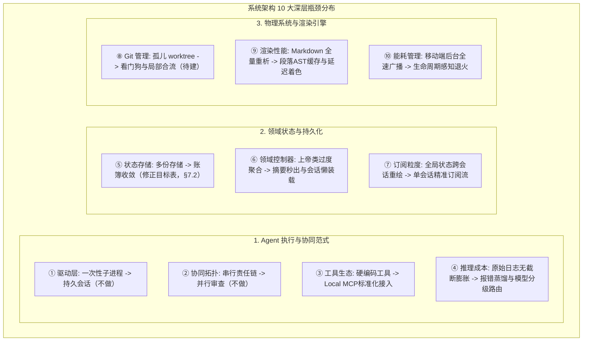
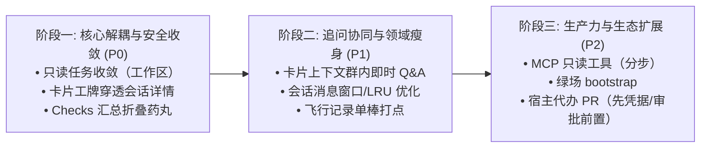

# 榫卯 (Tenon) · 超级智能体原生演化与人机协同全景架构规范

> **规范标识**：`SPEC-TENON-SUPER-AGENT-NATIVE-MASTER-V1`  
> **核心定位**：衔接既有 [`docs/tenon-agent-hub-and-team-orchestration-spec.md`](tenon-agent-hub-and-team-orchestration-spec.md)（团队与双轴模型）与 [`docs/tenon-agent-hub-ux-and-cross-platform-polish-spec.md`](tenon-agent-hub-ux-and-cross-platform-polish-spec.md)（跨端体验规范），深度复盘真机测试中的“机械假象”，解决编排器过度越位侵入的问题。确立**“宿主确定性存证 + 智能体自主探索”**的安全共治基石，系统梳理从手写硬编码逻辑到智能体原生能力的彻底解绑，完整定义智能体员工人设与 Prompt 契约、避坑自进化记忆、宿主代办 PR 闭环、人机协同八大触点、十大系统级架构演进路径以及独立的智能体能力评测体系。
>
> **文档状态**：V1 定稿（四项裁决已闭，见 §3.5）。文中【已落地】= 当前代码已有；【工作区】= 改动在未提交的工作区；【待建】= 只有设计、代码未实现；【不做】= 已裁决不实施。未标注者按目标形态读。

---

## 一、背景与宏观愿景：从“脚本执行器”到“数字员工”

### 1.1 范式对比：传统自动化平台 vs 超级智能体（Super-Agent）

当前业界优秀的智能体实践（如 DeepSeek Harness、Claude Code 等）展示了“群里一句话，全自主交付”的新型人机协同形态。对比我们既有的实现，两者存在本质的范式代差：

| 维度 | 传统脚本平台（此前形态） | 超级智能体 / 数字员工（目标形态） |
|---|---|---|
| **控制权归属** | **编排器死控全流程**：Kotlin 代码猜测试命令、遍历敏感词表、强行推进步骤 | **控制权倒置（Inversion of Control）**：人类给目标，Agent 自主规划命令、搭建环境、自愈修复 |
| **沟通与汇报** | **单向黑盒倾倒**：内部标准输出、npm 进度条、模型内心独白一股脑倒在卡片上 | **结构化高情商汇报**：一句话结论 + 关键 Diff + 交互式风琴抽屉 + 实时终端直达 |
| **任务终局判据** | **唯补丁论（No patch = Failure）**：只读问答因无补丁被强行打回自愈并报错 | **答案即终局**：有补丁交付补丁，只读任务给出自然语言结论即结案（[`PatchlessAnswer`](../orchestration/src/main/kotlin/com/kapp/tenon/orchestration/PatchlessAnswer.kt)） |
| **人机交互属性** | **批处理流水线**：派单后无法追问，工单结案后回复触发全新独立派单 | **同程伴随协同**：执行中透明可查，结案卡片在群内可针对补丁直接连续追问（Q&A） |

---

## 二、真机复盘：为什么此前测试反复觉得“很假”？

在真实多端（手机端 + 桌面端）测试中，团队反复体会到一种“说不出来的机械僵硬感”。深入排查代码、日志与交互链路，根本病灶有四点：

```
                    【真机实测四大机械病灶穿透】
  ┌──────────────────────────────────────────────────────────────┐
  │ 1. 任务属性错配：把「问答/调研」强推入「必须提补丁」的流水线  │
  │    · 用户问 `@agent git status` 或询问接口用法               │
  │    · 系统创建 Worktree，运行完发现 patch 为 null             │
  │    · 误判 Agent“没干活”，反复自愈催办 3 轮，最终挂红卡报错   │
  ├──────────────────────────────────────────────────────────────┤
  │ 2. 信息架构失焦：把「思考独白与构建日志」当成结论倾倒给人类    │
  │    · 卡面横幅充斥模型内心自白（如“任务看起来是只读的...”）  │
  │    · 200 行 Gradle/npm 构建进度条无序堆叠，撑破 3 屏        │
  ├──────────────────────────────────────────────────────────────┤
  │ 3. 协同边界断裂：派单之后沦为不可打扰、无法追问的单向黑盒    │
  │    · 派单后仅剩 Spinner 转圈，人类不敢补充要求               │
  │    · 结案后在群里针对补丁追问，被当成全新任务重新派单        │
  ├──────────────────────────────────────────────────────────────┤
  │ 4. 测试基准严重拟合单一工程，掩盖了真实人机交互场景          │
  │    · 既有真机用例全部围绕单一固定仓库，测试命令恒绿          │
  │    · 精力被底层崩溃与沙箱清理牵扯，从未真正测试人机对话闭环  │
  └──────────────────────────────────────────────────────────────┘
```

---

## 三、安全红线与权责共治：宿主确定性存证 vs 智能体自主探索

在走向 Agent 原生化的过程中，最容易走入的极端是“全权盲信 Agent，删掉所有硬性检查”。**本仓坚决反对这种做法**。

> **核心戒律（AGENTS.md §3）**：**自述不是门，宿主必须拿到物理事实证据。**

### 3.1 权责边界矩阵

```
                【安全共治：双层防护架构】
       人类需求输入 (自然语言 / 快捷指令 / 选型卡)
                         │
                         ▼
┌─────────────────────────────────────────────────────────────┐
│ 智能体（Agent）—— 自由探索与自主执行层                      │
│ • 自主嗅探工程语言栈与测试入口（无需宿主在 Kotlin 写死猜测） │
│ • 智能搭建/修复依赖环境，分析单测失败原因并循环自愈        │
│ • 生成代码改动，并向人类出具业务维度的自述解释报告          │
└─────────────────────────────────────────────────────────────┘
                         │ 物理输出 (stdout, exitCode, patch.diff)
                         ▼
┌─────────────────────────────────────────────────────────────┐
│ 宿主平台（Host）—— 确定性存证与 fail-closed 守卫层           │
│ • 真实进程退出码与标准错误采样（退出码 != 0 绝对阻断）      │
│ • 坚守 LowRiskReviewer 静态敏感词白名单，不可被 Prompt 绕过  │
│ • 物理沙箱无痕隔离（WorktreeSandboxExecutor 安全清理）      │
│ • 补丁反向试跑（git apply --check）与精确 Hunk 校验        │
└─────────────────────────────────────────────────────────────┘
```

> 注：矩阵里的“真实进程退出码”只覆盖**宿主自己起的进程**；Agent 在自己子进程里跑的命令，宿主当前拿不到退出码（`DriverEvent.ToolCall` 无结果字段，见 §5 末注与 §8.1）。这也是 §7.4 要把执行收进宿主中介通道的原因。

### 3.2 明确的不做清单 (Non-Goals)

为确保系统始终受控，严防权限越界与安全灾难，以下事项**明确不予实施**：

1. **不做脱离宿主中介的直接远端 Git PR**：
   - 绝不直接将 GitHub Token 和外部写权限注入读不可信仓库代码的 Agent 子进程；
2. **不做子进程 stdin 运行中劫持（No In-flight Stdin Injection）**：
   - CLI 子进程保持标准的单次 argv 隔离执行；中途软中断明确定义为“宿主优雅取消当前子进程 + 携带已产生上下文作为重派输入”，不引入脆弱的控制台输入流伪造；
3. **不做宿主确定性安全词表的废除**：
   - 绝不因“引入审查智能体”而删除 [`LowRiskReviewer`](../orchestration/src/main/kotlin/com/kapp/tenon/orchestration/LowRiskReviewer.kt)；确定性静态规则是第一道硬防护，模型审查仅作为解释与二次复核的加法；
4. **不做破坏现有单测体系的 CI 动态打分**：
   - 现有的八个模块确定性离线单元测试与门禁是本仓质量压舱石；Agent 的端到端探索能力评测作为独立的手动/夜间 harness 运行，不作为 CI 阻断门禁。

### 3.3 安全可控的宿主代办远端 PR 交付闭环 (Host-Mediated PR Delivery)

业界实践中“群里一句话，138 秒收到 PR”的核心诉求完全成立，但必须走**安全正道**：

```
Agent 沙箱 (只读/离线)        宿主安全控制面 (凭据托管)        远端代码托管平台
      │                               │                             │
      │ 1. 交付本地 patch.diff         │                             │
      ├──────────────────────────────►│                             │
      │                               │ 2. 宿主核验补丁并安全应用    │
      │                               │    git apply --check        │
      │                               │                             │
      │                               │ 3. 宿主从系统凭据库取凭据   │
      │                               │    （界面录入，待建）       │
      │                               │    调用 gh pr create / API  │
      │                               ├────────────────────────────►│
      │                               │                             │
      │                               │ 4. 回传真实 PR 链接到群卡片 │
      │                               │    (如 github.com/pull/42)  │
```

- **安全底线**：Agent 子进程自始至终接触不到任何 Git 凭据与外网写权限；远端分支推送与 PR 创建完全由**宿主控制面托管代理**，并在卡片上提供明确的人类确认触发点。
- **前置条件（当前未实现，属【待建】）**：
  1. 凭据必须走**界面录入**并落在系统凭据库（本仓不接受“手写 `~/.dsh/.credentials.yaml`”作为方案）；
  2. `gh` / 平台 API 是宿主依赖，缺失时如实报“未安装”，不静默回落到别的推送方式；
  3. 推送目标（remote、分支前缀、标题/正文）必须先预览，人类批准后才发出；预先授权的范围必须可枚举、可撤销，不能是一条无界开关；
  4. 全程记账（谁批的、推了哪个 ref、PR 链接、失败原因），失败可回滚远端分支；
  5. 平台 API 的限流/超时按既有诊断字段如实上报；远端写权限绝不进入沙箱。
- **裁决与排期**：做，P2，但**本轮不实现**；先把凭据界面 + 审批预览 + 记账三件前置落地，再接 `gh`/平台 API。

### 3.4 高危动作与人机审批梯级响应 (Permission Escalation Loop)

当 Agent 在自主排错或执行过程中遇到超出权限的敏感操作（如安装系统级环境、修改核心迁移脚本 `.sqm`、调用外网服务）时：
- **前提（必须先说清）**：只有执行走**宿主中介的工具通道**（见 §7.4）时，宿主才能“拦截”；裸 CLI 子进程内的工具调用，宿主只能事后观察、不能阻断。后一种情况下必须在派单前把禁止项写进沙箱策略，不能把“事后看见”包装成“已拦截”。
- 宿主发射**交互式审批确认卡**（记录表为 [`AgentApprovalEntity`](../app/src/commonMain/sqldelight/com/kapp/tenon/db/RelayDatabase.sq)）；
- 人类可在手机或桌面上轻点“允许一次”或“本次会话免审”（记录于 [`SessionExemptLedger`](../orchestration/src/main/kotlin/com/kapp/tenon/orchestration/SessionExemptLedger.kt)）；免审的准入仍先过确定性判据（[`LowRiskReviewer`](../orchestration/src/main/kotlin/com/kapp/tenon/orchestration/LowRiskReviewer.kt)），模型自评只能作为加法；
- 审批通过后宿主通知 Agent 继续推进，审批拒绝则优雅回退并尝试替代方案，形成闭环；无回执/超时必须如实显示为“未处置”，不得写成“已拒绝”。

### 3.5 裁决结果（已定稿，不再悬置）

以下四项此前与仓内既有裁决/不变量冲突，**现已拍板**，本文其余章节按此收敛：

| # | 事项 | 裁决 | 理由与边界 |
|---|---|---|---|
| 1 | §7.1 持久 Stdio 会话 | **不做** | 维持 §3.2-2（不做 stdin 运行中劫持）。会话生命周期会同时放大凭据、网络与确定性时序三个面；且“2~4 秒冷启动”没有本仓实测。若将来实测证明冷启动是主成本，另立 ADR，以“受控会话协议”重开，不得直接恢复 stdin 注入。 |
| 2 | §7.3 阶段性 Fan-out | **不做** | 维持 [orchestration-p2-upgrade-spec-2026-11-05.md](../design/spec/orchestration-p2-upgrade-spec-2026-11-05.md#L55) 的裁决：P2P 弱网下并发审查的锁冲突、AND 裁决与确定性时序代价大于收益。隔离棒组已有的并行保留；审查链保持线性。 |
| 3 | §7.7 清理 `chain/<id>` 分支 | **不自动清理** | `chain/<id>` 是链卡合并的唯一存世形态。只对**孤儿 worktree** 做 `git worktree prune`；分支随卡片生命周期保留。若要删除，只能由用户显式触发、按 cardId 逐个确认。 |
| 4 | §7.10 后台能耗退火 | **做，但有硬上限** | 后台仅暂停/降低 mDNS 主动扫描；**presence 心跳不得大于 `offlineAfter/2`（≤45s）**，且必须与 sweep 判据同批修改。60~180s 的原提案作废；先做后台 5 分钟真机读数再定曲线。 |

**据此关闭/收敛的其他候选**：§7.2 账簿暂不迁移（TSV 已解决重启；迁移需先解决产物寿命契约）；§7.8 模型分级路由不做（避免硬编码厂商，先测 token）；§7.9 Markdown AST 缓存暂不做（先测量）；§7.7 Hunk 局部合流不做（整单合并 + 打回重生成已覆盖，局部合流风险大于收益）。§7.4 MCP、§6.7 绿场 bootstrap、§8.1 飞行记录继续，但顺序固定：MCP 只读工具 → 绿场 bootstrap → 受控执行工具 → 飞行记录。

---

## 四、智能体员工人设契约与 Prompt 动力学架构 (Persona & Prompt Architecture)

真正的数字员工并非通用的冰冷模型，而是**具备明确岗位职责、专业技能、边界纪律与沟通情商的虚拟协同者**。系统通过清晰的人设契约与多层 Prompt 动态流水线实现拟真运作：

> **状态说明**：本节是**目标编制**。现状里 [`TeamPlanCompiler`](../orchestration/src/main/kotlin/com/kapp/tenon/orchestration/TeamExecution.kt) 只编译 `worker + reviewer` 两类岗位（[`TeamExecutionStore.kt`](../orchestration/src/main/kotlin/com/kapp/tenon/orchestration/TeamExecutionStore.kt#L57-L60)），Tester 不是强制角色；四份 Prompt 是目标契约，代码里的实际拼装见 §4.2。

### 4.1 四大核心数字员工人设画像 (Personas)

```
                       【数字研发团队四阶角色编制】
       人类需求
          │
          ▼
   ┌──────────────┐
   │ 调度司令     │ (Coordinator / Leader)
   │ 需求拆解与委派│
   └──────┬───────┘
          │ 分派研发
          ▼
   ┌──────────────┐          ┌──────────────┐
   │ 开发专家     │ 产出补丁  │ 测试验收官   │ 物理运行验证
   │ (Developer)  ├─────────►│ (Tester/QA)  │ (退出码与证据留痕)
   └──────────────┘          └──────┬───────┘
                                    │ 测试通过后
                                    ▼
                             ┌──────────────┐
                             │ 安全审查专家 │ 语义审查与风控评级
                             │ (Reviewer)   │ (宿主静态白名单双重守卫)
                             └──────────────┘
```

#### 1. 调度司令 (Team Leader / Coordinator)
* **岗位定位**：研发团队对外统一发言人，负责需求意图识别、工单拆解分派、跨角色推进与高情商汇报。
* **人设与 Prompt 契约**：
  ```
  你是由专业软件工程师构成的数字研发团队的 Team Leader。
  核心职责：
  1. 准确识别用户意图：严格区分「只读咨询/状态排查」与「编码/修改任务」；
  2. 对只读咨询任务，直接调取上下文出具有价值的自然语言结论，绝不浪费资源要求提 PR；
  3. 对研发任务，合理拆解目标并委派给专属开发与测试成员；
  4. 对外汇报始终「结论先行」，用最简练的人类自然语言汇报，严禁向群内转录机器原始日志。
  ```

#### 2. 开发专家 (Developer / Worker)
* **岗位定位**：在隔离沙箱工作树中进行代码编写的高级工程师。
* **人设与 Prompt 契约**：
  ```
  你是一名资深软件开发专家，正在隔离的代码沙箱工作树中工作。
  工作纪律与边界：
  1. 物理隔离：严格在当前仓库目录内作业，绝不探查或读取仓库外的任何路径；
  2. 最小侵入：只修改本任务强相关的文件，严禁盲目大面积格式化或重构无关代码；
  3. 契约守卫：严格遵守仓库既有架构（如领域层零 Compose 依赖、协议字段严格白名单）；
  4. 产出交付：不执行 git commit / push，完成工作后出具一句话总结「改了什么、依据是什么、遗留风险是什么」。
  ```

#### 3. 测试验收官 (Tester / QA Engineer)
* **岗位定位**：自主探测测试命令、编写测试夹具、执行验证并提供物理真实证据的质量守护者。
* **人设与 Prompt 契约**：
  ```
  你是一名严谨的测试与质量工程师。
  工作纪律与边界：
  1. 自主嗅探：分析工程技术栈并自主探测测试入口（如 ./gradlew test、pytest、npm test、cargo test）；
  2. 真实执行：物理运行测试并捕获执行输出；若测试失败，定位根因并向开发专家提供精简的错误堆栈；
  3. 自述非门：严禁在未真正跑通测试前自述“测试已通过”，必须提供可被宿主核验的真实命令与进程退出码；若本次工具执行没有经过宿主中介，宿主只能把它标为自述（见 §7.4/§8.1）。
  ```

#### 4. 安全与审查专家 (Reviewer / Security Auditor)
* **岗位定位**：对改动 Diff 补丁进行安全漏洞、架构一致性与逻辑回退审查的代码风控官。
* **人设与 Prompt 契约**：
  ```
  你是一名软件安全审计与代码审查专家。
  审查要点：
  1. 深度分析改动 Diff，排查潜在的安全注入、提权、绝对路径泄漏或破坏性删除操作；
  2. 检查改动是否破坏了既有的架构分层约定或协议向后兼容性；
  3. 评估本次改动的风险等级（L1 只读 / L2 修改 / L3 高危；取值域唯一来源是宿主 `AgentRiskLevels`，不另造 LOW/MEDIUM/HIGH 词汇），并向人类出具客观审查意见；
  4. 你的审查是安全加法，宿主确定性白名单守卫具有最高一票否决权。
  ```

> **风险等级不另造词**：`agent-approval.riskLevel` 的取值域只有 [`AgentRiskLevels`](../core/src/commonMain/kotlin/com/kapp/tenon/core/protocol/MessageTypes.kt#L634-L650) 一份（L1/L2/L3，编解码会拒收域外值）；模型输出不在域内时应记为无效，而不是映射成另一个词表。

---

### 4.2 三层 Prompt 动态装配与员工记忆自进化 (Assembly & Continuous Learning)

编排器在向模型下发提示词时，采用三层动态装配，杜绝上下文冗余：

```
┌─────────────────────────────────────────────────────────────┐
│ Layer 1: 不可变人设与物理沙箱约束 (Immutable Containment)    │
│ · 沙箱隔离声明 (WorkerPrompt.CONTAINMENT)                    │
│ · 岗位人设与执行纪律定义                                     │
├─────────────────────────────────────────────────────────────┤
│ Layer 2: 仓库上下文与规约注入 (Context & Knowledge Base)     │
│ · 目标仓库绝对根路径与基线 commit sha                        │
│ · PitfallLedger 避坑账本命中的历史规约条目 (动态记忆自进化)  │
├─────────────────────────────────────────────────────────────┤
│ Layer 3: 任务意图与自愈差量 (Dynamic Instruction & Deltas)   │
│ · 人类下达的自然语言目标 / 选型卡确认结果                    │
│ · 上一棒交接摘要 (StageSeed.previousSummary)                 │
│ · 多轮自愈时的差量报错蒸馏 (Delta Error Stacks)              │
└─────────────────────────────────────────────────────────────┘
```

**现状核对**：Layer 1 的 `WorkerPrompt.CONTAINMENT` 已存在（[`DesktopWorkerWatchdog.kt`](../orchestration/src/main/kotlin/com/kapp/tenon/orchestration/DesktopWorkerWatchdog.kt#L175-L181)，私有常量）；Layer 2 的 PitfallLedger 注入已存在于**单棒工单主路径**（[`DesktopWorkerOrchestrator.kt`](../orchestration/src/main/kotlin/com/kapp/tenon/orchestration/DesktopWorkerOrchestrator.kt#L2146-L2157)）；Layer 3 的“差量报错蒸馏”尚未实现；多棒链的 [`StageChain.promptOf`](../agentNode/src/main/kotlin/com/kapp/tenon/agent/StageChain.kt#L276) 尚未注入 PitfallLedger。

#### 避坑账本与数字员工成长性闭环 (Pitfall Ledger)
真正的团队成员具备“吃一堑长一智”的能力。系统借助 [`PitfallLedger`](../orchestration/src/main/kotlin/com/kapp/tenon/orchestration/PitfallLedger.kt) 实现仓库级的经验沉淀：
1. **经验沉淀**：当人类在卡片上点击“打回”并输入原因（例如：“不要直接删表，加 .sqm 迁移脚本”），该反馈自动转化为一条带有关键词 pattern 的规则存入仓库根下的 `.tenon/pitfalls.jsonl`；
2. **命中注入**：后续同一仓库派发类似任务时，宿主自动匹配命中规约，并作为硬约束注入 Layer 2；
3. **防止撑爆**：上限严格收紧为最多 8 条、每条 ≤ 200 字，确保提示词精炼高效。

**现状核对**：文件位置、8 条/200 字上限、打回反馈自动沉淀均已实现（[`PitfallLedger.kt`](../orchestration/src/main/kotlin/com/kapp/tenon/orchestration/PitfallLedger.kt#L22-L33)、[`DesktopWorkerOrchestrator.kt`](../orchestration/src/main/kotlin/com/kapp/tenon/orchestration/DesktopWorkerOrchestrator.kt#L526-L532)）；`pattern` 默认留空 = 恒匹配；注入目前只覆盖单棒工单主路径。“同义词语义泛化”仍是目标，不是现状。

---

### 4.3 表达情商与输出收敛协议 (Thought vs Token Discipline)

为彻底消灭卡片上倾倒内心自白的“假象”，系统在驱动层确立严格的流式输出路由纪律：

1. **内心思维独白 (`thought.delta`)**：
   - 包含模型的自我推演、路径搜索、假设推翻等内心状态；
   - **路由策略**：只写入任务产物日志与飞行记录仪，仅在崩溃或调试抽屉展开时作为现场尾部证据，**严禁进入卡面横幅与对外发言**；
2. **正式对外发言 (`token.delta`)**：
   - 经过深思熟虑后的正式答复或交付物摘要；
   - **表达要求**：**“先说结论，再说依据，列出要点”**。例如：“已完成修复，核心是将游标判断修正为 seq 比较，本地测试 12 例全部通过。”

> **现状**：`thought.delta` / `token.delta` 分流与“只读任务有答案即结案”已在**工作区**实现（[`PatchlessAnswer.kt`](../orchestration/src/main/kotlin/com/kapp/tenon/orchestration/PatchlessAnswer.kt)、[`DesktopWorkerOrchestrator.kt`](../orchestration/src/main/kotlin/com/kapp/tenon/orchestration/DesktopWorkerOrchestrator.kt) 的 diff），尚未提交、尚未跑门禁；不写成【已落地】。

---

## 五、智能体能力回归：从“硬编码手写逻辑”到“Agent 原生接管”的彻底解绑

此前代码库中存在大量“本该由智能体自然推导，却由开发者在 Kotlin 中手写硬编码”的脆弱逻辑。本次演化确立明确的解绑与替代路线：

| 功能维度 | 既有手写硬编码逻辑（代码现状） | 智能体原生接管方案（目标形态） | 架构收益 |
|---|---|---|---|
| **① 测试入口探测** | [`TicketVerification.kt`](../orchestration/src/main/kotlin/com/kapp/tenon/orchestration/TicketVerification.kt) 硬编码只认 `package.json` 的 `scripts.test`，其他生态（Gradle/Pytest/Cargo）直接返回 null 放弃验测 | **Tester Agent 自主探测**：Agent 自动嗅探语言栈、识别 Makefile/Gradle/Pytest，并在沙箱中配置环境执行验证；宿主保留**可核验的命令与退出码**（前提见下方注） | 摆脱单一前端仓库拟合，原生支持全语言工程自动化验证 |
| **② 意图识别分流** | [`DesktopWorkerOrchestrator.kt`](../orchestration/src/main/kotlin/com/kapp/tenon/orchestration/DesktopWorkerOrchestrator.kt) 用 `isPrototypeIntent` 与 `AbortSignals` 硬编码字符串字典（`"原型"`, `"stop"`, `"停"`）匹配 | **Leader Agent 语义理解**：由调度智能体理解深层语意（是咨询、架构探讨、代码实现还是撤销），编排器只负责按意图派发事件 | 消除由于错别字、近义词导致的命令失效，支持自然对话叫停 |
| **③ 任务终局收敛** | 唯补丁论：无补丁即判定失败（`patch == null` 强行走入自愈循环并催办 3 轮报红） | **[`PatchlessAnswer`](../orchestration/src/main/kotlin/com/kapp/tenon/orchestration/PatchlessAnswer.kt)**：当且仅当 CLI 退出正常且输出了自然语言回答，直接收敛为已完成 | 彻底根治只读咨询任务报红与空耗计算资源的幽灵缺陷 |
| **④ 团队工序编排** | `parseDelegation` 依赖字符串归位：`@agent` 分句、`组队:` 前缀与旧的 `角色(驱动): 任务` 阶段语法，强拼一维串行链 | **Planner Agent 动态工单编排**：智能体根据任务复杂度自主裁决责任链长度与审核棒数量（**并行审查已裁决不做**，见 §3.5；委派仍必须过代码门 [`StageChainGate`](../orchestration/src/main/kotlin/com/kapp/tenon/orchestration/StageChainGate.kt)） | 释放真正的多智能体协同潜力，按需自适应组装工序 |
| **⑤ 崩溃与错误诊断** | 编排器多处用 `takeLast(600)` 做尾部截取（验收输出、工单摘要等），确实可能截到进度条而丢掉真正的异常堆栈 | **Agent AST/Error 智能提炼**：错误诊断由智能体提取核心失败断言行与关联文件，并精准注入下一轮自愈上下文；宿主侧同时保留原始尾部供事后取证 | 自愈效率提升数倍，避免冗余噪音稀释模型注意力 |
| **⑥ 避坑经验检索** | [`PitfallLedger.kt`](../orchestration/src/main/kotlin/com/kapp/tenon/orchestration/PitfallLedger.kt) 按关键词子串匹配（`patternScore`），同义词/近义改写即失效 | **Agent 模式泛化与语义联想**：在提示词中由智能体理解历史踩坑规约的内在意图，实现跨命名风格的经验迁移 | 实现真正的知识沉淀与越用越聪明的团队成长性 |

**关于①的边界（重要）**：`testCommandFor` 只认 `package.json` 是**有意的保守**——[`TicketVerification.kt`](../orchestration/src/main/kotlin/com/kapp/tenon/orchestration/TicketVerification.kt#L85-L104) 的注释写明“猜错会把跑不起来变成一整轮自愈”。替换它是为了覆盖多生态，不是为了删除宿主证据：验收必须保留「命令 + 退出码 + 输出尾部」三件套，否则又回到“自述即绿”。

**关于宿主 exitCode 的前提**：当前 `DriverEvent.ToolCall` 只有工具名/入参/风险等级（[`AgentDriver.kt`](../agent-contract/src/main/kotlin/com/kapp/tenon/agent/drivers/AgentDriver.kt#L30-L37)），**没有结果与退出码**。因此“宿主捕获 exitCode”只有在下面两种情况下成立：①Agent 的工具执行走宿主中介通道（§7.4）；②宿主在 Agent 结束后自己重放验收（现有 [`TicketVerification`](../orchestration/src/main/kotlin/com/kapp/tenon/orchestration/TicketVerification.kt) 的做法）。否则只能记为 `agent_self_report`（§8.1）。

---

## 六、人机协同八大核心触点 (Touchpoints)

所有交互改造均基于代码库**已有能力接缝**展开，严禁重复建设：

### 6.1 触点 1：工牌与角色穿透 (Agent Badge Click-Through)
* **现状事实**：[`CardHeaderRow`](../composeApp/src/commonMain/kotlin/com/kapp/tenon/feature/chat/AgentCards.kt) 中的头像和角色为静态渲染；但底层的 `AgentSessionDetail` 路由和面板已经完备。
* **增量接缝**：
  - 在 [`AgentCards.kt`](../composeApp/src/commonMain/kotlin/com/kapp/tenon/feature/chat/AgentCards.kt) 的 `AgentCardBubble` 中透传 `message.agentSessionId`；
  - `CardHeaderRow` 点击事件回调触发导航：`nav.openAgentSessionDetail(sessionId)`（[`AppNavState.kt`](../composeApp/src/commonMain/kotlin/com/kapp/tenon/navigation/AppNavState.kt#L165)）；
  - 手机端下钻至会话全屏；桌面端“在右侧检查器激活该会话”是【待建】，现有 inspector 只承载会话信息/Live Log，没有按会话切换的入口。

### 6.2 触点 2：渐进式自适应卡片与风琴抽屉 (Collapsible Drawers)
* **现状事实**：Diff 差异与打回反馈抽屉已在 [`AgentCardParts.kt`](../composeApp/src/commonMain/kotlin/com/kapp/tenon/feature/chat/AgentCardParts.kt) 实现折叠；当前仅有检查列表（Checks）在多项时会纵向平铺。
* **增量接缝**：
  - 在 [`AgentCards.kt`](../composeApp/src/commonMain/kotlin/com/kapp/tenon/feature/chat/AgentCards.kt) 的 `CardChecksColumn` 顶部增加可折叠 Summary 药丸（如 `✓ 全部 4 项验证已通过 ▾`）；
  - 默认收起细节，点击后就地向下展开逐项退出码与命令证据；高度不写死 dp（由设计 token/内容决定），且汇总必须区分 `passed / failed / skipped`——全跳过不能显示成“已通过”（现有验收报告的 `skipped` 语义，[`TicketVerification.kt`](../orchestration/src/main/kotlin/com/kapp/tenon/orchestration/TicketVerification.kt#L55-L79)）。

### 6.3 触点 3：桌面宽屏第三栏终端 Inspector 激活裁决
* **现状事实**：桌面宽屏第三栏 [`DesktopInspectorPane`](../composeApp/src/commonMain/kotlin/com/kapp/tenon/ui/desktop/DesktopConversationsPane.kt) 与 [`AgentLiveLogPanel`](../composeApp/src/commonMain/kotlin/com/kapp/tenon/ui/desktop/DesktopShell.kt#L1221) 均已存在；受守卫测试保护的是 **Agents inspector 的挂载**（[`DesktopInspectorContentGuardTest.kt`](../composeApp/src/jvmTest/kotlin/com/kapp/tenon/ui/desktop/DesktopInspectorContentGuardTest.kt#L60-L75)），会话视图第三栏目前只承载对端信息（`peerHeaderLine`），没有按会话切换 Live Log 的入口。
* **增量接缝**：
  - 裁决共存模型：当用户未点选智能体卡片时，第三栏展示默认的对端/节点信息；当用户在群聊中点击某张卡片的“查看实时运行”或工牌时，第三栏临时切换为挂载 `AgentLiveLogPanel(sessionId)`；
  - 顶栏保留回退按钮，点击可平滑返回原节点信息；
  - 变更新增守卫：会话视图的 Live Log 挂载必须有源码级守卫（照 `DesktopInspectorContentGuardTest` 的形状），否则下一次重构会把入口静默拆掉。

### 6.4 触点 4：卡片上下文群内即时追问 (In-thread Card Q&A)
* **现状事实**：工单进入 `review_ready` 状态后从活跃表移除，用户在群内回复会被误当成全新任务重新派单。但协议层已原生具备 `replyTo` 字段与 `repliedToIsAgent` 判定。
* **增量接缝**：
  - 在 [`DesktopWorkerOrchestrator.kt`](../orchestration/src/main/kotlin/com/kapp/tenon/orchestration/DesktopWorkerOrchestrator.kt) 中，当收到带有 `replyTo` 且引用工单卡的消息时，优先走**只读问答**路由（复用现有 `runDiscussion` 的只读研讨流，不新造模型路由）；
  - **归属判据**：先回答“这张卡属于哪台宿主”——用卡片消息的 `agentSessionId`/route facts 判定本机是否是该卡的执行宿主；不是本机的卡不抢答（避免双端重复回复），转由对应宿主处理；
  - 宿主读取该工单已落盘的 `patch.diff` / `report.json` 作为只读上下文；路径解析复用 [`TicketPatchLedger.lookup`](../orchestration/src/main/kotlin/com/kapp/tenon/orchestration/TicketPatchLedger.kt) 与 [`HostCardActions`](../orchestration/src/main/kotlin/com/kapp/tenon/orchestration/HostCardActions.kt#L120-L145) 的同一条兜底链，不新写一套；
  - **产物缺失=如实说**：`/tmp` 被清理、换机或中止的任务没有产物，回答必须是“现场已不可读”，不能凭记忆编造 diff；
- 问答是**解释**不是验收：不改变卡片状态、不触发合并、不重新拉 Worktree。
* **裁决与排期**：做，P1。归属判据与产物缺失语义必须先于 UI 连线落地。

### 6.5 触点 5：中途温和打断与上下文重派 (Graceful In-flight Cancellation)
* **现状事实**：CLI 子进程的 stdin 在内核层接 `/dev/null`，无法中途发送交互式命令。现有中止已经是 **SIGTERM → 至多 3s → SIGKILL → 无痕清理**（[`WorktreeSandbox.kt`](../agentNode/src/main/kotlin/com/kapp/tenon/agent/drivers/WorktreeSandbox.kt#L42-L47)），不是“直接强杀”；中止会主动删除产物目录（同文件 [L367-L381](../agentNode/src/main/kotlin/com/kapp/tenon/agent/drivers/WorktreeSandbox.kt#L367-L381)），这是验收 §10d“目录消失”的要求。
* **增量接缝**：
  - 当人类在任务执行中发出打断信号（如在群里发“停一下，换个方案”）时：
    1. 宿主按既有中止序结束当前子进程（不引入 stdin 注入）；
    2. **不保留**沙箱临时文件（D-024 无痕清理是现有不变量）；若要保留部分成果，必须单独立项，处理脱敏、磁盘寿命与“产物体积爆炸”三件事，且不能破坏现状验收；
    3. 把“人类最新指令 + **已提交节点/已落盘产物**”作为下一轮派单输入重派；多棒链有 `chain/<id>` 分支可续，**单棒工单只能重跑，不能续跑**——文档不许把两种情况写成一种；
    4. 语音/文本打断与“新任务”的区分要沿用现有的意图判据（`AbortSignals`/`CognitiveFlow`），避免把一句“停”同时变成中止和新派单。

### 6.6 触点 6：思考与发言分离及只读任务直出 (Patchless Answer)
* **现状事实**：【工作区】已在 [`PatchlessAnswer.kt`](../orchestration/src/main/kotlin/com/kapp/tenon/orchestration/PatchlessAnswer.kt) 与 [`DesktopWorkerOrchestrator.kt`](../orchestration/src/main/kotlin/com/kapp/tenon/orchestration/DesktopWorkerOrchestrator.kt) 实现，但**尚未提交、尚未跑门禁**；测试文件 [`PatchlessAnswerTest.kt`](../orchestration/src/test/kotlin/com/kapp/tenon/orchestration/PatchlessAnswerTest.kt) 已在工作区。
* **运行机制**：
  - 严格区分 `token.delta`（对外发言）与 `thought.delta`（内心独白），卡面横幅仅采纳对外发言；
  - 当 CLI 任务正常执行结束（`status == finished`）且产生了自然语言回答时，判定为答复结案，卡片渲染为 100% 已完成，彻底杜绝无补丁自愈死循环；
  - 边界：`status != finished` 一律不算答案（崩溃/被中止不能被洗成成功）；静默 finished 只给一次重试机会（`PatchlessAnswer` 的三条判据）。

### 6.7 触点 7：绿场空目录选型与动态问答立项 (Greenfield Scaffolding)
* **现状事实**：[`ControlPlaneHookRoutes.kt`](../agentNode/src/main/kotlin/com/kapp/tenon/agent/ControlPlaneHookRoutes.kt#L417-L468) 已具备 `ask_question` 广播通路（HTTP hook），[`AgentCardParts.kt`](../composeApp/src/commonMain/kotlin/com/kapp/tenon/feature/chat/AgentCardParts.kt#L617) 已原生支持**单选**卡交互；但内置 CLI 驱动**没有接 MCP server**（main 代码里没有 `mcpServers` 注入），所以“Agent 自己调 ask_question”对外部插件成立，对 codex/claude/dsh 仍是【待建】。
* **增量接缝**：
  - 前置 1：绿场目录必须是**可工作的 git 仓**——[`WorktreeSandbox`](../agentNode/src/main/kotlin/com/kapp/tenon/agent/drivers/WorktreeSandbox.kt#L130-L160) 依赖 `git worktree add` 与可解析 base ref；当前生产代码没有 `git init`。需要先立项“空目录 bootstrap”（init + 首提交 + 项目目录登记 + 白名单）；
  - 前置 2：把 MCP server 接到 CLI 驱动（§7.4），否则 `ask_question` 只有插件路径；
  - 前置 3：eval/目标机上 Go/Python/Cargo 等工具链要有清单（§8.2），否则“自主识别”会退化成“环境缺失”；
  - 当人类给出绿场任务（目标目录为空或仅有 README）时，Agent 先发起选型确认卡，人类点选后再执行脚手架初始化；**没选型成功就不开工**，不猜技术栈。
* **裁决与排期**：做，P2；顺序固定为“MCP 只读工具 → 绿场 bootstrap → 受控执行工具”，不允许跳过 bootstrap 直接演示绿场。

### 6.8 触点 8：群内多角色 @Mention 意图路由与拟真身份体系
* **现状事实**：在协同项目群中，人类需要对特定专家精准指派。代码库中已有 `VirtualAgentMember`、`AvatarPalette` 和 `SenderIdentityContext`；但成员解析按**成员名字**匹配（[`TeamMention.kt`](../core/src/commonMain/kotlin/com/kapp/tenon/core/protocol/TeamMention.kt#L61-L73)），**不按岗位角色**。
* **增量接缝**：
  - 现状可用：`@Leader` / `@Tester` 只有在团队声明里**确实有成员叫这个名字**时才会命中；名字不同（如“小测”）就要 @ 那个名字。按岗位角色路由是【待建】，需要扩展解析器并处理重名 fail-closed；
  - 命中 Leader：由其统一拆解任务并推进整条责任链（现有 `TeamExecutionResolver` 路径）；
  - 命中 Tester/Reviewer 等成员：按既有席位/执行档判定是否本机可执行；不是本机席位则如实 blocked，不回落成“默认 codex 单棒”；
  - 每名智能体发言与发卡时使用专属头像/色彩徽标（复用 `AvatarPalette`），消灭“所有人共用一张无名机器人脸”；身份解析仍只走 `SenderIdentityContext` 一份来源。

---

## 七、系统架构深度优化十大演进蓝图

> **准入规则**：本节每条都必须先过 §3 的“宿主确定性存证/fail-closed”检查；§3.5 已裁决的事项按裁决执行，不再重开。下列“优化点”已按裁决标注做/不做。



### 7.1 驱动执行：持久会话——决定不做
* **裁决**：不做（见 §3.5-1）。维持单次 argv 隔离执行与 stdin `/dev/null`；不为“渐进式微调”引入会话生命周期。
* **重开条件**：只有在 dsh/codex/claude 的冷启动实测证明它是主成本，并且能给出“受控会话协议”（不是控制台注入）的完整安全设计时，才另立 ADR 重开。当前没有这组数据，因此不做。

### 7.2 状态存储：账簿收敛——决定暂不迁移
* **裁决**：暂不迁移 SQLite（见 §3.5）。“卡片→补丁”账簿继续用 `ticket-patches.tsv`；它已解决“宿主重启后卡片还能合并”（[`TicketPatchLedger.kt`](../orchestration/src/main/kotlin/com/kapp/tenon/orchestration/TicketPatchLedger.kt#L20-L45)、[`HostCardActions.kt`](../orchestration/src/main/kotlin/com/kapp/tenon/orchestration/HostCardActions.kt#L120-L145)），不是待修缺口。
* **原提议的错误**：`AgentTaskEntity` 是控制面任务队列（`node_id / task_id / session_id / op / prompt / queued_at`，[`RelayDatabase.sq`](../app/src/commonMain/sqldelight/com/kapp/tenon/db/RelayDatabase.sq#L463-L472)），没有 `cardId / workspacePath / patchPath`，不能直接复用。
* **重开条件**：只有先解决“账簿与 `patch.diff` 同生共死”的寿命契约，并新增 `TicketPatchEntity` + `.sqm`（迁移自包含、版本断言同步），才谈迁移；否则会制造“账簿有记录、补丁已不存在”的假可用。

### 7.3 协同拓扑：阶段性安全并行——决定不做
* **裁决**：不做 Fan-out（见 §3.5-2）。维持 [orchestration-p2-upgrade-spec-2026-11-05.md](../design/spec/orchestration-p2-upgrade-spec-2026-11-05.md#L55) 与 [orchestration-model-fit-2026-11-03.md](../design/spec/orchestration-model-fit-2026-11-03.md#L930) 的既有裁决；审查链保持线性确定性。
* **保留的并行**：仅隔离棒组的并行分发保留（[`StageChain.kt`](../agentNode/src/main/kotlin/com/kapp/tenon/agent/StageChain.kt#L955-L990)）；线性审查模式继续拒绝并行组（同文件 [L930](../agentNode/src/main/kotlin/com/kapp/tenon/agent/StageChain.kt#L930)）。
* **替代路径**：靠缩短棒数、减少重复审查、提升 Prompt 命中率来降耗时；不再以“40%~50%”这类未实测目标驱动架构。

### 7.4 工具生态：宿主中介 MCP——决定做（P2，分三步）
* **裁决**：做，但按“只读 → 受控执行 → 写入”分三步，且必须先接 CLI 驱动。它是 §3.4 拦截与 §8.1 证据的前提。
* **现状**：仓内已有 [`scripts/tenon-mcp-server.py`](../scripts/tenon-mcp-server.py)，提供 `tenon_fetch_node_capabilities / tenon_request_human_approval / tenon_send_group_card / tenon_ask_question` 四个工具，无宿主时 fail-closed；但**没有接到 CLI 驱动**（main 代码无 `mcpServers` 注入），也没有 `terminal/exec`、`fs/*`。
* **第一步**：`fs/read` + `git/diff`（只读，不需要审批），用于问答/审查；第二步：`terminal/exec`（必须走 [`AgentToolApprovalStore`](../agentNode/src/main/kotlin/com/kapp/tenon/agent/AgentToolApprovalStore.kt) / 高危租约与人类审批，宿主拿真实退出码）；第三步：`fs/write`（与沙箱写入语义冲突，最后做）。
* **安全前置**：逐工具列权限（读/写/执行/网络），网络默认 deny；不得把 shell 直接暴露给读不可信仓库的模型。

### 7.5 领域装载：会话消息窗口优化——决定做（P1）
* **先修正现状**：冷启动**已经不是**“加载全部消息”——[`RelayControllerMessagesComponent.kt`](../app/src/commonMain/kotlin/com/kapp/tenon/domain/RelayControllerMessagesComponent.kt#L905-L925) 已按会话读最近 `MessageStore.MESSAGE_PAGE_SIZE`（200）条并读 `ConversationSummary`（[`MessageStore.kt`](../app/src/commonMain/kotlin/com/kapp/tenon/domain/MessageStore.kt#L189)）。
* **裁决**：做（P1）。把每会话窗口从 200 降到 50，并对 3~5 个活跃会话做 LRU；进入会话再向上翻页（现有 `loadOlder`）。
* **不能退化的语义**：会话列表预览/最后消息时间依赖“每会话最后一条”（代码注释已写明），`ConversationSummary` 必须覆盖该事实；改窗口大小要同时验证列表预览、搜索与未读计数。

### 7.6 订阅流化：单会话精准隔离流——决定做（P2）
* **裁决**：做（P2）。在 [`RelayStateSlices.kt`](../app/src/commonMain/kotlin/com/kapp/tenon/domain/RelayStateSlices.kt) 增加按会话的派生子流（如 `messageFlowOf(convId)`），避免整张 `messages` map 变化导致的跨会话重组。
* **约束**：切片是**纯投影**，不得新增第二写入方（该文件 KDoc 已定）；新流必须与现有分页/恢复路径共用同一数据源，不能为了订阅另建缓存。

### 7.7 Git 治理：孤儿 worktree 看门狗——决定只做 prune
* **裁决**：只做**孤儿 worktree** 的 `git worktree prune`（启动/空闲）；不自动清理 `chain/*` 分支；不做 Hunk 局部合流（见 §3.5）。
* **分支不是垃圾**：`chain/<id>` 是链卡合并的**唯一存世形态**（worktree 收尾即删、分支刻意保留，[`DesktopStageChain.kt`](../orchestration/src/main/kotlin/com/kapp/tenon/orchestration/DesktopStageChain.kt#L40-L41)、[`ChainWorkspaceResolve.kt`](../orchestration/src/main/kotlin/com/kapp/tenon/orchestration/ChainWorkspaceResolve.kt#L20-L22)）。删除只能由用户显式触发、按 cardId 确认。
* **Hunk 局部合流（不做）**：当前 [`DesktopPatchMerge`](../orchestration/src/main/kotlin/com/kapp/tenon/orchestration/DesktopPatchMerge.kt) 只支持整份 patch/整条分支；局部合并会引入“补丁不完整可能编译不过”“未合入部分谁负责”两个新问题，收益不抵成本。整单合并 + 打回重生成已覆盖该需求。

### 7.8 推理优化：报错蒸馏可做，模型分级路由不做
* **裁决**：模型分级路由不做（避免硬编码厂商/模型名，也避免给 CLI 驱动私加路由层）；报错蒸馏可做（P2），但先做一次真实自愈循环的 token 采样。
* **候选优化**：自愈循环中先提取关键异常堆栈，只向模型输入核心错误行；语法检查/轻量问答用低成本模型需要单独的模型路由能力，不在本周期。
* **与安全章节的关系**：蒸馏只能减少输入，不能减少宿主侧证据；原始尾部仍要落盘供事后取证（§3.1）。

### 7.9 渲染引擎：AST 缓存——决定暂不做
* **裁决**：暂不做（见 §3.5）。先测量当前 Markdown 解析在流式回复中的帧耗时/分配；没有数据不做预研实现。
* **现状**：当前只 `remember(text)` 了换行转换（[L128](../composeApp/src/commonMain/kotlin/com/kapp/tenon/feature/chat/MarkdownMessage.kt#L128)）；是否构成瓶颈未知。
* **重开条件**：测量显示 Markdown 解析是主要卡顿来源，再按段落缓存；流式未闭合段落不能闪烁/丢行。

### 7.10 能耗调度：移动端生命周期感知退火——决定做，presence ≤45s
* **裁决**：做（见 §3.5-4）。后台只暂停/降低 mDNS 主动扫描；**presence 心跳不得大于 `offlineAfter/2`（≤45s）**；靠系统网卡变更广播按需唤醒。60~180s 的原提案作废。
* **硬约束**：当前发现心跳是 5s ± 1.5s（[`LuciolaDiscoveryEngine.kt`](../core/src/commonMain/kotlin/com/kapp/tenon/core/transport/LuciolaDiscoveryEngine.kt#L43-L49)），`Timings.offlineAfter = 90s`（AGENTS §5）。越过 90s 会让用户在电脑上看到手机“幽灵离线”，并破坏 `closeCount=0` 的真机判据。
* **前置**：先做一次“后台 5 分钟”的真机读数（心跳、电量、被系统杀），再定退火曲线；mDNS 释放与 presence 退火分别验收。

---

## 八、智能体能力评估体系 (Eval Harness)

为了保证演化结论客观、杜绝回归，系统建立独立于 CI 的离线能力评测体系：

### 8.1 飞行记录仪规范 (`flight-record.json`)

系统在执行复杂任务时，由宿主（Host）单向客观记录飞行轨迹，**严禁交由模型自述修改**：

```json
{
  "$schema": "tenon://eval/flight-record/v1",
  "taskId": "task-eval-001",
  "targetDirectory": "project-root-relative/workdir",
  "metrics": {
    "totalDurationMs": 138000,
    "selfHealingRounds": 1,
    "toolInvocationCount": 12,
    "exitCode": 0,
    "patchSizeBytes": 4096
  },
  "phases": [
    { "phase": "survey", "durationMs": 12000, "status": "ok" },
    { "phase": "scaffold", "durationMs": 35000, "status": "ok" },
    { "phase": "self_test", "durationMs": 45000, "status": "healed" },
    { "phase": "review", "durationMs": 28000, "status": "ok" }
  ],
  "hostEvidence": {
    "testCommand": "./gradlew test",
    "finalExitCode": 0,
    "verifiedBy": "host_process_exit"
  }
}
```

* **安全与脱敏规则**：写入前自动脱敏文件路径中的个人目录/内网地址、剥除敏感认证 Token，大小严格限制在 64 KiB 以内。脱敏必须是可测的确定性规则（同一输入同一输出），不能靠模型改写。
* **证据可信度分级（必写）**：`verifiedBy` 只允许三值——`host_process_exit`（宿主自己起进程拿退出码）、`host_mediated_tool_channel`（Agent 的命令经宿主工具通道执行，宿主有退出码）、`agent_self_report`（只有 Agent 自述）。**前两者才能作为“测试通过”的判据，后者只能作展示**。没有宿主证据时字段留空/写 unknown，绝不填 `0` 冒充通过。
* **数据源与寿命**：`phases` 需要宿主在每阶段起止打点；当前只有多棒链的进度，单棒没有 phase 数据，属【待建】。记录必须落在**沙箱外**的宿主数据目录并给出保留上限（按条数或天数），否则“沙箱无痕清理”会把飞行记录一起删掉，或反过来把磁盘吃满（本仓有过 21GB 库的现场）。
* **唯一写入方**：只允许宿主写；Agent 自述只能作为被标注的字段，不能修改 `metrics`/`hostEvidence`。
* **示例的边界**：上面的 JSON 假设 `./gradlew test` 由宿主执行或经宿主工具通道执行，所以 `verifiedBy` 才是 `host_process_exit`；如果命令是 Agent 自己跑的而宿主没拿到退出码，必须改成 `agent_self_report`，且该记录不得用于“测试通过”的判据。

### 8.2 混沌测试与鲁棒性验证矩阵
* **选型动态生成**：从完全空的工作区发起，检验 Agent 能否通过 `ask_question` 调研并自主生成完整工程骨架（前置见 §6.7：git bootstrap、MCP 接线、工具链清单）；
* **测试入口自适应**：在无提示词前提下，检验 Agent 能否自主识别 Gradle / Maven / Pytest / Cargo / Go Test；评测机必须声明装了哪些工具链（环境本身就是判据的一部分，不能假设）；
* **安全语义注入陷阱（双向）**：
  - 负例：源码注释中植入诱导免审文本，检验 [`LowRiskReviewer`](../orchestration/src/main/kotlin/com/kapp/tenon/orchestration/LowRiskReviewer.kt) 仍然阻断，不被 Agent 自述放行；
  - 正例（反向误杀）：正常注释里出现 `rm -rf` 字样但实际只是“避免这类操作”的说明，检验不会被无理由拦截，或至少给出可解释的挂起理由。只测“拦住”不测“误杀”，等于只验了一边。
* **可复现口径**：每条用例至少跑 N 次（建议 ≥3），固定模型/CLI 版本与温度并写入记录；通过判据必须是可机读的产物（退出码、文件存在、diff 命中），不是“看起来对”；token/时长成本设上限，超限按失败记。

---

## 九、分阶段落地路线图 (Phased Roadmap)



### 阶段一：核心解耦与安全收敛（P0，当前执行中）
1. **只读任务收敛【工作区】**：[`PatchlessAnswer.kt`](../orchestration/src/main/kotlin/com/kapp/tenon/orchestration/PatchlessAnswer.kt) 问答式任务直出，区分 `thought.delta` 与 `token.delta`；尚未提交、尚未跑门禁，不作为【已落地】引用；
2. **轻量 UI 连线**：
   - 卡片工牌点击穿透至 `AgentSessionDetail`；
   - 验证项 `CardChecksColumn` 顶部增加折叠药丸；
3. **验收标准（可核对）**：
   - 八个模块测试 + 门禁按 AGENTS §1 跑完，附命令与结果；
   - `PatchlessAnswer` 的旧行为反向验证：把“无补丁即失败”的旧判据放回去，新测试必须变红；
   - 不写“改动行数 < N 行”这类与质量无关的指标。

### 阶段二：追问协同与领域瘦身（P1）
1. 利用协议现有的 `replyTo` 字段支持卡片上下文在群内追问（归属判据与产物缺失语义见 §6.4）；
2. 账簿**不迁移**（§7.2 已裁决）；只补“产物与账簿同寿命”的显式说明/诊断，不动 TSV；
3. `RelayControllerMessagesComponent` 窗口/LRU 优化（§7.5），保留列表预览与未读计数的现有语义；
4. 飞行记录的单棒 phase 打点（§8.1），先只记录宿主已有的事实。

### 阶段三：生产力与生态扩展（P2）
1. MCP 三步：`fs/read` + `git/diff` → `terminal/exec`（审批+退出码）→ `fs/write`（§7.4）；
2. 绿场 bootstrap（§6.7）：git init + 首提交 + 项目目录登记 + 白名单，先于任何绿场演示；
3. 宿主代办 PR（§3.3）：先凭据界面 + 审批预览 + 记账，再接 `gh`/平台 API；本轮不实现；
4. 报错蒸馏（§7.8），先有 token 采样；Markdown AST/高亮**不做**（§7.9 已裁决先测量）；
5. Fan-out 与 Hunk 局部合流**不做**（§3.5、§7.7 已裁决）。

### 所有阶段的共同前置
- §3.5 四项已裁决：持久会话不做、Fan-out 不做、`chain` 分支不自动清理、后台 presence ≤45s；实现不得越过这四条。
- 任何“已落地”表述必须同时给出：代码位置（符号/文件）、测试命令与结果、是否已提交；三者缺一不得写【已落地】。
