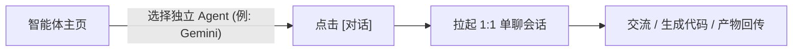
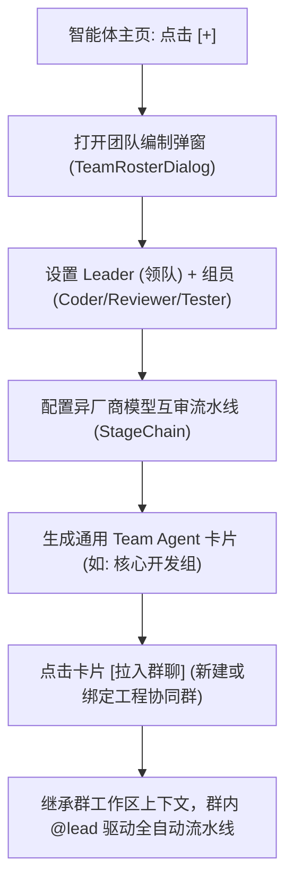

# 榫卯 (Tenon) · 智能体中心 (Agent Hub) 与团队协同重塑设计规范

> **规范标识**：`SPEC-TENON-AGENT-HUB-2026-V2`  
> **核心定位**：打破「工作区」工程概念对用户心智的绑架，确立「消息（沟通现场）vs 智能体（组织司令部）」的双轴产品模型；解耦「通用团队能力」与「具体项目环境」，释放 Team Agent 团队编制与异厂商互审流水线的一等公民体验。
>
> **状态（评审后）**：本文关于**工作区归属**的论断（§3、§6.3、§7-2、§7-5、§9.1）已由
> [`project-directory-and-execution-site-model.md`](project-directory-and-execution-site-model.md) **取代**；
> 其余章节（双轴模型、Agent Hub 卡片、§7 风险清单）仍按评审结论待改写，见
> [`tenon-agent-hub-spec-review.md`](tenon-agent-hub-spec-review.md)。

---

## 1. 背景与核心问题剖析

### 1.1 现状的三大痛点
1. **工作区概念绑架顶层导航**：
   底栏第 4 个 Tab 路由为 `AppRoutes.AGENTS`，但在界面上被命名为「工作区」，内容聚焦于目录、进程、Git 责任链。普通用户直觉上无法建立“智能体在哪里、能帮我干什么”的角色心智。
2. **Team Agent 核心资产深埋**：
   Tenon 已拥有强大的团队编制（`VirtualAgentMember` / `TeamRoster`）和多棒责任链（`StageChain` / 异厂商交叉审查），但入口被深埋在“群聊 -> 群信息 -> 席位管理 -> 团队编制”的四级弹窗中，难以被发现与调度。
3. **会话列表过度承载、体验臃肿**：
   为了透出团队状态，此前在会话列表中硬塞了「Team Folder 手风琴折叠」，破坏了即时通讯的时间序流，造成主聊天列表笨重复杂。
4. **工作区强耦合限制了智能体泛化**：
   此前假设所有智能体团队都必须绑定磁盘工程目录，导致代码评审、方案讨论、文案分析等纯智力型任务被工程沙箱卡死。

---

## 2. 顶层架构：双轴模型 (Dual-Axis Architecture)

系统全面划分为明确的「双轴」分工，把“组织管理”与“作战现场”彻底解耦：

```
                        【榫卯 (Tenon) 主客户端】
                                   │
         ┌─────────────────────────┴─────────────────────────┐
         ▼                                                   ▼
   【消息 Tab】                                        【智能体 Tab】
 (即时通讯 · 作战现场)                               (角色与团队 · 组织司令部)
         │                                                   │
 ┌───────┴───────┐                                   ┌───────┴───────┐
 │ • 个人私聊    │                                   │ • 单兵 Agent  │ (Gemini, Opencode)
 │ • 普通群聊    │                                   │ • 团队编制    │ (核心开发组, 流水线)
 │ • 协同项目群  │                                   │ • 权限与审批  │ (危险命令一键处置)
 │   (轻量团队标)│                                   │ • 任务进行态  │ (单元测试, 补丁生成)
 └───────┘                                   └───────┘
```

- **【消息】Tab（时间/群聊轴）**：
  - 纯粹的即时通讯流，以时间倒序排列。
  - 用户在这里与同事沟通，在群里 `@` 智能体派单、查看交付卡片。
- **【智能体】Tab（角色/任务轴）**：
  - 数字员工与组织管理中心。
  - 负责 Agent 的发现、团队组建、模型与驱动分配、任务执行态洞察与权限审批。

---

## 3. 核心解耦理念：能力属于团队，环境属于群聊

> **已取代**：本节事实前提有误——`GroupMeta` 没有顶层 `wsId`，工作区是**席位级**
> （`allowedWorkspaces`/`defaultWsId`），路径不进协议。归属模型已由
> [`project-directory-and-execution-site-model.md`](project-directory-and-execution-site-model.md)
> 重设为三层（D1–D4）：**群 = 项目现场；项目目录 = 宿主本机指针 `groupId → dirId`；
> `wsId` 只做协议寻址**。「能力属于团队、环境属于群」的产品直觉保留，落点以决策文为准。

```
                     【通用的智能体团队】
                  "全栈开发与异厂商审查组"
                (Leader + Coder + Reviewer)
                             │
         ┌───────────────────┴───────────────────┐
         ▼                                       ▼
    拉入【群聊 A】                         拉入【群聊 B】
  (绑定: 移动端仓库)                     (绑定: 后端服务仓库)
         │                                       │
         ▼                                       ▼
  针对移动端代码作业                     针对后端代码作业
```

1. **智能体团队是通用的“能力包”**：
   在智能体主页组建团队时，专注于配置领队（Leader）与组员（Coder/Reviewer 模型驱动），**默认不绑定任何物理磁盘路径**。
2. **协同群聊是具体的“项目作业现场”**：
   群本身绑定了工作区上下文（`GroupMeta.wsId`）。当通用团队被拉入群聊时，**自动就地继承该群的工作区权限与作业目录**。
3. **团队形态自然分化**：
   - **智力/顾问型团队 (Workspace-Free)**：拉入未绑定工作区的普通群或 1:1 私聊，在内存和临时沙箱中执行架构讨论、翻译、方案评审，产物直接回传群聊和文件柜。
   - **工程/落地型团队 (Workspace-Bound)**：拉入已绑定工程目录的协同群，自动挂载沙箱、Git 责任链、执行门禁并生成代码补丁。

---

## 4. 智能体中心 (Agent Hub) 界面与多群聚合

### 4.1 统一实体模型与渐进式披露
页面不搞割裂的切片，无论是单个 CLI 驱动还是多角色协同团队，统一作为**「智能体实体 (Agent Entity)」**在卡片流中呈现。

### 4.2 动态工作卡片原型 (含多群 Urgent-First 聚焦机制)

当一个团队同时服务多个群时，卡片采用**紧急优先（Urgent-First）机制**动态透出最需要机主关注的群状态：
- **优先级 1**：有危险命令等待审批（`Approval First`，橙红高亮置顶）；
- **优先级 2**：正在执行流水线任务（`Running Second`）；
- **优先级 3**：最新活跃回复（`Recent Last`，兜底）。

```
┌────────────────────────────────────────────────────────┐
│  智能体                                           [+]  │ <- 顶栏：标题 + [组建团队/添加]
├────────────────────────────────────────────────────────┤
│                                                        │
│  ┌──────────────────────────────────────────────────┐  │
│  │ 👥 核心开发组            [ 团队 3人 ]      已服务 3群│  │ <- 身份 + 团队标 + 服务群数
│  │ ⚠️ [移动端群] 1 条待审批: rm -rf /cache   [去批准] │  │ <- 【紧急优先】：审批阻塞插队置顶
│  │ ⚡ [后端服务群] 正在执行: 单元测试 (18/22)           │  │ <- 执行进度动态感知
│  │ 📁 当前聚焦: 移动端协同群 · teahouse-mobile [进入] │  │ <- 挂载项目与直达群聊
│  └──────────────────────────────────────────────────┘  │
│                                                        │
│  ┌──────────────────────────────────────────────────┐  │
│  │ 🤖 Gemini CLI           [ 独立 ]        刚刚      │  │
│  │ 🟢 空闲待命                                      │  │ <- 空闲态优雅折叠
│  │ 💬 分析完成，共发现 3 处内存泄漏风险              │  │
│  │ 💻 Mac Studio · 局域网                     [对话]│  │
│  └──────────────────────────────────────────────────┘  │
│                                                        │
│  ┌──────────────────────────────────────────────────┐  │
│  │ 💻 Opencode             [ 独立 ]         昨天     │  │
│  │ 🟢 空闲待命                                      │  │
│  │ 💬 已完成脚手架项目初始化                         │  │
│  │ 📱 本机驱动                                [对话]│  │
│  └──────────────────────────────────────────────────┘  │
│                                                        │
└────────────────────────────────────────────────────────┘
```

---

## 5. 两大业务流转闭环

### 5.1 闭环 A：单兵 Agent 私聊链路

- **适用场景**：临时技术答疑、独立算法推演、本机轻量脚本生成。

### 5.2 闭环 B：团队组建与群协同作战链路

- **适用场景**：重型工程迭代、跨模块 Bug 修复、自动化测试与代码审查。

---

## 6. 会话列表（消息 Tab）减负重构

1. **彻底移除手风琴折叠**：
   废除会话列表内的展开/折叠复杂二级树（原 `TeamFolderProjection`），会话列表恢复平铺时间序。
2. **轻量团队标识**：
   若群聊挂载了 Team Agent，会话行仅显示 `[👥 团队]` 药丸徽章。
3. **单窗口原则延续**：
   群聊对外交互始终保持单一窗口，群内只认 Leader 的 token，组员不平铺轰炸群聊，保护用户阅读体验。

---

## 7. 深入自审：7 大潜在隐患与工程防御方案

在多群复用与分布式跨设备架构下，必须针对以下 7 大风险建立严格的工程防火墙：

| # | 潜在风险 | 现场表征 | 工程防御方案 |
|---|---|---|---|
| **1** | **多群并发冲突** | 同一团队同时在群 A 和群 B 被 `@lead` 派活，底层驱动被并发打架或 Git 分支撞名。 | ① **沙箱严格隔离**：物理路径必须基于 `(groupId, taskId)` 独立隔离；<br>② **宿主队列调度**：驱动配置并发阈值（默认 1~2），超额任务挂起为 `WAITING_WORKER` 并向两端透出排队状态。 |
| **2** | **跨群数据泄密** | 恶意用户在公开群 A 中诱导 Agent 读取私密群 B 挂载的代码或凭据。 | ① **沙箱路径禁锢 (Path Jailing)**：沙箱根目录强行锁死在当前群的 `defaultWsId`，拦截任何 `../` 越界读取；<br>② **记忆强物理隔离**：给大模型的 Context 严格按 `groupId` 切片，严禁跨群共享对话记忆。 |
| **3** | **免审授权穿透** | 用户在实验群 A 点击了“本会话免审”，导致在生产群 B 中触发危险命令也被直接放行。 | **免审令牌必须强绑定 `(groupId, sessionId)`**：<br>严格禁止全局免审。「群 A 免审」仅在群 A 的当前 Session 生效；群 B 触发相同命令仍必须弹出独立审批弹窗。 |
| **4** | **宿主离线幽灵** | 团队的 Leader 部署在电脑上，电脑休眠后，手机端用户发消息石沉大海。 | ① **输入框前置嗅探**：`@` 候选菜单中，若宿主不可达，选项旁标红灰显 `[宿主休眠中]`；<br>② **发送拦截阻断**：用户强行发送时弹出友好阻断，避免消息入死信队列。 |
| **5** | **团队配置漂移** | 机主在主页修改了组员模型，但历史群的元数据未同步，导致版本分裂。 | **引用制（Reference）+ 增量广播**：<br>群元数据只存团队 ID 引用，编制主体在宿主本地（`team-execution.json`）；机主改动后宿主自动广播轻量 `GroupMerge`，保证所有群一致。 |
| **6** | **沙箱孤儿垃圾** | 退群或群解散后，宿主机器磁盘堆积孤儿分支与编译产物，吃光磁盘。 | ① **生命周期级联清理**：退群或群解散时，触发宿主 `deleteArtifactsSafely()`（严禁跟随软链接）；<br>② **看门狗兜底**：`SandboxIdleWatchdog` 自动回收超 180s 无心跳的沙箱。 |
| **7** | **纯手机端劝退** | 新用户没有电脑做宿主，打开智能体页面全空，无法体验。 | **内置轻量 Direct-API 驱动**：<br>支持手机端直接填入 API Key（Gemini/OpenAI/DeepSeek），无需电脑也可组建纯智力型讨论团队，零门槛上手。 |

> **已取代（第 2、5 条）**：
> - **§7-2**：「锁死在当前群的 `defaultWsId`」前提不成立（`defaultWsId` 是席位级字段，群不拥有工作区）。
>   防御以 [`tenon-agent-hub-spec-review.md`](tenon-agent-hub-spec-review.md) §5 为准：引用 `OsSandboxGuard`
>   （opt-in、只覆盖写路径），记忆按会话切、宿主全局凭据如实陈述；投递防线沿用既有「工作区→群」三键匹配。
> - **§7-5**：整条判为伪风险删除——执行配置是宿主本地事实（`team-execution.json`），「引用制 +
>   轻量 `GroupMerge` 广播」与既有裁决冲突；免批/审批的工作区维度按
>   [`seat-workspace-consistency-fix-plan.md`](seat-workspace-consistency-fix-plan.md) 的 C5/F3 处理。

---

## 8. 多端自适应契约 (Adaptive Contract)

| 布局模式 | 手机端 (Compact) | 桌面端 (Expanded 两栏) |
|---|---|---|
| **导航入口** | 底部导航第 4 个 Tab（文案：`智能体`，图标：`ic_bot`）。 | 左侧 NavigationRail 常驻「智能体」图标。 |
| **主屏布局** | 单列卡片流，居中限宽 560dp，垂直滚动。 | **左栏 (340dp)**：紧凑型 Agent 列表（带在线点、任务中提示与红点）；<br>**右栏 (主工作台)**：顶部展示该 Agent 编制/配置，下方沉浸式展示会话流与任务日志。 |
| **下钻交互** | 点击整卡进入全屏二级页。 | 始终停留在两栏内，点击左侧列表，右侧无缝更新上下文。 |

---

## 9. 数据与工程落地契约（零回归保障）

> **已取代（§9.1 的工作区部分）**：「零改动」按评审 §4 收窄为「Phase A 纯投影零改动」；工作区数据面
> 按决策文 §5.1 新增**宿主本地档案**（HostDirectory、群指针、节点级白名单——JSON 档案，非 DB、
> 非协议、无 `.sqm`）；线协议仍然零新键（外部 agent 互操作不动）。

1. **协议层与数据库（Zero-Change）**：
   - 协议：严格白名单不加新键（`CodecMsg.GROUP_TEXT_KEYS`），遵循 64KiB 帧预算硬约束。
   - 数据库：不引入新表和新字段，无需新增 `.sqm`，保证老版本与多设备向前兼容。
2. **数据源完全复用**：
   - Agent 节点数据：`agentPeers(agentSlice, nodeSlice, settingsSlice)`。
   - 团队编制与成员：`GroupMeta.virtualAgents`。
   - 待审批集合：`agentSlice.agentApprovals.values.filter { isPendingApproval(it, now) }`。
   - 活跃会话选取：`pickActiveSession`。
   - 编制配置界面：直接挂接既有成熟的 `TeamRosterDialog`。
3. **质量门禁 100% 遵守**：
   - 领域层零 Compose 依赖（遵守 `:domainComposeFreeGate`）。
   - 中文文案全部收敛于 `composeResources/values*/strings.xml`（遵守 `cjkLiteralGate`）。
   - 注释无日期、无私人绝对路径、无内网 IP（遵守 `constructionTraceGate`）。
