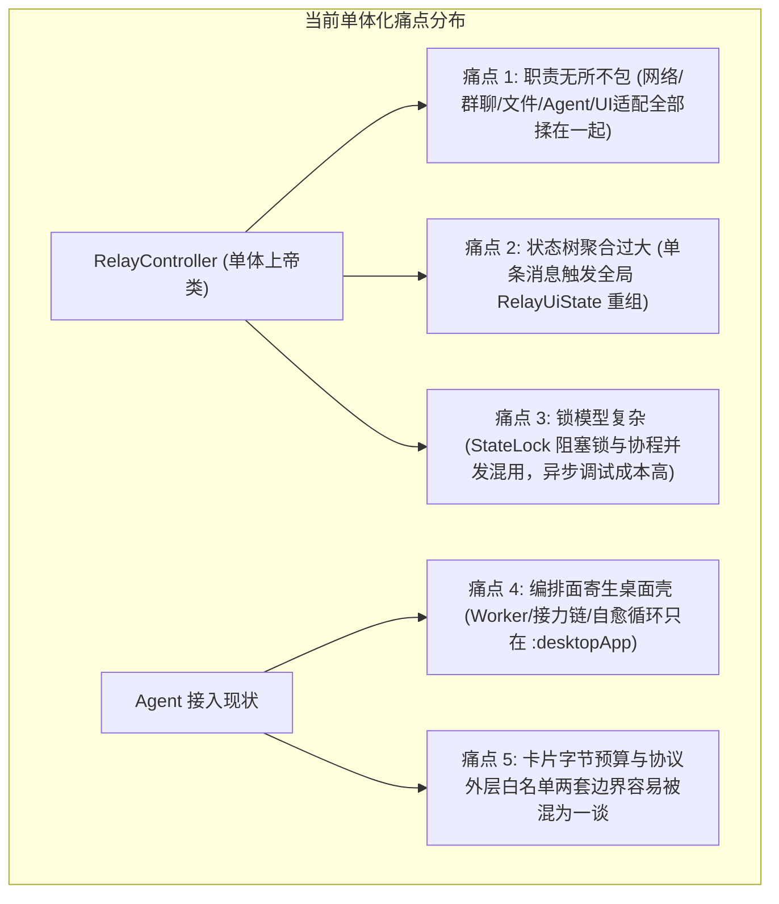
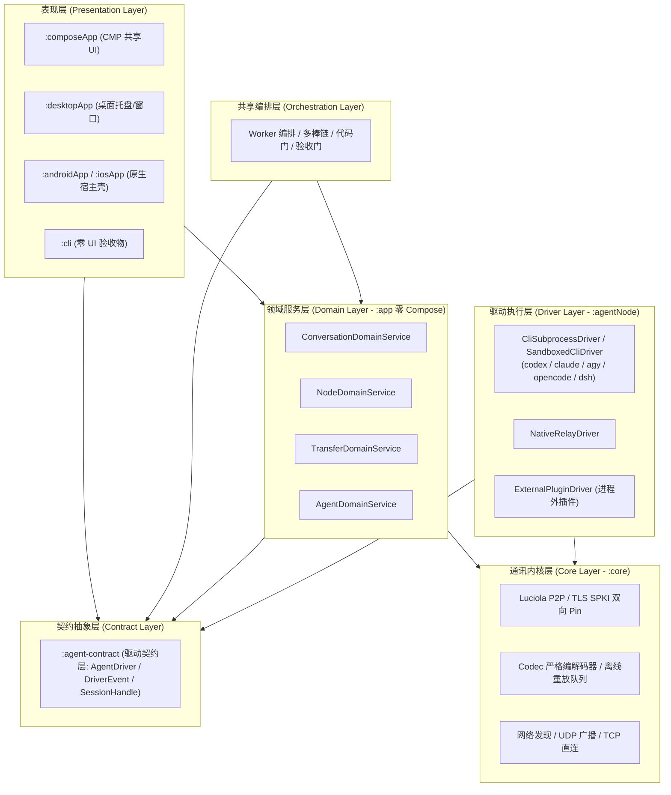
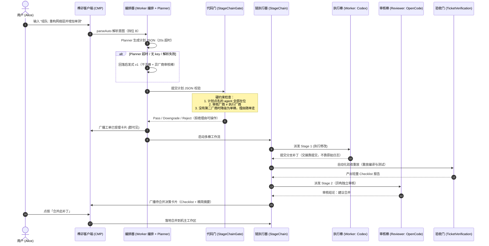
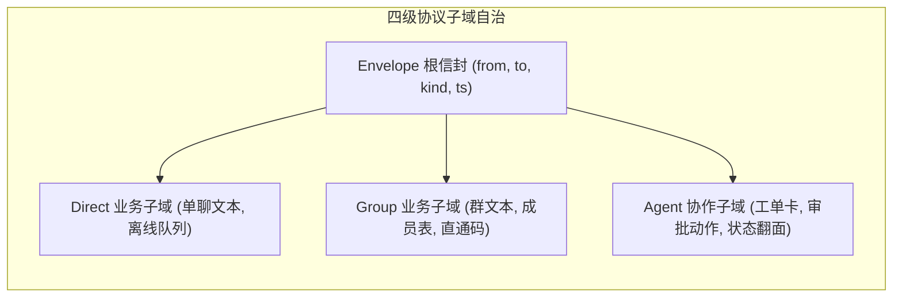
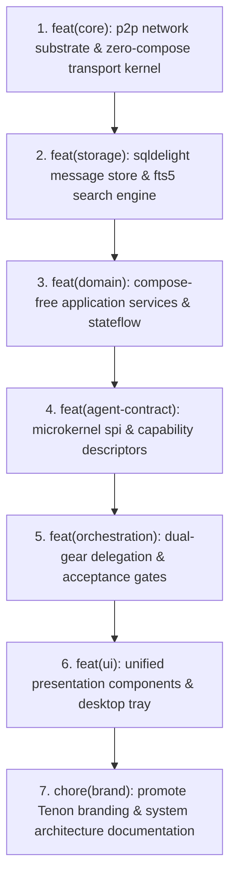

# Tidings（榫卯 Tenon）系统整体架构优化与 Agent 高扩展性演进蓝图

> **文档标识**：ARCH-BLUEPRINT  
> **适用范围**：`:core`、`:app`、`:agentNode`、`:composeApp`、`:desktopApp`、`:cli`（以及驱动契约层 `:agent-contract`）  
> **核心命题**：在局域网 P2P 团队协同与多 Agent 深入集成的现实背景下，对系统进行全局解耦，建立高内聚、低耦合、强扩展的 Agent 微内核与协作编排体系。

---

## 一、 执行摘要与演进背景

随着本系统近期业务能力的爆发式演进——相继落地了 **Luciola P2P 加密直连**、**Ktor 本地 Agent 控制面**、**五款真 CLI 驱动（Codex / Claude Code / Antigravity / OpenCode / DSH）**、**多棒责任链（StageChain）**、**Git Worktree 沙箱**、**验收门（TicketVerification）** 以及 **全平台品牌向「榫卯 Tenon」升级**，系统已经从最初的局域网点对点通信工具，演进为一个**人机同在场的超级局域网协同操作系统**。

然而，能力的极速增长带来了代码层面的复杂度集聚：单体 Controller 职责过度集中、表现层与 Agent 细节强耦合、协议外层白名单与卡片字节预算的边界容易被误读、状态流粒度过粗导致重组放大。

本蓝图以**现状代码为准**制定一份清晰、可持续、高扩展性的**全局架构治理与演进方案**。凡是与代码不符的早期草图（无状态驱动接口、超限自动剥离、同源自审自动放行等）都在正文中按实际实现改正；尚未存在的机制一律标注为「增量」，不写成既成事实：

1. **结构解耦**：把**现有**的会话制驱动契约抽取到独立的 `:agent-contract` 纯接口模块，而不是重新定义一套接口；
2. **驱动扩展**：统一已有的四类驱动形状（子进程 CLI / 沙箱 CLI / 本机中继 / 进程外插件），新增引擎只补注册与发现，不触碰主程序；
3. **编排深化**：把桌面壳独占的多棒编排、代码门与验收门下沉为共享编排面，落地「委派双挡（显式指定 / 意图路由）」；
4. **稳定坚守**：坚守本仓铁律——领域层零 Compose 依赖、严格白名单、超限拒绝不截断、无锁协程流。

对应到实施主线，本蓝图收敛为四个阶段：**Phase 1 编排下沉 → Phase 2 驱动契约统一 → Phase 3 领域服务化 → Phase 4 表现层收敛**。历史重塑与文档治理（第八节）放在四阶段完成之后，不属于架构阶段。

---

## 二、 系统现状与痛点诊断



### 2.1 单体膨胀：`RelayController` 职责过载
- **现状**：`RelayController` 承载了节点生命周期、网络拓扑维护、消息分发、文件断点续传、群元数据同步、本地数据库读写以及 Agent 调度的装配职责。系统已经把它拆成 **13 个 `RelayControllerXxxComponent`**（Agent、AgentInvoke、Avatar、Cabinet、Cidr、Groups、Messages、Pk、Recovery、Screen、ScreenHistory、Settings、Transfers），但**状态仍集中在主类持有的 `RelayCoreState` 里**。
- **体量**：`RelayController` 体系共 **15 个文件、约 1.1 万行**——主类 `RelayController.kt` **2,447 行**，13 个 Component 合计 **8,436 行**，另有横切扩展 `RelayControllerOps.kt` **110 行**。
- **已有基础**：每个 Component 的构造只拿一个 `host` 参数，依赖面是显式的（组件内逐个 `host.` 前缀），这为 Phase 3 的四域服务化提供了现成的边界起点。
- **弊端**：任何单点能力的调整（如修改链卡合并逻辑）仍要穿透主类与共享状态，增加了跨业务逻辑污染和回归验证成本。

### 2.2 Agent 控制面与表现层耦合过深
- **现状**：`composeApp` 中的卡片渲染逻辑（`AgentCards.kt`、`AgentApprovalCards.kt`）直接依赖卡片里的业务字段；手机端 `parseAgentCard` 认识的是一套固定 schema（`cardId` / `rev` / `type` / `title` / `progress` / `items` / `checks` / `banner` / `artifacts` 等）。
- **关键事实**：编解码层把卡片当成**不透明 `JsonObject`**，只校验它是对象且整卡不超过字节预算，**不逐键白名单**。因此编解码层与渲染层之间的卡片 schema 是**跨端约定**，而不是协议白名单——两件事不能混为一谈。
- **弊端**：每当新增一种 Agent 动作或调整驱动事件结构，必须同步改表现层与领域层代码；卡片 schema 一旦漂移，两端不会在编解码层报错，只会在渲染层缺字段。

### 2.3 协议白名单、取值域与「静默丢失」风险
- **现状**：群文本走严格字段白名单（`CodecMsg.GROUP_TEXT_KEYS`）与取值域常量对象（`AgentAckKinds` / `AgentGrantScopes` / `AgentExecPolicies` 等）。多一个外层键、或键对但值不在取值域，接收侧都会整帧拒收。
- **卡片是另一条边界**：卡片在 codec 里是不透明 `JsonObject` + `Limits.CARD_BYTES`（24 KiB）**字节预算**，超限由发送侧与接收侧各自拒绝——它不走逐键白名单，也不存在「自动剥离长文本」这条路。
- **真正的风险面**：① 外层群文本键漏配白名单（新增可选键必须同步白名单，旧端不认识就整帧丢弃，两端必须同版本）；② 取值域清单各写一份；③ 卡片字节预算被当成「可以截断」的软约束。三者共同的结果都是**发送侧显示成功、对端静默丢帧**。
- **纪律**：任何「键 + 取值域」字段，取值域只能有一个定义；卡片内层字段属于渲染 schema，变更要两端同版本，不靠白名单兜底。

### 2.4 粗粒度状态流重组风暴
- **现状**：`RelayUiState`（约 763 行）将会话、消息列表、节点表、群信息、设置、传输状态集中在一个聚合数据类中。它的头注明确写着「**全应用唯一的状态**」——理由是节点表、消息、队列深度是同一份真实数据，会话屏与聊天屏看的是同一个对端，每屏各自持有一份会退化成占位串。
- **弊端**：单条消息入库或心跳在线态变更都会让整棵状态树产生新快照，聊天视图树跟着重组。问题不在「数据该不该共享」，而在**订阅面太粗**：任何一域变化都会唤醒全部消费者。
- **改造方向**：保留单一事实源与唯一写入方（`RelayCoreState` + `RelayStateWriter`），只把**对外订阅面**切成按域切片（见 4.3 与 Phase 4）。

---

## 三、 核心架构设计原则

1. **领域层零 Compose 依赖**：
   - `:app` 模块坚决不引入 Compose 相关 API，纯粹由 Kotlin 标准库与协程驱动。UI 表现层 `:composeApp` 作为消费者，通过纯接口和状态流接入。
2. **计划即数据，骨架在代码，策略交模型**：
   - 坚决杜绝黑盒 Router 接管系统权限。LLM 只能输出标准化的计划 JSON 数据（`DelegationPlan`），真实的 Git 分支派发、沙箱隔离、代码审查与合并落地全部由受控代码驱动。
3. **协议白名单与帧预算铁律**：
   - 群文本 32 KiB、卡片 24 KiB（`Limits.CARD_BYTES`）、整帧 64 KiB。**超限即拒、绝不截断**：发送侧不产出注定被拒的帧，接收侧整帧拒收。轻量状态进卡片，大日志与完整证据走文件信道（`purpose=artifact`）。
4. **微内核等于「现有的会话制契约」，不是重新发明接口**：
   - 驱动契约就是代码里的 `AgentDriver`：`openSession` / `executeTask` / `handleAction` / `queryProgress`，事件走 `DriverEvent` 回调。能力 ACL 是**宿主状态**（`DriverRegistry` / `DriverCapabilityAcl`），不在接口上，也不透传给进程外插件。
   - 任何「无状态 `execute(task, workspace, env): Flow`」的设想与现状冲突，只能作为提案讨论，不得写进契约。

---

## 四、 全局模块拓扑与分层解耦体系



### 4.1 抽取纯契约层 `:agent-contract`
`:agent-contract` 的职责是**把已经存在的类型搬到一个零依赖模块**，让 `:app`、`:agentNode`、`:cli` 与移动端共享同一份驱动契约，而不是再定义第二套：

- **`AgentDriver`**：会话制接口——`openSession(wsPath, resumeSessionId)`、`executeTask(sessionId, prompt, onEvent)`、`handleAction(sessionId, actionId, decidedBy)`、`queryProgress(sessionId)`，以及 `driverId` / `displayName` / `listCapabilities()`；
- **`DriverEvent`**：七型密封接口——`ThoughtDelta`、`TokenDelta`、`ToolCall`、`Card`、`Artifact`、`Finished`、`Error`；
- **`SessionHandle` / `TaskProgressSnapshot` / `DriverCapability`**：会话句柄、进度点查快照与能力元数据；
- **岗位档案与计划数据**：`AgentProfiles`（纯声明表：key / vendor / displayName / defaultRole）与 `DelegationPlan` / `ChainStage`（计划 JSON 的 Kotlin 形态）可按依赖方向一并下沉；**执行器 `StageChain` 不下沉**，它依赖沙箱与运行时。

**明确不进契约层的**：能力 ACL（宿主状态，属于 `DriverRegistry` / `DriverCapabilityAcl`）、进程外插件桥、沙箱执行器。进程外插件驱动永远不会把 ACL 调用转发到插件进程——这是 4.1 的硬边界。

### 4.2 领域层解耦：组件 → 四域服务映射
目标是把 `RelayController` 体系收敛为 `:app` 内四个**零 Compose** 的垂直领域服务。下表的「现有组件」是已存在的 13 个 Component，映射依据是它们当前的职责与 `host` 依赖面；Phase 3 照此边界收拢，而不是推倒重写：

| 现有组件 / 文件 | 当前职责 | 目标域服务 |
|---|---|---|
| `RelayControllerMessagesComponent` | 单聊消息本体：发送、撤回、补发、落盘、检索 | **ConversationDomainService** |
| `RelayControllerGroupsComponent` | 建群/退群、群资料、成员、群消息 | **ConversationDomainService** |
| `RelayControllerPkComponent` | 会话内小游戏卡（比大小/猜拳） | **ConversationDomainService** |
| `RelayControllerScreenHistoryComponent` | 投屏记录 upsert 成聊天消息 | **ConversationDomainService**（消息产物面） |
| `RelayControllerRecoveryComponent` | 身份恢复 L2 的历史拉回（扩展在 Messages 上） | **ConversationDomainService**（网络触发留在 Node） |
| `RelayController` 主类 | 节点生命周期、发现、配对、传输装配 | **NodeDomainService**（Phase 3 后主类只留装配） |
| `RelayControllerCidrComponent` | 网段扫描、扫描结果 gossip | **NodeDomainService** |
| `RelayControllerAvatarComponent` | 节点头像与资料交换 | **NodeDomainService** |
| `RelayControllerSettingsComponent` | 设置落盘、端口、远程中继、能力声明 | **NodeDomainService**（纯 UI 偏好后续可上移） |
| `RelayControllerTransfersComponent` | 文件 offer/accept、续传、残片、传输日志 | **TransferDomainService** |
| `RelayControllerCabinetComponent` | 共享柜授权、浏览、上下行 | **TransferDomainService** |
| `RelayControllerScreenComponent` | 投屏会话协商与帧流（与文件直传共用数据平面） | **TransferDomainService**（是否独立成屏务域留待 Phase 3 裁决） |
| `RelayControllerAgentComponent` | agent 会话、事件、队列、审批、取消、回执、产物 | **AgentDomainService** |
| `RelayControllerAgentInvokeComponent` | 跨端派单网道、租约、执行门禁、看板卡 | **AgentDomainService** |
| `RelayControllerOps.kt` | 落盘 / 插消息 / 替换等横切小事务 | 共享事务辅助，不归属任何单一域 |

四个服务对外只暴露命令与状态流；主类的「装配」职责保留，但它不再直接持有跨域状态。

#### 4.2.1 组件依赖面矩阵（Phase 3 抽取依据）

抽取边界不是按目录搬文件，而是按「这一族真的碰了什么」定。下表是逐个分片统计 `host.` 调用得到的**实际依赖面**（当下代码的事实，不是推测）：

| 组件 | 目标域 | 状态/提交 | 核心表与锁 | 存储/运行时 | 横切事务 | 文案/通知 | 跨组件 | 其它 |
|---|---|---|---|---|---|---|---|---|
| Messages | Conversation | `_state` `publish` | `core` `stateLock` | `messageStore` `runtime` `remoteRelayClient` `messagesRestored` | `handleAppendMessage` `handleReplaceMessage` `replaceMessage` `handlePersistThreads` `persistMessages` `persistMutex` | `warn` `showNotification` `uiTexts` | **八个**：`agentCtl` `invokeCtl` `groupsCtl` `screenCtl` `pkCtl` `cidrCtl` `cabinetCtl` `avatarCtl` | `localMessageId` `onAgentPrompt` `onAgentFollowUp` `onAgentAbort` `requestFocus` `completedJob` `groupHasDeclaredAgents` `unathorizedAgentMention` `agentRouteFactsOf` `platform` |
| Groups | Conversation | `_state` `publish` `refreshPeers` | `core` | `scope` `runtime` | `handlePersist` `handleAppendMessage` `replaceMessage` | `warn` `info` `uiTexts` | — | `groupMetaWithNicks` `localMessageId` `onAgentPrompt` `unathorizedAgentMention` `agentRouteFactsOf` |
| Pk | Conversation | `_state` | — | `scope` `runtime` | `handleAppendMessage` | `warn` `showNotification` | — | — |
| ScreenHistory | Conversation | `_state` `publish` | `core` `stateLock` | `scope` `screenCardTextOf` | `handleAppendMessage` `handleReplaceMessage` `handlePersistThreads` | — | — | — |
| Recovery | Conversation | `publish` | — | `scope` `messageStore` `activeRuntime` | `handleAppendMessage` | — | — | — |
| 主类 RelayController | Node（装配） | `_state` `publish` `warn` `info` | `core` `stateLock` | 全部存储与运行时 | 全部横切事务 | 全部 | 全部 13 个组件 | 节点生命周期、发现、配对 |
| Cidr | Node | `_state` `publish` | — | `scope` `runtime` | `handlePersist` | `warn` `info` | — | — |
| Avatar | Node | `_state` | — | `scope` `runtime` `platform` | — | `warn` | — | — |
| Settings | Node | `_state` | — | `scope` `runtime` `platform` `remoteRelayClient` `remoteRelayHealthy` `remotePollingJob` `lastRemoteSeq` | `handlePersist` `refreshPeers` `handlePersistThreads` `handleAppendMessage` | `warn` | `messagesCtl` | `restart` `themeMode` `persistMessages` `jobs` |
| Transfers | Transfer | `_state` `publish` `refreshPeers` | `core` `stateLock` | `scope` `runtime` `platform` | `handleReplaceMessage` `handleAppendMessage` `handlePersist` `handlePersistThreads` | `warn` | — | `localMessageId` |
| Cabinet | Transfer | `_state` `publish` | — | `scope` `runtime` `platform` | `handlePersist` | `warn` `info` | — | — |
| Screen | Transfer | `_state` | — | `scope` `runtime` `platform` | — | `warn` `info` | — | `localMessageId` |
| Agent | Agent | `_state` | — | `scope` `runtime` `agentStore` | — | `warn` `showNotification` | `groupsCtl`（已收成宿主方法 `syncWorkspaceGroups`） | `onLocalSessionPageRequest` |
| AgentInvoke | Agent | `_state` | — | `scope` `runtime` `messageStore` | `handleAppendMessage` `handleReplaceMessage` | `uiTexts` | — | `localMessageId` `onChannelResultObserved` `jobs` |

**分类口径**：`core` / `stateLock` 是跨域共享的可变表与阻塞锁（Phase 3 的收敛对象）；`handle*` 是 `RelayControllerOps` 与主类上的共享事务；「跨组件」是直接调另一个 Component —— 这不是搬家的阻碍，而是**服务间接口**的清单。

**三条结论（决定抽取顺序）**：

1. **Agent 域最独立**：两个分片只碰 15 个宿主成员，且不依赖任何其它组件（唯一的跨域动作是建群后同步群资料，已收成宿主方法）。所以它先抽，样本代价最小。
2. **Conversation 域是最大汇聚点**：`Messages` 一个分片点名另外**八个**组件，`Groups` 与 `Settings` 又各自点名其余分片与主类 `messagesCtl`。先抽它等于把四个域的服务接口一次性压进来 —— 顺序应当是 Agent → Node / Transfer → Conversation。
3. **真实耦合不在状态表，而在 `core` 与 `stateLock`**：同一张 `threads` 表被 Messages / Groups / Transfers / ScreenHistory / Recovery 直接读写，同一把阻塞锁被 49 处取用（Messages 15、Transfers 14、主类 9、Recovery 4、Ops 3、ScreenHistory 3）。把表按域切走之前，先要证明每个锁点保护的不变量 —— 这是 Phase 3 第三步而不是第一步。

#### 4.2.2 第一域收口：AgentDomainService

Agent 域已完成机械抽取，判据是**编译期**而不只是文件搬家：

- **窄缝 `AgentDomainHost`**：两个 agent 分片只拿得到 15 个成员（状态读写、`agentStore`、`scope`、`runtime`、`messageStore`、`uiTexts`、`jobs`、分页桥、`localMessageId`、`syncWorkspaceGroups`、`warn`、`showNotification`、`onChannelResultObserved`、两条横切事务）。改回 `RelayController` 宿主会在编译期报一屏 `Unresolved reference`。
- **状态读写单入口**：读走只读的 `state`，写走 `updateAgentState`；分片不再直接拿 `MutableStateFlow`。Phase 4 把 agent 状态切成独立流时，改的是服务里的一个实现，而不是散落几十处的 `update` 调用点。
- **主类仍是门面**：`RelayController` 继续以同名成员暴露两族（`:orchestration` 与 UI 直接连它），`agentCtl` / `invokeCtl` 退化为指向服务内部组件的 getter，公开 API 零变更；构造点只剩 `AgentDomainService` 一处。
- **守卫与反向验证**：`AgentDomainWiringGuardTest` 钉住三条判据（宿主类型、不得出现 `host._state` / `host.core` / `host.stateLock` / `host.groupsCtl`、主类不得自己构造分片）。回归验证：把直接构造放回主类 ⇒ 用例红；把宿主类型写回 `RelayController` ⇒ 编译期报 `Unresolved reference`。

#### 4.2.3 第二域收口：NodeDomainService

节点域按同一形状抽取（网段探测 / 头像与资料 / 设置与远程中继三族）：

- **窄缝 `NodeDomainHost`**：状态读写、`publish` / `refreshPeers` / `restart`、`scope` / `platform` / `runtime` / `jobs`、`persistMessages` / `themeMode`、远程中继的客户端/轮询任务/健康态/游标、`info` / `warn`、`handlePersist` / `handlePersistThreads` / `handleAppendMessage`，以及跨域收口方法 `clearConversation`（原先设置分片直接调消息分片的 `handleClearMessages`）。
- **状态读写单入口**：写走 `updateNodeState`，读走只读 `state`；`_state` 直接访问在这三族里已清零。
- **主类仍是门面**：`cidrCtl` / `avatarCtl` / `settingsCtl` 退化为指向服务内部组件的 getter，公开 API 与 `:orchestration` 直连的成员零变更；构造点只剩 `NodeDomainService`。
- **节点生命周期/发现/配对暂不搬**：它们就是 `RelayController` 的装配面本身，搬它是一次整类边界评审，留到 Phase 3 收尾单独做。
- **守卫与反向验证**：`NodeDomainWiringGuardTest` 三条判据同上；回归验证：直接构造放回主类 ⇒ 用例红；宿主类型写回 `RelayController` ⇒ 编译期报 `Unresolved reference 'updateNodeState'`。

#### 4.2.4 第三域收口：TransferDomainService

传输域按同一形状抽取（文件传输 / 共享柜 / 投屏三族）：

- **窄缝 `TransferDomainHost`**：状态读写（`state` / `updateTransferState`）、`publish` / `refreshPeers`、`scope` / `runtime` / `platform`、`warn` / `info`、`localMessageId`、`handleAppendMessage` / `handleReplaceMessage` / `handlePersistThreads` / `handlePersist`；**显式保留** `core` 与 `stateLock`。
- **为什么保留 core / stateLock**：传输表（`transferMessages` / `transferConvs` / `groupTransferIds`）与聊天表同住 `RelayCoreState`、共用同一把阻塞锁；把它们从接口里藏掉只会让两族各拿一份视图。真正要做的是 Phase 3 第三步「按点替换 StateLock」——先证明每处锁保护的不变量，再按域切表。在那之前这里是**显式记账**的耦合，不假装已经消失。
- **状态读写单入口**：写走 `updateTransferState`，读走只读 `state`；三族里 `_state` 直接访问已清零。
- **主类仍是门面**：`transfersCtl` / `cabinetCtl` / `screenCtl` 退化为指向服务内部组件的 getter，公开 API 零变更；构造点只剩 `TransferDomainService`。
- **守卫与反向验证**：`TransferDomainWiringGuardTest` 钉住「宿主类型、不得出现 `host._state`、不得直接点名其它域分片、主类不得自建分片」；回归验证同上（直接构造 ⇒ 用例红；宿主类型写回 `RelayController` ⇒ 编译期报 `Unresolved reference 'updateTransferState'`）。

#### 4.2.5 第四域收口：ConversationDomainService（最大汇聚点）

会话域是四个域里唯一**入站总分发处**：一个信封进来先由消息分片按类型分发到其它三域。因此它的形状比前三个域多一层：

- **窄缝 `ConversationDomainHost`**：状态（只读 `state`）、`publish`、`core` / `stateLock`、`scope` / `platform` / `runtime` / `activeRuntime()`、`refreshPeers`、`messageStore` / `persistMessages` / `persistMutex` / `messagesRestored` / `remoteRelayClient`、`uiTexts` / `warn` / `info` / `showNotification` / `screenCardTextOf`、五条横切事务、`localMessageId` / `completedJob` / `requestFocus`、群判据（`groupHasDeclaredAgents` / `unathorizedAgentMention` / `groupMetaWithNicks` / `agentRouteFactsOf`）、三条壳层桥（`onAgentPrompt` / `onAgentFollowUp` / `onAgentAbort`）、本域两个分片（`groups` / `pk`）。
- **跨域只走端口**：`ConversationAgentPort`（15 条 agent 入站路由与派单入口）、`ConversationTransferPort`（投屏/共享柜入站）、`ConversationNodePort`（扫描结果/头像入站）。端口由 `ConversationDomainService` 实现，实现只调**其它域服务的方法**（`AgentDomainService.handleOnAgentSession` 一类；这些转发方法随本域一并加在三个服务上），分片拿不到别的域的组件类型。
- **本域对 UI 状态只读**：四个分片里没有一处直接写 `RelayUiState` —— 一律改 `core` 里的表再 `publish`，与 [RelayCoreState] KDoc 的「改表 → 同一临界区里 commit」一致。
- **主类仍是门面**：`messagesCtl` / `groupsCtl` / `pkCtl` / `screenHistoryCtl` 退化为 `conversationDomain` getter；构造顺序上会话域最后建（端口要转发到另外三个域的服务）。
- **守卫与反向验证**：`ConversationDomainWiringGuardTest` 除宿主类型与主类自建分片外，额外禁掉 `*Ctl` 与 `host.agentDomain` / `host.transferDomain` / `host.nodeDomain` —— 会话域伸手够别的域是最容易长回来的分叉，必须由守卫钉住；回归验证：把直接构造放回主类 ⇒ 用例红；宿主类型写回 `RelayController` ⇒ 编译期报类型不匹配。
- **连带改一处源码级守卫**：`:desktopApp` 的 `SingleExecutorPerInboundFrameTest` 钉的是「文本路由的派单被 `intentOwnsDispatch` 挡住，且判据取本机有没有 invoke 执行器」。收口后该调用点从 `host.invokeCtl.intentExecutorPresent()` 变为 `host.agent.intentExecutorPresent()`（语义不变），守卫字符串随之更新。

#### 4.2.6 StateLock 账本与替换裁决（Phase 3 第三步）

**原计划写「替换目标 = `Dispatchers.limitedParallelism(1)` 或 `MutableStateFlow`」——逐点证明后修正为「机制保留 + 只替换误用与可异步化的点」。** 修正不是放弃任务，是范围收缩：下面四条不变量说明这条机制被什么钉住。

#### 四条不变量（每条都有源码依据）

| # | 不变量 | 证据 |
|---|---|---|
| I1 | 锁必须**能被同步获取** | UI 在 Compose 回调里同步调用 `controller.selectConversation(...)` / `refreshPeers()`（`App.kt` / `DesktopShell.kt` / `DesktopWindow.kt`），`ChatScreenArgs` 注明「selectConversation 同步把 `core.unread` 清零」；`:orchestration` 也同步调 `controller.appendMessage(...)` |
| I2 | 必须**跨线程互斥** | 控制器 scope = `CoroutineScope(SupervisorJob() + Dispatchers.Default)`（androidApp / desktopApp / cli 三个宿主一致）；轮询、入站、UI 真并发 |
| I3 | 必须**可重入** | 持锁期间会调到再取锁的路径：`handleAppendMessage → handleApplyPendingRecall / replaceMessage / refreshPeers / handlePersistThreads`；Transfers 乐观卡片 → replaceMessage/appendMessage；Messages recall 循环 → handleApplyRecall → handleReplaceMessage |
| I4 | 持锁期间**不挂起、不做 IO** | 挂起由编译器强制（块体是非 suspend lambda）；IO 曾有一处违例（`pendingRecoveryPeers` 的落盘在锁内），本步已清掉，并由守卫钉住 |

**为什么不能用 `limitedParallelism(1)` 替换机制**：dispatcher 只决定协程在哪执行，串不了 I1 的同步调用与 `SqlDriver` 的同步接口（`execute`/`executeQuery`/`newTransaction` 全非 suspend）；也提供不了 I3 的可重入语义。强行覆盖只有两条路：把公开 API 改 suspend（改 UI 与 `:orchestration` 调用面），或在同步调用里阻塞等 dispatcher（死锁面比现有锁更危险）。

#### 持有点裁决

| 持有点 | 裁决 | 依据 |
|---|---|---|
| `StateLock.kt` expect + `withLock` | 保留 | 机制本身；`withLock` 的 try/finally 是「不漏解锁」的结构性保证 |
| `StateLock.jvmShared.kt` / `StateLock.ios.kt` 两个 actual | 保留 | `ReentrantLock` / `NSRecursiveLock` 天然满足 I3；commonMain 用不了 `synchronized`（iOS 目标） |
| `RelayCoreState.lock`（41 处调用点） | 保留 | I1–I4 全中；核心表（threads/summaries/unread/pending/transfer*）的**结构性读改写**与 UI 同步入口共用这把锁 |
| `DatabaseDriverFactory.driverCacheLock` | 保留 | `createDatabaseDriver` 是非 suspend 的启动路径；「每库每进程只开一条驱动」要求判断与打开原子（换成 `update{}` 的重试 lambda 会让驱动被打开两次） |
| `DatabaseDriverFactory.writeLockFor`（经 `SerializedAccessDriver`） | 保留 | `SqlDriver` 是同步接口；同进程两条连接会在事务升级写锁时**跳过 busy handler 直接 BUSY**（见该文件 KDoc 的实测），且必须可重入（嵌套事务） |
| `pendingRecoveryPeers` 借锁（4 处） | **替换** | 与核心表无关；读者是启动路径与 drain 协程，不需要阻塞语义；原写法还在持锁期间写文件（违反 I4）→ 改为 `MutableStateFlow<Set<String>>` 原子读改写，落盘移到锁外 |

#### 调用点账本（抽取前 45 处 → 替换后 41 处）

| 文件 | 函数（锁内做什么） | 保护的不变量 |
|---|---|---|
| `RelayController.kt` | `selectConversation` / `setVisibleConversation` / `selectPeer`（清零 unread 后 publish） | I1 UI 同步入口 + 计数读改写 |
| | `markAllRead`（unread 全清） | I1 |
| | `observe`（threads 快照） | I2 与入站并发迭代 |
| | `refreshPeers`（threads/summaries 快照） | I2 每 2s 轮询与 appendMessage 并发 |
| `RelayControllerMessagesComponent` | `handleAppendMessage` 由 Ops 承担；本文件 14 处：`handleDeleteMessage` / `handleClearMessages` / `handleClearAllMessages` / `handleApplyRecallFrom` / `handleApplyRecall` / `handlePendRecall` / `handleApplyPendingRecall` / `handleRestoreMessages` / `handleLoadOlderMessages`（2 处）/ `handleRestoreQueuedFrom` / `markStaleQueuedAsFailed` / `handleSyncPending` / `handleOnPruned` | I2 结构性读改写 threads/pending/pendingRecalls；I3 撤回循环可重入 |
| `RelayControllerTransfersComponent` | `handleOfferFilesWith` / `insertOptimisticTransferCard` / `commitOptimisticTransferCard` / `failOptimisticTransferCard` / `handleCancelTransfer` / `handleOnTransfer`（6 处）/ `handleResumeTransfer` / `handleCurrentTransferCard` / `handleUpsertTransferCard` | I2 transferConvs/transferMessages/groupTransferIds 表；I3 乐观卡片路径重入 |
| `RelayControllerOps` | `handleAppendMessage`（按 `at` 插序 + 未读计数）/ `replaceMessage`（按旧 id 整条替换）/ `handlePersistThreads`（**锁内取快照、锁外写盘**） | I2 插入顺序与 id 替换的原子性；I4 正确形状的样板 |
| `RelayControllerScreenHistoryComponent` | `handleUpsertScreenRecord` / `handleInterruptUnfinishedScreenRecords`（2 处） | I2 threads 表 upsert 与启动卫生检查 |
| `RelayControllerRecoveryComponent` | `mergeRecoveredThreads`（批量幂等合入 + `at` 插序） | I2 恢复合入与轮询并发 |
| `recovery/RecoveryActions` | `exportRecoveryBundleOrThrow`（threads 快照） | I2 导出与入站并发 |

#### 本步新增的守卫

- `StateLockUsageGuardTest`：除 `StateLock.kt` / 两个 actual / `SerializedAccessDriver` 外，生产源码禁止裸调 `lock()` / `unlock()`（漏解锁 = 链路静默卡死，比并发崩溃更难查）。
- `RecoveryPendingStateGuardTest`：`pendingRecoveryPeers` 的两个入口不得再出现 `stateLock` / `withLock`；任何 `withLock` 块体内不得出现 `RecoveryPendingPeers.save`（I4 的执行级守卫）。
- `DatabaseDriverOwnershipGuardTest`（持有点 ③④ 的所有权守卫）：`openPlatformDatabase(` 只许出现在工厂与三个平台 actual；`SerializedAccessDriver(` 只许由工厂套；`createDatabaseDriver(` 只许被三个平台的 store 工厂调用。绕开工厂 = 给同一个库开第二条连接（迁移跑两遍 + 并发写偶发 `SQLITE_BUSY`），编译器不拦、行为用例也多半不红，只能在源码层钉。
- 反向验证：把 `stateLock.withLock { RecoveryPendingPeers.save(...) }` 放回 `markRecoveryPullPending` ⇒ 两条用例变红；在任一分片写一处裸 `lock()` ⇒ 第一只用例变红；在任一分片写一句 `createDatabaseDriver(host.platform)` / `SerializedAccessDriver(...)` / `openPlatformDatabase(...)`（都可编译）⇒ 所有权守卫三条变红。

#### 持有点 ③④ 的可判定证据（为什么「保留」不是托词）

两把锁的语义都已由 `SharedDatabaseDriverTest` 行为级钉住，本步只补所有权守卫：

| 不变量 | 现有断言 |
|---|---|
| 同一数据根只开一条驱动 | `assertSame(first, second, "同一数据根必须复用同一条驱动")` |
| 不同数据根是不同驱动 | `assertNotSame(first, createDatabaseDriver(platformAt(otherDir)), …)` |
| 两个 store（message/agent）共用一个驱动、迁移只跑一遍 | `databaseDriverOpenCountForTests() == 1` |
| 库落在 WAL 上、每条新连接都有 busy_timeout | `assertEquals("wal", journalMode)` / `assertEquals(SQLITE_BUSY_TIMEOUT_MS, otherThreadValue)` |
| 串行化不阻塞外部只读观察者 | 外部 `sqlite3 -readonly` 读到 1 行、退出码 0 |

这两项**不需要换**：它们的调用面是非 suspend 的 `SqlDriver` 接口与启动期建驱动路径，`limitedParallelism(1)` 覆盖不到（见 I1）；`driverCacheLock` 还必须保证「判断与打开」原子（换 `update{}` 的重试 lambda 会打开两次驱动）。

### 4.3 细粒度 `StateFlow` 响应式状态流切片
先回应 `RelayUiState` 头注里的单状态理由：**单一事实源是对的，切片不改数据所有权**。`RelayCoreState` 仍是唯一可变状态，`RelayStateWriter` 仍是唯一写入方（「改表 → 同一临界区里 commit」没有第二条路）。切片切的是**对外订阅面**：

- `chatFlow`：会话摘要、当前会话消息、未读与发送中计数；
- `agentFlow`：agent 会话、运行态、待审批、产物；
- `nodeFlow`：节点表、发现/诊断、配对候选；
- `transferFlow`：传输进度、传输日志、共享柜视图；
- 设置偏好可另立一档；跨域的一次性 UI 请求（如定位会话）保持单次消费字段。

**可判定收益**：不是「重组率降低百分之多少」这类没有量具的口号，而是「改 agent 会话表不会让 `chatFlow` 产生新值」——由切片级测试逐条断言（见 Phase 4）。

### 4.4 Phase 4 迁移计划：RelayUiState 订阅面切片（已批准，按 §4.4.7 分步落地）

目标：把 40 个存储字段的大聚合切成**按订阅面**的不可变投影，让「改 agent 表」不再惊动会话面/节点面/传输面的订阅者；**不改数据所有权、不改写路径、不改公开 API**。

#### 4.4.1 现状（全部是可核对的事实）

- **单一订阅点**：`composeApp` 的 `App.kt` 顶部一行 `controller.state.collectAsState()`，之后把整个 `RelayUiState` 当参数传给 **25 个文件 / 29 个 Composable**（手机壳 `feature/*` 与桌面壳 `ui/desktop/*` 两套并存）。任何一次状态写入都让整棵树拿到新状态对象。
- **状态形状**：`RelayUiState` 有 **40 个存储字段** + 十余个派生 getter（`conversations` / `agentPeers` / `navBadges` / `totalPending` / `agentKindsByHost` …）。
- **写路径**：`RelayCoreState` 是唯一可变表；`RelayStateWriter.commit` 只覆盖 4 个会话面字段（`messages` / `unreadByPeer` / `pendingByPeer` / `conversationSummaries`），其余字段由三个域的写入口（`updateAgentState` / `updateNodeState` / `updateTransferState`）与主类直接 `_state.update` —— 全模块共 **33 处**（主类 25，服务与分片 8）。
- **非 Compose 消费者**：`:cli`（network / messages / peers / selfNodeId 等）、`:desktopApp`（`DesktopHosting` 读 `transferLogs`）、`composeApp/iosMain`（peers 判在线）。它们继续读 `controller.state`，本步不改。
- **实测字段面最宽的屏**（迁移难度排序依据）：`ChatScreen` 13 面、`DesktopShell` 10、`App.kt` 10、`AgentWorkspaceBoard` 7、`SettingsConnectionSubpage` 6、`WorkspaceDetailView` 6；最窄的几个（`NodesScreen` / `NodeSheets` / `ConversationsScreen` / `SettingsHomeScreen`）4–5 面。

#### 4.4.2 切片清单与重建边界

定义：**slice = 纯字段分区的不可变投影**，由 `_state` 派生（`map { ... }.distinctUntilChanged()`），不含存储、不含写入方法、不含跨面派生值。

| 切片 | 字段 | 实测消费者（代表） | 重建边界（什么使它产生新值） |
|---|---|---|---|
| `chatFlow` | `messages` / `conversationSummaries` / `unreadByPeer` / `pendingByPeer` | ConversationsScreen、DesktopConversationsPane、ChatScreen（消息段）、DesktopShell、徽标 | 仅上述四字段变化：消息增删改、未读/发送中计数、会话摘要 |
| `agentFlow` | `agentSessions` / `agentEvents` / `agentApprovals` / `agentTasks` / `agentRuns` / `agentInvokes` / `agentArtifacts` / `agentWorkspaces` / `agentGrants` / `pendingGrantRequests` / `sessionPageLoading` / `sessionPageExhausted` | AgentWorkspaceBoard、AgentCards、ConsoleScreen、AgentApprovalCards、ChatScreen（agent 段） | 仅 agent 面字段变化 |
| `nodeFlow` | `network` / `peers` / `mdnsServices` / `scanProgress` | NodesScreen、ScanScreen、DesktopNodesPane、DesktopStatusBar、壳层在线数 | 节点表/网络/发现/扫描变化 |
| `transferFlow` | `transferLogs` / `cabinet` / `screenSession` | CabinetScreen、CabinetPane、DesktopFilesPane、`:desktopApp` 宿主 | 传输日志/共享柜/投屏会话变化 |
| `settingsFlow` | `settings` / `updateState` / `restarting` | 设置屏族（6 屏）、各屏的 nick/theme 读取 | 设置或更新状态变化 |
| `chromeFlow` | `banner` / `settingsNote` / `focusRequest` / `externalStoreTick` | `App.kt` 壳、边栏、各屏横幅与提示 | 横幅/提示/定位请求/桥心跳；**一次性请求语义不变**（仍是「写入 → 消费后清空」，不引入新事件通道） |
| `avatarFlow` | `avatarCache` / `pickedAvatarBytes` / `pickedAvatarHash` / `pickedAvatarName` | SetAvatarPage、DesktopChatPane、AvatarPalette | 头像缓存与选图变化；单独成片的理由见 4.4.5 |

**重建边界的执行级含义**：判断「这一片该不该发射」只看**字段分区**，不看 UI 用途。`chatFlow` 不因 peers/settings 变化而发射 —— 会话行要显示的昵称/在线态由 4.4.3 的投影在 UI 侧按依赖组合，**不把节点字段塞进 `chatFlow`**。

#### 4.4.3 跨面派生值的处置（本计划最容易做错的地方）

现状里有三个**天生跨面**的派生：

- `RelayUiState.conversations` = `peers` ⊕ `settings.groups` ⊕ `conversationSummaries` ⊕ `messages` ⊕ `unreadByPeer`（chat + node + settings）；
- `agentPeers` = `peers` ⊕ `agentWorkspaces` ⊕ `settings`（agent + node + settings）；
- `navBadges` = `unreadByPeer` 求和 ⊕ `agentPeers` / `pendingByPeer`（chat + agent + node）。

处置：**下沉为 `:app` 内的 projection 纯函数**，输入是它真正依赖的切片，输出是渲染模型；UI 用 `remember(chat, node, settings) { ... }` / `derivedStateOf` 组合。**不允许**把跨面派生塞进某一片 —— 那会让该片重新变成「改什么都会变」的聚合，切片语义当场失效。

旧入口保留：`RelayUiState.conversations` 与 `navBadges(state)` 继续可用（`androidApp` 截图门禁与未迁移屏在用），标 deprecated，Phase 4 收尾再删；新增投影版本与之并存。

#### 4.4.4 单一写入方与「会话域只写表不写流」怎么保住

- 切片是**派生投影，不是第二份存储**：`_state` 仍是唯一可变状态，`RelayCoreState` 仍是唯一表，`RelayStateWriter.commit` 仍是会话面「改表 → 同一临界区 commit」的唯一出口；agent/node/transfer 三域仍只经各自宿主缝的写入口改状态。
- 因为切片由 `_state` 派生，**结构上不存在第二个写入方**。这比「给每个切片配一个 `MutableStateFlow`」安全：后者把单一写入方拆成四份，四个域各写各的，跨面一致性要靠约定（本仓最贵的一类缺陷正是「两处各写一份、谁也不报错」）。
- 会话域纪律原样保持：`ConversationDomainHost` 只有只读 `state` + `publish`，没有 update 入口；`ConversationDomainWiringGuardTest` 已禁 `host._state`。本步不新增任何写路径。
- 新增守卫：切片文件只读（无 `var` / `MutableStateFlow` / 写方法）；每个切片的字段清单在守卫里写死（多一个或少一个都红）。

#### 4.4.5 需要改的 UI 订阅点（分档）

| 档 | 范围 | 改法 |
|---|---|---|
| A 壳根（1 处） | `App.kt` 顶部 `collectAsState(controller.state)`；桌面壳 `DesktopShell` 顶部 | 改为按需收 6+1 个切片，壳层只下传当前屏要的切片 |
| B 屏（25 文件 / 29 个参数） | 手机壳 `feature/*` 与桌面壳 `ui/desktop/*` | 每个 Composable 的 `state: RelayUiState` 换成它实际用到的切片（或一个 projection 出来的屏模型）。按实测字段面**从窄到宽**迁：Nodes/Scan/Settings → Conversations/Cabinet → Agent 屏族 → ChatScreen 最后 |
| C 非 Compose | `:cli`、`:desktopApp` `DesktopHosting`、`composeApp/iosMain` | **不改**（不在重组路径上）；Phase 4 末再评估 |

`avatarFlow` 单独成片的理由：`avatarCache` 是 `Map<String, ByteArray>`、`pickedAvatarBytes` 是 `ByteArray` —— data class 等值对 ByteArray 是**指针等值**。当前写路径只在内容变化时重建这些值（同内容不重建），所以在切片里可接受；单独成片可以让「头像缓存变化不惊动其它屏」，同时用一个用例钉住等值语义（见 4.4.6-9）。若将来出现整表重建，再引入内容 hash 包装。

#### 4.4.6 可判定的验收判据

**源码级守卫（`RelayStateSlicesGuardTest`）**

1. 切片文件只含 `data class` 与派生 flow 访问器：不得出现 `var` / `MutableStateFlow` / `fun update`；
2. 每个切片的字段集合与本文 4.4.2 的表一致（清单写死在守卫里；往 `ChatSlice` 加一个 agent 字段 = 红）；
3. 已迁移屏的 Composable 签名不得再出现 `state: RelayUiState`；未迁移白名单**只许缩不许长**；
4. 切片派生必须逐个经 `distinctUntilChanged()`（去掉 = 红）；
5. projection 函数是纯函数：不 import Compose、不触碰 `MutableStateFlow` / `RelayCoreState` 写方法。

**行为级断言（`RelayStateSlicesTest`，`:app:jvmTest`，`runTest` 收集发射列表）**

6. 只写 agent 面（`updateAgentState { it.copy(agentSessions = …) }`）⇒ `agentFlow` 发射 1 次，`chatFlow` / `nodeFlow` / `transferFlow` / `settingsFlow` / `chromeFlow` 均不发射；
7. 只写会话表（`appendMessage(...)` + `publish()`）⇒ `chatFlow` 发射，其余四片不发射；
8. 只写节点面 / 传输面 / 设置面 ⇒ 各自发射、`chatFlow` 不发射；
9. 写入**相等值**（`_state.update { it }`）⇒ 任何片都不发射（`distinctUntilChanged` 生效）；`avatarFlow` 在「同内容不重建」时也不发射；
10. 反向验证：把 agent 字段塞进 `chatFlow` 的投影 ⇒ 6 红；去掉任一刀的 `distinctUntilChanged` ⇒ 9 红。

**全量与门禁**：`:app` / `:cli` / `:desktopApp` / `:composeApp` 测试绿；`:domainComposeFreeGate` 绿（切片在 `:app`）；设计门禁不受影响（本步不动 UI 像素）。

**不承诺**：不承诺「重组次数下降 X%」「帧率提升」这类没有量具的数字（本仓没有 Compose UI 测试基建）。可判定的语义只有一条：**跨面写入不产生该订阅面的新值**；它不替代真机手感验证。

#### 4.4.7 分步落地（每步独立可编译 + 测试绿）

| 步 | 内容 | 验收 |
|---|---|---|
| 4.1 | `:app` 新增 `RelayStateSlices.kt`：7 个 slice data class + `RelayController` 上的派生 flow 访问器（`chatFlow` … `avatarFlow`）；新增 `RelayStateSlicesGuardTest` 与 `RelayStateSlicesTest`。**UI 零改动** | 4.4.6 的 1–10 全绿；`:app:jvmTest` 绿 |
| 4.2 | 壳根迁移：`App.kt` 顶部改收切片；`navBadges` 新增投影版本并接入；`DesktopShell` 顶部同样处理 | 壳层测试 + 现有 UI 测试绿；守卫白名单开始收缩 |
| 4.3 | 屏逐个迁移（窄→宽）：Nodes/Scan/Settings 屏族 → Conversations/Cabinet → Agent 屏族 → ChatScreen；每屏改 `state: RelayUiState` 为所需切片组合，同步缩小白名单 | 每屏迁完跑 `:composeApp:jvmTest` + 截图/设计门禁；守卫 3 的计数单调下降 |
| 4.4 | 非 Compose 与残余：`:desktopApp` `DesktopHosting`、ios `MainViewController` 的 `state.value` 读点按需改读切片；删除已无消费者的 deprecated 派生 | `:desktopApp:test` / `:cli:test` 绿；`:app:jvmTest` 绿 |
| 4.5 | 收尾：守卫 3 的白名单清零（29 → 0）；文档与 AGENTS/README/CI 的门禁清单同步；全量串行 + `:testStabilityGate` | 全绿 + 稳定性 3 轮 |

#### 4.4.7.1 已知差异：步骤 4.5 顺带修掉的桌面端缺陷（可解释的帧变化）

- **现象**：`DeskAgents{Compact,Expanded,Medium,Wide}`、`R2DeskAgentsWindow`、`TabletAgents{Landscape,LandscapeDark}` 共 7 帧在 4.5 后与旧参考帧不同（294 帧中 7 帧）。
- **根因**：迁移前 `AgentConsoleScreen` 仍带 `state: RelayUiState? = null`，而壳层（`App.kt` / `DesktopShell`）从 4.3 起只传切片、不传 `state` ⇒ 该 `state` 恒为 `null`，再被原样传给 `AgentWorkspaceBoard` / `SessionDetailView` / `WorkspaceDetailView`，于是这些子屏按**空切片**渲染：桌面 Agent 页的工作区板与会话详情**一直是空白**。旧帧里「节点正在启动…」正是空 `network.phase` 的默认值。
- **修复**：4.5 删掉可选 `state` 参数后，内部调用改传本地切片变量，子屏第一次拿到真实数据 ⇒ 新帧出现「1 台设备 · 0 Agent · 0 工作区」「已收到 Agent」等真实结构。
- **处置**：接受为「缺陷修复导致的可解释变化」；**参考图不动**，待人工复核后另行补录。源码级守卫 `AgentConsoleSliceWiringGuardTest` 钉住内部调用必须传本地切片、禁止空构造回填（防「为保旧帧」把缺陷焊死）。

### 4.4.8 阶段验收与既有 flake 边界（2026-11 收官记录）

- **本阶段验收口径**：`:app:jvmTest`、`:composeApp:jvmTest`、`:desktopApp:test`、`:androidApp:test` 全量**串行**（`--max-workers=1`）全绿 + 五道源码门禁 + `unused-imports`；实测 815/660/369/13 全绿。
- **`testStabilityGate` 未通过，归因 :core 传输/发现时序（与本阶段无关）**：daemon 与 `--no-daemon` 各跑 3 轮，红点全部落在 `:core` 的 `LuciolaChannelThroughputSpikeTest.sixtyFourKbFramesOverSecureSession` / `LuciolaDiscoveryEngineTest.peerGoesOfflineAfterPeerStops` / `TransportSelfHealTest.*`（`--no-daemon` 对照：1/3 轮红，同一用例）；本阶段**零 :core 改动**，`:app:jvmTest` 多次全量串行绿。按 AGENTS §2.7-6：观测预算不是断言，**不改 :core 测试、不放宽断言**，记为本阶段之外的既有 flake，交传输面后续处理。

**风险与明确不做的事**

- **不拆** `RelayCoreState` 的表（那是存储面任务；切片只改订阅面，两者不能混在一笔里做）；
- **不改公开** `controller.state`（`:cli` 与宿主在用）；切片是追加，迁移完成后再评估删除；
- **不动** `:app` 里各域对 `state.value` 的**逻辑读取**（领域判据读单一事实源是对的）；切片只服务 UI 订阅；
- **不解决** `ui/desktop` 与 `feature/*` 的组件分叉（那是 Phase 4 另一条线：Shell-Content 收敛），两条线可以并行但各自独立验收；
- `StateFlow` 的合并语义不变（同一帧内多次写只发最终值，现有行为被切片继承）。

---

## 五、 Agent 高扩展性微内核与编排架构



### 5.1 `AgentDriver` 契约：抽取现有会话制接口
下面的代码就是**现有实现**（`drivers/AgentDriver.kt`；Phase 2 原样搬入 `:agent-contract`，包名与全限定名不变）；搬移不是改语义：

```kotlin
interface AgentDriver {
    val driverId: String
    val displayName: String
    suspend fun listCapabilities(): List<DriverCapability>

    /** 开启（或接续）会话；返回的 sessionId 是后续三个成员的寻址键。 */
    suspend fun openSession(wsPath: String, resumeSessionId: String?): SessionHandle

    /** 执行任务并流式回调事件（回调，不是 Flow）。 */
    suspend fun executeTask(
        sessionId: String,
        prompt: String,
        onEvent: suspend (DriverEvent) -> Unit,
    )

    /** 回传一次卡片操作；decidedBy 由宿主用于审批防重。 */
    suspend fun handleAction(sessionId: String, actionId: String, decidedBy: String)

    /** 点查进度；null = 当前没有可报告的进度（不是失败）。 */
    suspend fun queryProgress(sessionId: String): TaskProgressSnapshot?
}
```

- **事件类型**：`ThoughtDelta`、`TokenDelta`、`ToolCall`、`Card`、`Artifact`、`Finished`、`Error`。其中 `Card` 是不透明 JSON，字节预算由宿主在构群帧时把关；`Artifact` 的本机路径只走进程内，**绝不进协议帧**。
- **四类驱动按同一形状对齐**（均已实现）：`CliSubprocessDriver`、`SandboxedCliDriver`（同一 CLI 引擎的两种执行形态）、`NativeRelayDriver`、`ExternalPluginDriver`。注册、发现与在位探针统一走 `DriverRegistry` / `ControlPlane.resolveCliDriver`。
- **能力 ACL 不在接口上**：`updateCapabilityAcl` / `isCapabilityAllowed` 落在宿主 `DriverRegistry`（经 `DriverCapabilityAcl`）；内置驱动经构造注入的谓词读宿主状态，`ExternalPluginDriver` 完全不接触 ACL。
- **主动触发式演进规划（Target Architecture）**：驱动层在会话 `@` 被动触发之外，针对未来定时任务（Cron）与外部事件（Webhook/邮件 Inbound）的主动拉起能力，确立“插件只声明契约、宿主统管时钟调度与削峰”的架构不变量，详见演进提案 [AGENT-TRIGGER-AND-PLUGIN-SPECIFICATION.md](AGENT-TRIGGER-AND-PLUGIN-SPECIFICATION.md)。架构主干基线以 [LLD 2026-11-05](../design/spec/tenon-plugin-extensibility-detailed-spec-2026-11-05.md) 为准。

### 5.2 岗位档案（`AgentProfiles`）
岗位档案是**静态声明表**，回答「它是什么」，不回答「它在不在」。当前表里五款引擎：

| key | vendor | 默认岗位 |
|---|---|---|
| `codex` | openai | WORKER |
| `claude` | anthropic | WORKER |
| `agy` | google | WORKER |
| `opencode` | opencode | BOTH |
| `dsh` | deepseek | BOTH |

- **key 归一**：`codex-cli` / `codex` 命中，`antigravity` 归一成 `agy`；与 `ControlPlane.resolveCliDriver` 的四条匹配规则同源，两边不能分叉。
- **在位探针**：由 `ControlPlane.resolveCliDriver` 在运行时判定（CLI 装没装、能不能起），档案表不参与。
- **健康度**：二进制在位 ≠ 健康。宿主用 `AgentHealthLedger` 记录最近的会话失败史，编排器在组队前过滤掉近期失败的键。

**增量（尚未存在）**：`strengths`（擅长领域）与 `healthProbe`（API Key / 登录态探针）是增强项，不是现有字段；引入前不得在计划 JSON 或门禁里当既有事实使用。

### 5.3 委派双挡（Delegation Dual-Gear）
一个统一入口，两条生成路径，下层执行面完全复用（`DelegationPlan` → 同一套 `StageChain` 执行器）：

- **挡位 A（Explicit 指定模式）**：
  - 用户显式指令：`@codex 实现 X，@opencode 审核`；
  - `DelegationParser` 只做「谁干什么」的归位：分句后至少两个不同的已知 agent 键落在句首才算委派；句中顺嘴提到不算（宁可判窄不判宽），产出计划 JSON，无额外模型开销。
- **挡位 B（Autonomous 自动组队模式）**：
  - 用户自然语言意图：`组队: 做 X`（`team:` 是等价别名）；
  - 编排器调用宿主轻量 Planner LLM，基于岗位档案自动编排分工，产出计划 JSON；
  - **超时与降级**：Planner 单次上限 **20 秒**（`PlannerLlm.DEFAULT_TIMEOUT_MS`）。无 key、超时、结构不合法一律返回 null，回落到启发式 v1 的「干活棒 + 异厂商审核棒」；派单永不因为 planner 而卡住。

### 5.4 交叉审查代码门（Hard Code Gates）与降级策略
计划 JSON 由 `StageChainGate` 用硬编码 Kotlin 规则裁决，planner 只能建议、代码门赢。**现行三条规则**：

1. **在位**：计划点名的每个 agent（键归一后）必须在位置；缺谁、当前有什么，拒绝理由必须可操作；
2. **异厂商审核**：干活棒与审核棒同厂商 → 审核不独立，拒绝并给出当前可用的异厂商名单；
3. **降级优于吞单**：自动组队的启发式计划在找不到第二个厂商时只产出一棒，门把它**降级为单棒**（`Decision.Downgrade`，理由随单走），把事实告诉用户；planner 若给出同厂商审核，门直接拒绝（`Decision.Reject`）——两条路都不静默吞掉一次委派。

门只作用于**委派计划**。旧的 `角色(驱动键): 任务` 阶段语法是显式的权力用户控制，不在门内，行为零变更。

**待决提案（不是现行策略）**：单人单机、只配了一种引擎时「同源隔离 Prompt 接手 + 卡面强制打 `⚠️ 同源自审` 标签」的放行方式。它与现行「降级优于吞单」相反，因为自动放行会把「审核不独立」这个事实藏进一个标签里。提案若要落地，必须先回答「谁看到标签、标签是否可机判、审计台账怎么记」三个问题，并单独评审；在此之前文档与代码都按现行降级策略执行。

### 5.5 轻量化 Acceptance 验收报告（预算保护铁律）
- **卡片面轻量摘要**：`TicketVerification` 产出 Checklist（如 `[✓] Test 87/87`、构建/应用补丁结论），卡片只放聚合检查项；整卡受 `Limits.CARD_BYTES`（24 KiB）字节预算约束。
- **完整证据走文件信道**：完整补丁、测试 stdout、错误堆栈与日志走宿主既有的 `purpose=artifact` 免确认文件通路（`RelayController.sendAgentArtifacts` → core 的 `TransferManager` → P2P 文件信道）。卡片内的 `artifacts[]` 只保留自描述条目（`name` / `bytes` / `mime` / `sha256` 与稳定 intent 键），**本机路径到此为止，绝不进帧**。
- **发送侧不产出注定被拒的帧**：卡内放不下的产物由 `ArtifactPipe` 的预算决策直接分流到文件信道，而不是截断卡片。早期草图里 `evidenceId` 一类「卡片只记录一个 id」的说法与实现不符，已按上述字段改正。

### 5.6 自愈循环与人工介入熔断器（Max Turn Breaker）
- **现状**：桌面壳的自愈循环已有轮次上限——`DesktopWorkerOrchestrator` 里把 `maxHealRounds` 写成本地常量 3；超过即出 blocked 卡并把每轮首因如实写进横幅（`HealReport`）。另有 I/O 空闲看门狗（`SandboxIdleWatchdog`）在「进程活着但长时间无推进」时按既有中止序止损。
- **增量（裁决：守卫先行，暂不抽常量）**：`SPEC-ORCHESTRATION-2026-11-03 §15 第 3 条` 已裁决保留 `DesktopWorkerOrchestrator` 里私有的 `maxHealRounds` 局部变量——全仓生产源码只有这一处字面 `3`，没有第二个消费者，抽常量却要改动真机翻车最多的自愈路径。先加源码层守卫（参照 `FrameCapSingleSourceTest`）钉住「生产源码只准一处 `= 3`、`HealReport.bannerOf` 实参必须引用它」；待 Phase 1 编排下沉后 `:cli` / 移动端真要判「什么时候必须交回人」、或出现第二处字面 `3` 时，再抽成编排层单源常量。**不引入 `MAX_TURNS` / `NEEDS_HUMAN_INTERVENTION` 这类新符号**：该 Spec §4.2 / §8 已裁决以代码真名为准，终态就是 `ticket.stage = "blocked"` + `HealReport.bannerOf` 交还横幅。
- 超限后的行为：工单翻面冻结，通知人类机主点选最终处置方案；不允许无限 Token 消耗或死锁分歧。

---

## 六、 协议子域自治与可靠性保障



1. **子协议白名单与编解码器（目标态）**：
   - 现状是 `Codec` / `CodecMsg` / `CodecInvoke` 加若干白名单与取值域常量对象；目标是按子域收敛出独立校验器（如 Direct / Group / Agent 三套），使某一个 Agent 新卡片的调整不影响基础群聊与单聊解析，杜绝全局整帧误拒。
   - **卡片内层不在白名单里**：卡片是 codec 眼中的不透明 `JsonObject`，只校验「是对象 + 不超过 `Limits.CARD_BYTES`」。子协议治理要管的是**外层键与取值域**，以及卡片 schema 的跨端版本对齐。
2. **超限即拒 + 长内容走文件信道**：
   - 任何卡片编码前都不得「超过 24 KiB 就自动剥离长文本」——截断后的 JSON 解不了，且会制造「发送侧以为成功、接收侧整帧拒收」的静默丢失。正确行为是**拒绝**：
     - 发送侧：`NodeOutbound` 的卡片预算断言、宿主卡片构建器的整卡字节闸门（`OrchestratorCards` 超预算直接抛，不静默截断）；
     - 宿主入口：控制面 `POST /v1/agent/hook/card` 超预算回 400 `card-too-large`（拒绝不截断）；
     - 接收侧：卡片/群文本超预算一律 bad-payload 整帧拒收。
   - 长日志、完整测试报告、全量补丁走 `purpose=artifact` 文件通路；卡片只保留摘要与自描述产物条目。发、收、队列重放三处共用同一份 `Limits.CARD_BYTES`，不允许各写一个数字。

---

## 七、 实施与演进路线图

四个阶段按依赖顺序推进；每阶段的验收都要**可判定**（源码级守卫、门禁读数、可执行验收物），不使用「重组率降低百分之多少」这类没有量具的口号。

| 阶段 | 核心任务 | 交付物与可判定验收标准 |
|---|---|---|
| **Phase 1：编排下沉** | 把桌面壳独占的编排面下沉到共享编排模块（优先 `:agentNode`，或新建 `:orchestration`；裁决依据是依赖方向：需要 `ControlPlane` / `StageChain` 的纯逻辑，但不能依赖桌面 UI）。首批 5 个文件合计 **2,732 行**：`DesktopWorkerOrchestrator`（1,886）、`DesktopStageChain`（352）、`PlannerLlm`（148）、`StageChainGate`（86）、`TicketVerification`（260）。桌面壳只留装配（构造注入控制器桥）。灰区一并裁决：台账/巡检/租约判定 7 文件合计 790 行、卡片补丁 3 文件合计 463 行、`DesktopExtension` 2,155 行的宿主接线 | ① `:cli` 的 classpath 上能建一条链并跑完假驱动（零桌面依赖）；② `:domainComposeFreeGate` 绿；③ `:jlinkModulesGate` 同步更新；④ 桌面既有测试不回退；⑤ 共享编排模块内无桌面 UI import（源码级守卫） |
| **Phase 2：四类驱动 SPI 统一 + `:agent-contract`** | 把**现有**契约（`AgentDriver` / `DriverEvent` 七型 / `SessionHandle` / `TaskProgressSnapshot` / `DriverCapability`）抽到 `:agent-contract`；规范化 `CliSubprocessDriver` / `SandboxedCliDriver` / `NativeRelayDriver` / `ExternalPluginDriver` 的注册、发现与在位探针口径（与 `ControlPlane.resolveCliDriver`、`AgentProfiles.normalizeKey` 同源）；把两条不变量写进契约：**交接靠提交不靠原始日志**（`StageChain.promptOf` 只吃 `StageSeed`）、**单卡单槽翻面刷新**（`cardId` + `rev` 单调） | ① 驱动行为零变更（现有驱动测试全绿）；② 契约模块零 Compose、零桌面依赖，三端（桌面/移动/`:cli`）可共享；③ 两条不变量有源码级守卫测试，并做反向验证（把旧行为放回去用例变红）；④ 同步 `settings.gradle.kts`、`:jlinkModulesGate`、`:domainComposeFreeGate` 扫描根与四份注释门禁扫描根清单 |
| **Phase 3：四域服务化 + StateLock 替换** | 按 §4.2 的组件→服务映射，把 `RelayController` 体系（15 文件约 1.1 万行，主类 2,447 行、13 个 Component 8,436 行）收敛为 Conversation / Node / Transfer / Agent 四个 `:app` 内零 Compose 服务，主类只留装配。`StateLock` 的裁决经第三步逐点证明后**修正**：**机制保留**（`StateLock.kt` expect + 两个 actual + `RelayCoreState.lock` + `DatabaseDriverFactory.driverCacheLock` / `writeLockFor`）——同步 UI 回调（I1）、跨线程互斥（I2）、可重入（I3）三条让 `Dispatchers.limitedParallelism(1)` 无法覆盖这些路径：强推要么把公开 API 改 suspend（改 UI 与 `:orchestration` 调用面），要么在同步调用里阻塞等 dispatcher（死锁面比现有锁更大）。只替换**误用与可异步化的点**：①借核心锁的 `pendingRecoveryPeers` → `MutableStateFlow<Set<String>>`（顺带消掉「持锁期间写文件」违例）；②持锁期间只取快照、锁外做 IO 的点位可改单线程事务上下文。逐点账本与保留理由见 §4.2.6 | ① 主类不再直接持有跨域状态（源码级守卫）；② 每个**保留**点有 I1–I4 依据、每个**替换**点有反向验证（旧形状放回去用例变红）；③ 源码级守卫：除实现与包装层外禁裸 `lock()`/`unlock()`、禁持锁 IO；④ 改并发后 `:testStabilityGate` 连跑 3 轮全绿；⑤ `:app` / `:core` / `:cli` 测试绿，`:domainComposeFreeGate` 绿 |
| **Phase 4：表现层收敛** | ① `RelayUiState` 按订阅面切片（`chatFlow` / `agentFlow` / `nodeFlow` / `transferFlow`）：先回应其头注的单状态理由，**保语义不保形状**——单一事实源与 `RelayStateWriter` 唯一写入方不变，只改订阅面；② Shell-Content 收敛：`ui/desktop` 现有 **9,964 行**、`*Pane.kt` 合计 **4,026 行**，按「内容共享、外壳参数化」的判据收敛（先统一模型，再统一组件，最后拆外壳）；③ 文案资源化：编排面 CJK 基线（提示词、岗位词、拒绝理由、检查项、diff 摘要）按既有口径（宿主生成、随卡下发、手机渲染）入资源，最终 `:cjkLiteralGateBaseline` 只降不升 | ① 切片级测试断言「改 agent 表不产生 chatFlow 新值、改节点态不产生消息快照」；② `tools/ux-scoreboard.py` 的 `ci.duplicate_composables` 只降不升；③ 组件两端帧进 `componentSpecs.previews`（手机帧 + 桌面帧缺一不算共享）；④ `:designScreenDiffGate` 量具缺口按「先逐字确认原型、再 `--baseline --reason` 记账」处理；⑤ 文案完成后 CJK 基线只降不升 |

四阶段完成后再执行第八节的 Git 历史重塑与资产治理——那是对已定型交付物的整理，不属于架构演进阶段。

---

## 八、 工程资产治理与 Git 历史重构规范

### 8.1 治理背景与核心哲学
在系统从早期原型走向工业级架构的演进过程中，历经了多轮方案探索、实验验证与功能迭代。历史提交记录中不可避免地混杂了调试过程、临时探索日志，部分设计讨论也曾提及外部同类产品。随着架构演进蓝图的确立与品牌向「榫卯 Tenon」全面升级，必须建立严格的工程资产治理体系：

1. **第一人称独立叙事法则（First-Person Independent Narrative）**：
   - 严禁在代码、注释或正式文档中使用外部产品名称作为功能参考；
   - **拒绝在扫描器或门禁中硬编码敏感词黑名单**（`BANNED_KEYWORDS = ["A", "B", ...]` 属于反模式，黑名单本身就是对代码库的二次反向污染）；
   - 榫卯（Tenon）拥有独立完备的话语体系与领域实体（微内核 SPI、双挡路由、交叉代码门、验收凭据信道）。正式入库代码与文档仅描述本系统自身模型。

2. **工程资产物理两分法（Physical Separation of Concerns）**：
   - **持久契约资产（严格纳入 Git）**：仅保留经过定型且采用第一人称叙事的正式文档体系：
     - 根目录规范：`ARCHITECTURE.md`（系统分层）、`AGENTS.md`（不变量与门禁约束）、`README.md`；
     - `docs/` 核心契约：`architecture-blueprint.md`（全局演进蓝图）、`adr/`（架构决策记录）、`PROTOCOL-AGENT-WORKSPACE.md`（工作区协议）、`public-transport-security.md`（公网传输安全）、`physical-acceptance-sop.md`（物理验收 SOP）、`desktop-distribution-guide.md`（桌面打包分发）；
     - `design/` 设计契约：`design/spec/`、`design/tokens/` 等表现层设计规范。
   - **过程消耗品（物理隔离，严禁入库）**：方案推演草案、早期技术预研（Spike）、竞品横评、真机联调阶段性排查日记等，一律收敛于 `/docs/plans/`（受根目录 `.gitignore` 保护，永不上线）。任何非持久契约均不得直接提交至 `docs/` 根目录。

### 8.2 执行时机：为什么必须在「架构重构完工后」进行历史重塑？
- **业务稳定优先**：如果在重构开发期间频繁重写 Git 历史，会导致远程分支发散、团队协作基线错乱、未完成特性的 cherry-pick 冲突；
- **状态冻结交付**：当 Phase 1 ~ 4（编排下沉、驱动契约统一、四域服务化、表现层收敛）全部落地，并通过工程门禁与全量串行测试后，代码资产达到确定终态。此时进行历史梳理成本最低、风险可控，能一次性交付最高工业水准的洁净版本历史。

### 8.3 Git 历史重构的七大里程碑（Milestone Squash）
架构重构完成后，通过创建新孤儿子分支或阶梯 Squash，将数百个零散提交重组为 7 个结构清晰、语义严肃的工业级里程碑提交：



1. **Commit 1: `feat(core): p2p network substrate & zero-compose transport kernel`**
   - Luciola P2P 加密直连、TLS 双向校验、UDP/TCP 双通道信封、严格字段白名单与 24 KiB 卡片预算防御机制。
2. **Commit 2: `feat(storage): sqldelight message store & fts5 search engine`**
   - SQLDelight 数据库定义、自包含迁移链条、FTS5 全文索引防孤儿触发器、无锁读写分离。
3. **Commit 3: `feat(domain): compose-free application services & stateflow`**
   - 领域层彻底去 Compose 依赖，拆分会话/节点/传输与 Agent 调度垂直服务。
4. **Commit 4: `feat(agent-contract): microkernel spi & capability descriptors`**
   - 独立的 `:agent-contract` 纯接口模块、会话制 `AgentDriver` SPI、标准化岗位档案。
5. **Commit 5: `feat(orchestration): dual-gear delegation & acceptance gates`**
   - 委派双挡（显式 `@` 与意图路由）、异厂商交叉审查硬代码门、轻量卡片 + 文件信道 Acceptance 凭据、自愈熔断器。
6. **Commit 6: `feat(ui): unified presentation components & desktop tray`**
   - 手机/桌面统一 UI 组件库、对话卡片折叠动效、桌面托盘常驻与无头模式支持。
7. **Commit 7: `chore(brand): promote Tenon branding & system architecture documentation`**
   - 全平台榫卯（Tenon）品牌落地、多语言对账、工程门禁体系与架构演进蓝图。

### 8.4 重建操作标准程序（SOP）
1. **全量镜像备份**：`git push origin main:backup/pre-reconstruct-YYYYMMDD`，确保不可逆操作前具备 100% 还原点；
2. **文档资产对账与物理隔离**：
   - 检查 `git status` 与 `docs/` 目录；
   - 将所有过程推演、草稿、临时笔记移动至 `/docs/plans/`；
   - 显式确认 `git check-ignore docs/plans/any-draft.md` 生效；
3. **阶梯重塑暂存（Staging）**：
   - 检出干净分支，按 7 大里程碑模块顺序分批 `git add` 并生成语义化提交信息；
4. **验证门禁全量守门**：
   - 必须通过工程门禁全量（`:cjkLiteralGate`、`:constructionTraceGate`、`:domainComposeFreeGate` 等）；
   - 串行运行全量测试用例确认无功能与并发退化；
5. **安全替换与团队对齐**：
   - 仅在主分支具备强制推送租约时更新：`git push --force-with-lease origin main`；
   - 团队成员统一执行 `git fetch && git reset --hard origin/main` 迁移至全新基线。

---

## 九、 总结

本演进蓝图立足于**榫卯（Tenon）**的局域网团队协同核心定位，既借力了业界前沿的「多 Agent 岗位化协作与 Acceptance 验收」经验，又严格捍卫了本仓「本地优先、去中心化、代码门裁决、零静默丢失」的纪律。

与早期草图相比，这一版把三件事钉死为事实：**驱动契约是会话制的**（`openSession` / `executeTask` / `handleAction` / `queryProgress` + `DriverEvent`），**卡片预算是硬拒绝而非自动剥离**（超限即拒、长内容走文件信道），**编排门是「降级优于吞单」而非同源自动放行**（同源放行只作为待决提案单列）。在此之上，Phase 1 ~ 4 把编排从桌面壳里取出来、把契约抽到共享模块、把单体拆成四域服务、把表现层按订阅面收敛，为系统未来接入任意外部 AI 生产力工具奠定坚固的架构基石。
